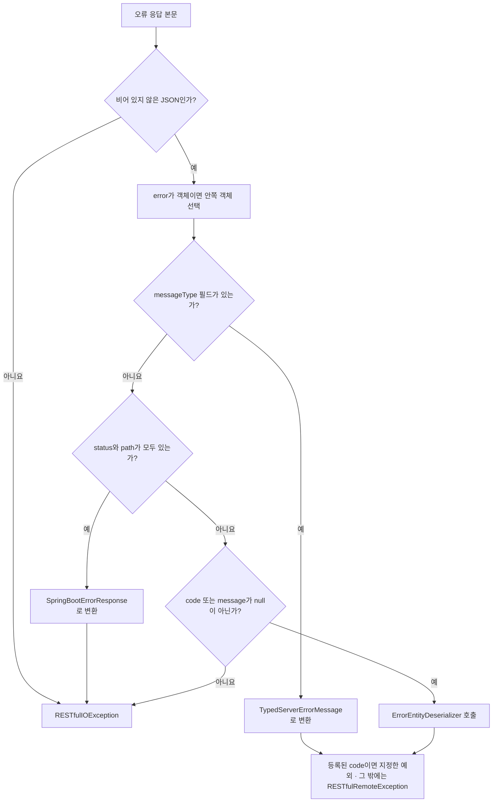

# `utils.http` 사용자 가이드

`utils.http`는 OkHttp를 사용해 HTTP 요청을 보내고, 응답 본문을 문자열이나 Java 객체로 받아오는 유틸리티다. 서버의 오류 응답을 예외로 바꾸는 기능도 제공한다.

중심 클래스인 [`HttpRESTfulClient`](../src/main/java/utils/http/HttpRESTfulClient.java)는 **동기 방식**으로 동작한다. 호출한 스레드에서 응답 수신과 본문 변환을 마친 뒤 반환하므로, 호출 시간이 길어질 수 있는 곳에서는 실행 스레드와 제한 시간을 함께 고려해야 한다.

이 가이드는 클라이언트 구성, 요청 작성, 응답 변환, 오류 처리 순서로 설명한다. 예제의 `Item`, `Payload` 등은 설명을 위한 업무용 타입이며, 별도로 표시한 경우를 제외하고 import와 보조 메서드는 생략했다.

---

## 1. 어떤 API를 사용할까

| 필요한 기능 | 사용할 API |
|---|---|
| 응답 본문을 문자열로 받기 | `client.get(url)` 또는 `STRING_DESER` |
| JSON 구조를 `JsonNode`로 읽기 | `client.jsonDeserializer()` |
| JSON을 특정 Java 클래스로 변환 | `JacksonResponseBodyDeserializer<T>` |
| 응답 헤더와 본문을 함께 받기 | `callAndGetHeaders(Request, deser)` |
| 응답 헤더만 조회 | `head(url)` |
| 기본 인증 헤더·JSON 매퍼·오류 변환 설정 | `HttpRESTfulClient.builder()` |
| 대용량 본문을 스트리밍하거나 `Call`을 직접 취소 | `getHttpClient()`로 얻은 OkHttp 클라이언트 사용 |

본문을 Java 객체로 변환하는 작업을 **역직렬화**라고 한다. 이 문서에서 응답 파서는 `ResponseBodyDeserializer<T>`, 오류 파서는 `ErrorEntityDeserializer`를 뜻한다. 두 인터페이스 모두 `HttpRESTfulClient`에 정의되어 있다.

일반적인 요청 처리 흐름은 다음과 같다. 본문을 읽지 않는 응답과 오류 변환의 세부 규칙은 4장과 6장에서 설명한다.

```mermaid
flowchart TD
    request["요청 구성 · 기본 헤더 적용"] --> call["OkHttp로 동기 호출"]
    call -->|IOException| io["RESTfulIOException"]
    call -->|응답 수신| read["본문을 문자열로 읽기"]
    read -->|읽기 실패| io
    read --> status{"성공 응답인가? · 2xx"}
    status -->|예| close["Response 닫기"]
    close --> parse["지정한 응답 파서로 변환"]
    parse --> value["문자열 또는 객체 반환"]
    status -->|아니요| error["오류 본문의 형식 판별"]
    error --> exception["Response 닫기 · 기본 예외 또는 등록된 예외 발생"]
```

`utils.rpc.restful`은 이 패키지 위에서 원격 작업 호출을 제공한다. 일반 HTTP 요청에는 `HttpRESTfulClient`를 사용하고, 원격 작업의 실행 상태까지 관리하려면 RPC 계층을 살펴본다.

유효한 파서를 전달한 일반 처리 경로에서는 본문 읽기나 오류 변환에 실패해도 `try`-with-resources로 응답을 닫는다. 잘못된 파서 인자로 인해 이 처리에 진입하지 못하는 경우는 7.1에서 설명한다.

---

## 2. 빠른 시작

```java
JsonMapper mapper = JacksonUtils.newJsonMapper(false);
HttpRESTfulClient client = HttpRESTfulClient.builder()
        .header("Authorization", "Bearer " + token)
        .jsonMapper(mapper)
        .build();

String itemsUrl = "https://api.example.com/v1/items";
String itemUrl = itemsUrl + "/1";

// 문자열로 받기
String body = client.get(itemsUrl);

// JSON 구조로 받기 — 클라이언트에 설정한 매퍼 사용
JsonNode tree = client.get(itemsUrl, client.jsonDeserializer());

// 특정 Java 객체로 받기 — 같은 매퍼를 응답 파서에도 전달
Item item = client.get(itemUrl,
        new JacksonResponseBodyDeserializer<>(mapper, Item.class));

// 반환값이 필요 없으면 무시할 수 있다.
client.delete(itemUrl);
```

`HttpRESTfulClient.newDefaultClient()`는 `builder().build()`와 같다. `delete(url)`도 응답 본문을 읽고 성공 여부를 확인한 뒤 문자열을 반환한다. 반환값을 사용하지 않는다고 응답 처리를 생략하는 것은 아니다.

---

## 3. 클라이언트 구성

### 3.1 빌더 설정

| 메서드 | 설정 내용 | 지정하지 않았을 때 |
|---|---|---|
| `httpClient(OkHttpClient)` | 연결·제한 시간·인터셉터 등 HTTP 설정 | `OkHttpClientUtils.newClient()` |
| `header(name, value)` | 기본 요청 헤더 | 없음 |
| `jsonMapper(JsonMapper)` | 오류 형식 판별과 `jsonDeserializer()`에 사용할 매퍼 | `new JsonMapper()` |
| `errorEntityDeserializer(deser)` | `{code, message}` 계열의 오류 본문 변환 | 설정된 매퍼를 사용하는 `JacksonErrorEntityDeserializer` |
| `remoteException(code, factory)` | 알려진 서버 오류 코드를 사용자 정의 예외로 변환 | `RESTfulRemoteException` 사용 |

```java
HttpRESTfulClient client = HttpRESTfulClient.builder()
        .httpClient(myOkHttpClient)
        .header("Authorization", "Bearer " + token)
        .header("X-Tenant", "acme")
        .jsonMapper(myMapper)
        .build();
```

같은 빌더에서 `build()`를 여러 번 호출할 수 있다. 지정하지 않은 기본 컴포넌트는 호출할 때마다 새로 생성한다. 직접 전달한 OkHttp 클라이언트·매퍼·오류 파서는 같은 객체를 재사용하며, 헤더와 오류 코드 등록 목록은 생성 시 복사한다. 빌더를 여러 스레드에서 동시에 수정해도 된다는 의미는 아니다.

### 3.2 제한 시간과 TLS 설정

연결 제한 시간이나 호출 전체의 제한 시간은 OkHttp 빌더에서 설정한다.

```java
OkHttpClient httpClient = new OkHttpClient.Builder()
        .connectTimeout(Duration.ofSeconds(3))
        .readTimeout(Duration.ofSeconds(10))
        .callTimeout(Duration.ofSeconds(15))
        .build();

HttpRESTfulClient client = HttpRESTfulClient.builder()
        .httpClient(httpClient)
        .build();
```

이 값들은 예시이며, 서버의 응답 시간과 작업 특성에 맞춰 정한다. `callTimeout`은 OkHttp 호출에 적용되는 제한으로, 본문을 읽은 뒤 수행하는 사용자 정의 파서의 실행 시간까지 제한하지는 않는다.

| 생성 메서드 | TLS 검증 |
|---|---|
| `OkHttpClientUtils.newClient()` | OkHttp 기본 설정 사용 |
| `newTrustAllOkHttpClient()` | 인증서와 호스트명 검증 모두 생략 |
| `newTrustAllOkHttpClientBuilder()` | 검증을 생략하는 빌더 반환. 추가 설정 가능 |

`newTrustAllOkHttpClient*`는 서버의 신원을 검증하지 않으므로 통신 상대를 위조하는 공격에 취약하다. 제한된 테스트 용도로만 사용하고, 운영 환경에서는 신뢰할 인증서를 올바르게 설정한다. 이 두 메서드는 TLS 초기화 과정에서 `NoSuchAlgorithmException`·`KeyManagementException`을 던질 수 있다.

### 3.3 기본 헤더 적용 규칙

| 요청 방식 | 기본 헤더 적용 방식 |
|---|---|
| URL을 받는 `get`·`post`·`put`·`patch`·`delete`·`head` | 새 요청에 등록된 기본 헤더를 추가 |
| `callAndGetHeaders(Request, deser)` | 요청에 같은 이름의 헤더가 없을 때만 추가. 호출자가 지정한 값 우선 |
| `getHttpClient().newCall(...)` 직접 사용 | `HttpRESTfulClient`의 기본 헤더를 적용하지 않음 |

`header()`를 **동일한 문자열 이름**으로 다시 호출하면 기존 값을 덮어쓴다. 다만 빌더는 대소문자를 구분하는 맵에 저장하므로 `Authorization`과 `authorization`을 별도로 등록하면 둘 다 남을 수 있다. 같은 헤더 이름의 표기를 일관되게 사용한다.

### 3.4 `HttpClientProxy`

[`HttpClientProxy`](../src/main/java/utils/http/HttpClientProxy.java)는 `getHttpClient()`와 `getEndpoint()`를 제공하는 인터페이스다. 여러 컴포넌트에서 OkHttp 클라이언트와 대상 주소를 함께 다룰 때 사용한다.

`HttpRESTfulClient` 자체는 이 인터페이스를 구현하지 않으며 기본 엔드포인트도 저장하지 않는다. 각 요청에 URL을 전달해야 한다.

---

## 4. 요청 작성과 응답 반환

### 4.1 요청 메서드

| 메서드 | 반환값 | URL 타입 |
|---|---|---|
| `get(url)` / `get(url, deser)` | `String` / `T` | `String`, `HttpUrl` 모두 지원 |
| `post(url, body)` / `post(url, body, deser)` | `String` / `T` | `String` |
| `put(url, body)` / `put(url, body, deser)` | `String` / `T` | `String` |
| `patch(url, body)` / `patch(url, body, deser)` | `String` / `T` | `String` |
| `delete(url)` / `delete(url, deser)` | `String` / `T` | `String` |
| `head(url)` | `Headers` | `String` |
| `callAndGetHeaders(request, deser)` | `Tuple<Headers, T>` | `Request`에 지정 |

`body`는 `RequestBody`다. 요청 본문을 문자열로 직접 받는 `post`·`put`·`patch` 오버로드는 없다. DELETE에 본문을 넣는 등 편의 메서드로 표현하기 어려운 요청은 `Request`를 직접 구성한다.

### 4.2 요청 본문의 미디어 타입 지정

```java
// JSON 본문
String json = mapper.writeValueAsString(item);
RequestBody body = HttpRESTfulClient.newJsonRequestBody(json);
Item created = client.post(url, body,
        new JacksonResponseBodyDeserializer<>(mapper, Item.class));

// 일반 문자열 본문
client.post(url, HttpRESTfulClient.newTextRequestBody(text));

// 그 밖의 미디어 타입
RequestBody csvBody = RequestBody.create(csv, MediaType.get("text/csv; charset=utf-8"));
client.post(url, csvBody);
```

| 헬퍼 또는 상수 | 미디어 타입 |
|---|---|
| `newJsonRequestBody(String)` / `MEDIA_TYPE_JSON` | `application/json; charset=utf-8` |
| `newTextRequestBody(String)` / `MEDIA_TYPE_TEXT` | `text/plain; charset=utf-8` |

`newJsonRequestBody()`는 전달한 문자열을 JSON 미디어 타입으로 포장한다. Java 객체를 JSON으로 직렬화하거나 문자열이 올바른 JSON인지 검증하지는 않는다. 객체 변환은 예제처럼 매퍼로 먼저 수행한다.

### 4.3 응답 헤더와 본문 함께 받기

```java
Request request = new Request.Builder()
        .url(url)
        .header("Authorization", "Bearer " + requestToken)
        .get()
        .build();

Tuple<Headers, Item> response = client.callAndGetHeaders(request, itemDeser);
String etag = response._1.get("ETag");
Item item = response._2;
```

이 경우 요청에 지정한 인증 헤더가 기본 인증 헤더보다 우선한다. 반환값에는 헤더와 본문만 들어 있으며 **HTTP 상태 코드는 포함되지 않는다.** 성공 상태가 200인지 201인지 구분하거나 원본 `Response`가 필요하면 OkHttp를 직접 사용한다.

### 4.4 본문이 없을 때

| 응답 | 본문 처리 | 응답 파서 호출 | 결과 |
|---|---|---|---|
| 성공한 HEAD 요청 | 읽지 않음 | 안 함 | `head()`는 헤더 반환. `callAndGetHeaders()`의 본문 값은 `null` |
| 204 / 205 | 읽지 않음 | 안 함 | 본문 반환값 `null` |
| 304가 클라이언트에 그대로 전달됨 | 읽지 않음 | 안 함 | 성공 범위인 2xx가 아니므로 오류 처리 |
| 그 밖의 2xx이며 본문이 빈 문자열 | 빈 문자열로 읽음 | 호출함 | 파서의 처리 결과에 따름 |
| 실패한 HEAD 요청 | 읽지 않음 | 안 함 | 본문 없는 오류 응답으로 처리 |

204의 `null`과 200 응답의 빈 문자열은 다르게 처리된다. 예를 들어 200의 빈 본문을 객체로 변환하면 파싱 오류가 발생할 수 있다. 304도 이 클라이언트에서는 정상 반환을 뜻하지 않는다.

---

## 5. 응답과 오류 본문 변환

### 5.1 응답 파서 선택

```java
@FunctionalInterface
public interface ResponseBodyDeserializer<T> {
    T deserialize(Headers headers, String respBody) throws IOException;
}
```

| 파서 | 반환값 | 사용하는 매퍼 |
|---|---|---|
| `HttpRESTfulClient.STRING_DESER` | 원래 문자열 | 사용하지 않음 |
| `HttpRESTfulClient.JSON_DESER` | `JsonNode` | 상수에 연결된 별도의 `JsonMapper` |
| `client.jsonDeserializer()` | `JsonNode` | 클라이언트 빌더에 설정한 매퍼 |
| `new JacksonResponseBodyDeserializer<>(mapper, Item.class)` | 지정한 클래스의 객체 | 생성자에 전달한 매퍼 |
| 사용자 정의 람다 | 원하는 타입 | 람다에서 선택 |

`builder().jsonMapper(...)`는 `JSON_DESER`나 별도로 만든 `JacksonResponseBodyDeserializer`의 설정을 바꾸지 않는다. 같은 설정을 사용하려면 매퍼를 명시적으로 공유한다.

`JacksonResponseBodyDeserializer`는 `Class<T>`를 받는다. `List<Item>`처럼 타입 인자가 필요한 응답은 람다에서 Jackson의 `TypeReference`를 사용할 수 있다.

```java
HttpRESTfulClient.ResponseBodyDeserializer<List<Item>> itemsDeser =
        (headers, body) -> mapper.readValue(body, new TypeReference<List<Item>>() {});
List<Item> items = client.get(url, itemsDeser);
```

기본 Jackson 파서는 `Content-Type`을 확인하지 않고 본문을 JSON으로 읽는다. 응답 헤더에 따라 다른 형식을 처리해야 한다면 람다에서 분기한다.

```java
HttpRESTfulClient.ResponseBodyDeserializer<Payload> deser = (headers, body) -> {
    String contentType = headers.get("Content-Type");
    if ( contentType != null && contentType.startsWith("application/json") ) {
        return mapper.readValue(body, Payload.class);
    }
    return Payload.ofText(body);
};
```

이 예제는 단순한 분기다. `application/problem+json` 같은 JSON 계열 미디어 타입도 받아야 한다면 해당 서버의 규약에 맞게 판별 조건을 확장한다.

### 5.2 응답 파서의 예외 처리

| 파서가 던진 값 | 호출자에게 전달되는 예외 |
|---|---|
| `RESTfulException` 하위 예외 | 같은 예외를 그대로 전달 |
| `IOException` 또는 그 밖의 `RuntimeException` | 원인을 담은 `RESTfulIOException` |
| `Error` | 감싸지 않고 전파 |

본문을 읽고 `Response`를 닫은 뒤 파서를 호출하므로, 파서는 전달받은 문자열과 헤더를 사용한다. `deser`에는 `null`을 전달할 수 없다. 현재 검사는 요청을 보낸 뒤에 이루어지므로, `null`로 응답 변환을 생략하려 해서는 안 된다(7.1).

### 5.3 오류 파서가 적용되는 범위

```java
@FunctionalInterface
public interface ErrorEntityDeserializer {
    RESTfulErrorEntity deserialize(String respBody) throws IOException;
}
```

기본 구현은 [`JacksonErrorEntityDeserializer`](../src/main/java/utils/http/JacksonErrorEntityDeserializer.java)다. `RESTfulErrorEntity`는 `code`와 `message`를 읽고 그 밖의 부가 필드는 무시한다.

**사용자 정의 오류 파서가 모든 실패 응답을 처리하는 것은 아니다.** 클라이언트가 JSON 형식을 먼저 판별한 뒤, `code` 또는 `message`가 `null`이 아닌 경우에만 호출한다. `messageType`이나 `status`와 `path`가 있으면 해당 형식의 처리가 우선한다.

| 오류 본문 예 | 사용자 정의 `ErrorEntityDeserializer` 호출 |
|---|---|
| `{"code":"E1","message":"실패"}` | 호출 |
| `{"error":{"code":"E1","detail":"실패"}}` | 안쪽 객체를 JSON 문자열로 만들어 전달 |
| `{"errorCode":"E1","detail":"실패"}` | 호출하지 않음. 형식을 인식하지 못한 오류로 처리 |
| `{"status":400,"path":"/items","message":"실패"}` | 호출하지 않음. Spring Boot 형식으로 처리 |
| HTML 또는 일반 문자열 | JSON 파싱 단계에서 실패하므로 호출하지 않음 |

따라서 필드명이 완전히 다른 오류 형식은 오류 파서만 바꿔서는 지원할 수 없다. 서버 응답 형식을 맞추거나 OkHttp 응답을 직접 처리해야 한다.

사용자 정의 오류 파서는 유효한 엔티티를 반환하고, 파싱 실패는 `IOException`으로 알리는 방식이 적합하다. 현재 오류 처리 코드는 이 경로의 `IOException`과 `IllegalArgumentException`은 변환하지만, `null` 반환으로 인한 `NullPointerException`이나 다른 실행 시 예외까지 모두 감싸지는 않는다.

---

## 6. 오류 처리

### 6.1 예외 계층과 적용 범위

```text
RuntimeException
 └─ RESTfulException
     ├─ RESTfulRemoteException  서버가 보낸 구조화된 오류
     └─ RESTfulIOException      통신·본문 읽기·파싱 실패 또는 일부 서버 오류
```

기본 처리에서는 위 두 하위 예외를 주로 사용한다. 둘을 함께 처리하려면 `RESTfulException`을 잡는다. 다만 `remoteException(...)`으로 등록한 예외는 이 계층에 속하지 않을 수 있으므로 별도로 처리해야 한다. 잘못된 URL이나 인자, 사용자 정의 컴포넌트에서 발생하는 예외까지 모두 이 계층으로 바뀌는 것은 아니다.

```java
try {
    Item item = client.get(url, itemDeser);
    use(item);
}
catch ( RESTfulRemoteException e ) {
    RESTfulErrorEntity entity = e.getRemoteErrorEntity();
    if ( entity != null ) {
        log.warn("server error: code={}, message={}", entity.getCode(), entity.getMessage());
    }
    else {
        log.warn("server error: {}", e.getMessage());
    }
}
catch ( RESTfulIOException e ) {
    log.warn("HTTP call failed: status={}", e.getHttpStatusCode(), e);
}
```

이 예제는 기본 오류 정보를 확인하는 방법을 보여 준다. 실제 호출부에서는 작업 실패를 상위에 전달할지, 사용자에게 알릴지 등 후속 처리를 정해야 한다.

### 6.2 HTTP 상태 코드로 구분하기

예외 이름만으로 서버 오류와 네트워크 오류를 구분할 수 없다. 예를 들어 같은 404라도 본문 형식에 따라 `RESTfulRemoteException` 또는 `RESTfulIOException`이 된다. HTTP 상태별 처리가 필요하면 `getHttpStatusCode()`를 확인한다.

| 오류 발생 시점 | `getHttpStatusCode()` | 비고 |
|---|---|---|
| 비-2xx 응답을 `RESTfulException` 계열로 변환 | 실제 응답 상태 코드 | 본문에 들어 있는 `status` 필드가 아닌 HTTP 응답 코드 |
| 연결 실패 또는 응답을 받기 전 제한 시간 초과 | `UNKNOWN_STATUS_CODE` (`-1`) | HTTP 오류 변환 단계에 도달하지 않음 |
| 응답 본문을 읽는 중 실패 | `-1` | 응답을 받았어도 현재 구현은 코드 값을 저장하지 않음 |
| 성공 응답의 본문 변환 실패 | 새로 생성한 예외는 `-1` | 메시지에는 `[200 URL]` 같은 정보가 포함될 수 있음 |
| 등록된 예외가 `RESTfulException`을 상속하지 않음 | 조회 API 없음 | 사용자 정의 예외를 별도로 처리 |

```java
try {
    client.delete(resourceUrl);
}
catch ( RESTfulException e ) {
    // 이 API에서 "이미 없는 자원의 삭제"를 성공으로 취급하는 경우
    if ( e.getHttpStatusCode() != 404 ) {
        throw e;
    }
}
```

`-1`을 반드시 “서버 응답을 받지 못했다”는 뜻으로 해석해서는 안 된다. 현재 구현에서는 본문 읽기나 성공 응답 파싱 실패도 `-1`이다. 파서가 기존 `RESTfulException`을 직접 던졌다면 그 객체의 상태 코드 값도 그대로 유지된다.

### 6.3 통신 오류와 본문 읽기 오류

`newCall(...).execute()`에서 발생한 `IOException`은 다음과 같이 분류한다. 원래 예외는 `getCause()`로 확인할 수 있다.

| 원인 예외 | `RESTfulIOException` 메시지의 주요 문구 |
|---|---|
| `ConnectException` | `Failed to connect to the server` |
| `SocketTimeoutException` | `RESTful call timed out` |
| `InterruptedIOException`이며 현재 스레드가 인터럽트 상태 | `RESTful call interrupted` |
| 그 밖의 `InterruptedIOException` | `RESTful call timed out` |
| 그 밖의 `IOException` | `Failed to call` |

`SocketTimeoutException`을 먼저 처리하므로 단순 소켓 제한 시간 초과를 인터럽트로 분류하지 않는다. `InterruptedIOException` 처리에서는 `Thread.currentThread().isInterrupted()`를 조회할 뿐, 새로 인터럽트 상태를 설정하거나 지우지 않는다.

응답 수신 이후 `ResponseBody.string()`에서 발생한 `IOException`은 별도 경로에서 `Failed to read RESTful response`로 처리한다. **본문을 읽다가 제한 시간을 넘긴 경우에는 위 표의 메시지가 나오지 않을 수 있다.** 원인을 구분할 때 메시지 문자열만 비교하지 말고 원인 예외와 스레드 상태도 확인한다.

인터럽트 상태를 지우지 않고 확인하려면 `Thread.currentThread().isInterrupted()`를 사용한다. `Thread.interrupted()`는 확인하면서 상태를 지운다. 또한 이 클라이언트는 진행 중인 `Call`을 외부에 제공하지 않으므로, 명시적인 취소가 필요하면 OkHttp의 `Call`을 직접 관리한다.

### 6.4 서버 오류 형식 판별

비-2xx 응답은 본문을 JSON으로 읽고, `error` 필드가 객체이면 **한 겹만** 벗겨낸 뒤 아래 순서로 판별한다.



그림은 기본 분기를 보여 준다. JSON이나 객체 변환 실패는 기본 구현에서 `RESTfulIOException`으로 처리하며, 사용자 정의 오류 파서의 제약은 5.3을 따른다.

| 판별 결과 | 기본 예외 | 오류 엔티티 보관 여부 |
|---|---|---|
| `messageType` 있음 | `RESTfulRemoteException` | 메시지에 `code`·`text`를 담으며 `getRemoteErrorEntity()`는 `null` |
| `status`와 `path` 있음 | `RESTfulIOException` | Spring Boot 형식을 문자열로 변환 |
| `code` 또는 `message`가 `null`이 아님 | `RESTfulRemoteException` | `getRemoteErrorEntity()`로 조회 가능 |
| 본문 없음 | `RESTfulIOException` | `Empty RESTful error response` |
| JSON 파싱·형식 변환 실패 | `RESTfulIOException` | `Failed to parse RESTful error response` |
| 그 밖의 형식 | `RESTfulIOException` | `Unrecognized RESTful error response` |

`messageType` 분기와 `code`·`message` 분기에는 등록된 사용자 정의 예외가 우선 적용된다. 여러 형식의 필드가 섞여 있으면 표에서 먼저 나오는 형식이 선택된다.

Spring Boot 형식의 `"error":"Internal Server Error"`는 문자열이므로 바깥 객체를 유지한다. `{"error":{"code":"E1","message":"실패"}}`처럼 객체일 때만 안쪽으로 들어간다. `messageType`의 기본 enum 값은 `Info`, `Warning`, `Error`, `Exception`이다. 성공 여부는 이 값이 아니라 HTTP 응답 코드로 판단한다.

오류 본문을 기본 `RESTfulIOException`으로 바꾸는 경로에서는 메시지 앞에 상태 코드와 URL을 붙인다.

```text
[404 http://localhost:8080/svc/items] Empty RESTful error response
```

`RESTfulRemoteException`에는 이 접두어를 붙이지 않는다. 같은 예외 타입이어도 `{code, message}` 형식과 `TypedServerErrorMessage` 형식은 엔티티 보관 방식이 다르므로, `getRemoteErrorEntity()`를 사용할 때는 `null`을 확인한다.

### 6.5 알려진 오류 코드를 사용자 정의 예외로 변환

서버의 오류를 예외 타입으로 구분하려면 허용할 코드와 생성 함수를 빌더에 등록한다. 응답이 지정한 클래스 이름을 직접 로딩하지 않고, 등록한 함수만 호출한다.

```java
HttpRESTfulClient client = HttpRESTfulClient.builder()
        .remoteException("mdt.model.ResourceNotFoundException", ResourceNotFoundException::new)
        .remoteException("mdt.model.ResourceAlreadyExistsException", ResourceAlreadyExistsException::new)
        .build();

try {
    client.post(url, body, itemDeser);
}
catch ( ResourceAlreadyExistsException e ) {
    handleAlreadyExists(e);
}
catch ( RESTfulException e ) {
    handleHttpFailure(e);
}
```

예제의 예외는 메시지 문자열을 받는 생성자가 있는 `RuntimeException` 하위 타입이라고 가정한다.

- 등록한 코드는 `{code, message}`와 `{messageType, code, text}` 두 형식에 적용된다. Spring Boot 형식에는 적용되지 않는다.
- 생성 함수는 `message` 또는 `text`를 받으며, 값이 없으면 `null`을 받을 수 있다.
- 미등록 코드, 생성 함수의 `null` 반환, 생성 함수가 던진 `RuntimeException`은 기본 `RESTfulRemoteException` 처리로 돌아간다. `Error`까지 잡는 것은 아니다.
- 등록한 예외가 `RESTfulException`을 상속하면 응답 상태 코드가 설정된다. 다른 예외라면 `catch (RESTfulException)`으로 잡히지 않으며 상태 코드도 자동으로 보관하지 않는다.

따라서 오류 변환 함수가 “항상 `RESTfulException`을 반환한다”거나 “어떤 경우에도 예외를 직접 던지지 않는다”고 가정해서는 안 된다. 등록된 예외의 타입과 사용자 정의 오류 파서에서 발생할 수 있는 예외를 함께 고려해야 한다.

### 6.6 `RESTfulErrorEntity`의 변환 메서드

`code`에는 오류 식별자 또는 패키지명을 포함한 예외 클래스 이름이 들어갈 수 있다.

| 메서드 | 동작 | 클래스 로딩 |
|---|---|---|
| `toRemoteException()` | 엔티티를 보관하는 `RESTfulRemoteException` 생성 | 하지 않음 |
| `toClientException()` | `code`를 클래스 이름으로 해석해 해당 예외 생성 | 수행함 |

클라이언트의 기본 처리에서는 `toRemoteException()`을 사용한다. `TypedServerErrorMessage.toException()`도 클래스 로딩 없이 `RESTfulRemoteException`을 만든다.

`toClientException()`을 직접 사용하려면 대상 클래스가 `RuntimeException`의 하위 타입이어야 한다. 메시지가 있으면 `(String)` 생성자, 없으면 인자 없는 생성자가 필요하다. 복원에 성공하면 예외 객체를 반환하고, 클래스나 생성자를 찾지 못하는 등 복원에 실패하면 예외를 던진다.

원격 응답의 클래스 이름을 실제로 로딩하므로 신뢰할 수 있는 응답에만 사용한다. 알려진 코드만 예외로 구분하려는 목적이라면 6.5의 등록 방식으로 처리할 수 있다.

### 6.7 서버에서 오류 본문 만들기

```java
RESTfulErrorEntity.of(exception);          // code: 예외 클래스 이름, message: 예외 메시지
RESTfulErrorEntity.of("작업 실패", cause);  // 주어진 메시지에 원인 메시지를 추가
RESTfulErrorEntity.ofMessage("잘못된 요청"); // code 없이 message만 설정

TypedServerErrorMessage.from(exception);   // 유형 Exception, 코드, 메시지, 발생 시각
new TypedServerErrorMessage("E1001", "재고 부족");
```

이 메서드들은 오류 정보를 담는 객체를 만든다. HTTP 상태 코드 설정과 JSON 직렬화는 서버 응답을 작성하는 쪽에서 별도로 처리한다.

---

## 7. 사용 시 주의할 점과 구현 제약

### 7.1 응답 파서에 `null`을 전달하지 않는다

현재 `deser`의 유효성 검사는 HTTP 요청을 전송하고 응답을 받은 뒤, 응답을 닫는 처리에 들어가기 전에 수행된다. `null`을 넘기면 `IllegalArgumentException`이 발생하며 이 경로에서는 응답 닫기가 보장되지 않는다. 잘못된 인자를 전달해도 요청은 이미 서버에 도착했을 수 있다.

결과가 필요 없으면 문자열 반환 메서드를 호출하고 반환값을 무시하거나, 유효한 파서를 전달한다. 이 항목은 현재 구현의 제약이며 Java 소스가 수정되면 함께 갱신해야 한다.

### 7.2 본문은 메모리로 전부 읽는다

HEAD·204·205·304를 제외하면 `ResponseBody.string()`으로 본문 전체를 읽는다. 파서에서 결과를 버리더라도 이 읽기 과정은 이미 수행된 뒤다. 대용량 다운로드는 OkHttp의 응답 스트림을 직접 사용하고, `Response`를 사용 후 닫는다.

```java
Request request = new Request.Builder()
        .url(downloadUrl)
        .header("Authorization", "Bearer " + token)
        .build();

try ( Response response = client.getHttpClient().newCall(request).execute() ) {
    if ( !response.isSuccessful() || response.body() == null ) {
        throw new IOException("download failed: status=" + response.code());
    }
    try ( InputStream input = response.body().byteStream() ) {
        Files.copy(input, target, StandardCopyOption.REPLACE_EXISTING);
    }
}
```

직접 호출할 때는 기본 인증 헤더와 오류 변환이 적용되지 않으므로 예제처럼 필요한 처리를 함께 작성한다. 이 경로는 `IOException`도 호출자가 직접 처리해야 한다.

### 7.3 오류 타입만으로 재시도 여부를 정하지 않는다

`RESTfulIOException`에는 연결 실패뿐 아니라 Spring Boot 오류 응답과 JSON 변환 실패도 포함된다. 상태 코드, 원인 예외, 요청의 재실행 가능 여부를 확인해야 한다. 단순히 이 예외를 잡았다는 이유로 같은 요청을 다시 보내는 정책은 적합하지 않다.

### 7.4 응답 로그에 본문이 포함된다

현재 DEBUG 로그는 응답 코드·헤더·본문 전체를 기록한다. 인증 정보나 개인정보가 응답에 포함되는 서비스에서는 로그 수준과 보관 정책을 확인한다. 요청 본문 로그는 내용을 읽지 않고 미디어 타입과 길이만 요약한다.

---

## 8. 테스트로 동작 확인하기

HTTP 테스트는 프로젝트의 테스트 의존성에 포함된 OkHttp `MockWebServer`를 사용한다. 외부 서버 없이 요청 헤더·본문과 응답 처리를 확인할 수 있다.

```java
@Test
void getReturnsBody() throws Exception {
    MockWebServer server = new MockWebServer();
    server.start();
    try {
        server.enqueue(new MockResponse()
                .setResponseCode(200)
                .setBody("{\"name\":\"a\"}"));

        HttpRESTfulClient client = HttpRESTfulClient.newDefaultClient();
        String body = client.get(server.url("/items/1"));
        assertEquals("{\"name\":\"a\"}", body);

        RecordedRequest request = server.takeRequest(1, TimeUnit.SECONDS);
        assertNotNull(request);
        assertEquals("GET", request.getMethod());
        assertEquals("/items/1", request.getPath());
    }
    finally {
        server.shutdown();
    }
}
```

| 확인할 동작 | 기존 테스트 |
|---|---|
| 오류 형식 판별, 중첩 `error`, 등록된 예외 변환 | [`HttpRESTfulClientTest`](../src/test/java/utils/http/HttpRESTfulClientTest.java) |
| 실제 요청, 미디어 타입, 본문 없는 응답, 제한 시간, 응답 파싱 | [`HttpRESTfulClientCallTest`](../src/test/java/utils/http/HttpRESTfulClientCallTest.java) |
| OkHttp 클라이언트 생성 | [`OkHttpClientUtilsTest`](../src/test/java/utils/http/OkHttpClientUtilsTest.java) |
| 오류 객체의 생성·변환 | [`RESTfulErrorEntityTest`](../src/test/java/utils/http/RESTfulErrorEntityTest.java), [`SpringBootErrorResponseTest`](../src/test/java/utils/http/SpringBootErrorResponseTest.java), [`TypedServerErrorMessageTest`](../src/test/java/utils/http/TypedServerErrorMessageTest.java) |

오류 분기를 테스트할 때는 메시지에 원문 일부가 포함되는지만 확인하지 않는다. 인식하지 못한 응답도 원문을 메시지에 담으므로, 예외 타입과 엔티티 필드 또는 해당 형식의 고유한 변환 결과를 함께 확인한다.

```bash
gradle test --tests 'utils.http.*'
```

---

## 9. API 요약

| 타입 | 역할 |
|---|---|
| [`HttpRESTfulClient`](../src/main/java/utils/http/HttpRESTfulClient.java) | 동기 요청, 응답 변환, 기본 헤더와 오류 코드 등록 |
| [`OkHttpClientUtils`](../src/main/java/utils/http/OkHttpClientUtils.java) | 기본 또는 TLS 검증 생략 클라이언트 생성 |
| [`HttpClientProxy`](../src/main/java/utils/http/HttpClientProxy.java) | OkHttp 클라이언트와 대상 주소를 함께 제공하는 인터페이스 |
| [`JacksonResponseBodyDeserializer`](../src/main/java/utils/http/JacksonResponseBodyDeserializer.java) | JSON 본문을 지정한 클래스의 객체로 변환 |
| [`JacksonErrorEntityDeserializer`](../src/main/java/utils/http/JacksonErrorEntityDeserializer.java) | JSON 오류 본문을 `RESTfulErrorEntity`로 변환 |
| [`RESTfulErrorEntity`](../src/main/java/utils/http/RESTfulErrorEntity.java) | `code`·`message` 오류 형식 |
| [`SpringBootErrorResponse`](../src/main/java/utils/http/SpringBootErrorResponse.java) | `status`·`error`·`message`·`path` 등의 오류 형식 |
| [`TypedServerErrorMessage`](../src/main/java/utils/http/TypedServerErrorMessage.java) | `messageType`·`code`·`text`·`timestamp` 오류 형식 |
| [`RESTfulException`](../src/main/java/utils/http/RESTfulException.java) | 기본 HTTP 예외의 공통 부모. HTTP 상태 코드 조회 제공 |
| [`RESTfulRemoteException`](../src/main/java/utils/http/RESTfulRemoteException.java) | 구조화된 서버 오류. 형식에 따라 오류 엔티티 보관 |
| [`RESTfulIOException`](../src/main/java/utils/http/RESTfulIOException.java) | 통신·본문 읽기·파싱 실패와 일부 서버 오류 |

---

## 10. 관련 문서

- [`utils.http` 개발 노트](../src/main/java/utils/http/CLAUDE.md) — 패키지 구현과 내부 동작
- [`utils.rpc.restful` 개발 노트](../src/main/java/utils/rpc/restful/CLAUDE.md) — HTTP 기반 원격 작업 호출
- [`JacksonUtils`](../src/main/java/utils/json/JacksonUtils.java) — JSON 매퍼 생성과 변환 도구
- [비동기 실행 가이드](async-threaded-guide.md) — 별도 스레드 실행과 취소 처리
- [라이브러리 전체 구조](../CLAUDE.md)
