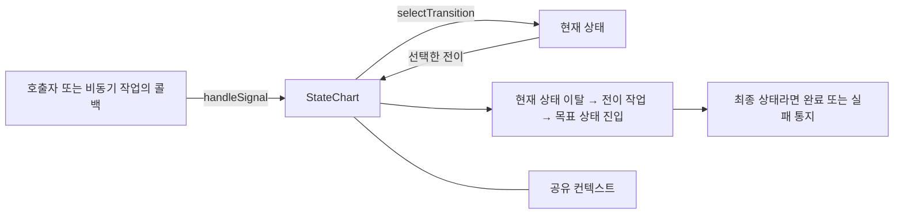
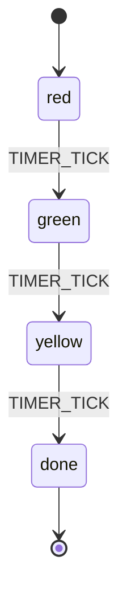
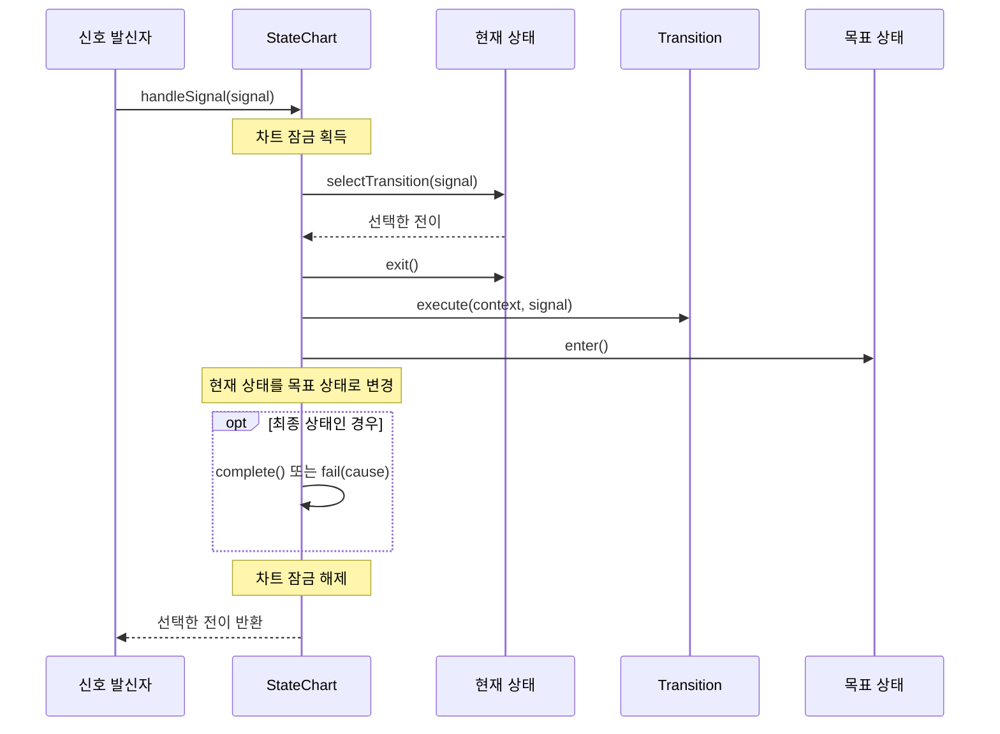

# `utils.statechart` 사용자 가이드

`utils.statechart`는 현재 상태와 입력 신호에 따라 다음 동작을 결정하는 상태 차트 라이브러리다. 연결, 인증, 작업 수행, 종료처럼 단계별로 처리 규칙이 달라지는 작업에 사용할 수 있다. 상태 진입·이탈 작업과 전이 중 수행할 작업을 나누어 정의하며, 차트 전체의 성공·실패·취소 결과는 `utils.async` API로 조회한다.

상태 전이는 `start()`나 `handleSignal()`을 **호출한 스레드에서 동기적으로 처리**한다. 비동기 실행 기반 클래스를 상속한다고 해서 신호 처리용 스레드나 메시지 큐를 자동으로 만드는 것은 아니다. 또한 복합 상태를 표현하는 타입은 있지만, 현재 기본 구현의 계층 전이 기능에는 제약이 있다(7장).

예제는 Java 17 기준이다. 완전한 클래스 형태로 제시한 예제 외에는 import와 업무용 타입을 필요한 부분만 표시했다.

## 1. 구성 요소

| 요소 | 역할 | 주요 타입 |
|---|---|---|
| 컨텍스트 | 여러 상태가 공유하는 업무 데이터와 소속 차트 참조 보관 | [`StateContext<C>`](../src/main/java/utils/statechart/StateContext.java) |
| 차트 | 상태 등록, 신호 전달, 전이 실행, 종료 결과 관리 | [`StateChart<C>`](../src/main/java/utils/statechart/StateChart.java) |
| 상태 | 진입·이탈 작업을 수행하고 신호에 맞는 전이 선택 | [`State<C>`](../src/main/java/utils/statechart/State.java) |
| 신호 | 상태에 전달하는 사건이나 요청 | [`Signal`](../src/main/java/utils/statechart/Signal.java) |
| 전이 | 목표 상태와 이동 중 수행할 작업 지정 | [`Transition<C>`](../src/main/java/utils/statechart/Transition.java) |



`getState()`는 `RUNNING`, `COMPLETED` 같은 **실행 상태**를 반환한다. `getCurrentState()`는 `red`, `connected`처럼 사용자가 정의한 **업무 상태 객체**를 반환한다. 두 상태를 구분해서 사용한다.

## 2. 빠른 시작: 신호등 상태 전이

다음 예제는 세 번의 타이머 신호를 받은 뒤 끝난다. 실제로 계속 반복하는 신호등이 아니라 상태 전이와 완료를 함께 보여 주는 예제다.



```java
import utils.statechart.Signal;
import utils.statechart.SingleOutState;
import utils.statechart.SinkState;
import utils.statechart.StateChart;
import utils.statechart.StateContext;
import utils.statechart.Transitions;

public class TrafficLightExample {
    static final class Context implements StateContext<Context> {
        private StateChart<Context> chart;

        @Override
        public StateChart<Context> getStateChart() {
            return chart;
        }

        @Override
        public void setStateChart(StateChart<Context> chart) {
            if (this.chart != null) {
                throw new IllegalStateException("이미 차트가 등록되어 있습니다.");
            }
            this.chart = chart;
        }
    }

    enum LightSignal implements Signal { TIMER_TICK }

    public static void main(String[] args) throws Exception {
        Context context = new Context();
        StateChart<Context> chart = new StateChart<>(context);
        chart.addState(new SingleOutState<>("red", context,
                LightSignal.TIMER_TICK, Transitions.noop("green")));
        chart.addState(new SingleOutState<>("green", context,
                LightSignal.TIMER_TICK, Transitions.noop("yellow")));
        chart.addState(new SingleOutState<>("yellow", context,
                LightSignal.TIMER_TICK, Transitions.noop("done")));
        chart.addState(new SinkState<>("done", context));
        chart.setInitialState("red");
        chart.addFinalState("done");

        chart.start();
        chart.handleSignal(LightSignal.TIMER_TICK);
        chart.handleSignal(LightSignal.TIMER_TICK);
        chart.handleSignal(LightSignal.TIMER_TICK);

        Context result = chart.get();
        System.out.println("완료 상태: " + result.getStateChart().getState());
    }
}
```

`chart.get()`은 완료까지 기다리고, 성공하면 컨텍스트를 반환한다. 실패하면 `ExecutionException`, 취소되면 `CancellationException`을 던진다. 실패나 취소를 예외 대신 결과 객체로 확인하려면 `waitForFinished()`를 사용한다.

## 3. 상태와 전이 정의

### 3.1 컨텍스트

`StateContext<C>`의 타입 인자에는 구현 클래스 자신을 넣는다. 예를 들어 `Context implements StateContext<Context>`로 선언하면 차트와 상태에서 구체적인 컨텍스트 타입을 그대로 사용할 수 있다.

`StateChart` 생성자가 `context.setStateChart(this)`를 호출한다. 사용자가 직접 등록할 필요는 없다. 구현체는 이미 등록한 차트를 다른 차트로 바꾸려는 호출을 `IllegalStateException`으로 거부해야 한다. 차트를 새로 실행하려면 컨텍스트도 새로 만든다.

업무 데이터는 컨텍스트에 추가할 수 있다. 다만 차트 내부 잠금이 외부 코드의 필드 접근까지 보호하지는 않는다. 실행 중 바뀌는 값은 신호를 통해 변경하거나 별도 동기화 규칙을 정한다.

### 3.2 상태의 세 가지 역할

| 메서드 | 호출 시점 | 구현할 내용 |
|---|---|---|
| `enter()` | 상태에 진입할 때 | 비동기 작업 시작, 타이머 등록 등 |
| `selectTransition(signal)` | 현재 상태에 신호가 전달될 때 | 신호를 처리할 전이 선택 |
| `exit()` | 다른 상태로 이동하거나 취소될 때 | 해당 상태에서 시작한 작업 정리 |

`enter()`와 `exit()`의 기본 구현은 아무 일도 하지 않는다. `selectTransition()`은 전이 후보만 반환하도록 작성하고, 데이터 변경이나 외부 호출은 전이 작업에 둔다. 처리하지 않는 신호에는 `Optional.empty()`를 반환한다.

사용자 상태는 보통 [`AbstractState<C>`](../src/main/java/utils/statechart/AbstractState.java)를 상속한다. 이 클래스는 경로와 컨텍스트를 보관한다.

```java
// JobContext는 StateContext<JobContext> 구현체다.
record JobFinished(String output) implements Signal { }

class RunningState extends AbstractState<JobContext> {
    RunningState(JobContext context) {
        super("running", context);
    }

    @Override
    public Optional<Transition<JobContext>> selectTransition(Signal signal) {
        if (signal instanceof JobFinished finished) {
            return Optional.of(Transitions.create("done", (context, ignored) -> {
                context.setOutput(finished.output());
            }));
        }
        return Optional.empty();
    }
}
```

### 3.3 제공되는 상태 타입

| 타입 | 동작 | 사용할 때 확인할 점 |
|---|---|---|
| [`SingleOutState`](../src/main/java/utils/statechart/SingleOutState.java) | 지정한 신호에만 반응하여 하나의 전이 선택 | `equals()`로 비교. 고정 전이 또는 `Supplier<Transition<C>>` 지정 가능 |
| [`SinkState`](../src/main/java/utils/statechart/SinkState.java) | 더 이상 나가지 않는 종료 상태 | `exit()`와 `selectTransition()` 모두 예외를 던지므로 최종 상태로 등록 |
| [`ExceptionState`](../src/main/java/utils/statechart/ExceptionState.java) | 실패 원인을 보관하는 종료 상태 | 최종 상태로 등록하고 진입 전 실패 원인 설정 |
| [`DefaultCompositeState`](../src/main/java/utils/statechart/DefaultCompositeState.java) | 하위 상태에 진입·이탈·신호 처리를 위임 | 외부 패키지에서 초기 하위 상태를 설정할 공개 API가 없음 |

`SingleOutState`의 신호에는 enum이나 값 비교를 구현한 record를 쓰기 편하다. 일반 클래스가 `equals()`를 재정의하지 않았다면 같은 내용으로 새 객체를 만들어도 등록한 신호와 일치하지 않는다.

`SinkState`를 등록만 하고 `addFinalState()`를 빠뜨리면 진입 후에도 차트가 실행 중으로 남는다. 다음 신호가 도착하면 `selectTransition()`의 예외 때문에 실패한다.

### 3.4 세 가지 전이 생성 방법

| 호출 | 상태 이동 | 전이 작업 |
|---|---|---|
| `Transitions.create("target", action)` | 목표 상태로 이동 | 수행 |
| `Transitions.noop("target")` | 목표 상태로 이동 | 없음 |
| `Transitions.stay()` | 현재 상태 유지 | 수행하지 않음 |

`stay()`는 목표 경로가 없는 전이다. 현재 구현은 이 경우 `exit()`, `enter()`, `Transition.execute()`를 모두 건너뛴다. 사용자 정의 전이에서 목표를 `Optional.empty()`로 반환해도 같은 규칙이 적용된다.

반면 현재 상태의 경로를 목표로 명시하면 `exit()` → 전이 작업 → `enter()`를 모두 수행한다. **현재 상태로 다시 진입하는 전이와 `stay()`는 다르다.** 신호를 무시하는 `Optional.empty()`와 달리 `Optional.of(Transitions.stay())`는 전이를 선택한 결과로 반환되므로, 하위 클래스의 기본 신호 처리 여부에도 영향을 준다.

## 4. 구성과 실행 순서

### 4.1 시작 전 구성

차트를 만들 때는 다음 순서를 따른다.

1. 컨텍스트와 차트를 만든다.
2. `addState()`로 모든 상태를 등록한다.
3. `setInitialState()`로 초기 상태를 지정한다.
4. `addFinalState()`로 하나 이상의 최종 상태를 지정한다.
5. `start()`를 한 번 호출한다.

초기 상태는 최종 상태일 수 없다. 구성 메서드는 시작 전에만 호출하며, 여러 스레드에서 동시에 구성하지 않는다. 등록되지 않은 경로를 초기·최종 상태로 지정하면 예외가 발생한다.

상태 경로는 문자열 전체가 등록 키다. `"/running/task"`와 `"running/task"`는 서로 다른 키다. `AbstractState.getPathSegments()`는 `/`로 나누고 빈 조각을 제거한 목록을 제공하지만, 등록 경로를 정규화하거나 부모 상태를 자동으로 만들지는 않는다.

같은 경로로 `addState()`를 다시 호출하면 기존 상태가 대체된다. 이미 지정한 초기·최종 상태는 객체 참조로 보관되므로 새 객체로 자동 교체되지 않는다. 경로를 중복 등록하지 않고, 상태 등록을 마친 뒤 초기·최종 상태를 지정하는 것이 좋다. `getState(path)`는 미등록 경로에 대해 `null`을 반환한다.

### 4.2 전이 처리 순서



그림은 목표 경로가 있는 전이의 정상 경로다. 전이가 없거나 `stay()`이면 이동 절차를 수행하지 않는다. `handleSignal()` 반환값은 **전이 선택 여부**이며 성공적인 이동을 보장하지 않는다. 전이 작업이 실패해도 선택한 전이가 반환될 수 있으므로 결과 상태를 함께 확인한다.

`RUNNING`이 아닐 때 들어온 신호는 저장하지 않고 버린다. `Optional.empty()`만으로는 실행 중이 아니어서 버렸는지, 해당 상태가 신호를 처리하지 않았는지 구분할 수 없다.

### 4.3 현재 상태를 조회할 때

초기 상태의 `enter()`가 끝난 뒤에 현재 상태를 등록하고 `RUNNING`으로 바꾼다. 따라서 초기 `enter()` 안에서 같은 스레드로 `handleSignal()`을 호출하면 신호가 무시된다.

일반 전이에서도 목표 상태의 `enter()`가 끝난 뒤에 현재 상태를 갱신한다. 이전 상태의 `exit()`가 성공한 뒤부터 이 시점까지는 현재 상태가 `null`이다. 목표 `enter()`에서 즉시 같은 차트로 신호를 보내면 잘못된 상태에서 처리될 수 있다.

잠금 밖의 다른 스레드는 전이가 끝날 때까지 기다리지만, 같은 스레드의 재진입 호출은 잠금을 다시 얻을 수 있다. 따라서 상태 콜백에서 신호를 직접 재귀 호출하지 말고, 비동기 결과를 별도 실행기에 전달한다(6장).

## 5. 완료·실패·취소

### 5.1 종료 경로별 차이

| 종료 방식 | 현재 상태 `exit()` | 최종 상태 `enter()` | 차트 결과 |
|---|---|---|---|
| 일반 최종 상태로 전이 | 호출 | 호출 | `COMPLETED`, 결과는 컨텍스트 |
| 최종 상태로 등록한 `ExceptionState`로 전이 | 호출 | 호출 | `FAILED`, 해당 상태의 원인 사용 |
| `complete()` 직접 호출 | 호출하지 않음 | 호출하지 않음 | `COMPLETED` |
| `fail(cause)` 직접 호출 | 호출하지 않음 | 호출하지 않음 | `FAILED` |
| `cancel(true)` | 현재 상태가 있으면 호출 시도 | 호출하지 않음 | 취소가 반영되면 `CANCELLED` |

취소 시 `exit()`의 예외는 무시한다. `exit()`가 예외를 던지면 현재 상태 참조가 남을 수도 있다. `complete()`·`fail()` 직접 호출도 현재 상태 참조를 지우지 않으므로, `getCurrentState() != null`을 실행 중이라는 뜻으로 사용하면 안 된다.

자원 정리를 최종 상태의 `enter()`에만 두면 직접 완료·실패·취소 경로에서 빠질 수 있다. 모든 종료 경로에 필요한 정리는 종료 콜백이나 별도 소유자의 정리 로직에서도 처리한다. 다만 비동기 정리 콜백을 등록했다면 차트 결과 확정과 정리 완료는 별개다.

### 5.2 실패 원인을 상태에 전달

`ExceptionState`에 도달했다는 이유만으로 실패 원인이 자동 저장되지는 않는다. 해당 상태로 들어가는 전이 작업에서 값을 설정한다.

```java
record JobFailed(Throwable cause) implements Signal { }

ExceptionState<JobContext> error = new ExceptionState<>("error", context);
chart.addState(error);
chart.addFinalState("error");

// 사용자 상태의 selectTransition() 안에서 사용한다.
// if (signal instanceof JobFailed failed) { ... }
Transition<JobContext> toError = Transitions.create("error", (ctx, signal) -> {
    error.setFailureCause(((JobFailed) signal).cause());
});
```

전이 작업 → 목표 상태 진입 → 최종 상태 판정 순서이므로 위 설정은 실패 판정 전에 반영된다. 오류 상태도 반드시 `addFinalState()`로 등록해야 한다.

### 5.3 예외가 발생한 위치에 따른 동작

| 예외 발생 위치 | 차트에 미치는 영향 | 호출자에게 전달되는 방식 |
|---|---|---|
| 초기·최종 상태 미설정 등 시작 전 검증 | 시작 절차에 들어가지 않음 | 검증 예외 직접 전달 |
| 초기 상태 `enter()` | 실패 통지 | 원인을 담은 `IllegalStateException` |
| `selectTransition()` | 실패 통지 | 발생한 예외를 다시 던짐 |
| 미등록 목표 경로 조회 | 실패 통지 | `IllegalStateException` |
| 전이 중 `exit()`, 전이 작업, 목표 `enter()` | 실패 통지. 이전 상태로 되돌리지 않음 | 내부에서 처리하여 호출자에게 다시 던지지 않음 |
| `handleSignal(null)` | 신호 처리 전에 거부 | `NullPointerException` |

표는 일반적인 `Exception` 처리 경로다. 전이 실패 시 현재 상태가 비어 있거나, 이탈에 실패한 이전 상태가 남을 수 있다. `handleSignal()`에 대한 `try/catch`만으로 모든 실패를 감지할 수는 없다.

### 5.4 결과 조회와 콜백

| API | 사용 목적 |
|---|---|
| `get()` | 완료를 기다려 컨텍스트를 얻거나 실패·취소 예외 처리 |
| `get(timeout, unit)` | 호출자의 대기 시간을 제한. 시간 초과가 차트를 취소하지는 않음 |
| `waitForFinished()` | `AsyncResult<C>`로 완료·실패·취소 구분 |
| `poll()` | 현재 실행 결과를 기다리지 않고 조회 |
| `whenFinished(handler)` | 종료 결과를 동기 콜백으로 처리 |
| `whenFinishedAsync(handler)` | 종료 결과를 별도 실행기에서 처리 |

`whenFinished()`는 비동기 콜백이 아니다. 종료를 통지하는 스레드에서 실행되거나 이미 끝난 실행에 등록하면 등록하는 스레드에서 호출될 수 있다. 긴 작업이나 다른 실행의 종료 대기는 동기 콜백에 넣지 않는다. 이 계층의 결과 조회에는 `getResult()` 대신 `get()` 또는 `waitForFinished()`를 사용한다.

## 6. 동시성과 비동기 작업 연결

### 6.1 직렬 처리와 실행 스레드

`StateChart`는 하나의 `Guard`로 시작, 신호 처리, 명시적 종료 및 취소 정리를 직렬화한다. `enter()`, `exit()`, `selectTransition()`, 전이 작업도 이 잠금을 가진 상태에서 실행된다.

이는 한 번에 하나씩 처리한다는 뜻이며, 항상 같은 전용 스레드에서 실행한다는 뜻은 아니다. 여러 스레드가 신호를 보내면 각 호출 스레드가 순서대로 작업을 수행한다. 호출 시작 시각 순서대로 처리된다는 보장도 없다. `ThreadLocal`이나 스레드 소속을 전제로 상태를 구현하지 않는다.

차트 잠금과 `AbstractAsyncExecution`의 실행 상태 잠금은 별개다. 동기 종료 콜백에서 다른 차트 호출이나 잠금 획득을 연달아 수행하면 잠금 순서가 얽힐 수 있다. 콜백은 짧게 유지하고 외부 처리는 `whenFinishedAsync()`를 사용한다.

### 6.2 비동기 완료를 신호로 전달

```java
@Override
public void enter() {
    longRunningTaskAsync(getContext()).whenCompleteAsync((value, error) -> {
        Signal signal = error == null ? new JobFinished(value) : new JobFailed(error);
        getContext().getStateChart().handleSignal(signal);
    }, callbackExecutor);
}
```

`callbackExecutor`는 작업을 별도 스레드에 전달하는 실행기여야 한다. `Runnable::run`처럼 즉시 실행하는 실행기는 상태 진입 중 재진입 문제를 피하지 못한다. 일반 `whenComplete()`도 이미 완료된 future에 등록하면 즉시 실행될 수 있으므로 구분한다.

다른 스레드로 전달한 콜백은 차트 잠금이 해제된 뒤 신호를 처리할 수 있다. 반대로 `enter()`에서 그 콜백의 종료를 기다리면 콜백은 잠금을, `enter()`는 콜백을 기다리는 상황이 생길 수 있다. 작업 완료 대기는 상태 콜백 밖에서 한다.

상태를 벗어난 뒤 도착하는 늦은 결과는 새 상태로 전달되거나 차트 종료 후 무시된다. 이전 작업의 결과가 새 작업에 섞이면 안 되는 경우 신호에 작업 ID를 넣어 확인하고, 상태 이탈 시 작업 취소도 함께 설계한다.

## 7. 복합 상태의 현재 지원 범위

[`CompositeState`](../src/main/java/utils/statechart/CompositeState.java)는 초기 하위 상태와 현재 하위 상태를 조회하는 인터페이스다. [`DefaultCompositeState`](../src/main/java/utils/statechart/DefaultCompositeState.java)는 다음 동작을 제공한다.

| 메서드 | 기본 구현 |
|---|---|
| `enter()` | 초기 하위 상태를 현재 하위 상태로 지정하고 진입 |
| `exit()` | 현재 하위 상태에서 이탈한 뒤 참조 제거 |
| `selectTransition(signal)` | 현재 하위 상태에 선택을 위임 |
| `getCurrentState()` | 현재 하위 상태 반환 |

현재 `setInitialState(State<C>)`는 패키지 내부에서만 호출할 수 있다. 다른 패키지의 하위 클래스에서도 이 메서드에 접근할 수 없으므로, 단순히 상속한다고 초기 상태를 설정할 수 있는 것은 아니다. 초기 상태를 설정하지 않은 채 진입하면 실패한다.

또한 기본 구현은 하위 상태가 선택한 전이를 그대로 상위 차트에 반환한다. 목표 경로는 **차트 전체의 등록 맵에서 조회**하며, 전이 시 현재 복합 상태 전체에서 이탈한다. 경로에 `/`가 있다고 하위 상태 사이의 전이를 자동으로 처리하거나 내부 현재 상태를 갱신하지 않는다.

따라서 일반 사용에서는 먼저 평면 상태들을 등록해 구성하는 것이 명확하다. 복합 상태 내부에서 전이를 처리해야 한다면 하위 상태 관리와 전이 규칙을 별도로 구현해야 한다. UML 상태 차트의 모든 계층 전이 규칙이 구현되어 있다고 가정하지 않는다.

## 8. 사용 중 확인할 사항

| 상황 | 확인할 점 |
|---|---|
| 신호를 보냈는데 아무 일도 없음 | 차트가 `RUNNING`인지, 현재 상태가 해당 신호를 선택하는지 확인 |
| 초기 상태에서 보낸 신호가 사라짐 | 초기 `enter()`가 끝나기 전에는 실행 상태가 `RUNNING`이 아님 |
| 오류 상태로 갔는데 실행이 끝나지 않음 | 오류 상태의 최종 상태 등록 확인 |
| `stay()`의 작업이 실행되지 않음 | 목표가 없는 전이는 작업 자체를 수행하지 않음 |
| 상태 전이가 실패했지만 호출에서 예외가 안 남 | 전이 수행 중 예외는 결과 상태로 확인 |
| 완료 후 연결·타이머가 남음 | 직접 종료 경로에는 상태 이탈·최종 상태 진입이 생략됨 |
| 다른 신호나 취소가 오래 대기함 | 상태 콜백과 전이 작업이 차트 잠금을 오래 보유하는지 확인 |
| 같은 차트를 다시 시작할 수 없음 | 차트와 컨텍스트를 새로 생성 |

## 9. 관련 문서와 코드

- [WebSocket 가이드](websocket-guide.md) — 연결 결과와 수신 메시지를 신호로 처리하는 실제 사용 예
- [비동기 실행 가이드](async-threaded-guide.md) — 결과 조회, 콜백과 취소의 공통 동작
- [스레드 유틸리티 가이드](thread-guide.md) — `Guard`와 실행기 사용법
- [`Transitions`](../src/main/java/utils/statechart/Transitions.java), [`TransitionAction`](../src/main/java/utils/statechart/TransitionAction.java) — 전이 생성과 실행 작업 인터페이스
- [`StateChartTest`](../src/test/java/utils/statechart/StateChartTest.java), [`StatesTest`](../src/test/java/utils/statechart/StatesTest.java), [`TransitionsTest`](../src/test/java/utils/statechart/TransitionsTest.java) — 상태 전이와 종료 동작 예제
