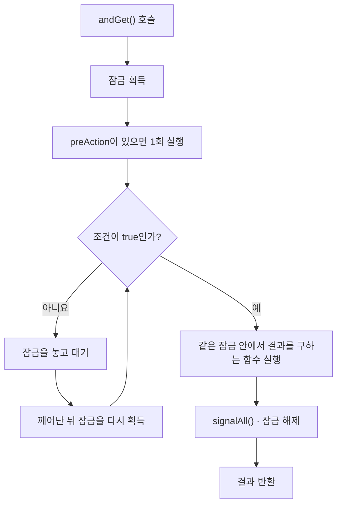

# `utils.thread` 사용자 가이드

`utils.thread`는 여러 스레드가 공유 상태에 안전하게 접근하고, 작업을 예약하거나 결과를 주고받을 때 사용하는 유틸리티 모음이다. Java의 잠금·조건 대기·실행기를 사용하기 쉽게 묶었으며, [`utils.async`](async-threaded-guide.md)의 비동기 실행 클래스도 이 패키지를 사용한다.

이 가이드는 가장 기본이 되는 `Guard`의 사용법부터 설명한다. 주기 작업은 4장, 실행기는 5장, 스레드 간 데이터 전달은 6장에서 다룬다. 7장에는 사용 시 주의할 점과 현재 구현의 제약을 정리했다. 예제의 `Event`, `Sample`, `Report` 등은 설명을 위한 업무용 타입이며, import와 보조 메서드는 생략했다.

---

## 1. 어떤 클래스를 사용할까

| 필요한 기능 | 사용할 클래스 | 선택 기준 |
|---|---|---|
| 공유 상태 보호와 조건 대기 | [`Guard`](../src/main/java/utils/thread/Guard.java) | 상태 확인·변경과 대기를 같은 잠금으로 처리 |
| 기존 `Condition`에 대기 조건 연결 | [`ConditionVariable`](../src/main/java/utils/thread/ConditionVariable.java) | 이미 잠금과 `Condition`을 직접 관리하는 코드에 사용 |
| 초기화·반복 작업·정리로 구성된 주기 실행 | [`RecurringSchedule`](../src/main/java/utils/thread/RecurringSchedule.java), [`RecurringWork`](../src/main/java/utils/thread/RecurringWork.java) | 전용 스레드 또는 공유 실행기에서 반복 |
| 즉시 실행·지연 실행·주기 작업 예약 | [`CamusExecutor`](../src/main/java/utils/thread/CamusExecutor.java) | 여러 실행 방식을 하나의 인터페이스로 사용 |
| 데이터 처리를 다른 스레드에 맡기기 | [`AsyncConsumer`](../src/main/java/utils/thread/AsyncConsumer.java) | `Consumer<T>`를 비동기로 호출 |
| 실행 중인 작업 뒤에 최신 요청 하나만 남기기 | [`SingleWaiterExecutor`](../src/main/java/utils/thread/SingleWaiterExecutor.java) | 오래된 대기 요청은 취소해도 되는 작업 |
| 마감 시각에 비동기 작업 취소 요청 | [`Timer`](../src/main/java/utils/thread/Timer.java) | `Execution`의 타이머 취소 기능. 예약 개수 제한에 주의 |
| 최신 값 하나만 전달 | [`LengthOneOverridingQueue`](../src/main/java/utils/thread/LengthOneOverridingQueue.java) | 중간 값을 건너뛰어도 되는 상태·측정값 |
| 여러 작업의 결과를 도착하는 대로 수집 | [`CompletionFStream`](../src/main/java/utils/thread/CompletionFStream.java) | 제출 순서에 관계없이 완료 결과 처리 |
| 동시에 요청된 값 생성을 하나로 합치기 | [`InterThreadShareSupplier`](../src/main/java/utils/thread/InterThreadShareSupplier.java) | 진행 중인 생성 결과를 여러 호출자가 공유. 현재 제약은 6.3 참고 |

주기 실행의 결과·취소·오류 정책까지 관리해야 한다면 [`utils.async` 가이드](async-threaded-guide.md)의 `PeriodicLoopExecution`, `PeriodicPoller`, `PeriodicLoopService`도 함께 살펴본다.

---

## 2. `Guard` — 공유 상태 보호와 조건 대기

`Guard`는 `ReentrantLock` 하나와 그 잠금에 연결된 `Condition` 하나를 관리한다. 잠금은 여러 스레드가 공유 상태를 동시에 바꾸지 못하게 하고, 조건 대기는 필요한 상태가 될 때까지 스레드를 쉬게 한다.

```java
private final Guard m_guard = Guard.create();
@GuardedBy("m_guard") private State m_state = State.NOT_READY;
```

`@GuardedBy`는 어떤 잠금으로 필드를 보호하는지 표시하는 주석이다. 실제로 잠금을 걸어 주지는 않으므로, 해당 필드를 읽거나 바꾸는 코드에서 같은 `Guard`를 사용해야 한다.

### 2.1 상태를 읽거나 바꾸기 — `run`, `get`, `accept`

이 메서드들은 잠금을 획득한 뒤 전달받은 함수를 실행한다. 작업이 성공하든 예외를 던지든 `finally`에서 `signalAll()`을 호출하고 잠금을 해제한다.

```java
m_guard.run(() -> m_state = State.READY);          // 상태 변경 후 대기 중인 스레드에 알림
State state = m_guard.get(() -> m_state);         // 잠금을 획득한 상태에서 읽기
m_guard.accept(this::setStateInGuard, State.DONE); // 함수에 값을 전달해 실행

// 검사 예외(checked exception)를 던지는 함수도 사용할 수 있다.
m_guard.runChecked(() -> flushToDisk());
int count = m_guard.getChecked(() -> readCount());
```

`signalAll()`은 대기 중인 스레드들이 조건을 다시 확인할 수 있게 한다. 신호를 보냈다고 모든 스레드가 바로 작업을 시작하는 것은 아니다. 각 스레드는 잠금을 다시 획득하고 자신의 조건이 만족되는지 확인해야 한다.

> 읽기만 하는 `get()`도 `signalAll()`을 호출한다. 매우 자주 실행되는 읽기 경로에서 불필요한 알림이 부담된다면 `lock()`·`unlock()`으로 직접 보호할 수 있다.

### 2.2 조건이 만족될 때까지 기다리기 — `awaitCondition`

`awaitCondition(...)`에는 **작업을 진행해도 되는 조건**을 전달한다. 이 메서드만 호출하면 빌더가 만들어질 뿐이며, `andReturn()`·`andRun()`·`andGet()` 등을 호출해야 실제 대기가 시작된다.

```java
// 준비될 때까지 기다린 뒤 반환
m_guard.awaitCondition(() -> m_state == State.READY).andReturn();

// 큐가 비어 있지 않으면 항목 하나를 꺼내 반환
Event event = m_guard.awaitCondition(() -> !m_queue.isEmpty())
                     .andGet(() -> m_queue.poll());

// 준비되면 상태 변경까지 같은 잠금 안에서 처리
m_guard.awaitCondition(() -> m_state == State.READY)
       .andRun(() -> m_state = State.CONSUMED);

// 조건을 기다린 뒤 검사 예외를 던지는 작업 수행
m_guard.awaitCondition(() -> isReady()).andRunChecked(() -> commit());
```

조건 검사와 후속 작업은 같은 잠금을 획득한 상태에서 실행된다. **실제로 대기하는 동안에는 잠금을 놓고**, 깨어나면 잠금을 다시 획득한 뒤 조건을 재검사한다. 덕분에 다른 스레드가 상태를 바꿀 수 있다.

다음은 `andGet()`의 기본 흐름이다. 예외와 제한 시간 처리는 생략했다.



| 메서드 | 조건이 만족된 뒤 하는 일 | 후속 작업 종료 시 알림 |
|---|---|---|
| `andReturn()` | 잠금을 해제하고 반환 | 없음 |
| `andRun(...)` / `andRunChecked(...)` | 작업 실행 | `signalAll()` |
| `andGet(...)` / `andGetChecked(...)` | 작업을 실행하고 결과 반환 | `signalAll()` |

신호 없이 대기에서 깨어날 수도 있으므로, 깨어났다는 사실만으로 조건이 만족됐다고 판단해서는 안 된다. `awaitCondition`은 내부에서 조건을 반복 검사한다. 조건 함수는 상태 확인만 하도록 작성하고, 상태 변경은 후속 작업에서 처리한다.

### 2.3 대기에 제한 시간 두기

| 지정 방법 | 의미 | 예 |
|---|---|---|
| `Duration` | 조건 대기에 사용할 기간 | `Duration.ofSeconds(5)` |
| `long, TimeUnit` | 기간과 단위를 따로 지정 | `5, TimeUnit.SECONDS` |
| `Date` | 시스템 시계 기준의 마감 시각 | `new Date(deadlineMillis)` |

```java
m_guard.awaitCondition(() -> m_done, Duration.ofSeconds(5))
       .andReturn();
```

제한 시간 안에 조건이 충족되지 않으면 `TimeoutException`, 대기 중 인터럽트되면 `InterruptedException`이 발생한다. 기간이 0일 때는 조건을 먼저 확인하고, 만족되지 않으면 바로 `TimeoutException`을 던진다. 음수 기간은 허용하지 않는다.

`Duration`과 `TimeUnit` 방식은 남은 대기 시간을 나노초 단위로 계산한다. 이 제한은 **메서드 호출 전체의 실행 시간 제한이 아니다.** 잠금 획득, 사전 작업, 조건 충족 후의 작업을 강제로 중단하지 않는다. `Date` 방식은 지정한 절대 시각을 기준으로 판단한다.

### 2.4 대기 전에 한 번 실행하기 — `preAction`

잠금을 획득한 직후, 첫 조건 검사 전에 실행할 작업을 지정한다. 조건이 이미 만족돼 있어도 실행되며, 대기에서 깨어날 때마다 반복하지는 않는다.

```java
m_guard.preAction(() -> sendRequest())
       .awaitCondition(() -> m_response != null, Duration.ofSeconds(10))
       .andGet(() -> m_response);
```

`preAction`이 예외를 던지면 `signalAll()`을 호출하고 잠금을 해제한 뒤 원래 예외를 전파한다.

위 예제의 `sendRequest()`는 요청만 보내고 반환해야 한다. 같은 `Guard`가 필요한 다른 스레드의 응답 처리까지 여기서 기다리면 서로 잠금을 기다리게 될 수 있다. 응답을 받는 쪽에서는 `m_guard.run(() -> m_response = response)`처럼 상태를 갱신하고 대기자에게 알려야 한다.

### 2.5 검사 예외 처리의 차이

이름에 `Checked`가 붙어 있어도 예외 처리 방식은 모두 같지 않다.

| 메서드 | 전달한 작업에서 발생한 예외 처리 |
|---|---|
| `runChecked`, `getChecked`, `acceptChecked` | 선언된 예외를 감싸지 않고 그대로 전파 |
| `andRunChecked`, `andGetChecked` | `InterruptedException`은 인터럽트 상태를 복원하고 그대로 전파. 그 밖의 예외·오류는 원인을 풀어 `ExecutionException`으로 전달 |
| `preAction` | 실행 시 예외와 `Error`를 그대로 전파 |

조건 대기에서 발생하는 `InterruptedException`과 `TimeoutException`은 후속 작업의 실패와 별도로 처리한다.

### 2.6 잠금과 신호를 직접 다루기

빌더로 표현하기 어려운 흐름은 직접 구성할 수 있다. `unlock()`은 반드시 `finally`에서 호출하고, 조건 검사는 `if`가 아니라 `while`로 반복한다.

```java
m_guard.lock();
try {
    while ( !ready() ) {
        m_guard.awaitSignal();
    }
    doWork();
    m_guard.signalAll();
}
finally {
    m_guard.unlock();
}
```

이 예제에서는 `doWork()`가 정상 반환했을 때만 알림을 보낸다. 작업 실패 시에도 변경된 상태를 알려야 한다면 알림을 `finally`로 옮기거나 `run()`·`andRun()`을 사용한다.

| 메서드 | 동작 |
|---|---|
| `lock()` / `unlock()` | 잠금 획득·해제. 같은 스레드가 여러 번 획득하는 재진입 허용 |
| `signalAll()` | 대기 중인 모든 스레드에 알림 |
| `awaitSignal()` | 신호 등을 기다리며 잠금을 놓았다가, 다시 획득한 뒤 반환 |
| `awaitSignal(Date)` / `awaitSignal(Duration)` | 제한 시간 동안 대기. 시간 만료 시 `false` 반환 |
| `awaitSignalNanos(long)` | 대기 후 남은 시간을 나노초 단위로 반환. 0 이하면 만료 |

`signalAll()`과 모든 `awaitSignal...()` 메서드는 **현재 스레드가 잠금을 획득한 상태에서** 호출해야 한다. 반환값이 `true`여도 업무상의 조건이 만족됐다는 뜻은 아니므로 조건을 다시 확인한다. 또한 저수준 `awaitSignal(Duration)`은 양수 기간만 받으므로, 0을 허용하는 `awaitCondition(..., Duration)`과 구분한다.

---

## 3. `ConditionVariable` — 조건이 참인 동안 기다리기

`ConditionVariable`은 기존 `Condition`에 조건 함수를 연결한다. `Guard.awaitCondition`과 달리 **기다려야 하는 조건**을 받는다.

| API | 조건이 `true`일 때 | 큐에서 값을 꺼내려면 |
|---|---|---|
| `Guard.awaitCondition(condition)` | 대기를 마치고 후속 작업 수행 | `() -> !queue.isEmpty()` |
| `ConditionVariable(condition, waitCondition)` | 계속 대기 | `() -> queue.isEmpty()` |

```java
Lock lock = new ReentrantLock();
Condition condition = lock.newCondition();
ConditionVariable available =
        new ConditionVariable(condition, () -> m_queue.isEmpty());

lock.lock();
try {
    available.await();             // 큐가 비어 있는 동안 대기
    Event event = m_queue.poll();
    process(event);
}
finally {
    lock.unlock();
}
```

호출자는 `Condition`을 만든 잠금을 직접 획득해야 한다. 데이터를 넣는 쪽에서도 같은 잠금으로 큐를 변경하고 `condition.signalAll()`을 호출한다. 오래 걸리는 `process()`는 가능하면 항목을 꺼낸 뒤 잠금 밖에서 수행한다.

`await(time, unit)`과 `awaitUntil(deadline)`은 시간 만료 시 예외 대신 `false`를 반환한다. 새 코드에서 잠금과 알림을 함께 관리하려면 `Guard`가 편리하다.

---

## 4. 주기 실행

### 4.1 초기화·반복·정리 정의 — `RecurringWork`

```java
public class HealthCheck implements RecurringWork {
    @Override
    public void onStarted(RecurringSchedule schedule) throws Throwable {
        // 반복 작업에 필요한 자원 초기화
    }

    @Override
    public void perform() throws Exception {
        ping();
    }

    @Override
    public void onStopped() {
        // 사용한 자원 정리
    }
}
```

`onStarted()`가 성공하면 `perform()`을 반복하고, 중지하거나 작업이 실패하면 `onStopped()`로 정리한다. 초기화 자체가 실패한 경우에는 `onStopped()`를 호출하지 않으므로, 부분적으로 확보한 자원은 `onStarted()` 안에서 정리해야 한다.

작업 자체에 중단 신호를 전달하려면 [`InterruptableWork`](../src/main/java/utils/thread/InterruptableWork.java)의 `interrupt()`도 구현한다. 이 메서드는 스레드 인터럽트와 별개인 사용자 정의 중단 처리다.

### 4.2 전용 스레드 사용 — `RecurringScheduleThread`

```java
RecurringScheduleThread schedule =
        RecurringScheduleThread.newFixedRateSchedule("health", new HealthCheck(), 5_000);
// newFixedDelaySchedule(...)도 제공한다.
// 초기 지연이 필요하면 (이름, 작업, initialDelay, interval) 형태를 사용한다.

schedule.start();
...
schedule.stop(true);        // 중단 요청. InterruptableWork 구현 여부에 따라 처리 방식이 달라짐
schedule.waitForStopped();  // 정리를 마치고 STOPPED가 될 때까지 대기
```

주기와 초기 지연의 단위는 **밀리초**다. 전용 스레드는 생성한 스레드의 데몬 설정을 상속하며, 일반적인 호출 환경에서는 비데몬 스레드이므로 사용을 마치면 중지해야 한다.

| 방식 | 다음 작업까지 기다리는 시간 | 작업이 주기보다 오래 걸리면 |
|---|---|---|
| `newFixedRateSchedule` | 주기에서 이번 작업 시간을 뺀 나머지 | 대기 없이 다음 작업 시작 |
| `newFixedDelaySchedule` | 이번 작업이 끝난 뒤 주기 전체 | 작업 후 대기 시간을 그대로 유지 |

주기가 1,000ms이고 작업 시간이 300ms라고 가정하면 다음과 같다. 실행 지연과 내부 보정은 생략했다.

```text
고정 주기: [작업 0~300] [대기 300~1000] [작업 1000~1300] …
고정 지연: [작업 0~300] [대기 300~1300] [작업 1300~1600] …
```

전용 스레드 구현은 대기 지연을 `LongVariableSmoother`로 보정한다. `RecurringSchedule`의 고정 주기는 **매 작업의 실제 시작 시점**을 기준으로 계산하므로, 최초 시작 시점에 맞춰 밀린 작업 횟수를 따라잡는 방식과는 차이가 있다. 원격 호출 사이에 충분한 간격을 두려면 고정 지연을 사용한다.

### 4.3 공유 실행기 사용 — `RecurringScheduleImpl`

`CamusExecutor`의 팩토리로 생성한다. 각 반복 작업은 실행기 풀에 제출되므로 매번 같은 스레드에서 실행된다고 가정하면 안 된다.

```java
CamusExecutor executor = new CamusExecutorImpl();
RecurringSchedule schedule =
        executor.createScheduleWithFixedDelay(new HealthCheck(), 0, 5_000);
schedule.start();
...
schedule.stop(false);
schedule.waitForStopped();
executor.stop(true);        // 스케줄 정리가 끝난 뒤 실행기 종료 요청
```

초기화와 일부 제어 기능은 두 구현에서 다르게 동작한다.

| 항목 | `RecurringScheduleThread` | `RecurringScheduleImpl` |
|---|---|---|
| `onStarted()` 실행 위치 | 전용 작업 스레드 | `start()`를 호출한 스레드 |
| 초기화 실패 확인 | `getFailureCause()` 확인. 현재 구현은 `start()`에서 원인을 예외로 전달하지 않음 | `start()`가 `ExecutionException`을 던짐 |
| `perform()` 실행 위치 | 전용 작업 스레드 | 실행기 풀의 스레드 |
| `performNow()` | `IDLE`일 때 대기를 깨움 | `UnsupportedOperationException` 발생 |
| 시간 제한 종료 대기 | `waitForStopped(millis)` 제공 | 동일 API가 있으나 현재 시간 계산 오류가 있음(7.6) |

### 4.4 상태 확인과 종료

| 메서드 | 설명 |
|---|---|
| `getState()` | `STARTING`(초기화), `WORKING`(작업 중), `IDLE`(다음 작업 대기), `STOPPING`(중지 중), `STOPPED`(중지됨) |
| `getFailureCause()` | 기록된 실패 원인 확인. 초기화 실패 전달 방식은 4.3 참고 |
| `getInterval()` / `setInterval(millis)` | 반복 주기 조회·변경. 이미 시작한 대기 시간을 즉시 바꾼다는 의미는 아님 |
| `start()` | 초기화 후 반복 시작 |
| `stop(mayInterruptIfRunning)` | 중지 요청. 정리가 끝나기 전에 반환할 수 있음 |
| `waitForStopped()` | `STOPPED`가 될 때까지 대기 |
| `waitForStopped(millis)` | 시간 제한 종료 대기. 정상 종료 시 `true`, 시간 만료 시 `false` |

`stop()`은 언제나 즉시 반환하는 메서드가 아니다. 초기화 중에는 초기화가 끝나기를 기다리고, 사용자 정의 `interrupt()`나 내부 취소 처리에도 시간이 걸릴 수 있다.

두 구현 모두 작업이 `InterruptableWork`이면 `stop(false)`에서도 사용자 정의 `interrupt()`를 호출한다. 전용 스레드 구현에서는 이 메서드가 있으면 `stop(true)`도 `Thread.interrupt()` 대신 해당 메서드를 사용한다. 따라서 인자만 보고 작업 스레드에 인터럽트가 전달됐다고 판단해서는 안 된다.

---

## 5. 작업 실행기

### 5.1 `CamusExecutor` — 즉시 실행과 예약 실행

`Executor`를 확장해 결과가 있는 작업 제출, 지연 실행, 반복 작업 생성을 제공한다.

```java
CamusExecutor executor = new CamusExecutorImpl();
// 이미 관리 중인 풀이 있으면 new CamusExecutorImpl(executorService)

executor.execute(task);
Future<String> result = executor.submit(() -> compute());
Future<?> later = executor.schedule(task, 3, TimeUnit.SECONDS);
RecurringSchedule schedule = executor.createScheduleWithFixedDelay(task, 0, 1_000);
schedule.start();           // 생성만으로는 주기 작업이 시작되지 않음
...
schedule.stop(false);
schedule.waitForStopped();
executor.stop(true);
```

`stop(true)`는 지연 예약을 관리하는 스레드를 멈추고, 아직 제출하지 않은 예약을 비운 뒤 기반 실행기의 `shutdown()`도 호출한다. 실행 중인 모든 작업의 완료를 기다리지는 않는다. `stop(false)`는 기반 실행기를 종료하지 않으므로 다른 컴포넌트와 풀을 공유할 때 구분해서 사용한다. 예약 큐를 비우는 것이 각 작업의 `Future`를 정상 완료시키는 것은 아니므로, 실행기를 먼저 종료하고 예약 결과를 기다리는 흐름은 피한다.

컴포넌트가 외부에서 실행기를 전달받도록 하려면 [`ExecutorAware`](../src/main/java/utils/thread/ExecutorAware.java)를 구현한다. 일반적인 순서는 속성 설정, `setExecutor(...)`, `Initializable.initialize()`다. 인터페이스를 구현하는 것만으로 실행기가 자동 설정되지는 않으며, 컴포넌트 관리자가 해당 메서드를 호출해야 한다.

### 5.2 `AsyncConsumer` — 데이터 처리를 다른 스레드에 맡기기

`Consumer<T>`를 구현하므로 기존 소비자를 비동기로 호출하도록 감쌀 수 있다.

```java
AsyncConsumer<Event> consumer = AsyncConsumer.singleWorker(this::handle);
// 동시 호출에 안전한 처리 함수라면 여러 스레드 사용 가능:
// AsyncConsumer.multipleWorkers(this::handle, 4);

consumer.accept(event);                                  // 처리 요청만 제출
CompletableFuture<Void> done = consumer.schedule(event); // 처리 완료·실패 추적
consumer.shutdown();                                    // 실행기 종료 요청
```

여러 작업 스레드를 사용하는 경우 처리 함수는 동시 호출에 안전해야 한다. 상태가 없는 함수가 적합하며, 공유 상태가 있다면 별도 동기화가 필요하다. `singleWorker(consumer, executor)`처럼 실행기를 직접 넘긴 경우에는 실제 동시 실행 개수가 그 실행기의 설정을 따른다.

`shutdown()`은 생성 방식과 관계없이 내부 실행기를 종료한다. 외부에서 전달한 공유 실행기도 종료하므로 소유권을 분명히 해야 한다. 종료 완료까지 기다리려면 `getExecutor().awaitTermination(...)`을 사용한다.

### 5.3 `SingleWaiterExecutor` — 최신 대기 작업 하나만 유지

실행 중인 작업 하나와 다음에 실행할 작업 하나를 관리한다. 실행 중 새 요청이 들어오면 대기 자리에 넣고, 이미 대기 중인 작업이 있으면 그 작업에 `cancel(true)`를 호출한 뒤 새 작업으로 교체한다. **새 요청이 들어왔다는 이유로 현재 실행 중인 작업을 취소하지는 않는다.**


```java
SingleWaiterExecutor executor = new SingleWaiterExecutor();
executor.submit(renderA);
executor.submit(renderB);
executor.submit(renderC);   // A 실행 중에 B가 아직 대기 중이면 B를 취소하고 C로 교체
...
executor.stop();
```

화면 갱신처럼 최신 요청만 처리하면 되는 작업에 적합하다. 제출할 때는 아직 시작하지 않은 `StartableExecution`을 사용한다.

이 클래스는 Java의 `Executor`를 구현하지 않으며 `submit()`도 결과를 반환하지 않는다. 실제 완료·실패·취소는 제출한 작업의 `whenFinished(...)` 등으로 확인한다. `stop()`은 실행 중인 작업과 대기 중인 작업 모두에 취소를 요청하며, 이후에는 작업을 제출할 수 없다. 취소 요청과 실제 종료는 구분해야 한다.

### 5.4 `Timer` — 마감 시각에 취소 요청

`Execution.setTimeout(long, TimeUnit)`에서 사용하는 데몬 스레드 기반 타이머다. 일반적으로 `Executions.getTimer()`로 공용 인스턴스를 얻는다.

```java
Executions.getTimer().setTimer(execution, 30, TimeUnit.SECONDS);
```

마감 시각이 되면 아직 끝나지 않은 작업에 `cancel(true)`를 호출한다. 작업을 강제로 끝내거나 `TimeoutException`으로 실패시키는 기능은 아니다. 최종 상태는 작업의 취소 처리에 따라 달라진다. `PeriodicLoopExecution.setTimeout(Duration)`과의 차이는 [`utils.async` 가이드](async-threaded-guide.md)의 제한 시간 설명을 참고한다.

내부 예약 큐는 **최대 64개**를 보관한다. 이를 넘으면 마감이 가장 늦은 항목이 별도 통지 없이 제외되므로, 제외된 작업에는 타이머 취소가 전달되지 않는다. 여러 컴포넌트가 공용 타이머를 함께 사용한다는 점도 고려해야 한다.

---

## 6. 스레드 간 데이터 전달

### 6.1 `LengthOneOverridingQueue` — 최신 값 하나만 보관

아직 소비하지 않은 값이 있더라도 새 값이 들어오면 이전 값을 덮어쓴다. 중간 측정값을 생략해도 되는 센서 화면이나 진행률 표시에 적합하다.

```java
LengthOneOverridingQueue<Sample> queue = new LengthOneOverridingQueue<>();

// 데이터를 보내는 쪽
queue.add(sample);                        // null이면 IllegalArgumentException

// 데이터를 받는 쪽
Sample value = queue.poll();              // 값이 없으면 들어올 때까지 대기
Sample later = queue.poll(Duration.ofSeconds(1)); // 시간 만료 시 TimeoutException
Sample current = queue.peek();            // 꺼내지 않고 확인. 비어 있으면 null
```

| 호출 순서 | 호출 후 보관된 값 | 반환값 |
|---|---|---|
| `add(A)` | A | 없음 |
| `add(B)` | B — A는 덮어써짐 | 없음 |
| `peek()` | B | B |
| `poll()` | 비어 있음 | B |

이 클래스의 **`poll()`은 값이 없으면 기다린다.** 대기하지 않고 확인하려면 `peek()`를 사용한다. 모든 값을 빠짐없이 전달해야 한다면 `BlockingQueue`나 `SuppliableFStream`을 사용한다.

### 6.2 `CompletionFStream` — 도착하는 완료 결과부터 처리

여러 `Execution`의 완료 결과를 버퍼에 넣고 `FStream`으로 꺼낸다. 먼저 제출한 작업이 오래 걸려도 나중에 제출한 작업의 결과를 먼저 처리할 수 있다. 동시에 완료되는 작업의 세부 순서는 콜백 실행과 버퍼 적재 순서에 따라 달라진다.

스트림 원소는 `T`가 아니라 **`utils.func.Result<T>`**다. 성공한 값뿐 아니라 실패 원인과 취소 결과도 전달된다.

다음은 개수가 정해진 소규모 작업 목록을 처리하는 예다. 제출 중 완료 콜백이 버퍼를 가득 채워 대기하지 않도록, 버퍼를 작업 수만큼 확보한다.

```java
List<StartableExecution<Report>> tasks = createReportTasks();
try ( CompletionFStream<Report> results =
        new CompletionFStream<>(Math.max(1, tasks.size())) ) {
    for ( StartableExecution<Report> task : tasks ) {
        results.submit(task);             // 아직 시작하지 않았다면 자동으로 시작
    }

    for ( int i = 0; i < tasks.size(); ++i ) {
        Result<Report> result = results.next().get();
        result.ifSuccessful(this::handle)
              .ifFailed(e -> log.warn("job failed", e))
              .ifNone(() -> log.info("job cancelled"));
    }
    // 제출한 개수만큼 결과를 받았으므로 try 블록을 나가며 스트림을 닫는다.
}
```

**작업을 모두 제출했다는 이유로 곧바로 `endOfSupply()`를 호출하면 안 된다.** 이 메서드는 앞으로 도착할 결과도 받지 않겠다는 뜻이다. 아직 끝나지 않은 작업의 결과는 버려진다. 위 예제처럼 받을 개수를 알고 있으면 그 개수만큼 소비한다. 끝까지 읽는 `forEach()`를 사용하려면 모든 결과의 버퍼 적재가 끝난 뒤 공급 종료를 알리는 별도 조율이 필요하다.

버퍼와 종료를 다룰 때는 다음을 구분한다.

| 상황 | 동작 |
|---|---|
| 버퍼가 가득 참 | 결과를 넣는 완료 콜백이 빈자리가 생길 때까지 대기 |
| `endOfSupply()` 이후 | 이미 적재된 결과는 읽을 수 있지만 새 결과는 받지 않음 |
| `close()` 이후 | 남은 버퍼를 비우고 새 결과도 받지 않음 |
| 공급 종료 또는 닫기 이후 `submit()` | `IllegalStateException` 발생 |

완료 콜백은 동기적으로 버퍼에 결과를 넣는다. 따라서 콜백을 실행하는 작업 스레드가 멈출 수 있고, 이미 끝난 작업의 콜백을 등록할 때는 제출한 스레드가 대기할 수도 있다. 대량 작업은 한꺼번에 모두 제출하기보다 제출 개수를 제한하고 결과를 받는 대로 다음 작업을 제출하거나, 제출과 소비를 별도 스레드에서 진행한다.

스트림을 닫는다고 제출한 작업까지 자동 취소되지는 않는다. 수집을 중단할 때 실행 중인 작업도 멈춰야 한다면 작업 참조를 보관하고 별도로 취소한다. 상속한 `poll()`, `next(timeout, unit)`, `setSupplyListener(...)` 등의 버퍼 API도 사용할 수 있다.

### 6.3 `InterThreadShareSupplier` — 겹치는 값 생성 요청 공유

한 스레드가 값을 만드는 동안 다른 스레드에서도 같은 요청이 들어오면, 새로 생성하지 않고 진행 중인 결과를 함께 사용하도록 만든 클래스다. 호출이 겹치지 않으면 매번 새 값을 생성하므로 장기 캐시와는 용도가 다르다.

```java
InterThreadShareSupplier<Token> supplier =
        new InterThreadShareSupplier<>(() -> authServer.issueToken());
supplier.setWaitTimeout(Duration.ofSeconds(5));

Token token = supplier.get();
// InterruptedException, TimeoutException, ExecutionException 처리 필요
```

대기 제한은 **다른 스레드가 생성 중인 결과를 기다리는 시간**에 적용된다. 직접 `issueToken()`을 수행하는 스레드의 호출 시간까지 제한하지는 않으므로, 통신 클라이언트에도 별도 제한 시간이 필요하다.

현재 구현에는 다음 제약이 있다. 위 예제는 대기 제한을 명시하고, 값 생성 함수가 `null`을 반환하지 않는 경우를 전제로 한다.

- **대기 제한을 지정하지 않은 경로에 오류가 있다.** Javadoc에는 무제한 대기라고 되어 있지만, 실제 `get()`은 다른 스레드가 생성 중이어도 대기를 건너뛴다. 그 결과 이전 값이 반환되거나, 아직 실패 원인도 없으면 `NullPointerException`이 발생할 수 있다.
- 생성 함수가 `null`을 반환하면 정상 값으로 처리하지 않고 `ExecutionException`을 던진다.
- 대기자가 깨어나 결과를 읽기 전에 새 생성이 시작되면, 원래 기다리던 생성 대신 다음 생성까지 기다릴 수 있다. 요청별로 특정 생성 결과를 정확히 공유해야 한다면 현재 구현만으로 보장된다고 가정해서는 안 된다.

같은 값을 생성 후 계속 재사용하려는 경우에는 [`utils.func.Lazy`](../src/main/java/utils/func/Lazy.java) 계열을 검토한다.

---

## 7. 자주 혼동하는 동작과 구현 제약

### 7.1 알림을 보내려면 먼저 잠금을 획득해야 한다

`Guard.signalAll()`이나 저수준 대기 메서드를 잠금 없이 호출하면 `IllegalMonitorStateException`이 발생한다. `run()`·`get()`·`accept()`와 조건 대기 빌더는 잠금을 내부에서 관리한다.

### 7.2 기다린 뒤 상태를 바꿀 때는 `andRun()`을 사용한다

`andReturn()`은 잠금을 해제하고 반환하며, 정상 반환 시 알림을 보내지 않는다. 그 뒤에 상태를 바꾸면 잠금 밖에서 변경하게 된다.

```java
// 잘못된 예: 상태 변경이 잠금 밖에서 이루어지고, 다른 대기자에게 알리지도 않음
m_guard.awaitCondition(() -> m_state == State.READY).andReturn();
m_state = State.CONSUMED;

// 조건 확인과 상태 변경을 같은 잠금 안에서 처리
m_guard.awaitCondition(() -> m_state == State.READY)
       .andRun(() -> m_state = State.CONSUMED);
```

### 7.3 조건 함수의 의미를 구분한다

`Guard.awaitCondition`은 조건이 **참이 될 때까지**, `ConditionVariable`은 조건이 **참인 동안** 기다린다. 같은 조건 함수를 그대로 옮겨 쓰면 즉시 반환하거나 계속 기다리게 될 수 있다. 큐를 대상으로 한 비교는 3장을 참고한다.

### 7.4 중지 요청과 정리 완료는 다르다

`RecurringSchedule.stop()`이 반환해도 `onStopped()`가 아직 끝나지 않았을 수 있다. 종료 상태까지 기다리려면 `waitForStopped()`를 사용한다. 다만 `perform()` 실행 스레드에서 자기 스케줄의 종료를 기다리면 스스로 끝나기를 기다리게 되므로, 구현은 이를 감지해 `RuntimeException`을 던진다. 종료 대기는 외부 스레드에서 수행한다.

공유 실행기를 사용하는 스케줄은 정리 작업에도 실행기가 필요하다. 스케줄을 멈추고 종료를 확인한 뒤 실행기를 종료한다.

### 7.5 어떤 데이터가 생략될 수 있는지 확인한다

| 도구 | 생략되거나 버려질 수 있는 대상 | 적합한 용도 |
|---|---|---|
| `SingleWaiterExecutor` | 새 요청으로 교체된 대기 작업 | 최신 화면 갱신 요청 |
| `LengthOneOverridingQueue` | 아직 읽지 않은 이전 값 | 최신 측정값·진행률 |
| `CompletionFStream` | 공급 종료·닫기 이후 도착한 결과 | 종료 시점을 조율하는 완료 결과 수집 |
| `Timer` | 64개를 초과한 예약 중 마감이 가장 늦은 항목 | 제한된 수의 취소 예약 |

타이머 예약이 많은 경우에는 별도 `ScheduledExecutorService` 등으로 예약을 관리한다. 완료 결과를 모두 받아야 한다면 `CompletionFStream`의 공급 종료를 작업 제출 완료와 혼동하지 않는다.

### 7.6 인터페이스와 현재 구현이 다른 부분

| 항목 | 현재 동작 | 사용 시 유의점 |
|---|---|---|
| `RecurringScheduleImpl.performNow()` | 지원하지 않으며 예외 발생 | 즉시 실행 기능이 필요하면 구현체를 확인 |
| `RecurringScheduleThread.start()` 초기화 실패 | 실패 원인을 기록하지만 호출자에게 예외로 전달하지 않음 | `getFailureCause()`도 확인 |
| `RecurringScheduleImpl.waitForStopped(millis)` | `awaitNanos()`에 남은 시간 대신 마감 계산값을 전달 | 지정한 시간보다 오래 기다릴 수 있으므로 엄격한 종료 제한으로 사용하지 않음 |
| `InterThreadShareSupplier`의 대기 제한 미설정 | 무제한 대기가 실제로 수행되지 않음 | 대기 제한을 명시하고 6.3의 제약 확인 |

이 표는 현재 소스에서 확인한 동작이다. 해당 구현이 수정되면 문서의 제약도 함께 갱신해야 한다.

---

## 8. API 요약

| 타입 | 주요 API와 역할 |
|---|---|
| [`Guard`](../src/main/java/utils/thread/Guard.java) | `run`·`get`·`accept`로 잠금 안에서 실행, `awaitCondition`으로 조건 대기, `preAction`으로 사전 작업 지정 |
| [`ConditionVariable`](../src/main/java/utils/thread/ConditionVariable.java) | `await`·`awaitUntil`로 대기 조건이 해제될 때까지 기다림 |
| [`RecurringSchedule`](../src/main/java/utils/thread/RecurringSchedule.java) | `start`·`stop`·`waitForStopped`·`getState`로 주기 작업 제어 |
| [`RecurringScheduleThread`](../src/main/java/utils/thread/RecurringScheduleThread.java) | `newFixedRateSchedule`·`newFixedDelaySchedule`로 전용 스레드 방식 생성 |
| [`RecurringScheduleImpl`](../src/main/java/utils/thread/RecurringScheduleImpl.java) | `CamusExecutor`를 사용하는 주기 실행 구현 |
| [`RecurringWork`](../src/main/java/utils/thread/RecurringWork.java) / [`InterruptableWork`](../src/main/java/utils/thread/InterruptableWork.java) | `onStarted`·`perform`·`onStopped`로 작업 정의 / `interrupt`로 중단 처리 |
| [`CamusExecutor`](../src/main/java/utils/thread/CamusExecutor.java) / [`CamusExecutorImpl`](../src/main/java/utils/thread/CamusExecutorImpl.java) | `execute`·`submit`·`schedule`·주기 작업 팩토리 제공 |
| [`ExecutorAware`](../src/main/java/utils/thread/ExecutorAware.java) | `getExecutor`·`setExecutor`로 외부 실행기 설정 |
| [`AsyncConsumer`](../src/main/java/utils/thread/AsyncConsumer.java) | `accept`로 비동기 처리 요청, `schedule`로 완료 결과 추적 |
| [`SingleWaiterExecutor`](../src/main/java/utils/thread/SingleWaiterExecutor.java) | `submit`으로 최신 대기 작업 유지, `stop`으로 취소 요청 |
| [`Timer`](../src/main/java/utils/thread/Timer.java) | `setTimer`로 마감 시각의 취소 예약 |
| [`LengthOneOverridingQueue`](../src/main/java/utils/thread/LengthOneOverridingQueue.java) | `add`로 최신 값 저장, `poll`로 대기 후 꺼내기, `peek`로 확인 |
| [`CompletionFStream`](../src/main/java/utils/thread/CompletionFStream.java) | `submit`으로 결과 수집 등록, `next`로 완료 결과 소비 |
| [`InterThreadShareSupplier`](../src/main/java/utils/thread/InterThreadShareSupplier.java) | `get`으로 생성 결과 공유, `setWaitTimeout`으로 공유 대기 제한 설정 |

---

## 9. 관련 문서

- [`utils.thread` 개발 노트](../src/main/java/utils/thread/CLAUDE.md) — 패키지 내부 구조
- [`utils.async` 사용자 가이드](async-threaded-guide.md) — 실행 결과, 취소, 폴링, 주기 서비스 사용법
- [`utils.async` 개발 노트](../src/main/java/utils/async/CLAUDE.md) — `Guard`, `Timer`, `SingleWaiterExecutor`를 사용하는 비동기 실행 구조
- [스트림 가이드](stream-guide.md) — `SuppliableFStream`의 버퍼와 공급 종료 처리
- [라이브러리 전체 구조](../CLAUDE.md)
