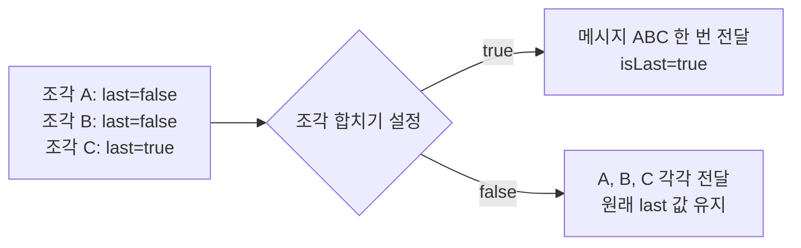
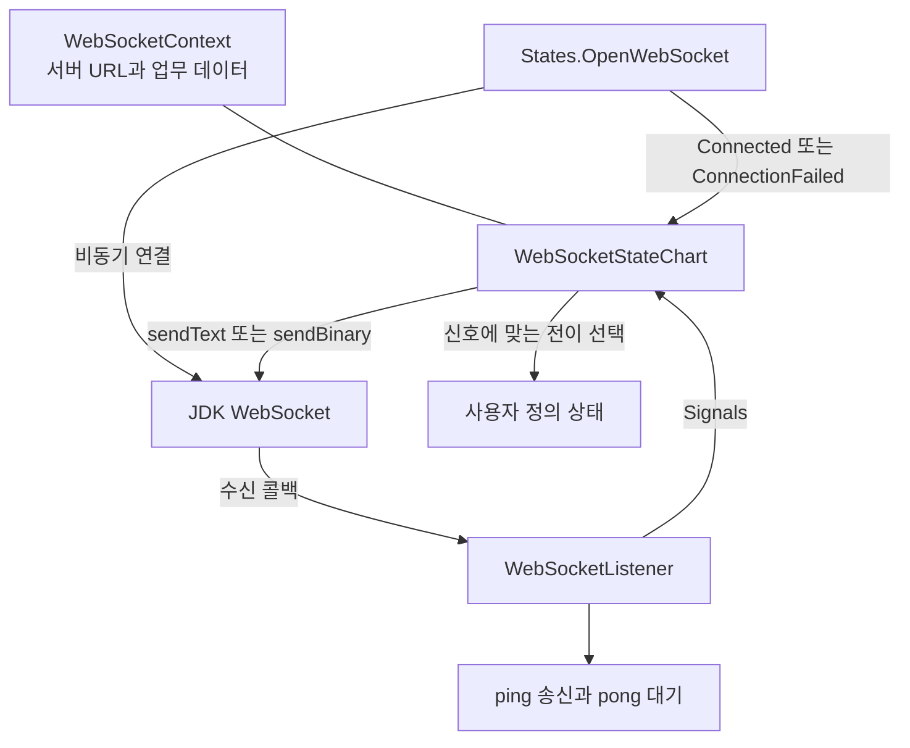
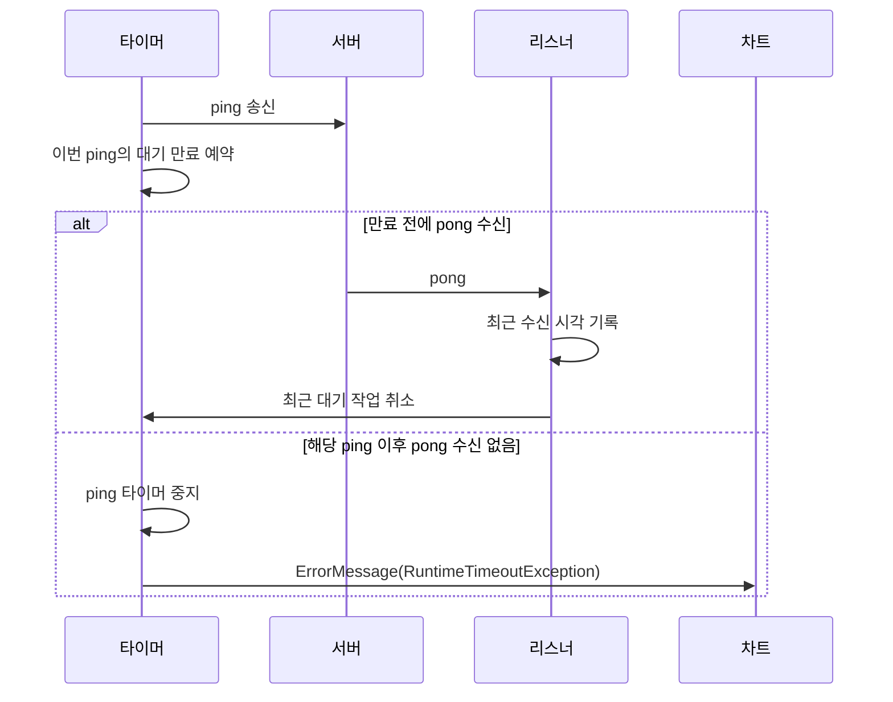

# `utils.websocket` 사용자 가이드

`utils.websocket`는 JDK의 `java.net.http.WebSocket` 클라이언트를 이용해 메시지를 받거나, 상태에 따라 연결과 송수신을 관리하는 패키지다. 수신 메시지를 RxJava 연산으로 처리하려면 `WebSocketObservable`을, 연결·인증·요청·응답 같은 단계를 구분하려면 `WebSocketStateChart`를 사용한다.

이 프로젝트의 컴파일 기준은 Java 17이다. 예제도 미리 보기 기능 없이 사용할 수 있는 문법으로 작성했다. 예제 서버 주소는 실제 사용하는 주소로 바꾸고, 코드 조각의 import와 업무용 타입은 필요한 부분을 추가한다.

## 1. 두 API의 차이

| 항목 | `WebSocketObservable` | `WebSocketStateChart` |
|---|---|---|
| 처리 모델 | RxJava3 `Observable<Message>` | `utils.statechart`의 상태와 신호 |
| 연결 시작 | 구독할 때마다 새 연결 | 연결 상태의 `enter()`에서 시작 |
| 송신 | 공개 송신 API 없음 | 텍스트·바이너리 송신 지원 |
| 텍스트 수신 | 조각을 합치거나 그대로 받도록 선택 | 조각을 합쳐 완성된 메시지 전달 |
| 바이너리 수신 | 조각을 합치거나 그대로 받도록 선택 | 조각마다 신호 전달 |
| 연결 유지 확인 | 주기적인 ping 송신 없음 | ping 주기와 pong 대기 시간 설정 |
| 종료 결과 | `onComplete`, `onError`, 구독 해제 | `COMPLETED`, `FAILED`, `CANCELLED` |
| 다시 연결 | 새 구독 | 새 차트와 컨텍스트 생성 |

두 API의 `TextMessage`·`BinaryMessage`는 이름이 같아도 서로 다른 타입이다. Observable에서는 `WebSocketObservable.TextMessage`, 차트에서는 `Signals.TextMessage`를 사용한다.

## 2. `WebSocketObservable`로 메시지 받기

### 2.1 구독과 해제

```java
import io.reactivex.rxjava3.disposables.Disposable;
import utils.websocket.WebSocketObservable;

Disposable subscription = WebSocketObservable.builder()
        .uri("ws://localhost:8080/echo")
        .build()
        .subscribe(message -> {
            if (message instanceof WebSocketObservable.TextMessage text) {
                System.out.println("텍스트: " + text.getText());
            } else if (message instanceof WebSocketObservable.BinaryMessage binary) {
                System.out.println("바이너리 크기: " + binary.getBytes().length);
            }
        }, error -> {
            System.err.println("연결 또는 수신 실패: " + error);
        }, () -> {
            System.out.println("서버가 연결을 종료했습니다.");
        });

// subscription을 보관하고 수신 기능을 끝낼 때 호출한다.
// subscription.dispose();
```

이 예제는 연결만으로 데이터를 보내 주는 서버를 전제로 한다. 서버가 먼저 요청을 받아야 응답하는 방식이라면 송신 기능을 제공하는 상태 차트 API를 사용한다. `subscribe()`가 반환되어도 연결이 완료된 것은 아니다.

구독마다 새 WebSocket 연결을 만든다. 같은 Observable 객체를 여러 번 구독해도 연결을 공유하지 않는다. 여러 소비자가 하나의 연결을 사용해야 한다면 `.publish().refCount()` 같은 RxJava 공유 연산자의 연결·해제 규칙에 맞춰 구성한다.

구독 해제는 `Disposable.dispose()`로 요청한다. 연결 중에 해제하면 연결 future 자체를 취소하지는 않지만, 나중에 연결 객체가 전달됐을 때 close 프레임 전송을 시도한다. 이 과정은 강제 연결 종료나 상대 서버의 종료 응답까지 보장하는 방식은 아니다.

### 2.2 빌더 옵션

| 옵션 | 기본값 | 의미 |
|---|---|---|
| `uri(String)` | 없음, 필수 | 서버 URI. 설정하지 않으면 `build()`에서 거부 |
| `httpClient(HttpClient)` | 새 기본 클라이언트 | 연결에 사용할 HTTP 클라이언트 지정 |
| `collectTextFragments(boolean)` | `true` | 텍스트 조각을 마지막 조각까지 합칠지 결정 |
| `collectBinaryFragments(boolean)` | `true` | 바이너리 조각을 마지막 조각까지 합칠지 결정 |

URI 문자열의 문법 검사는 `uri()`에서 수행한다. WebSocket 접속에 적합한 URI인지, 서버에 연결할 수 있는지 등은 실제 접속 단계에서 확인된다. `httpClient(null)`은 빌더에서 걸러지지 않으므로 유효한 클라이언트를 전달한다.

### 2.3 메시지 조각 처리

메시지는 여러 수신 조각으로 나뉠 수 있다. `last=true`는 그 조각으로 메시지가 완성된다는 뜻이다.



| 메시지 타입 | 내용 조회 | 마지막 조각 확인 |
|---|---|---|
| `WebSocketObservable.TextMessage` | `getText()` | `isLast()` |
| `WebSocketObservable.BinaryMessage` | `getBytes()` | `isLast()` |

기본 설정에서는 메시지 전체를 메모리에 모은다. 큰 바이너리를 파일로 바로 쓰려면 `collectBinaryFragments(false)`를 지정하고 조각을 도착하는 대로 처리한다. 조각 모드에서도 호출자가 다시 전부 메모리에 쌓으면 메모리 사용량은 줄지 않는다. 내부에는 메시지 크기 상한이 없다.

바이너리 내용은 수신 `ByteBuffer`에서 새 배열로 복사하지만, `getBytes()`는 그 내부 배열을 그대로 반환한다. 읽기 전용으로 보관하는 데 반드시 추가 복사가 필요한 것은 아니지만, 다른 소비자와 공유하면서 수정하거나 독립된 복사본이 필요하면 `getBytes().clone()`을 사용한다.

### 2.4 종료 이벤트

| 상황 | 구독자에게 전달하는 이벤트 | 연결 처리 |
|---|---|---|
| close 프레임 수신 | `onComplete()` | 받은 코드와 사유로 close 전송 시도 |
| 연결 실패 또는 오류 | `onError(error)` | 연결 객체가 있으면 close 전송 시도 |
| `dispose()` 호출 | 별도 완료 이벤트 없음 | 정상 종료 코드로 close 전송 시도 |

close 프레임의 상태 코드가 비정상 종료를 뜻하더라도 이 어댑터는 `onComplete()`를 호출한다. 구독자에게 상태 코드와 사유를 전달하는 별도 메시지도 없다. 종료 이유를 업무 판단에 사용해야 한다면 `Signals.ConnectionClosed`를 제공하는 상태 차트 API가 적합하다.

### 2.5 수신 속도와 비동기 처리

리스너는 시작 시 한 번, 각 텍스트·바이너리 콜백 처리 후 다시 `request(1)`을 호출한다. 이 요청은 **완성된 업무 메시지 한 개가 아니라 수신 콜백의 허용 횟수**를 조절한다. 조각을 합치는 동안에도 다음 조각을 요청해야 메시지를 완성할 수 있다. 수신 데이터의 수명과 요청 횟수는 서로 다른 규칙이다. [JDK 17 리스너 규약](https://docs.oracle.com/en/java/javase/17/docs/api/java.net.http/java/net/http/WebSocket.Listener.html)

동기 구독자가 오래 처리하면 다음 요청도 늦어진다. 하지만 `observeOn()` 등으로 처리 스레드를 바꾸면 리스너는 데이터를 큐에 넣고 다음 수신을 요청할 수 있다. 따라서 `request(1)`만으로 후속 처리 전체의 버퍼 크기나 메모리 사용량이 제한된다고 볼 수 없다. 큰 데이터나 느린 소비자를 다룰 때는 후속 큐와 처리 속도도 함께 관리한다.

## 3. 상태 차트로 연결과 송수신 관리하기

상태 차트의 기본 개념과 실행 규칙은 [상태 차트 가이드](statechart-guide.md)를 참고한다. `WebSocketStateChart.start()`는 차트를 시작하며, 서버 접속 완료까지 기다리지는 않는다.

### 3.1 구성 요소와 신호 전달



| 타입 | 책임 |
|---|---|
| [`WebSocketContext<C>`](../src/main/java/utils/websocket/WebSocketContext.java) | 서버 URL과 차트 참조 보관. 하위 클래스에 업무 데이터 추가 |
| [`WebSocketStateChart<C>`](../src/main/java/utils/websocket/WebSocketStateChart.java) | 상태 차트, 송신 API, 미처리 오류·종료 신호의 기본 처리 |
| [`WebSocketListener`](../src/main/java/utils/websocket/WebSocketListener.java) | JDK 콜백을 신호로 변환하고 ping 타이머 관리. 패키지 내부 클래스 |
| [`WebSocketSignal`](../src/main/java/utils/websocket/WebSocketSignal.java) | WebSocket 참조를 가진 신호의 기반 클래스 |
| [`Signals`](../src/main/java/utils/websocket/Signals.java) | 연결 결과와 수신 이벤트 타입 |
| [`States`](../src/main/java/utils/websocket/States.java) | 연결 상태와 종료 상태 구현 |

연결 객체는 컨텍스트가 아니라 차트가 보관한다. `chart.getWebSocket()`은 연결 등록 전에는 `null`이고, 차트 종료 후에도 마지막 객체를 반환한다. 반환값의 존재만으로 연결이 살아 있다고 판단하면 안 된다.

### 3.2 신호 종류

| 신호 | 발생 계기 | 주요 조회 메서드 |
|---|---|---|
| `Connected` | 연결 성공 후 차트에 WebSocket 등록 | `getWebSocket()` |
| `ConnectionFailed` | 연결 future의 실패 | `getCause()` |
| `TextMessage` | 텍스트 조각을 모두 수신 | `getMessage()`, `getWebSocket()` |
| `BinaryMessage` | 바이너리 조각 수신 | `getBytes()`, `isLast()`, `getWebSocket()` |
| `ErrorMessage` | 통신 오류 또는 pong 대기 시간 초과 | `getError()`, `getWebSocket()` |
| `ConnectionClosed` | close 프레임 수신 | `getStatusCode()`, `getReason()`, `getWebSocket()` |

텍스트는 완성된 메시지로 전달하며, 바이너리는 조각마다 전달한다. 바이너리 전체가 필요한 경우 사용자 상태에서 합쳐야 한다. `Signals.BinaryMessage.getBytes()`도 배열을 직접 반환한다.

### 3.3 제공되는 상태의 실제 동작

| 상태 | 진입 시 동작 | 최종 상태로 등록했을 때 결과 |
|---|---|---|
| `States.OpenWebSocket` | 기본 `HttpClient`로 연결 시도 | 연결용 상태이므로 최종 상태로 사용하지 않음 |
| `States.CompletedState` | close 전송 시도 | `COMPLETED` |
| `States.CancelledState` | close 전송 시도 | **`COMPLETED`** |
| `States.ErrorState` | close 전송 시도 | `FAILED`, 설정된 실패 원인 사용 |

`CancelledState`는 이름만으로 실행 결과를 `CANCELLED`로 바꾸지 않는다. 일반 `SinkState`의 하위 타입이므로 최종 상태로 등록해 도달하면 정상 완료된다. 실행 결과를 취소로 남기려면 `chart.cancel(true)`를 사용한다.

종료 상태들은 모두 프로토콜의 정상 종료 코드 `1000`을 사용한다. `ErrorState`도 오류를 사유 문자열로 표현할 뿐 비정상 close 코드를 보내지는 않는다. 차트의 업무 결과와 WebSocket 종료 코드는 별개다.

`OpenWebSocket`의 기본 실패 전이는 지정 경로로 이동만 한다. `ConnectionFailed`의 원인을 `ErrorState`에 자동 복사하지 않으므로, 원인을 남기려면 아래 예제처럼 전이 작업에서 설정한다.

### 3.4 예제: 연결 후 메시지를 보내고 응답 한 번 받기

아래 코드는 `ws://localhost:8080/echo`에 에코 서버가 실행 중인 환경을 전제로 한다. 메서드 본문은 예외를 호출자에게 전달하도록 작성했다.

```java
import java.time.Duration;
import java.util.Optional;
import java.util.concurrent.TimeUnit;
import utils.statechart.AbstractState;
import utils.statechart.Signal;
import utils.statechart.Transition;
import utils.statechart.Transitions;
import utils.websocket.Signals;
import utils.websocket.States;
import utils.websocket.WebSocketContext;
import utils.websocket.WebSocketStateChart;

public class EchoExample {
    static final class Context extends WebSocketContext<Context> {
        Context(String url) { super(url); }
    }

    public static void main(String[] args) throws Exception {
        String url = args.length > 0 ? args[0] : "ws://localhost:8080/echo";
        Context context = new Context(url);
        WebSocketStateChart<Context> chart = new WebSocketStateChart<>(context);
        chart.setPingInterval(Duration.ofSeconds(20));
        chart.setPongTimeout(Duration.ofSeconds(5));

        States.ErrorState<Context> error = new States.ErrorState<>("error", context);
        chart.addState(error);
        chart.addState(new States.CompletedState<>("done", context));
        chart.addState(new States.OpenWebSocket<Context>(
                "open", context, chart, "running", "error") {
            @Override
            public Optional<Transition<Context>> selectTransition(Signal signal) {
                if (signal instanceof Signals.ConnectionFailed failed) {
                    return Optional.of(Transitions.create("error", (ctx, ignored) -> {
                        error.setFailureCause(failed.getCause());
                    }));
                }
                return super.selectTransition(signal);
            }
        });
        chart.addState(new AbstractState<Context>("running", context) {
            @Override
            public void enter() {
                chart.sendText("hello", true).whenCompleteAsync((ws, failure) -> {
                    if (failure != null) {
                        chart.handleSignal(new Signals.ErrorMessage(
                                chart.getWebSocket(), failure));
                    }
                });
            }

            @Override
            public Optional<Transition<Context>> selectTransition(Signal signal) {
                if (signal instanceof Signals.TextMessage text) {
                    return Optional.of(Transitions.create("done", (ctx, ignored) -> {
                        System.out.println("서버 응답: " + text.getMessage());
                    }));
                }
                return Optional.empty();
            }
        });
        chart.setInitialState("open");
        chart.addFinalState("done");
        chart.addFinalState("error");

        try {
            chart.start();
            chart.get(30, TimeUnit.SECONDS);
        } finally {
            if (!chart.isDone()) {
                chart.cancel(true);
            }
        }
    }
}
```

`error`를 최종 상태로 등록해야 연결 실패가 차트의 실패로 끝난다. `whenCompleteAsync()`는 송신 future가 이미 끝난 경우에도 상태 진입 도중 같은 스레드로 신호가 재진입하는 것을 피하기 위해 사용했다.

`get(30, ...)`은 결과를 기다리는 시간을 제한한다. 시간 초과가 연결 시도나 차트를 자동 취소하지 않으므로 `finally`에서 중지를 요청한다. 단, 연결 완료 전 취소에는 현재 구현의 별도 제약이 있다(6.1).

## 4. 송신과 종료 API

### 4.1 송신

| 메서드 | 반환과 대기 |
|---|---|
| `sendText(text, last)` | `CompletableFuture<WebSocket>` 반환 |
| `sendBinary(bytes, last)` | `CompletableFuture<WebSocket>` 반환 |
| `sendTextSync(text, last)` | 송신 future가 끝날 때까지 대기 |
| `sendBinarySync(bytes, last)` | 송신 future가 끝날 때까지 대기 |

`last=true`는 메시지의 마지막 조각이라는 뜻이다. 나눠 보내지 않는 메시지는 `true`를 사용한다. 송신 future의 완료는 서버의 업무 응답을 받았다는 뜻이 아니다.

차트가 `RUNNING`이고 WebSocket 참조가 등록되어 있어야 한다. 이 검사는 소켓이 현재 열려 있음을 보장하지 않으며, 실제 송신 실패는 즉시 예외 또는 실패한 future로 나타날 수 있다. 비동기 송신 future의 실패가 모두 자동으로 차트 실패로 바뀌는 것도 아니므로 필요한 오류 처리를 등록한다.

송신 순서를 보장해야 한다면 이전 future가 끝난 뒤 다음 송신을 연결한다. `sendBinary()`는 전달한 배열을 복사하지 않고 `ByteBuffer`로 감싸므로 송신 완료 전에는 배열을 수정하지 않는다.

동기 송신은 실패 원인을 `RuntimeExecutionException`에 담고, 대기 중 인터럽트는 `InterruptedException`으로 전달한다. 차트의 상태 콜백은 잠금을 보유하므로 그 안에서는 비동기 송신을 사용하고 대기하지 않는 편이 좋다.

### 4.2 차트 종료와 연결 닫기

차트는 생성 시 종료 콜백을 등록한다. 이미 등록된 연결은 정상 완료·실패·취소 어느 경로로 끝나든 close 전송을 시도한다. 사용자 정의 최종 상태나 직접 `complete()`·`fail()`을 호출하는 경로도 포함된다.

반면 `chart.close()`와 `close(code, reason)`은 **연결 닫기만 시도**한다. 이 호출 자체가 차트를 완료나 취소 상태로 바꾸지는 않는다. 차트를 중단하려면 `cancel(true)`를 사용한다.

현재 `close()`는 `sendClose(...).join()`으로 close 전송 완료까지 기다리고 오류는 무시한다. 상대의 close 응답을 기다리는 것은 아니며 자체 제한 시간이나 `abort()` 대체 경로는 없다. 종료 상태의 진입과 종료 콜백에서도 이 메서드를 호출하므로, 차트의 결과 대기 시간을 정했다고 모든 정리 호출에 같은 제한이 적용되는 것은 아니다.

### 4.3 처리하지 않은 오류·종료 신호

사용자 상태가 전이를 선택하지 않았고 차트가 여전히 실행 중이면 다음 기본 처리를 적용한다.

| 신호 | 기본 처리 |
|---|---|
| `ErrorMessage` | `fail(error)`로 실패 |
| `ConnectionClosed` | `cancel(true)`로 취소 |
| `ConnectionFailed` | 별도 기본 처리 없음. `OpenWebSocket`에서 경로 선택 |

사용자가 선택한 전이가 우선한다. `Transitions.stay()`도 선택한 전이이므로 기본 처리를 막는다. 오류·종료 신호를 처리하고도 차트를 계속 유지하려면 연결과 후속 신호가 더 이상 없을 수 있다는 점을 고려해야 한다.

## 5. ping과 pong으로 연결 상태 확인

`setPingInterval()`과 `setPongTimeout()`을 모두 지정하면 리스너의 `onOpen()`에서 감시를 시작한다. 한쪽만 지정하면 시작하지 않는다.

```java
chart.setPingInterval(Duration.ofSeconds(20));
chart.setPongTimeout(Duration.ofSeconds(5));
```

두 값은 연결 전에 지정하고 실행 중에는 변경하지 않는다. ping 주기는 타이머 생성 시 고정되지만 pong 대기 시간은 이후 예약에서 다시 읽으므로, 연결 후 설정이 모두 무시된다고 볼 수도 없다. 실행 중 변경을 위한 동기화·재설정 API는 제공하지 않는다.

설정 메서드는 양수인지 검사하지만 내부 타이머는 밀리초를 사용한다. 특히 1ms 미만의 ping 주기는 0ms로 변환되어 타이머 등록에 실패할 수 있으므로 밀리초 이상 단위를 사용한다.



각 ping마다 대기 만료 작업을 예약한다. 새 ping을 보낼 때 이전 작업을 취소하지 않으므로 `pongTimeout`이 `pingInterval`보다 길어도 응답 중단을 감지할 수 있다. 작업은 해당 ping을 보낸 뒤 pong이 한 번이라도 왔는지 확인한다.

다만 payload로 ping과 pong을 일대일로 대응시키지는 않는다. `onPong()`은 최근 수신 시각을 갱신하고 가장 최근에 예약한 작업을 취소한다. 늦은 pong이나 상대가 자발적으로 보낸 pong도 최근 응답으로 인정될 수 있다. 로그의 경과 시간 역시 가장 최근 ping 기준이라 정확한 개별 왕복 시간 측정값은 아니다.

첫 시간 초과가 발생하면 신호를 보내기 전에 감시를 중지한다. 사용자 전이가 오류를 처리하고 차트를 계속 실행해도 감시는 자동 재개되지 않는다. 차트가 종료되어도 타이머를 중지한다. 타이머와 신호 처리가 늦어질 수 있으므로 감지 시각을 엄격한 실시간 상한으로 해석하지 않는다.

## 6. 현재 구현에서 주의할 점

### 6.1 연결이 완료되기 전에 차트가 끝나는 경우

`OpenWebSocket`은 연결 future를 보관하거나 상태 이탈 시 취소하지 않는다. 또한 성공 콜백은 차트가 이미 종료되었는지 확인하지 않고 WebSocket을 등록한다. 따라서 차트를 먼저 취소한 뒤 연결이 늦게 성공하면, 종료 콜백이 실행될 때는 연결이 없어 닫지 못하고 이후 등록된 연결이 남을 수 있다.

Observable의 늦은 연결 정리 로직과는 다르다. 연결 도중 취소를 확실히 처리해야 하는 사용처는 연결 future를 소유하고 늦게 성공한 연결을 닫는 사용자 정의 연결 상태가 필요하다. 현재 차트의 종료 콜백만으로 이 경로까지 정리된다고 가정하지 않는다.

### 6.2 연결 직후의 수신 순서

리스너는 `onOpen()`에서 바로 수신을 요청한다. 별도의 연결 완료 콜백이 WebSocket을 등록하고 `Connected` 신호를 보내는 순서와 모든 수신 이벤트 사이의 순서를 조정하는 큐는 없다. 서버가 연결 직후 즉시 메시지를 보내면 아직 연결 상태에서 신호를 받아 처리하지 못할 수 있다. 서버의 초기 안내 메시지가 필수라면 연결 단계의 신호 처리와 버퍼링을 별도로 설계한다.

### 6.3 ping 처리의 차이

JDK WebSocket은 ping 수신 시 pong을 자동 회신한다. 상태 차트 리스너는 이를 이용하며 추가 pong을 보내지 않는다. [JDK 17 `onPing()` 규약](https://docs.oracle.com/en/java/javase/17/docs/api/java.net.http/java/net/http/WebSocket.Listener.html#onPing(java.net.http.WebSocket,java.nio.ByteBuffer))

반면 현재 Observable 리스너에는 `sendPong(message)`를 명시적으로 호출하는 코드가 남아 있다. 자동 응답과 중복될 수 있고, 비동기 송신에 받은 버퍼를 그대로 넘기면서 그 완료를 반환하지 않아 버퍼 사용 기간도 일치하지 않는다. 두 구현의 ping 처리가 같다고 가정하지 않는다.

상태 차트의 주기 ping 송신도 반환 future의 실패를 직접 관찰하지 않는다. 따라서 연결 확인 기능을 모든 송신 오류까지 즉시 잡는 수단으로 보지는 않는다.

### 6.4 재연결과 연결 설정

`WebSocketStateChart`는 연결을 한 번만 등록할 수 있다. 재연결할 때는 차트와 컨텍스트를 새로 만든다. 기본 `OpenWebSocket`은 매번 기본 `HttpClient`를 만들며 사용자 클라이언트, 접속 헤더, 접속 제한 시간을 설정하는 생성자 옵션은 없다. 이런 설정이 필요하면 연결 상태를 별도로 구현한다.

## 7. 문제 상황별 확인 사항

| 증상 | 확인할 내용 |
|---|---|
| 구독했는데 아무 메시지도 오지 않음 | 서버가 먼저 송신하는 방식인지 확인. Observable에는 송신 API가 없음 |
| 구독 횟수만큼 서버 연결이 생김 | 구독마다 새 연결을 만드는 구조 |
| 큰 메시지 수신 중 메모리 사용량 증가 | 조각 합치기 설정과 후속 비동기 큐 확인 |
| 오류 상태로 갔는데 차트가 끝나지 않음 | `addFinalState("error")` 등록 확인 |
| 연결 실패 원인이 `null` | 실패 신호의 원인을 오류 상태에 설정했는지 확인 |
| `CancelledState`로 갔는데 정상 완료로 보임 | 실제 취소 결과가 필요하면 `cancel(true)` 사용 |
| 오류 이후에도 차트가 실행 중 | 사용자 전이 또는 `stay()`가 기본 처리를 막았는지 확인 |
| pong 시간 초과 이후 감시가 재개되지 않음 | 현재 구현은 시간 초과 시 타이머를 끝내고 재시작하지 않음 |
| 차트 취소 뒤 늦게 연결이 남음 | 연결 완료 전 취소 제약 확인 |

## 8. 관련 문서와 코드

- [상태 차트 가이드](statechart-guide.md) — 상태 등록, 전이 순서, 결과와 콜백
- [비동기 실행 가이드](async-threaded-guide.md) — 대기 시간과 실행 취소의 차이
- [`WebSocketObservable`](../src/main/java/utils/websocket/WebSocketObservable.java) — 구독과 조각 수신 구현
- [`WebSocketStateChartTest`](../src/test/java/utils/websocket/WebSocketStateChartTest.java), [`WebSocketListenerTest`](../src/test/java/utils/websocket/WebSocketListenerTest.java) — 송신·종료·ping 동작 검증
- [`WebSocketContextTest`](../src/test/java/utils/websocket/WebSocketContextTest.java), [`SignalsTest`](../src/test/java/utils/websocket/SignalsTest.java) — 컨텍스트와 신호 사용 예
