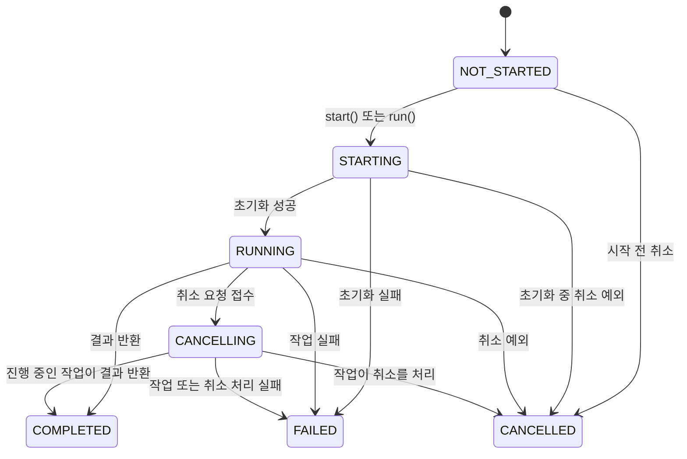
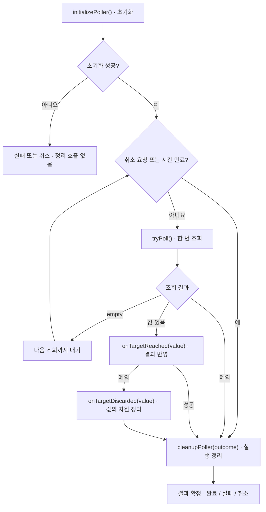
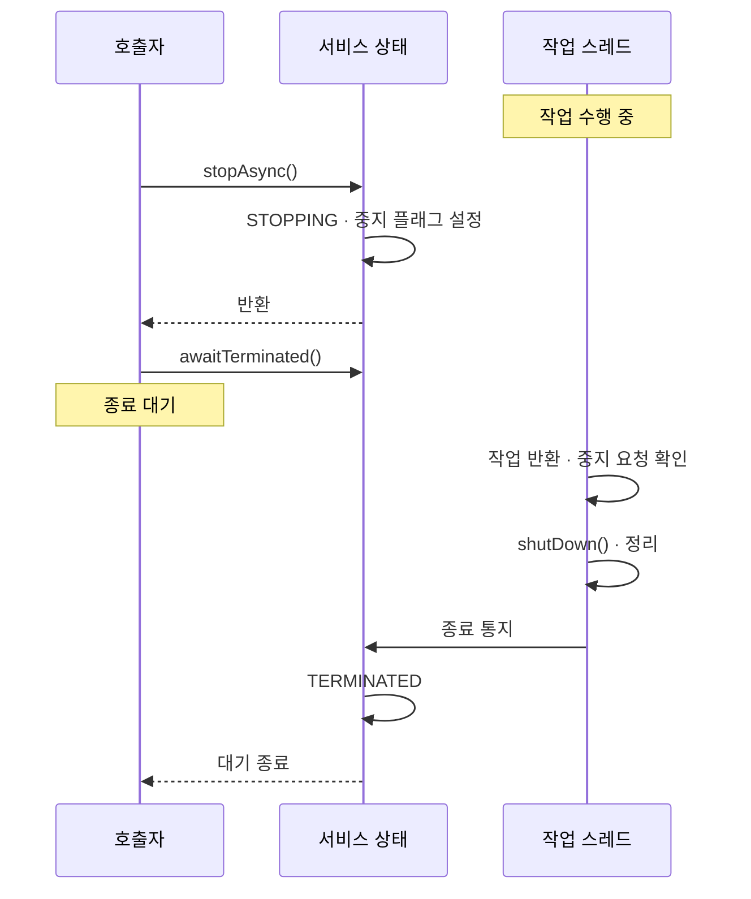

# utils.async 사용 가이드

`utils.async`는 [`Execution<T>`](Execution.java) 인터페이스(Java `Future<T>`의 확장)를 중심으로 비동기 작업의 상태 관리, 리스너, 취소와 제한 시간 처리를 제공한다. 이 문서는 1장에서 패키지 전체를 짧게 소개하고, 2장부터는 시간이 오래 걸리는 작업을 실행하거나 일정한 간격으로 작업을 반복하는 스레드 기반 클래스의 사용법을 자세히 설명한다.

처음 읽는다면 1장의 개요, 2장의 선택 기준, 3장의 실행·결과 처리 방법을 확인한 뒤 필요한 클래스의 장으로 이동하면 된다. 지속적으로 실행할 서비스를 만들 때는 9장부터 읽어도 된다. 10장에는 혼동하기 쉬운 동작, 11장에는 API를 정리했다.

---

## 1. 패키지 개요

### 1.1 `Execution<T>`과 상태

`Execution<T>`은 `Future<T>`에 다음 기능을 더한다.

- 명시적인 상태 `AsyncState`와 `isNotStarted()`/`isRunning()`/`isCompleted()`/`isFailed()`/`isCancelled()` 등의 조회 메서드
- 시작·종료 리스너 (`whenStarted`, `whenFinished` 등, 1.2)
- 상태 대기 (`waitForStarted`, `waitWhileStarting`, `waitForFinished`)와 현재 상태 조회(`poll()`)
- 성공 결과를 변환하는 `map(...)`
- 제한 시간 설정 `setTimeout(long, TimeUnit)` (10.1)

상태는 다음과 같이 바뀐다. 모든 전이 경로는 3.1의 그림에 정리했다.

```
NOT_STARTED → STARTING → RUNNING → COMPLETED
                                 ↘ FAILED
                                 ↘ CANCELLED
                                 ↘ CANCELLING → CANCELLED (또는 COMPLETED, FAILED)
```

상태 전이는 모두 내부 잠금(`EventDrivenExecution`의 `m_aopGuard`)으로 직렬화된다. `notify*` 메서드가 상태를 바꾸면 `signalAll()`로 신호를 보내므로, `waitForStarted()`·`waitForFinished()`로 기다리던 스레드가 깨어난다.

대부분의 구현은 상태 전이 메서드(`notifyStarting()`, `notifyStarted()`, `notifyCompleted()`, `notifyFailed()`, `notifyCancelling()`, `notifyCancelled()`)를 제공하는 [`EventDrivenExecution`](EventDrivenExecution.java)을 상속한다. 이를 기반으로 스레드에서 작업을 수행하는 클래스(2장 이후), `CompletableFuture`를 감싸는 [`CompletableFutureAsyncExecution`](CompletableFutureAsyncExecution.java), Guava `ListenableFuture`를 감싸는 [`ListenableFutureAsyncExecution`](ListenableFutureAsyncExecution.java)이 제공된다.

### 1.2 리스너

| 메서드 | 호출 시점 | 실행 스레드 |
|---|---|---|
| `whenStarted(Runnable)` | `RUNNING`에 도달했을 때 1회 | 상태를 전이시킨 스레드. 내부 잠금을 보유한 채 실행된다 |
| `whenStartedAsync(Runnable)` | 위와 같음 | 별도 스레드 풀 |
| `whenFinished(Consumer<Result<T>>)` | 종료 상태(완료·실패·취소)로 전이할 때 1회 | 상태를 전이시킨 스레드. 내부 잠금을 보유한 채 실행된다 |
| `whenFinishedAsync(Consumer<Result<T>>)` | 위와 같음 | 별도 스레드 풀 |

- 이미 해당 시점이 지난 뒤에 등록하면 리스너가 바로 실행된다. 같은 리스너 인스턴스를 여러 번 등록해도 한 번만 호출된다.
- `RUNNING`에 도달하지 못하고 끝난 실행(시작 전 취소, 초기화 실패 등)에서는 `whenStarted` 리스너가 호출되지 않는다.
- `Async`가 붙지 않은 리스너는 실행의 잠금을 보유한 채 실행되므로 짧게 끝내고, 같은 실행의 다른 메서드를 호출하지 않는다. 오래 걸리거나 블로킹되는 처리는 `whenStartedAsync`/`whenFinishedAsync`를 쓴다.

사용 예는 3.3에 있다.

### 1.3 취소와 제한 시간

취소는 작업이 중단 요청을 확인하고 스스로 끝나는 협력적 방식이다. `cancel(true)`는 실행 중인 작업을 `CANCELLING`으로 바꾸고, 작업이 이를 확인해 종료해야 `CANCELLED`가 된다. 블로킹 호출을 깨워야 하면 [`CancellableWork`](CancellableWork.java)를 구현한다. 자세한 규칙은 3.5와 10.2에 있다.

제한 시간은 두 종류다. 모든 `Execution`의 `setTimeout(long, TimeUnit)`은 만료 시 취소를 요청하고, `PeriodicLoopExecution` 이하의 `setTimeout(Duration)`은 만료 시 `TimeoutException`으로 실패시킨다(6.2, 10.1).

### 1.4 조합 연산자 — `utils.async.op`

여러 실행을 하나의 실행으로 묶는 합성 실행은 [`AsyncExecutions`](op/AsyncExecutions.java)의 정적 팩토리로 만든다.

```java
import utils.async.op.AsyncExecutions;

// 순차 실행: 결과 타입은 Object이며 값은 마지막 element의 결과.
// 중간 element가 실패·취소되면 즉시 FAILED·CANCELLED가 되고 뒤의 element는 시작하지 않는다.
SequentialAsyncExecution seq = AsyncExecutions.sequential(execA, execB, execC);

// 동시 실행: 결과 값은 항상 null. 개별 결과가 필요하면 element를 직접 참조한다.
ConcurrentAsyncExecution par = AsyncExecutions.concurrent(execA, execB);

// 시간 제한: target이 RUNNING이 된 뒤 5초 안에 끝나지 않으면 target을 취소한다.
TimedAsyncExecution<T> timed = AsyncExecutions.timed(exec, Duration.ofSeconds(5));
```

- `concurrent`는 모든 element가 끝나거나(성공·실패·취소 무관), `setElementCompletionCountToComplete(n)`으로 지정한 수만큼 성공하면 `COMPLETED`가 된다. element의 실패·취소는 합성 실행을 실패시키지 않는다. 완료 조건에 도달하면 아직 실행 중인 element는 취소한다.
- `timed`는 시간이 만료되면 target을 취소하고, 합성 실행도 `CANCELLED`로 끝난다(`FAILED`가 아니다). 시간 만료로 취소됐는지는 `isTimedoutCancelled()`로 구분한다.
- `sequential`/`concurrent`는 element의 개별 결과를 노출하지 않는다.
- 이 밖에 `delay`, `backgrounded`, `fold`, `flatMap` 등이 있다. `Execution`에는 `flatMap` 메서드가 없으므로, 앞선 실행의 결과로 다음 실행을 이어 붙일 때는 `AsyncExecutions.flatMap(leader, chain)`을 쓴다.

각 클래스의 계약과 상태 전이 규칙은 Javadoc을 참고한다.

### 1.5 외부 명령 실행 — `utils.async.command`

외부 명령을 하위 프로세스로 실행하는 `CommandExecution`, 명령과 파일·값을 주고받는 `CommandVariable`, 프로세스를 재시작 정책에 따라 유지하는 `ProgramService`는 [`utils.async.command` 사용 가이드](command/README.md)에서 설명한다.

### 1.6 원격 호출로 노출 — `utils.rpc.restful`

`Execution`을 HTTP 원격 연산으로 노출하려면 `RESTfulAsyncRpcServer`를, 원격 연산을 호출하려면 `RESTfulRpcClient`(동기) 또는 `RESTfulAsyncRpcClient`(비동기 폴링)를 사용한다. `RESTfulAsyncRpcClient`는 7장의 `AbstractPeriodicPoller`를 상속한 구현이다. 외부 명령을 그대로 원격 연산으로 제공하는 구현체는 `utils.rpc.restful.process.RESTfulCommandExecutionServer`다. 자세한 내용은 [`utils.rpc.restful` README](../rpc/restful/README.md)를 참고한다.

---

## 2. 스레드 기반 실행 클래스 개요

스레드 기반 클래스를 쓸 때는 먼저 작업의 목적에 따라 `Execution`과 `Service` 중 하나를 선택한다.

- **Execution 계열**은 작업을 끝낸 뒤 결과를 받으려 할 때 사용한다. 다운로드처럼 한 번에 끝나는 작업뿐 아니라, 여러 페이지를 수집하거나 서버가 준비될 때까지 조회하는 작업도 포함한다. `Future`를 확장한 [`Execution`](Execution.java)으로 진행 상태와 결과를 확인한다.
- **Service 계열**은 통계 수집이나 상태 보고처럼 중지 요청이 올 때까지 계속 수행할 작업에 사용한다. 결과값을 반환하지 않으며, Guava `Service`의 `startAsync()`와 `stopAsync()`로 시작과 중지를 요청한다.

본문에서는 하위 클래스가 재정의하여 동작을 추가하는 메서드를 **확장 메서드(hook)**라고 부른다. 반복문에서 작업을 한 번 수행하는 것을 **반복 단계(iteration)**, 목표 상태가 되었는지 주기적으로 조회하는 것을 **폴링(polling)**이라고 부른다.

다루는 클래스는 다음과 같다.

| 계열 | 클래스 |
|---|---|
| Execution | [`AbstractThreadedExecution`](AbstractThreadedExecution.java), [`AbstractLoopExecution`](AbstractLoopExecution.java), [`PeriodicLoopExecution`](PeriodicLoopExecution.java), [`AbstractPeriodicPoller`](AbstractPeriodicPoller.java), [`PeriodicPoller`](PeriodicPoller.java) |
| Service | [`AbstractLoopService`](AbstractLoopService.java), [`PeriodicLoopService`](PeriodicLoopService.java) |

### 2.1 클래스 계층

```
[Execution 계열]
EventDrivenExecution<T>                상태 전이(notifyXxx)와 대기·리스너 제공
 └─ AbstractAsyncExecution<T>          start() + Executor 지정
     └─ AbstractThreadedExecution<T>   ★ 작업 1회를 별도 스레드(또는 호출 스레드)에서 수행
         └─ AbstractLoopExecution<T>   ★ 결과가 나올 때까지 iterate()를 반복
             └─ PeriodicLoopExecution<T>   ★ 반복 사이의 대기 시간과 전체 제한 시간 설정
                 └─ AbstractPeriodicPoller<R>  ★ 목표 상태를 조회하는 데 필요한 확장 메서드 제공
                     └─ PeriodicPoller<T>      ★ 람다와 빌더로 구성하는 폴링

[Service 계열]
Guava AbstractExecutionThreadService   startUp → run → shutDown, startAsync/stopAsync
 └─ AbstractLoopService                ★ 중지 요청 플래그 + 대기 수단
     └─ PeriodicLoopService            ★ 주기 작업 서비스 (빌더 또는 상속)
```

아래로 갈수록 특정 용도에 필요한 기능이 더해진다. 예를 들어 `AbstractLoopExecution`은 반복을 담당하고, `PeriodicLoopExecution`은 여기에 주기와 제한 시간을 추가한다. 일부 상위 메서드는 `final`로 재정의되어 있으므로, 각 클래스에서 제공하는 확장 메서드를 구현해야 한다.

### 2.2 무엇을 써야 하나

| 하고 싶은 일 | 사용할 클래스 | 구현할 것 |
|---|---|---|
| 오래 걸리는 작업 하나를 비동기로 수행 | `AbstractThreadedExecution` | `executeWork()` |
| 결과가 나올 때까지 단계를 반복 (주기 없음) | `AbstractLoopExecution` | `initializeLoop()` / `iterate(long)` / `finalizeLoop()` |
| 일정 주기로 작업을 반복, 제한 시간 적용 | `PeriodicLoopExecution` | `performPeriodicAction(long)` |
| 목표 상태가 될 때까지 주기적으로 조회 (재사용할 클래스로) | `AbstractPeriodicPoller` | `tryPoll()` (필요하면 다른 확장 메서드도 재정의) |
| 별도 클래스를 만들지 않고 목표 상태까지 주기적으로 조회 | `PeriodicPoller` | 조회 람다와 빌더 설정 |
| 중지할 때까지 일정 주기로 작업을 계속 수행 (통계 수집, 상태 보고 등) | `PeriodicLoopService` | 람다 하나 (또는 `performPeriodicAction(long)`) |
| 중지할 때까지 작업별 반복 흐름을 직접 구현 (큐 소비 등) | `AbstractLoopService` | `run()`, `triggerShutdown()` |

3~8장은 Execution 계열, 9장은 Service 계열을 설명한다. 두 계열의 시작·종료 API는 9.1에서 비교한다.

---

## 3. Execution 계열의 실행과 결과 처리

이 장의 실행·대기·취소 방법은 Execution 계열에 공통으로 적용된다. Service 계열의 사용법은 9장에서 설명한다.

### 3.1 상태



그림은 대표적인 상태 변경 경로를 나타낸다. 외부 코드가 `notifyFailed()` 등의 메서드로 종료 상태를 직접 통지하는 경로는 생략했다.

- `STARTING`: 초기화 메서드(`initializeThread()` 등)를 실행하는 구간.
- `RUNNING`: 작업 본문(`executeWork()` 등)이 수행되는 구간.
- `CANCELLING`: 취소가 요청되었지만 작업이 아직 끝나지 않은 구간. 이 상태에서도 작업이 결과를 내면 `COMPLETED`로 끝날 수 있다.

### 3.2 `start()`와 `run()`

| 호출 방법 | 작업을 수행하는 스레드 | 호출이 끝나는 시점 |
|---|---|---|
| `start()` | 새 스레드(기본은 데몬) 또는 `setExecutor(...)`로 지정한 실행기 | 작업을 시작하거나 실행기에 제출한 뒤 반환한다. 결과는 별도로 기다린다. |
| `run()` | 호출한 스레드 | 작업을 마칠 때까지 기다린 뒤 결과를 반환하거나 예외를 던진다. |

둘 중 하나만, 한 번만 호출할 수 있다. 두 번째 호출은 `IllegalStateException`이다.

`Executor`를 지정하면 실제 실행 방식은 그 실행기를 따른다. 예를 들어 호출 스레드에서 작업을 바로 수행하는 실행기를 지정하면 `start()`도 작업이 끝나기 전에는 반환하지 않는다.

아래 예제의 `ApiClient`, `Item`, `Sensor` 등은 사용자가 제공하는 업무용 타입이다. 필요한 import와 보조 메서드는 생략했다.

```java
// 비동기 실행
MyExecution exec = new MyExecution(...);
exec.start();
AsyncResult<Result> r = exec.waitForFinished(30, TimeUnit.SECONDS);   // 또는 exec.get()

// 동기 실행 — 호출 스레드에서 바로 수행
Result value = new MyExecution(...).run();
```

시작 완료를 기다릴 때 `waitForStarted()`는 `RUNNING`에 도달할 때까지만 기다린다. 시작 전 취소나 초기화 실패처럼 `RUNNING`에 도달하지 못하고 끝나면 영원히 대기하므로, 그럴 가능성이 있으면 `waitForStarted(long, TimeUnit)`을 쓰거나 시작 절차(`STARTING`)가 끝날 때까지만 기다리는 `waitWhileStarting()`을 쓴다.

### 3.3 결과 받기

```java
exec.get();                         // 완료 값 반환. 실패 → ExecutionException, 취소 → CancellationException
exec.get(10, TimeUnit.SECONDS);     // 제한 시간 내 대기
AsyncResult<T> r = exec.waitForFinished();   // 작업의 성공·실패·취소를 결과 객체로 받기
if ( r.isCompleted() ) { use(r.getUnchecked()); }
else if ( r.isFailed() ) { log(r.getFailureCause()); }
else if ( r.isCancelled() ) { handleCancellation(); }

exec.whenStarted(() -> log("started"));                       // 리스너 방식
exec.whenFinished(result -> result.ifSuccessful(this::use)
                                  .ifFailed(this::report)
                                  .ifNone(this::handleCancellation)); // 취소
```

리스너의 실행 스레드와 잠금에 관한 주의 사항은 1.2를 참고한다.

> `waitForFinished()`는 **작업 자체의 실패**를 예외로 던지지 않고 결과 객체에 담는다. 다만 기다리는 스레드가 인터럽트되면 `InterruptedException`, 제한 시간을 지정한 대기가 만료되면 `TimeoutException`이 발생할 수 있다. 작업 결과를 확인하지 않으면 생성되지 않은 출력 파일을 읽는 등 후속 코드에서 문제가 드러날 수 있다.

| 필요한 동작 | 사용할 메서드 | 작업이 실패했을 때 |
|---|---|---|
| 성공한 결과값을 바로 사용 | `get()` | `ExecutionException` 발생 |
| 성공·실패·취소를 나누어 처리 | `waitForFinished()` | 반환된 `AsyncResult`에서 원인 확인 |
| 기다리지 않고 현재 상태 확인 | `poll()` | 현재 상태를 담은 `AsyncResult` 반환 |
| 작업 종료 시 후속 처리 등록 | `whenFinished(...)` | 콜백에서 성공·실패·취소 구분 |

`get(10, TimeUnit.SECONDS)`의 10초는 **호출자가 기다리는 시간**이다. 대기가 만료되어도 작업 자체가 취소되지는 않는다. 작업의 제한 시간을 설정하는 방법은 6.2와 10.1에서 설명한다.

### 3.4 예외가 상태로 바뀌는 규칙

작업 본문이나 초기화 메서드가 던진 예외는 다음과 같이 처리한다. 이미 외부에서 종료 상태가 확정된 경우에는 3.6의 규칙을 따른다. 정리 메서드의 예외 처리 방식은 각 클래스의 설명을 참고한다.

| 던진 예외 | 최종 상태 | `run()`이 던지는 예외 |
|---|---|---|
| `InterruptedException`, `CancellationException` | `CANCELLED` | 그 예외 그대로 |
| 그 밖의 `Exception` | `FAILED` (원인은 감싼 예외를 푼 원래 예외) | `ExecutionException` (cause = 원인) |
| `Error` | 상태 전이 없음 | 그대로 전파 |

`ExecutionException` 등으로 감싸서 던져도 실패 원인을 기록할 때 풀리므로, `getFailureCause()`에는 원래 예외가 남는다.

### 3.5 취소

```java
boolean accepted = exec.cancel(true);          // 취소 요청을 접수했는지 확인
AsyncResult<T> outcome = exec.waitForFinished(); // 실제 종료 상태는 별도로 확인
```

취소는 **작업이 중단 요청을 확인하고 스스로 종료하는 방식**으로 동작한다. 이를 협력적 취소라고 한다. 기본 구현의 `cancel(true)`는 작업 스레드를 인터럽트하지 않는다. `true`를 반환해도 실제 취소가 끝났다는 뜻은 아니다.

실행 중인 작업의 취소 요청은 일반적으로 `CANCELLING`으로 상태를 바꾼 뒤 반환한다. 다만 초기화 중이거나 이미 취소를 처리 중이면 상태가 바뀌기를 일정 시간 기다릴 수 있고, `CancellableWork`를 구현했다면 `cancelWork()`가 반환할 때까지 기다린다. 따라서 모든 경우에 즉시 반환하는 메서드는 아니다.

- 작업 본문에서 주기적으로 `isCancelRequested()`를 검사하거나 `checkCancelled()`를 호출한다.
- 블로킹 호출(소켓 읽기, 하위 작업 대기 등)을 깨워야 하면 클래스가 [`CancellableWork`](CancellableWork.java)를 구현한다. `cancel()`이 `CANCELLING` 전이 직후 `cancelWork()`를 호출하므로, 거기서 소켓을 닫거나 하위 작업을 취소한다. `cancelWork()`는 `cancel()`을 호출한 스레드에서 실행되므로 중단 신호만 보내고 바로 반환해야 한다.
- `cancel(false)`는 아직 시작하지 않았거나 `CancellableWork`인 경우에만 효과가 있다.
- `cancelWork()`가 예외를 던지면 그 예외를 원인으로 `FAILED` 전이를 시도한다. 이미 종료 상태가 확정됐다면 기존 결과를 유지한다.

작업 스레드를 인터럽트해서 블로킹을 깨우려면 `cancelWork()`에서 직접 인터럽트한다. 인터럽트로 발생한 `InterruptedException`은 3.4의 규칙에 따라 `CANCELLED`가 된다. 블로킹 대상을 닫는 방식의 예는 4.2에 있다.

```java
class InterruptibleTask extends AbstractThreadedExecution<Void> implements CancellableWork {
	private volatile Thread m_worker;

	@Override
	protected Void executeWork() throws Exception {
		m_worker = Thread.currentThread();
		Thread.sleep(60_000);                   // 인터럽트되면 InterruptedException → CANCELLED
		return null;
	}

	@Override
	public boolean cancelWork() {
		Thread t = m_worker;
		if ( t != null ) {
			t.interrupt();
		}
		return true;
	}
}
```

### 3.6 외부에서 종료가 확정된 경우

`notifyFailed(...)` 등은 `public`이라 작업 밖에서도 실행을 종료시킬 수 있다(`cancelWork()` 실패도 같은 경로다). 이 경우 다음이 보장된다.

- 먼저 확정된 상태가 최종 상태로 유지된다. 작업이 나중에 결과를 내거나 다른 예외로 끝나도 바뀌지 않는다.
- `run()`도 이미 확정된 결과를 따른다. 완료된 경우에는 결과값을 반환하고, 실패한 경우에는 그 원인을 담은 `ExecutionException`을 던진다. 단, `Error`는 상태 변경 없이 그대로 전파한다.
- 반복 실행 계열은 다음 반복 단계를 시작하기 전에 멈춘다(5장).

외부 통지는 상태를 확정할 뿐, 실행 중인 메서드를 강제로 멈추지는 않는다. 따라서 외부 종료가 있는 경우에는 `waitForFinished()`가 반환된 뒤에도 진행 중이던 작업과 정리가 잠시 계속될 수 있다.

---

## 4. `AbstractThreadedExecution` — 작업 하나를 비동기로

### 4.1 확장 메서드

| 확장 메서드 | 필수 | 호출 시점 | 비고 |
|---|---|---|---|
| `executeWork()` | ✔ | `RUNNING`에서 1회 | 반환값이 결과가 된다. |
| `initializeThread()` |  | `STARTING`에서 1회, 작업 스레드에서 | 예외를 던지면 `executeWork()`는 호출되지 않는다. |
| `abortAfterInitialize()` |  | 초기화는 성공했지만 그 사이 외부에서 종료되어 `RUNNING`이 되지 못한 경우 | 초기화에서 확보한 자원을 정리한다. |
| `finalizeThread()` |  | `executeWork()`를 수행한 뒤, 일반적으로 종료 상태가 확정된 후 1회 | `Error`로 작업이 끝나도 호출되지만, 이 경우 종료 상태는 확정되지 않을 수 있다. 일반 예외는 로그만 남는다. |
| `onResultDiscarded(T)` |  | `executeWork()`가 결과를 반환했지만 외부 종료 때문에 `COMPLETED`가 되지 못한 경우 1회 | 결과가 소유한 자원을 정리한다. 예외는 로그만 남는다. |

> 일반적인 완료·실패·취소 경로에서는 `finalizeThread()`가 종료 상태로 전이한 뒤에 호출되므로, `waitForFinished()`로 기다리던 쪽이 `finalizeThread()`보다 먼저 깨어날 수 있다. 정리 완료를 기다려야 하는 자원은 다른 동기화 수단을 쓴다.

### 4.2 예제 — 다운로드

```java
public class DownloadExecution extends AbstractThreadedExecution<Path> implements CancellableWork {
	private final URI m_uri;
	private final Path m_target;
	private volatile InputStream m_input;

	public DownloadExecution(URI uri, Path target) {
		m_uri = uri;
		m_target = target;
		setThreadNamePrefix("download");
	}

	@Override
	protected void initializeThread() throws Exception {
		m_input = m_uri.toURL().openStream();       // 실패하면 FAILED, executeWork()는 호출되지 않음
	}

	@Override
	protected void abortAfterInitialize() {
		IOUtils.closeQuietly(m_input);              // 초기화 직후 외부 종료로 시작하지 못한 경우
	}

	@Override
	protected Path executeWork() throws Exception {
		try {
			Files.copy(m_input, m_target, StandardCopyOption.REPLACE_EXISTING);
			return m_target;
		}
		catch ( IOException e ) {
			if ( isCancelRequested() ) {
				throw new CancellationException("download cancelled");
			}
			throw e;
		}
	}

	@Override
	public boolean cancelWork() {
		IOUtils.closeQuietly(m_input);              // 블로킹 중인 read()를 깨운다
		return true;
	}

	@Override
	protected void finalizeThread() {
		IOUtils.closeQuietly(m_input);
	}
}
```

```java
DownloadExecution dl = new DownloadExecution(uri, path);
dl.setExecutor(ioExecutor);       // 선택: 지정하지 않으면 새 데몬 스레드에서 수행
dl.start();
...
dl.cancel(true);                  // cancelWork()가 스트림을 닫아 read()를 깨운다
```

이 예제는 취소 중 스트림이 닫혀 발생한 `IOException`을 취소로 처리한다. 모든 스트림 구현에서 `close()`가 대기 중인 읽기를 즉시 끝내는 것은 아니므로, 실제 통신 클라이언트의 읽기 제한 시간도 설정해야 한다. 또한 취소 전에 일부 기록된 파일을 지우는 처리는 별도로 구현해야 한다.

### 4.3 기타 설정

| 메서드 | 의미 |
|---|---|
| `setExecutor(Executor)` | `start()` 시 새 스레드 대신 이 `Executor`에 제출한다. 거부되면 `FAILED`가 되고 예외가 `start()` 호출자에게 전파된다. |
| `setDaemonThread(boolean)` | 새 스레드를 만들 때 데몬 여부 (기본 `true`). |
| `setThreadNamePrefix(String)` | 스레드 이름과 `toString()`에 쓰인다. |

---

## 5. `AbstractLoopExecution` — 결과가 나올 때까지 반복

결과가 나올 때까지 `iterate()`를 반복 호출하는 클래스다. 하위 클래스는 초기화, 반복 작업, 정리 메서드를 구현한다.

### 5.1 확장 메서드

| 확장 메서드 | 필수 | 설명 |
|---|---|---|
| `initializeLoop()` | ✔ | 반복 실행 시작 전 1회. 예외를 던지면 `finalizeLoop()`도 호출되지 않으므로 부분 초기화의 정리는 직접 한다. |
| `iterate(long loopIndex)` | ✔ | 한 번의 반복 단계. `FOption.of(값)`을 반환하면 그 값으로 반복 실행이 끝나고, `FOption.empty()`면 다음 반복 단계로 넘어간다. `null`을 반환하면 `IllegalStateException`으로 `FAILED`. |
| `finalizeLoop()` | ✔ | `initializeLoop()`가 성공했다면 종료 사유와 무관하게 1회. 예외는 로그만 남는다. 기존 인터럽트 상태를 지운 채 호출하고, 호출 후 복원한다. |

`finalizeLoop()` 안에서는 `getLoopOutcome()`으로 반복 실행이 어떻게 끝났는지(완료 값, 실패 원인, 취소, 또는 외부에서 확정된 결과)를 알 수 있다. 일반적인 종료 경로에서는 아직 최종 상태가 확정되지 않아 `poll()`로 결과를 얻을 수 없다. 외부에서 이미 종료를 통지했다면 `poll()`에도 그 결과가 나타난다.

### 5.2 반복 실행이 끝나는 조건

다음 반복 단계를 시작하기 직전에 검사한다.

1. 취소 요청(`CANCELLING`)이 있거나 스레드가 인터럽트되었으면 취소 예외를 던져 반복을 끝낸다. 이미 확정된 결과가 없다면 최종 상태는 `CANCELLED`가 된다.
2. 외부에서 이미 종료가 확정되었으면 → 확정된 상태를 유지한 채 종료(`finalizeLoop()`는 호출된다).

따라서 반복 단계 하나가 오래 걸리면 그만큼 종료가 늦어진다. 긴 반복 단계 안에서는 `isCancelRequested()`를 직접 확인하거나, 작업을 잘게 나누거나, `CancellableWork`로 블로킹을 깨운다.

```java
class CountDown extends AbstractLoopExecution<Long> {
	private int m_count;

	@Override
	protected void initializeLoop() {
		m_count = 10;
	}

	@Override
	protected FOption<Long> iterate(long loopIndex) throws InterruptedException {
		if ( isCancelRequested() ) {
			throw new CancellationException();      // 반복 단계 안에서 직접 확인하는 협력적 취소
		}
		Thread.sleep(100);                          // 대기 중 인터럽트되면 InterruptedException → CANCELLED
		return (--m_count <= 0) ? FOption.of(loopIndex) : FOption.empty();
	}

	@Override
	protected void finalizeLoop() { }
}
```

`iterate()`가 선언한 검사 예외(checked exception)는 `InterruptedException`, `TimeoutException`, `ExecutionException`이다. 재정의할 때 `throws Exception`으로 넓힐 수 없으므로, 그 밖의 검사 예외는 `ExecutionException`으로 감싸서 던진다.

### 5.3 예제 — 페이지 단위 수집

```java
public class PageCollector extends AbstractLoopExecution<List<Item>> {
	private final ApiClient m_client;
	private final List<Item> m_items = new ArrayList<>();
	private Cursor m_cursor;

	public PageCollector(ApiClient client) {
		m_client = client;
	}

	@Override
	protected void initializeLoop() throws Exception {
		m_cursor = m_client.openCursor();
	}

	@Override
	protected FOption<List<Item>> iterate(long loopIndex) throws InterruptedException, ExecutionException {
		Page page = m_client.next(m_cursor);         // 한 페이지를 읽은 뒤 다음 단계에서 취소 여부 확인
		m_items.addAll(page.items());
		return page.isLast() ? FOption.of(m_items) : FOption.empty();
	}

	@Override
	protected void finalizeLoop() {
		m_cursor.close();
		AsyncResult<List<Item>> outcome = getLoopOutcome();
		if ( outcome.isFailed() ) {
			getLogger().warn("collection failed after {} items", m_items.size(), outcome.getFailureCause());
		}
	}
}
```

### 5.4 정책 — 취소 요청 중에 결과가 나온 경우

취소 요청 시점에 진행 중이던 반복 단계가 결과를 반환하면 그 결과로 `COMPLETED`가 된다. `cancel(true)`가 `true`를 반환했더라도 최종 상태는 `COMPLETED`일 수 있으므로, 호출자는 최종 상태를 확인해야 한다.

---

## 6. `PeriodicLoopExecution` — 주기와 제한 시간을 정해 반복

반복 단계 사이에 정해진 간격만큼 대기하고, 전체 실행에 제한 시간을 설정하는 클래스다. 하위 클래스는 `iterate()` 대신 `performPeriodicAction(long)`을 구현한다(`iterate()`는 `final`).

### 6.1 주기 모드 — `IntervalMode`

| 모드 | 다음 반복 단계 시작 | 작업 한 번이 주기보다 오래 걸리면 | 적합한 경우 |
|---|---|---|---|
| `FIXED_DELAY` (단일 인자 생성자의 기본값) | 이번 반복 단계가 **끝난** 시점 + 주기 | 그래도 주기만큼 기다린다 | 원격 조회, 재연결 등 연달아 수행되면 안 되는 작업 |
| `FIXED_RATE` | 반복 실행 시작 시점 + 주기 × n | 밀린 만큼 **대기 없이 연달아** 수행한다(catch-up) | 일정한 시작 간격이 필요한 샘플링·보고 |

```java
protected MySampler() {
	super(Duration.ofMillis(100), IntervalMode.FIXED_RATE);
}
```

예를 들어 주기가 100ms이고 작업 한 번에 60ms가 걸린다면 다음과 같이 실행된다. 첫 작업은 0ms에 시작하고, 실행 지연은 없다고 가정한다.

```text
FIXED_RATE   [작업 0~60]  [대기 60~100]  [작업 100~160]  [대기 160~200]  …
FIXED_DELAY  [작업 0~60]  [대기 60~160]  [작업 160~220]  [대기 220~320]  …
```

| 작업 시간 | 모드 | 1~3번째 작업 시작 시점 | 해석 |
|---|---|---|---|
| 60ms | `FIXED_RATE` | 0, 100, 200ms | 작업 시간과 관계없이 정해진 시작 간격을 유지한다 |
| 60ms | `FIXED_DELAY` | 0, 160, 320ms | 작업 후 매번 100ms씩 기다린다 |
| 150ms | `FIXED_RATE` | 0, 150, 300ms | 예정 시각을 이미 지났으므로 대기 없이 다음 작업을 수행한다 |
| 150ms | `FIXED_DELAY` | 0, 250, 500ms | 작업이 오래 걸려도 작업 후 대기 시간은 유지한다 |

`FIXED_RATE`도 작업을 병렬로 실행하지는 않는다. 같은 스레드에서 이전 작업이 끝난 뒤 다음 작업을 수행한다.

### 6.2 제한 시간 — `setTimeout`과 `setDue`

두 메서드는 제한 시간을 계산하는 기준이 다르다. 반복 경계에서 시간 만료를 감지하면 `TimeoutException`으로 `FAILED`가 된다.

| 메서드 | 기준 | 시작이 늦어지면 |
|---|---|---|
| `setTimeout(Duration)` | 반복 실행이 **실제로 시작된 시점**부터의 기간 | 영향 없음 — 지정한 기간 전체를 쓴다 |
| `setDue(Instant)` | 시스템 시계 기준의 **절대 시각** | 그만큼 쓸 수 있는 시간이 준다. 시작 시점에 이미 지났으면 첫 반복 단계 전에 실패 |

- 둘 다 설정하면 `setDue`가 우선한다. `TimeoutException` 메시지에는 실제로 적용된 쪽(`due=` 또는 `timeout=`)이 표시된다.
- 둘 다 시작 전에만 설정할 수 있다.
- 시간 측정은 `PeriodicLoopExecution.initializeLoop()`에서 시작한다. 따라서 그 뒤에 수행하는 폴러 초기화 시간도 제한 시간에 포함되지만, 실행기에 제출된 뒤 작업 시작을 기다린 시간은 `setTimeout(Duration)`에 포함되지 않는다.
- 제한 시간은 진행 중인 작업을 **강제로 중단하지 않는다.** 작업 시작 직전과, 작업이 `FOption.empty()`를 반환하여 반복을 계속하려는 시점에 검사한다. 이미 시작한 작업이 결과값을 반환하면 제한 시간이 지났더라도 그 결과로 완료될 수 있다.
- 원격 호출처럼 오래 걸릴 수 있는 작업에는 `getRemainingTime()`으로 남은 시간을 얻어 개별 요청의 제한 시간으로 전달한다. 이 값이 없으면 전체 제한 시간이 설정되지 않은 것이고, `Duration.ZERO`이면 이미 만료된 것이다.

```java
@Override
protected FOption<Status> performPeriodicAction(long loopIndex)
	throws InterruptedException, TimeoutException, ExecutionException {
	Duration remains = getRemainingTime().getOrElse(Duration.ofSeconds(30));
	if ( remains.isZero() ) {
		throw new TimeoutException("status query deadline reached");
	}
	Status status = m_client.fetchStatus(remains);       // 요청 제한 시간에 남은 시간을 전달
	return status.isReady() ? FOption.of(status) : FOption.empty();
}
```

`performPeriodicAction()`이 선언한 검사 예외(checked exception)는 `InterruptedException`, `TimeoutException`, `ExecutionException`이다. 그 밖의 검사 예외는 `ExecutionException`으로 감싸서 전달한다. `CancellationException`과 다른 실행 시 예외는 별도 선언 없이 던질 수 있다. `AbstractPeriodicPoller`의 확장 메서드는 `throws Exception`을 허용하므로 검사 예외를 직접 던질 수 있다(7.1).

> 주기 계산과 시간 만료 여부 판단에는 시스템 시계 대신 단조 시계(`System.nanoTime()`)를 사용한다. NTP 동기화 등으로 시스템 시계가 앞뒤로 바뀌어도 반복 단계가 몰리거나, 대기가 길어지거나, 제한 시간이 조기에 만료되지 않는다. `getDue()`가 돌려주는 시각은 참고용이다.

### 6.3 확장 메서드 재정의 규칙

`initializeLoop()`/`finalizeLoop()`을 재정의하면 **반드시 `super`를 호출**한다. 특히 `super.initializeLoop()`는 시작 시점과 마감을 계산하므로 빠뜨리면 주기·제한 시간이 동작하지 않는다.

### 6.4 예제 — 일정 시간 동안 샘플 수집

```java
public class SampleCollector extends PeriodicLoopExecution<List<Double>> {
	private final Sensor m_sensor;
	private final int m_count;
	private final List<Double> m_samples = new ArrayList<>();

	public SampleCollector(Sensor sensor, int count) {
		super(Duration.ofMillis(100), IntervalMode.FIXED_RATE);   // 100ms 박자 유지
		m_sensor = sensor;
		m_count = count;
		setTimeout(Duration.ofSeconds(5));
	}

	@Override
	protected FOption<List<Double>> performPeriodicAction(long loopIndex) {
		m_samples.add(m_sensor.read());
		return m_samples.size() >= m_count ? FOption.of(m_samples) : FOption.empty();
	}
}
```

---

## 7. `AbstractPeriodicPoller` — 목표 상태가 될 때까지 조회

목표 상태가 될 때까지 주기적으로 조회하는 작업에 필요한 확장 메서드를 제공한다. 이 클래스는 상위 메서드인 `initializeLoop()`, `finalizeLoop()`, `performPeriodicAction()`을 `final`로 재정의한다. 하위 클래스에서는 다음 메서드를 구현한다.

### 7.1 확장 메서드와 호출 흐름

| 구분 | 확장 메서드 | 필수 | 설명 | 예외가 나면 |
|---|---|---|---|---|
| 초기화 | `initializePoller()` |  | 시작 시 1회 | 실패 또는 취소. 정리 메서드는 호출하지 않음 |
| 조회 | `tryPoll()` | ✔ | 주기마다 반복. `FOption.of(값)`은 목표 도달, `empty()`는 계속 조회 | 실패 또는 취소 |
| 결과 반영 | `onTargetReached(R)` |  | 목표 도달 시 1회. 반환할 결과를 가공하거나 내부 상태에 반영 | **실행 결과도 실패 또는 취소** |
| 결과 폐기 | `onTargetDiscarded(R)` |  | 얻은 값을 결과로 전달하지 못한 경우 그 값의 자원을 정리 | 로그만 기록 |
| 실행 정리 | `cleanupPoller(AsyncResult<R>)` |  | 초기화가 성공했다면 종료 사유와 관계없이 1회. 정리 시점의 결과와 원인을 전달받음 | 로그만 기록 |

다음 그림은 초기화 후 조회를 반복하다가 결과를 반환하는 기본 흐름이다. 외부에서 종료 상태를 확정하는 경로와 결과 폐기는 7.3과 7.5에서 별도로 설명한다.



그림의 취소·시간 검사는 반복 경계에서 이루어진다. 진행 중인 조회가 결과를 반환하면 기존 완료 정책을 따른다(5.4, 6.2).

- `tryPoll()`과 `onTargetReached()`는 `IOException` 같은 검사 예외를 감싸지 않고 직접 던져도 된다. 실패 결과에는 원래 예외가 기록된다.
- 결과 반영이 실패하면 작업도 실패해야 하는 처리(예: 연산 결과를 내부 상태에 반영)는 `cleanupPoller()`가 아니라 **`onTargetReached()`**에서 한다. `cleanupPoller()`의 예외는 결과에 영향을 주지 않는다.
- 목표 상태 값이 `null`이어도 된다(`FOption.of(null)`). `cleanupPoller()`에는 완료로 전달되어 비정상 종료와 구분된다.
- 현재 시도 번호는 `getPollAttempt()`로 얻는다(0부터. 첫 조회 전에는 `-1`).

### 7.2 생성자와 주기

```java
protected MyPoller() {
	super(Duration.ofSeconds(1));                              // FIXED_DELAY (기본)
	// super(Duration.ofSeconds(1), IntervalMode.FIXED_RATE);  // 필요할 때만
}
```

조회는 보통 원격 서버나 장치를 대상으로 하므로, 연속 요청을 피하려면 기본값인 `FIXED_DELAY`가 적합하다. `FIXED_RATE`는 조회가 느려졌을 때 쉬지 않고 연달아 요청하게 된다.

### 7.3 자원을 반환하는 폴러 — `onTargetDiscarded`

`tryPoll()`이 연결 객체처럼 자원을 소유한 값을 반환하면, 그 값이 최종 결과로 전달되지 못하는 경우 **아무도 닫지 않게 된다.** 다음 경우에 `onTargetDiscarded()`가 호출되므로 거기서 닫는다.

- `tryPoll()`이 값을 반환했지만 그 사이 외부에서 실행이 종료되어 `onTargetReached()`가 호출되지 않은 경우
- `onTargetReached()`가 예외를 던진 경우
- `onTargetReached()` 수행 도중 외부에서 종료되어 최종 결과로 사용되지 않은 경우
- 반환할 결과를 정한 뒤, 정리 도중이나 완료 상태로 전이하기 전에 외부에서 종료된 경우

전달하지 못한 결과를 중복해서 폐기하지 않도록 처리한다. 다만 **항상 `cleanupPoller()`보다 먼저 호출되는 것은 아니다.** 정리 도중이나 정리 후에 외부 종료가 확정되어 완료 전이가 실패하면 `cleanupPoller()`가 끝난 뒤에 결과를 폐기한다.

반대로 `tryPoll()` 내부에서 연결에 실패하여 `empty()`를 반환하거나 예외를 던지는 경우에는 프레임워크가 생성된 자원을 알 수 없다. 이때의 정리는 `tryPoll()` 안에서 직접 해야 한다.

최종 결과로 정상 전달된 연결은 호출자가 사용을 마친 뒤 닫는다. `onTargetDiscarded()`는 전달하지 못한 값만 정리한다.

### 7.4 예제 — WebSocket 재연결

```java
public class WebSocketReconnector extends AbstractPeriodicPoller<WebSocketClient> {
	private final Supplier<WebSocketClient> m_clientFactory;

	public WebSocketReconnector(Supplier<WebSocketClient> factory, Duration retryDelay) {
		super(retryDelay);                                   // FIXED_DELAY: 연결 시도가 길어져도 연달아 재시도하지 않음
		m_clientFactory = factory;
	}

	@Override
	protected FOption<WebSocketClient> tryPoll() throws Exception {
		Duration remaining = getRemainingTime().getOrElse(Duration.ofSeconds(5));
		if ( remaining.isZero() ) {
			throw new TimeoutException("reconnection deadline reached");
		}
		// 밀리초 변환으로 0이 되지 않게 하고, 한 번의 연결 시도는 최대 5초로 제한한다.
		long timeoutMillis = Math.max(1L, Math.min(remaining.toMillis(), 5_000L));
		WebSocketClient client = m_clientFactory.get();
		boolean connected = false;
		try {
			connected = client.connectBlocking(timeoutMillis, TimeUnit.MILLISECONDS);
			if ( connected ) {
				return FOption.of(client);
			}
			return FOption.empty();
		}
		finally {
			if ( !connected ) {
				client.close();  // 연결 실패나 인터럽트로 끝난 시도의 자원을 정리
			}
		}
	}

	@Override
	protected void onTargetDiscarded(WebSocketClient client) {
		client.close();                                      // 연결됐지만 결과로 전달되지 못한 클라이언트
	}

	@Override
	protected void cleanupPoller(AsyncResult<WebSocketClient> outcome) {
		if ( !outcome.isCompleted() ) {
			getLogger().warn("reconnection gave up: {}", outcome);
		}
	}
}
```

```java
WebSocketReconnector reconnector = new WebSocketReconnector(factory, Duration.ofSeconds(2));
reconnector.setTimeout(Duration.ofMinutes(1));
WebSocketClient client = reconnector.run();
```

### 7.5 정책 — 결과 반영과 외부 종료가 경합할 때

- 외부에서 이미 종료가 확정되었으면 `onTargetReached()`를 호출하지 않는다.
- `onTargetReached()` 도중 종료가 확정되면 조회한 값을 최종 결과로 사용하지 않는다.
- 단, `onTargetReached()`가 이미 수행한 부수 효과(내부 상태 반영 등)는 되돌리지 않는다. 그러므로 `onTargetReached()`가 반영한 상태는 **실행이 `COMPLETED`로 끝난 것을 확인한 뒤**에 사용한다.
- `CANCELLING`(취소 요청 중)은 종료가 확정된 것이 아니므로, 그 사이 목표에 도달하면 `onTargetReached()`가 호출되고 `COMPLETED`로 끝날 수 있다.
- `cleanupPoller()`가 받는 결과는 정리 시작 시점에 정한 결과다. 정리 도중이나 그 이후에 외부 종료가 확정되면 실제 최종 상태와 달라질 수 있다. 호출자는 정리 메서드의 인자만으로 성공을 판단하지 말고 최종 실행 결과를 확인해야 한다.

---

## 8. `PeriodicPoller` — 람다와 빌더로 폴링 구성

클래스를 따로 만들 필요 없이 조회 함수 하나로 폴러를 만든다.

### 8.1 팩토리

| 팩토리 | 조회 함수 | 종료 조건 | 결과 |
|---|---|---|---|
| `poll(CheckedSupplier<T>)` | `() -> T` | `null`이 아닌 값을 반환하면 종료, `null`이면 계속 | 반환한 값 |
| `poll(CheckedFunction<PollContext, T>)` | `ctx -> T` | 위와 같음 | 반환한 값 |
| `pollUntil(CheckedSupplier<Boolean>)` | `() -> boolean` | `true`가 되면 종료 | 항상 `TRUE` (종료 여부만 의미 있음) |
| `pollWhile(CheckedSupplier<Boolean>)` | `() -> boolean` | `false`가 되면 종료 | 항상 `TRUE` (종료 여부만 의미 있음) |

`PollContext`는 조회 함수 안에서 `attempt()`(현재 시도 번호, 0부터)와 `remainingTime()`(남은 제한 시간)을 제공한다.

> `pollUntil`/`pollWhile`의 결과값은 조건 값이 아니다. 특히 `pollWhile`은 조건이 `false`가 되어 끝나도 결과는 `TRUE`다. 조건 충족 여부는 실행이 `COMPLETED`로 끝났는지로 판단한다(제한 시간 초과는 `FAILED`).

### 8.2 빌더 옵션

| 메서드 | 의미 | 기본값 |
|---|---|---|
| `fixedDelay(Duration)` | 조회가 끝난 시점부터 대기 (`FIXED_DELAY`) | **`fixedDelay(1초)`** |
| `fixedRate(Duration)` | 시작 시점을 기준으로 한 고정 주기 (`FIXED_RATE`, 밀리면 연달아) | |
| `timeout(Duration)` | 실제로 시작된 시점부터의 제한 기간 | 없음 |
| `due(Instant)` | 절대 마감 시각 (`timeout`보다 우선) | 없음 |
| `initializer(CheckedRunnable)` | 시작 시 1회 실행 | 없음 |
| `onDiscarded(CheckedConsumer<T>)` | 결과로 전달되지 못한 값의 정리 (7.3과 같은 조건) | 없음 |
| `cleanup(CheckedConsumer<AsyncResult<T>>)` | 종료 결과를 받는 정리 작업 | 없음 |
| `name(String)` | 스레드 이름 접두사 | `"poller"` |

`fixedRate`와 `fixedDelay`는 나중에 호출한 쪽이 적용된다.

### 8.3 예제

```java
// 1) 상태 대기 — 목표 상태가 되면 그 상태를 결과로
InstanceStatus status = PeriodicPoller.poll(() -> {
								InstanceStatus s = client.getStatus();
								return s == InstanceStatus.RUNNING ? s : null;
							})
							.fixedDelay(Duration.ofSeconds(1))
							.timeout(Duration.ofSeconds(30))
							.build()
							.run();

// 2) 남은 시간을 개별 요청의 제한 시간으로 전달 — PollContext 사용
PeriodicPoller.poll(ctx -> fetchIfReady(ctx.remainingTime().getOrElse(Duration.ofSeconds(10))))
		.timeout(Duration.ofMinutes(1))
		.build()
		.start();

// 3) 연결 획득 — 자원을 반환하므로 onDiscarded 필수
Connection conn = PeriodicPoller.poll(this::tryConnect)       // 실패 시 null
							.fixedDelay(Duration.ofSeconds(2))
							.timeout(Duration.ofMinutes(1))
							.onDiscarded(Connection::close)
							.build()
							.run();

// 4) 조건 대기 — 결과값이 아니라 완료 여부로 판단
PeriodicPoller<Boolean> waiter = PeriodicPoller.pollUntil(() -> Files.exists(readyFile))
							.fixedRate(Duration.ofMillis(300))
							.timeout(Duration.ofSeconds(3))
							.build();
waiter.start();
boolean ready = waiter.waitForFinished().isCompleted();
```

> 조회 함수가 던진 예외는 원래 예외를 실패 원인으로 기록한다. 조회가 일시적으로 실패해도 계속 재시도하려면 조회 함수 안에서 예외를 잡고 `null`을 반환한다.

---

## 9. Service 계열 — 중지할 때까지 계속 실행하는 작업

### 9.1 Execution과 Service의 차이

| | Execution 계열 | Service 계열 |
|---|---|---|
| 수명 | 한 번 실행하고 결과를 남긴다 | 시작한 뒤 **중지할 때까지** 계속 실행한다 |
| 결과 | 완료 값 또는 실패·취소 | 결과값 없음. 실패 원인만 있다 |
| 기반 | `Execution` (`Future` 확장) | Guava `Service` |
| 시작 / 중지 | `start()`·`run()` / `cancel(true)` | `startAsync()` / `stopAsync()` |
| 종료 대기 | `waitForFinished()`, `get()` | `awaitTerminated()` |
| 실패 정보 | `isFailed()` 확인 후 `getFailureCause()` | `FAILED` 상태에서 `failureCause()` |
| 대표 용도 | 목표 상태까지 폴링, 한 번의 수집 작업 | 주기적인 통계 수집, 상태 보고, 큐 소비 |

둘 다 **재시작할 수 없다**. 다시 실행하려면 새 인스턴스를 만든다.

Service의 상태는 Guava 규칙을 따른다. 다음은 주요 경로다.

```
NEW → STARTING → RUNNING → STOPPING → TERMINATED
       │          │          │
       └──────────┴──────────┴────→ FAILED   (초기화·실행·정리 실패)
```

- `STARTING`: `startUp()`(초기화) 수행. 예외가 나면 `FAILED`가 되고 `run()`·`shutDown()`은 호출되지 않는다.
- `RUNNING`: `run()`(반복 실행) 수행.
- `shutDown()`(정리)은 `startUp()`이 성공했다면 정상 중지든 실패든 항상 호출된다.

```java
service.startAsync().awaitRunning();            // 시작하고 RUNNING이 될 때까지 대기
...
service.stopAsync();                            // 중지 요청
try {
	service.awaitTerminated();                  // TERMINATED가 될 때까지 대기
}
catch ( IllegalStateException e ) {
	if ( service.state() == Service.State.FAILED ) {
		log.error("service failed", service.failureCause());
	}
	else {
		throw e;
	}
}
```

> `awaitTerminated()`는 서비스가 `FAILED`로 끝나면 `IllegalStateException`을 던진다. 따라서 실패 여부를 확인하는 코드는 위 예제처럼 예외 처리 안에 둔다. `awaitRunning()`도 초기화 실패 등으로 `RUNNING`에 도달하지 못하면 예외를 던지므로 시작을 요청한 쪽에서 처리한다.

### 9.2 `AbstractLoopService` — 중지 요청을 기다리며 작업 반복

Guava `AbstractExecutionThreadService`에 **중지 요청 플래그**와 그 플래그를 기다리는 수단을 더한 추상 클래스다. 직접 상속해 자신만의 반복 실행을 만들 때 쓴다.

| 멤버 | 설명 |
|---|---|
| `isStopRequested()` | 중지 요청 여부. 잠금 없이 읽으므로 작업 중에 자주 호출해도 된다. |
| `markStopRequested()` | 중지 요청을 기록하고 `m_guard`에서 대기 중인 스레드를 깨운다. |
| `awaitUntilStopRequested()` | 중지 요청이 올 때까지 대기한다. |
| `m_guard` | 중지 요청과 함께 쓰는 [`Guard`](../thread/Guard.java). 제한 시간 있는 대기는 `m_guard.awaitCondition(() -> m_stopRequested, timeout)`. |

하위 클래스의 규칙은 두 가지다.

1. `run()`에서 작업을 반복하며 `isStopRequested()`가 `true`가 되면 반환한다.
2. `triggerShutdown()`에서 `markStopRequested()`를 호출한다. 그래야 `stopAsync()`가 반복 실행을 멈추고, 대기 중인 반복 실행을 깨운다.

```java
public class EventDrainer extends AbstractLoopService {
	private final BlockingQueue<Event> m_queue;

	public EventDrainer(BlockingQueue<Event> queue) {
		m_queue = queue;
	}

	@Override
	protected void run() throws Exception {
		while ( !isStopRequested() ) {
			Event ev = m_queue.poll(500, TimeUnit.MILLISECONDS);   // 주기적으로 깨어나 중지 요청 확인
			if ( ev != null ) {
				handle(ev);
			}
		}
	}

	@Override
	protected void triggerShutdown() {
		markStopRequested();
	}
}
```

> `markStopRequested()`는 플래그만 바꾸고 서비스 상태는 바꾸지 않는다. 외부에서 직접 호출하면 `stopAsync()`를 거치지 않고도 반복 실행이 끝나 `run()`이 반환되고, 서비스는 `TERMINATED`가 된다. 일반적인 중지는 `stopAsync()`를 쓴다.

> `AbstractLoopService`를 직접 상속하면 작업 스레드는 Guava 기본값인 **일반(non-daemon)**이다. 중지하지 않은 서비스가 JVM 종료를 막을 수 있으므로 반드시 `stopAsync()`를 호출하거나, `executor()`를 재정의하여 데몬 스레드를 쓴다(`PeriodicLoopService`는 기본이 데몬).

### 9.3 `PeriodicLoopService` — 주기 작업 서비스

정해진 주기로 작업을 반복하는 `AbstractLoopService` 구현이다. 빌더로 바로 만들거나 상속해서 쓴다.

```java
PeriodicLoopService svc = PeriodicLoopService.builder(() -> collectStatistics())
								.name("stat-collector")
								.fixedRate(Duration.ofSeconds(10))
								.initialDelay(Duration.ofSeconds(3))
								.build();
svc.startAsync().awaitRunning();
...
svc.stopAsync().awaitTerminated();
```

#### 빌더 옵션

| 메서드 | 의미 | 기본값 |
|---|---|---|
| `task(CheckedRunnable)` / `task(CheckedConsumer<LoopContext>)` | 반복할 작업. `builder(task)`로도 지정한다 | 없음 (상속 시 `performPeriodicAction` 재정의) |
| `fixedRate(Duration)` | 시작 시점을 기준으로 한 고정 주기 (`FIXED_RATE`, 밀리면 연달아) | **`fixedRate(1초)`** |
| `fixedDelay(Duration)` | 작업이 끝난 시점부터 대기 (`FIXED_DELAY`) | |
| `initialDelay(Duration)` | 첫 반복 단계 전 대기. `FIXED_RATE`의 기준 시점은 이 지연이 끝난 시점 | 없음 |
| `errorPolicy(ErrorPolicy)` | 작업 실패 시 정책 (아래) | `ErrorPolicy.STOP` |
| `stopOnError(boolean)` | `errorPolicy(STOP)`/`errorPolicy(CONTINUE)`의 간편 별칭 | `true` |
| `initializer(CheckedRunnable)` | 시작 시 1회 (`startUp()`) | 없음 |
| `cleanup(CheckedRunnable)` | 종료 시 1회 (`shutDown()`). 예외는 로그만 남는다 | 없음 |
| `daemon(boolean)` | 작업 스레드의 데몬 여부 | **`true`** |
| `name(String)` | 서비스 이름. 작업 스레드 이름으로도 쓰인다 | `"periodic-service"` |

`fixedRate`와 `fixedDelay`는 나중에 호출한 쪽이 적용된다. `build()`는 작업이 설정되지 않았으면 `IllegalStateException`을 던진다(작업 없이 `performPeriodicAction()`을 재정의하는 하위 클래스는 `build()` 대신 `super(builder)`를 쓴다).

> **기본 주기 모드가 Execution 계열과 다르다.** `PeriodicLoopService`는 일정한 박자가 중요한 서비스 작업을 위해 `FIXED_RATE`가 기본이고, `PeriodicLoopExecution`/폴러 계열은 원격 조회를 위해 `FIXED_DELAY`가 기본이다. 원격을 호출하는 서비스라면 `fixedDelay(...)`를 명시한다. 주기와 초기 지연은 단조 시계로 측정한다.

#### 작업에서 반복 단계 번호와 중지 요청 확인 — `LoopContext`

`stopAsync()`는 중지를 요청하며, 수행 중인 작업을 **강제로 중단하지 않는다**. 서비스는 해당 작업이 반환한 뒤 반복을 멈춘다. 호출자가 종료까지 기다리려면 `awaitTerminated()`를 사용한다. 오래 걸리는 작업은 `LoopContext`를 받는 형태로 작성해 중지 요청을 직접 확인한다.

```java
PeriodicLoopService.builder(ctx -> {
		for ( Item item: fetchBatch() ) {
			if ( ctx.isStopRequested() ) {
				return;                          // stopAsync()에 바로 반응
			}
			process(item);
		}
		if ( ctx.iteration() % 10 == 0 ) {
			fullSync();                          // 첫 작업을 포함해 10번에 한 번 (반복 번호는 0부터)
		}
	})
	.fixedDelay(Duration.ofSeconds(5))
	.build();
```

`builder(() -> ...)`와 `builder(ctx -> ...)`는 람다의 인자 개수로 구분된다.

다음 그림은 실행 중인 `PeriodicLoopService`에 중지를 요청했을 때의 흐름이다. 예제는 작업이 중지 요청을 확인하고 정상적으로 반환하는 경우를 보여 준다.



작업 사이에서 대기 중이라면 중지 요청이 그 대기를 깨운다. 반면 작업 내부의 소켓 읽기나 별도 대기까지 자동으로 해제하지는 않으므로, 오래 걸리는 작업에는 개별 제한 시간이나 중지 요청 확인이 필요하다.

#### 작업이 실패하면 — `ErrorPolicy`

| 정책 | 동작 |
|---|---|
| `ErrorPolicy.STOP` (기본값) | 첫 실패에서 서비스를 `FAILED`로 끝낸다 |
| `ErrorPolicy.CONTINUE` | 실패해도 계속 수행한다 |
| `ErrorPolicy.failAfterConsecutiveFailures(n)` | **연속** `n`회째 실패에서 `FAILED`로 끝낸다. 한 번이라도 성공하면 횟수가 초기화된다 |

오류 정책에 따라 `FAILED`로 끝나면 마지막 작업 예외가 `failureCause()`가 된다. 일시적인 오류는 허용하되 계속되는 장애는 호출자가 감지할 수 있게 하려면 `failAfterConsecutiveFailures(n)`을 쓴다. 이 정책은 반복 작업이 던진 일반 예외(`Exception`)에 적용되며, 초기화 실패나 `Error`에는 적용되지 않는다.

계속 수행하는 동안 같은 경고가 매 반복 단계마다 쌓이지 않도록 로그를 줄인다.

| 시점 | 레벨 |
|---|---|
| 연속 실패의 첫 번째 | `WARN` + 스택 트레이스 |
| 이어지는 실패 | `DEBUG` |
| 연속 10, 100, 1000…회째 | `WARN` 한 줄 ("still failing") |
| 다시 성공 | `INFO` ("recovered after N consecutive failure(s)") |

현재 연속 실패 횟수는 `getConsecutiveFailureCount()`로 모니터링할 수 있다.

#### 인터럽트

반복 작업이나 대기 중에 발생한 인터럽트는 **중지**로 처리한다. 정리까지 정상적으로 마치면 서비스는 `TERMINATED`가 된다. 다음 경우가 해당하며, 초기화 중 발생한 예외에는 이 규칙을 적용하지 않는다.

- 대기 중에 인터럽트된 경우
- 작업이 `InterruptedException` 또는 `RuntimeInterruptedException`을 던진 경우
- 작업이 다른 예외를 던졌지만 그 시점에 작업 스레드의 인터럽트 플래그가 켜져 있는 경우
- 작업이 예외 없이 인터럽트 플래그만 켜고 반환한 경우 — 다음 반복 단계를 시작하기 전에 확인하므로, `FIXED_RATE`에서 밀린 반복 단계를 연달아 실행하는 중이어도 멈춘다

원인 사슬에 `InterruptedException`이 들어 있다는 것만으로는 중지로 보지 않는다(다른 스레드의 작업이 인터럽트된 결과일 수 있다).

기본 `shutDown()`은 빌더의 `cleanup`을 호출하기 전에 **인터럽트 플래그를 지우고**, 정리가 끝나면 플래그를 되돌린다. 따라서 이전 인터럽트 때문에 정리 중의 `sleep()`·`await()`·`join()`이 곧바로 중단되는 것을 막는다. 정리 도중 새로 발생하는 인터럽트까지 막는 것은 아니다.

#### 상속해서 쓰기

```java
class StatCollector extends PeriodicLoopService {
	StatCollector() {
		super("stat-collector", Duration.ofSeconds(10), IntervalMode.FIXED_RATE);
	}

	@Override
	protected void performPeriodicAction(long loopIndex) throws Exception {
		collectStatistics();
	}

	@Override
	protected void startUp() throws Exception { openResources(); }      // 초기화

	@Override
	protected void shutDown() { closeResources(); }                     // 정리
}
```

`super(name, interval, mode)`는 나머지 설정에 기본값을 쓴다. 초기 지연이나 오류 정책 같은 빌더 설정이 필요하면 `super(PeriodicLoopService.builder()....)`처럼 빌더를 넘기는 생성자를 쓴다. `performPeriodicAction()` 안에서는 `isStopRequested()`로 중지 요청을 확인한다.

위 예제처럼 `shutDown()`을 직접 재정의하면 기본 구현의 인터럽트 플래그 처리와 예외 로깅도 대체된다. 이 경우 정리 중 블로킹이나 예외를 어떻게 처리할지 직접 정해야 한다. 기본 처리를 사용하려면 빌더의 `cleanup(...)`으로 정리 작업을 지정한다. 빌더의 초기화·정리를 유지하면서 메서드도 재정의하는 경우에는 `super.startUp()`·`super.shutDown()` 호출을 빠뜨리지 않는다.

#### 조회

`getIterationCount()`(실패한 반복 단계 포함), `getConsecutiveFailureCount()`, `getErrorPolicy()`, `getIntervalMode()`, `getLoopInterval()`, `getInitialDelay()`, `isDaemon()`, `isStopRequested()`.

---

## 10. 자주 혼동하는 동작

### 10.1 이름이 같은 `setTimeout`이 두 개다

| 메서드 | 정의된 곳 | 만료되면 |
|---|---|---|
| `setTimeout(long, TimeUnit)` | 모든 `Execution` | `Timer`가 `cancel(true)`로 취소 요청. 실제 결과는 취소 처리에 따라 달라짐 |
| `setTimeout(Duration)` | `PeriodicLoopExecution` 이하 | **`TimeoutException`으로 `FAILED`** |

반복 실행 계열에서 "시간 안에 목표에 도달하지 못함"을 실패로 다루려면 `setTimeout(Duration)`을 쓴다. 또 `Timer`는 동시에 64개까지만 보관하므로 대량의 실행에 `setTimeout(long, TimeUnit)`을 걸지 않는다.

### 10.2 `cancel(true)`는 즉시 끝내지 않는다

취소 요청이 접수되어도 실제 종료가 완료된 것은 아니다. 최종 결과는 `waitForFinished()`로 확인한다. 반복 작업이나 `executeWork()`가 취소를 확인하지 않으면 끝나지 않을 수도 있다. `cancelWork()`를 구현한 경우에는 그 메서드가 반환하기 전까지 `cancel()` 호출도 끝나지 않는다(3.5).

### 10.3 `waitForFinished()`는 실패를 던지지 않는다

반환된 `AsyncResult`를 확인한다(3.3).

### 10.4 결과 확정과 자원 정리 완료는 구분해야 한다

| 정리 메서드 | 일반적인 완료·실패·취소 경로의 호출 시점 | 결과 확인 방법 |
|---|---|---|
| `finalizeLoop()` | 최종 상태 확정 전 | `getLoopOutcome()` |
| `cleanupPoller(outcome)` | 최종 상태 확정 전 | 전달받은 `outcome` |
| `finalizeThread()` | 최종 상태 확정 후 | `poll()` 등으로 확정된 결과 확인 |
| Service의 `shutDown()` | 초기화 성공 후, `TERMINATED` 또는 `FAILED` 확정 전 | 작업 중 기록한 정보로 정리 |

Execution 계열에서 **외부 코드가 종료를 먼저 통지한 경우**에는 위 순서와 달리 `finalizeLoop()`·`cleanupPoller()`도 상태 확정 후에 실행될 수 있다. 정리 메서드가 받은 결과 역시 정리 도중 외부에서 확정한 최종 결과와 달라질 수 있다. 또한 `Error`가 발생하면 Execution의 종료 상태가 확정되지 않을 수 있다(3.4).

따라서 `waitForFinished()`가 반환됐다는 이유만으로 모든 정리가 끝났다고 판단해서는 안 된다. 특히 `finalizeThread()`나 외부 종료 뒤의 정리까지 기다려야 한다면 별도 완료 신호를 마련한다.

### 10.5 `PeriodicLoopExecution` 확장 메서드 재정의 시 `super` 호출

상위 클래스의 초기화·정리 흐름을 유지하도록 `super`를 호출한다. 특히 `super.initializeLoop()`를 빠뜨리면 시작 시점과 마감이 설정되지 않아 주기·제한 시간이 정상적으로 동작하지 않는다(6.3).

### 10.6 원격 조회에는 `FIXED_DELAY`를 우선 고려한다

`FIXED_RATE`에서는 조회가 주기보다 오래 걸리면 쉬지 않고 연달아 요청한다. 원격 조회와 재연결에서 요청 사이에 대기 시간을 확보하려면 `FIXED_DELAY`를 쓴다.

### 10.7 자원을 반환하는 조회에는 `onTargetDiscarded`/`onDiscarded`

지정하지 않으면 외부 종료 시 연결이 새는 경로가 생긴다(7.3).

### 10.8 Service의 `stopAsync()`는 작업을 중단하지 않는다

수행 중인 작업이 끝나야 반복 실행이 멈춘다. 오래 걸리는 작업은 `LoopContext.isStopRequested()`(빌더) 또는 `isStopRequested()`(상속)를 확인한다(9.3).

### 10.9 `PeriodicLoopService`와 폴러의 기본 주기 모드가 다르다

`PeriodicLoopService`는 `FIXED_RATE`, `PeriodicPoller`·`AbstractPeriodicPoller`·`PeriodicLoopExecution`은 `FIXED_DELAY`가 기본이다. 원격을 호출하는 서비스는 `fixedDelay(...)`를 명시한다.

### 10.10 `AbstractLoopService`를 직접 상속할 때

`triggerShutdown()`에서 `markStopRequested()`를 호출하지 않으면 `stopAsync()`가 반복 실행을 멈추지 못한다. 또 작업 스레드가 일반(non-daemon)이므로 중지하지 않은 서비스가 JVM 종료를 막는다(9.2).

---

## 11. API 요약

| 클래스 | 구현할 확장 메서드 | 주요 설정/조회 |
|---|---|---|
| `AbstractThreadedExecution<T>` | `executeWork()`, (`initializeThread`, `abortAfterInitialize`, `finalizeThread`, `onResultDiscarded`) | `start()`, `run()`, `setExecutor`, `setDaemonThread`, `setThreadNamePrefix` |
| `AbstractLoopExecution<T>` | `initializeLoop()`, `iterate(long)`, `finalizeLoop()` | `getLoopOutcome()` (finalizeLoop 안에서) |
| `PeriodicLoopExecution<T>` | `performPeriodicAction(long)`, (`initializeLoop`/`finalizeLoop` + `super`) | 생성자 `(Duration[, IntervalMode])`, `setTimeout(Duration)`, `setDue(Instant)`, `getRemainingTime()`, `getIntervalMode()`, `getLoopInterval()` |
| `AbstractPeriodicPoller<R>` | `tryPoll()`, (`initializePoller`, `onTargetReached`, `onTargetDiscarded`, `cleanupPoller`) | 생성자 `(Duration[, IntervalMode])`, `getPollAttempt()` |
| `PeriodicPoller<T>` | 없음 (람다) | `poll`, `pollUntil`, `pollWhile`, 빌더(8.2) |
| 공통 (`Execution`) | — | `get`, `waitForFinished`, `poll`, `whenFinished`, `cancel`, `isCancelRequested`, `checkCancelled` |
| `AbstractLoopService` | `run()`, `triggerShutdown()` (+ `startUp`, `shutDown`) | `isStopRequested()`, `markStopRequested()`, `awaitUntilStopRequested()`, `m_guard` |
| `PeriodicLoopService` | 없음 (람다) 또는 `performPeriodicAction(long)` | `builder(...)`, 빌더(9.3), 생성자 `(String, Duration, IntervalMode)`/`(Builder)`, `getIterationCount()`, `getConsecutiveFailureCount()` |
| 공통 (Guava `Service`) | — | `startAsync`, `awaitRunning`, `stopAsync`, `awaitTerminated`, `state`, `failureCause`, `addListener` |

---

## 12. 관련 문서

- [`utils.async.command` 사용 가이드](command/README.md) — 외부 명령 실행, 파일 변수, 프로그램 서비스와 재시작 정책
- [`utils.async` 개발 노트](CLAUDE.md) — 상태 전이, 취소 흐름, 조합 연산자 등 내부 동작
- [`utils.thread` 사용 가이드](../thread/README.md) — `Guard`, `Timer` 등 이 계층이 기반으로 쓰는 동시성 도구
- [Guava `Service` 설명](https://github.com/google/guava/wiki/ServiceExplained) — Service 계열이 따르는 생명주기
- [RESTful RPC 개발 노트](../rpc/restful/CLAUDE.md) — `AbstractPeriodicPoller`의 실제 구현 예인 `RESTfulAsyncRpcClient`
