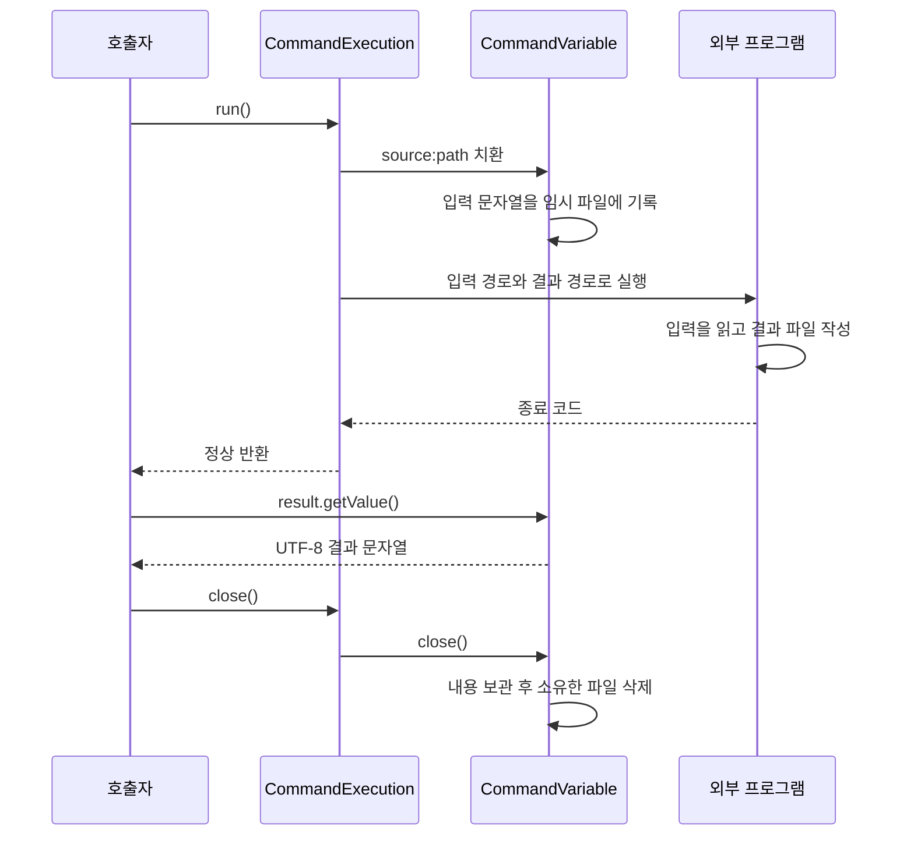
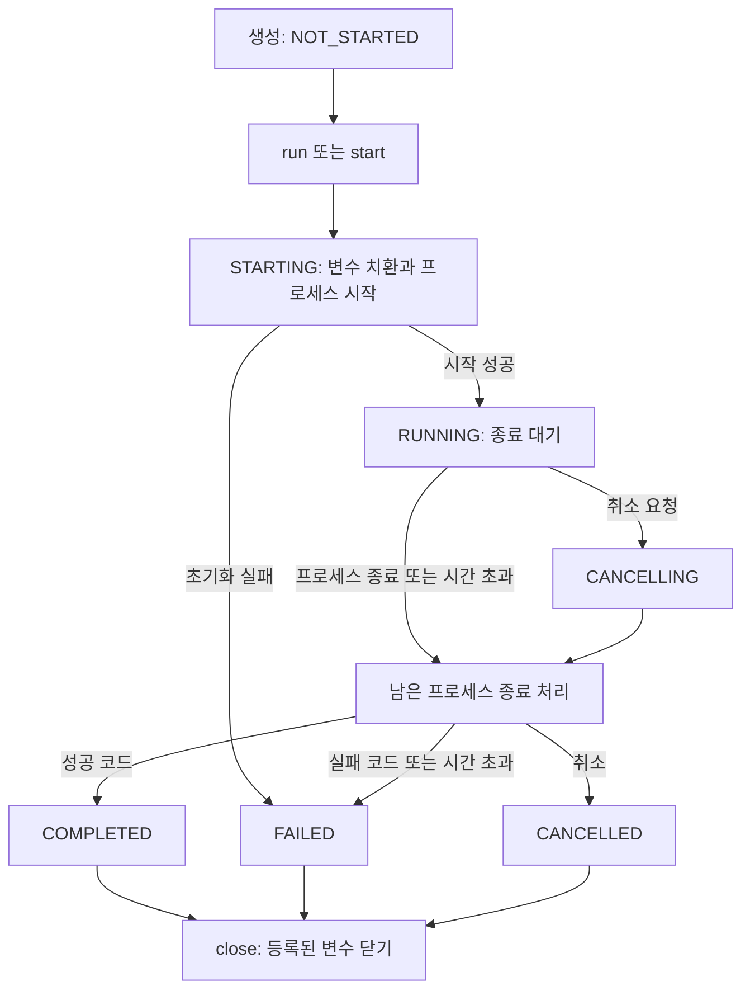
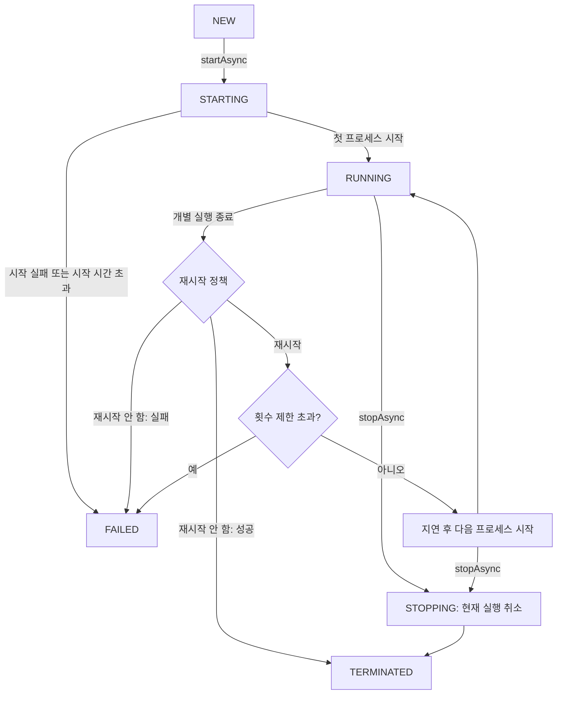

# `utils.async.command` 사용 가이드

`utils.async.command`는 외부 프로그램을 실행하고 종료 결과와 자원을 관리하는 패키지다. 한 번 실행할 작업에는 `CommandExecution`을, 외부 프로그램을 계속 운영하면서 필요할 때 재시작하려면 `ProgramService`를 사용한다. 명령에 전달할 문자열과 파일은 `CommandVariable`로 관리할 수 있다.

이 가이드는 Java 17을 기준으로 단일 명령 실행, 변수와 입출력 설정, 오류 처리, 서비스 운영 방법을 설명한다. 명령 예제는 Linux의 `/bin/echo`, `/bin/sh`, `/usr/bin/python3` 등을 사용하므로 실행 환경에 맞게 경로를 바꾼다. 완전한 클래스 형태가 아닌 Java 예제는 메서드 본문에 넣는 코드이며, import와 호출자에게 전파할 예외 선언은 필요한 부분만 표시했다.

## 1. 클래스 선택

| 클래스 | 역할 | 주로 사용하는 상황 |
|---|---|---|
| [`CommandExecution`](CommandExecution.java) | 외부 명령을 한 번 실행하고 성공·실패·취소를 관리 | 파일 변환, 스크립트 실행, 배치 작업 |
| [`CommandVariable`](CommandVariable.java) | 명령에 전달할 값과 파일 관리 | 문자열 인자 전달, 파일을 통한 입력·결과 교환 |
| [`CommandFailedException`](CommandFailedException.java) | 허용되지 않은 종료 코드와 출력 끝부분 제공 | 명령 실패 원인 확인 |
| [`ProgramService`](ProgramService.java) | 외부 프로그램을 Guava `Service`로 운영 | 서버나 작업 프로세스의 시작·중지·재시작 |
| [`ProgramServiceConfig`](ProgramServiceConfig.java) | 명령, 환경 변수, 재시작 조건 설정 | Java 코드 또는 JSON으로 서비스 구성 |
| [`RestartPolicy`](RestartPolicy.java) | 종료 결과에 따른 재시작 여부 결정 | 실패할 때만 재시작, 항상 재시작 등 |
| [`ServiceShutdownHook`](ServiceShutdownHook.java) | JVM 종료 시 서비스 중지 요청 | 애플리케이션 종료 시 외부 프로그램 정리 |

`CommandExecution`은 `AbstractThreadedExecution<Void>`를 상속하므로 `utils.async`의 실행·결과 조회 API를 사용한다. `ProgramService`는 Guava `Service`의 생명주기를 따른다. 두 클래스는 시작·대기 메서드가 서로 다르다.

| 작업 | `CommandExecution` | `ProgramService` |
|---|---|---|
| 생성 | `builder().addCommand(...).build()` | `create(config)` 또는 `create(configFile)` |
| 시작 | `run()` 또는 `start()` | `startAsync()` |
| 시작 완료 대기 | `waitForStarted()` | `awaitRunning()` |
| 종료 결과 대기 | `get()` 또는 `waitForFinished()` | `awaitTerminated()` |
| 중지 요청 | `cancel(true)` | `stopAsync()` |
| 자원 정리 | `close()` — 등록된 변수도 닫음 | 서비스 중지 및 종료 대기 |
| 다시 실행 | 새 실행 객체 생성 | 종료된 서비스 대신 새 서비스 생성 |

## 2. 명령 한 번 실행하기

### 2.1 현재 스레드에서 실행

`run()`은 현재 스레드에서 프로세스를 시작하고 종료까지 기다린다. 반환형은 `Void`이므로 성공하면 `null`을 반환한다. 출력 문자열은 반환값에 들어 있지 않다.

```java
import utils.async.command.CommandExecution;
import utils.async.command.CommandExecution.Output;

try (CommandExecution exec = CommandExecution.builder()
        .addCommand("/bin/echo", "안녕하세요")
        .stdout(Output.inherit())
        .stderr(Output.inherit())
        .build()) {
    exec.run();
    System.out.println("종료 코드: " + exec.getExitCode().orElseThrow());
}
```

기본 설정은 **표준 입력을 비우고 표준 출력과 표준 오류를 버린다.** 콘솔에서 출력을 확인하려면 위처럼 `inherit()`를 지정한다. `try-with-resources`를 사용하면 정상 완료뿐 아니라 예외가 발생한 경우에도 `close()`가 호출된다.

### 2.2 다른 스레드에서 실행

`start()`는 작업을 비동기로 시작한다. 실행 결과를 사용해야 하는 시점에 `get()`으로 기다린다. `get()` 자체는 실행을 시작하지 않는다.

```java
try (CommandExecution exec = CommandExecution.builder()
        .addCommand("/bin/echo", "비동기 실행")
        .stdout(Output.inherit())
        .build()) {
    exec.start();
    // 이 위치에서 명령과 독립적인 작업을 수행할 수 있다.
    exec.get();
}
```

`start()`는 기본적으로 별도 스레드를 만든다. 실행기를 공유하려면 시작 전에 상속받은 `setExecutor(executor)`를 호출한다. 각 명령은 종료를 기다리는 동안 작업 스레드를 사용하므로, 동시에 실행할 명령 수와 실행기의 크기를 함께 고려한다. 실행기는 호출자가 종료해야 한다.

같은 객체에 `run()`이나 `start()`를 다시 호출할 수는 없다. 반복 실행할 때는 매번 새 객체를 만들거나 `ProgramService`를 사용한다. 비동기 실행 후 곧바로 `try` 블록을 빠져나오면 `close()`가 아직 실행 중인 명령을 취소한다.

### 2.3 명령과 인자는 따로 전달한다

`addCommand()`의 각 원소가 하나의 명령행 인자가 된다. 첫 원소는 실행 파일이며, 공백·따옴표·파이프 기호를 셸 문법으로 해석하지 않는다.

```java
// "hello world"를 하나의 인자로 전달한다. 따옴표 문자를 덧붙이지 않는다.
.addCommand("/bin/echo", "hello world")

// 여러 번 호출하면 기존 목록 뒤에 인자가 추가된다.
.addCommand("/usr/bin/python3", "convert.py")
.addCommand("--format", "json")
```

파이프나 셸 내장 명령이 필요하면 셸을 명시한다. 셸에 전달할 데이터는 스크립트 문자열에 이어 붙이지 말고 별도 인자로 전달한다.

```java
.addCommand("/bin/sh", "-c", "printf '%s\\n' \"$1\"", "sh", "hello world")
```

셸의 `${NAME}` 표기는 이 패키지의 변수 치환과 겹친다. 위 예제처럼 위치 인자 `$1`을 쓰거나, 복잡한 셸 코드를 별도 스크립트 파일에 두면 명령 문자열의 이중 해석을 피할 수 있다.

## 3. 실행 환경과 입출력 설정

### 3.1 빌더 설정 요약

| 메서드 | 기본값 | 동작 |
|---|---|---|
| `addCommand(...)` | 없음, 필수 | 명령행 토큰을 누적 |
| `workingDirectory(File)` | JVM의 현재 작업 디렉터리 | 존재하는 디렉터리만 허용 |
| `environmentVariables(Map)` | 빈 맵 | 자식 프로세스에 전달할 환경 변수. 여러 번 호출하면 마지막 맵으로 대체 |
| `environmentFile(File)` | 없음 | 환경 변수 파일. `null`로 해제 |
| `stdin(Input)` | `Input.none()` | 표준 입력 연결 |
| `stdout(Output)` | `Output.discard()` | 표준 출력 연결 |
| `stderr(Output)` | `Output.discard()` | 표준 오류 연결 |
| `addVariable(CommandVariable)` | 없음 | 명령행 변수 등록. 이름이 중복되면 예외 |
| `addVariableIfAbsent(CommandVariable)` | 없음 | 같은 이름의 변수가 있으면 새 변수를 등록하지 않음 |
| `timeout(Duration)` | `null`, 제한 없음 | 실행 대기 제한 시간. 양수이고 1ms 이상이어야 함 |
| `successExitCodes(int...)` | `0` | 정상 종료로 인정할 코드. 기존 설정을 대체하며 하나 이상 필요 |

빌드 시 명령 목록과 환경 변수 맵은 복사된다. 다만 등록한 `CommandVariable` 객체 자체를 복제하지는 않는다. 파일을 소유하는 변수를 여러 실행 객체에서 공유하면 한 실행의 `close()`가 다른 실행에 필요한 파일을 지울 수 있으므로 실행마다 별도로 만든다.

### 3.2 상대 경로의 기준

| 설정 대상 | 상대 경로를 해석하는 기준 |
|---|---|
| `workingDirectory` 자체 | JVM의 현재 작업 디렉터리 |
| `Input.file`, `Output.file` | 명령의 작업 디렉터리 |
| `environmentFile` | 명령의 작업 디렉터리 |
| `CommandVariable`에 전달한 `File` | JVM의 현재 작업 디렉터리 |
| 명령에 전달한 일반 파일명 인자 | 실행되는 프로그램이 해석. 보통 명령의 작업 디렉터리 |

변수 파일을 작업 디렉터리에 두려면 `new File(workDir.getAbsoluteFile(), "result.json")`처럼 기준 경로를 직접 지정한다. 작업 디렉터리와 출력 파일의 부모 디렉터리는 미리 준비한다. `workingDirectory()`는 디렉터리를 생성하지 않는다.

### 3.3 표준 입력·출력 연결

| 대상 | 선택지 | 의미 |
|---|---|---|
| stdin | `Input.none()` | 빈 입력. 프로그램이 읽으면 EOF에 도달 |
| stdin | `Input.inherit()` | JVM의 표준 입력 상속 |
| stdin | `Input.file(file)` | 파일을 입력으로 사용. 실행 시 일반 파일인지 검사 |
| stdout, stderr | `Output.discard()` | 출력 버림 |
| stdout, stderr | `Output.inherit()` | JVM의 해당 출력 상속 |
| stdout, stderr | `Output.file(file)` | 파일에 기록. 기존 내용은 덮어씀 |
| stdout, stderr | `Output.file(file).append()` | 기존 파일 끝에 이어 씀 |
| stderr만 | `Output.toStdout()` | 표준 오류를 표준 출력에 합침 |

```java
File workDir = Files.createTempDirectory("command-work-").toFile();
File logFile = new File(workDir, "command.log");

try (CommandExecution exec = CommandExecution.builder()
        .addCommand("/bin/sh", "-c", "echo ready; echo diagnostic >&2")
        .workingDirectory(workDir)
        .stdout(Output.file(new File("command.log")).append())
        .stderr(Output.toStdout())
        .build()) {
    exec.run();
}
// 리다이렉션 파일은 exec.close()로 삭제되지 않는다.
System.out.println(Files.readString(logFile.toPath()));
Files.delete(logFile.toPath());
Files.delete(workDir.toPath());
```

이 API는 프로세스의 입출력 스트림을 직접 반환하지 않는다. 작은 텍스트 결과는 파일로 기록한 뒤 읽고, 프로그램이 결과 파일 경로를 인자로 받는다면 `CommandVariable.output()`을 사용할 수 있다. 두 방식은 파일 삭제 책임이 다르다(4.2).

### 3.4 환경 변수의 우선순위

같은 키가 여러 곳에 있으면 다음 순서로 높은 우선순위의 값이 적용된다.


```java
.workingDirectory(workDir)
.environmentFile(new File("worker.env"))
.environmentVariables(Map.of("MODE", "production"))
```

`worker.env`는 다음처럼 작성한다.

```properties
# 빈 줄과 #으로 시작하는 주석은 무시한다.
DATA_DIR=/srv/data
INPUT_DIR=${DATA_DIR}/input
MODE=development
LABEL="example worker"
```

이 경우 `MODE`는 코드에 지정한 `production`이 된다. 파일 안에서는 먼저 정의한 키를 이후 값에서 참조할 수 있고, `${env:HOME}`과 `${sys:user.dir}`도 사용할 수 있다. 단, `environmentVariables` 맵은 파일 내부의 변수 치환에 제공되지 않는다.

환경 파일은 셸 스크립트가 아니다. `KEY=value` 형식으로 작성하고 `=` 양옆에 불필요한 공백을 넣지 않는다. 값 전체를 감싼 큰따옴표는 제거하지만 `export`, 작은따옴표 제거, 셸 명령 실행 같은 기능은 제공하지 않는다.

파일이 없거나 일반 파일이 아니면 해당 설정을 무시한다. 일반 파일을 읽는 중 오류가 나거나 형식이 잘못되면 실행이 실패한다. 반드시 필요한 파일이라면 실행 전에 존재 여부를 별도로 확인한다.

## 4. `CommandVariable`로 값과 파일 전달하기

### 4.1 치환 문법

변수 이름이 `message`, 값이 `hello`라면 치환 결과는 다음과 같다.

| 명령행 표기 | 치환 결과 |
|---|---|
| `${message}` | 변수 이름인 `message` |
| `${message:name}` | 변수 이름인 `message` |
| `${message:value}` | 값인 `hello`. 파일 변수이면 UTF-8로 읽은 내용 |
| `${message:path}` | 파일의 절대 경로. 문자열 변수이면 이때 값을 파일에 기록 |
| `${WORKING_DIR}` | 명령의 작업 디렉터리 절대 경로 |
| `${env:HOME}` | JVM을 실행한 환경의 `HOME` |
| `${sys:user.dir}` | JVM 시스템 프로퍼티 `user.dir` |

**값을 전달하려면 `:value`를 명시한다.** `${message}`는 `${message:value}`의 축약형이 아니다.

```java
try (CommandVariable message = CommandVariable.input("message", "hello world");
     CommandExecution exec = CommandExecution.builder()
         .addCommand("/bin/echo", "${message:value}")
         .addVariable(message)
         .stdout(Output.inherit())
         .build()) {
    exec.run();
}
```

명령행 치환은 두 단계로 진행된다. 먼저 `WORKING_DIR`, `env`, `sys` 등 일반 참조를 처리하고, 다음으로 등록된 명령 변수를 처리한다. 명령 변수로도 해석할 수 없는 참조나 지원하지 않는 수식어가 있으면 프로세스를 시작하기 전에 실패한다. 일반 참조와 겹치지 않도록 `env`, `sys`, `WORKING_DIR` 같은 이름은 명령 변수 이름으로 피하는 편이 좋다.

명령 변수의 값에 들어 있는 `${...}`는 다시 치환하지 않는다. 값에 공백이 있어도 인자가 추가로 분리되지 않는다. 반면 일반 참조 단계는 중첩 치환을 허용한다. `${env:KEY}`는 자식에게 전달할 환경 변수 맵이나 환경 파일의 값을 조회하는 기능이 아니다.

### 4.2 변수 생성과 파일 소유권

| 생성 메서드 | 파일을 다루는 방식 | `close()` 시 삭제 |
|---|---|---|
| `input(name, value)` | 처음에는 문자열만 보관. `:path` 요청 시 임시 파일 생성 | 생성한 임시 파일 삭제 |
| `input(name, value, file)` | `:path` 요청 시 지정 파일을 값으로 덮어씀 | 지정 파일 삭제 |
| `inputFile(name, file)` | 기존 파일을 그대로 사용 | 삭제하지 않음 |
| `inputFile(name, file, true)` | 기존 파일을 그대로 사용. 복사하지 않음 | 지정 파일 삭제 |
| `output(name, file)` | 생성 즉시 기존 파일 삭제. 결과 파일은 실행 프로그램이 작성 | 지정 파일 삭제 |

`input(name, value, file)`은 `:path`로 사용하지 않았더라도 닫을 때 지정 파일을 삭제한다. 보존해야 할 기존 파일에는 `inputFile(name, file)`을 사용한다. `output()`의 경로는 실행별 임시 경로로 준비하면 이전 결과를 지우는 동작이 다른 작업에 영향을 주지 않는다.

`CommandExecution.close()`는 등록된 모든 변수를 닫는다. 변수도 `AutoCloseable`이므로 위 예제처럼 함께 자원으로 선언하면 실행 객체를 빌드하는 중 예외가 발생해도 정리할 수 있다. 중복 `close()` 호출은 허용된다.

`addVariableIfAbsent()`가 등록하지 않은 변수는 실행 객체가 정리하지 않는다. 이 경우에는 호출자가 해당 변수를 닫아야 한다. 등록 여부는 빌더의 `hasVariable(name)`, 등록된 변수는 실행 객체의 `getVariableMap()`으로 확인한다. 반환된 맵은 수정할 수 없다.

### 4.3 파일을 통한 입력과 결과 교환

아래 예제는 입력 문자열을 파일로 전달하고, Python 프로그램이 대문자로 변환한 결과를 다른 파일에 쓰도록 한다. `CommandVariable.output()`은 stdout을 자동으로 연결하지 않으므로 프로그램에 출력 경로를 인자로 전달해야 한다.

```java
import java.nio.file.Files;
import java.nio.file.Path;
import java.time.Duration;
import utils.async.command.CommandVariable;

Path workDir = Files.createTempDirectory("command-data-");
String script = """
        import pathlib, sys
        source = pathlib.Path(sys.argv[1]).read_text(encoding='utf-8')
        pathlib.Path(sys.argv[2]).write_text(source.upper(), encoding='utf-8')
        """;

try {
    try (CommandVariable source = CommandVariable.input("source", "hello");
         CommandVariable result = CommandVariable.output(
             "result", workDir.resolve("result.txt").toFile());
         CommandExecution exec = CommandExecution.builder()
             .addCommand("/usr/bin/python3", "-c", script,
                         "${source:path}", "${result:path}")
             .workingDirectory(workDir.toFile())
             .addVariable(source)
             .addVariable(result)
             .stderr(Output.inherit())
             .timeout(Duration.ofSeconds(10))
             .build()) {
        exec.run();
        String text = result.getValue();
        System.out.println(text);  // HELLO
    }
    // 입력 임시 파일과 result.txt는 닫는 과정에서 삭제된다.
} finally {
    Files.delete(workDir);
}
```



### 4.4 결과를 읽는 시점

파일 모드에서 `getValue()`는 호출할 때마다 파일 전체를 UTF-8로 다시 읽는다. 실행 도중에는 파일이 없거나 내용이 아직 완성되지 않았을 수 있으므로, 보통 성공 완료 후에 읽는다. 바이너리나 큰 결과 파일은 문자열로 읽는 변수 API 대신 별도 파일 처리 방식이 적합하다.

변수를 닫을 때도 파일 내용을 읽어 보관하며, 닫은 뒤의 `getValue()`는 보관한 값을 반환한다. 다만 닫는 과정에서 읽기 오류가 발생해도 `close()`는 이를 호출자에게 전파하지 않는다. 이전에 읽은 값이 있으면 그 값이 남고, 한 번도 읽지 못했다면 닫은 뒤 `getValue()`가 실패한다. 결과가 필요한 작업은 예제처럼 닫기 전에 값을 읽어 성공 여부를 확인한다.

`getFile()`은 현재 연결된 파일을 반환할 뿐 파일을 만들지 않는다. 아직 파일로 바꾸지 않은 문자열 변수이면 `null`이다. 닫은 변수에 `getValueByModifier("path")`를 호출하면 `IllegalStateException`이 발생한다. 결과 파일을 영구 보관하려면 닫기 전에 다른 경로로 복사하거나, 처음부터 호출자가 관리하는 파일 경로를 일반 인자로 전달한다.

## 5. 종료 결과와 오류 처리

### 5.1 성공 여부와 종료 코드

기본적으로 종료 코드 `0`만 성공이다. 다른 코드도 정상 결과를 뜻하는 프로그램은 성공 코드를 지정한다.

```java
try (CommandExecution exec = CommandExecution.builder()
        .addCommand("/usr/bin/grep", "needle", "input.txt")
        .workingDirectory(workDir)
        .successExitCodes(0, 1)
        .stdout(Output.inherit())
        .stderr(Output.inherit())
        .build()) {
    exec.run();
    boolean found = exec.getExitCode().orElseThrow() == 0;
    System.out.println("검색 결과 존재: " + found);
}
```

`getExitCode()`는 `OptionalInt`를 반환한다. 실행 전이거나, 종료 코드를 기록하기 전에 취소·시간 초과가 발생했다면 빈 값이다. 실패 코드로 자연 종료한 경우에는 실제 코드가 남는다.

`CommandFailedException`은 **성공 코드 집합에 포함되지 않은 코드**로 종료했음을 뜻한다. 성공 코드 설정에서 `0`을 제외했다면 종료 코드 `0`도 이 예외의 대상이 될 수 있다.

### 5.2 동기 실행의 예외 처리

일반적인 동기 실행 경로에서는 `run()`이 `CommandFailedException`을 직접 던진다. 실행 제한 시간 초과 등 다른 실패는 원인을 담은 `ExecutionException`으로 전달된다.

```java
try (CommandExecution exec = CommandExecution.builder()
        .addCommand("/bin/sh", "-c", "echo 'conversion failed' >&2; exit 2")
        .workingDirectory(workDir)
        .stderr(Output.file(new File("error.log")))
        .timeout(Duration.ofSeconds(10))
        .build()) {
    try {
        exec.run();
    } catch (CommandFailedException e) {
        System.err.println("명령 종료 코드: " + e.getExitCode());
        String tail = e.getOutputTail();
        // 필요한 경우 tail을 확인한다. 출력에는 민감한 값이 포함될 수 있다.
    } catch (ExecutionException e) {
        if (e.getCause() instanceof TimeoutException) {
            System.err.println("명령 실행 제한 시간을 초과했습니다.");
        } else {
            throw e;
        }
    }
}
```

`CommandFailedException`은 `ExecutionException`의 하위 클래스이므로 먼저 잡는다. 취소는 `CancellationException`, 동기 실행 스레드의 인터럽트는 `InterruptedException`으로 전달될 수 있다. 인터럽트를 상위 호출자에게 전파하지 않고 처리한다면 스레드의 인터럽트 상태를 복원한다.

`getOutputTail()`은 stderr가 파일로 연결되어 있으면 그 파일을, 그렇지 않으면 stdout 파일을 읽는다. 끝부분 최대 4KiB를 UTF-8로 읽어 앞뒤 공백과 잘린 첫 줄을 정리한다. 파일 연결이 없거나 읽을 수 없으면 `null`이다. 이어 쓰는 로그에는 이전 실행의 내용도 섞일 수 있으며, 이 문자열은 예외 메시지에 자동으로 포함되지 않는다.

### 5.3 비동기 실행의 결과 처리

`start()` 이후 `get()`을 사용하면 실패 원인이 `ExecutionException.getCause()`에 들어간다. 따라서 `CommandFailedException`도 원인에서 확인한다. 실패·취소를 예외 대신 상태로 처리하려면 `waitForFinished()`를 사용한다.

```java
exec.start();
AsyncResult<Void> result = exec.waitForFinished();
switch (result.getState()) {
    case COMPLETED -> System.out.println("작업 완료");
    case FAILED -> {
        Throwable cause = result.getFailureCause();
        if (cause instanceof CommandFailedException failure) {
            System.err.println("명령 종료 코드: " + failure.getExitCode());
        } else {
            System.err.println("실행 실패: " + cause);
        }
    }
    case CANCELLED -> System.out.println("작업 취소");
    default -> throw new IllegalStateException("예상하지 못한 상태: " + result);
}
```

`AsyncResult`는 `utils.async.AsyncResult`다. 이 예제의 `exec`도 호출자가 `try-with-resources` 등으로 닫아야 한다. `waitForFinished()`는 실패·취소를 결과에 담지만, 기다리는 스레드의 `InterruptedException`까지 없애 주지는 않는다. 콜백·실행기 등 공통 기능은 [`utils.async` 가이드](../README.md)를 참고한다.

## 6. 제한 시간, 취소, 정리

### 6.1 서로 다른 세 가지 제한 시간

| 설정 또는 호출 | 제한하는 대상 | 시간이 지나면 |
|---|---|---|
| `CommandExecution.Builder.timeout(...)` | 프로세스 시작 후 `executeWork()`의 종료 대기 | 명령이 실패하고 프로세스 종료 처리 수행 |
| `exec.get(5, TimeUnit.SECONDS)` | 호출자가 결과를 기다리는 시간 | 호출자에게 `TimeoutException`. 명령은 계속 실행될 수 있음 |
| `ProgramServiceConfig.setStartTimeout(...)` | 서비스 첫 실행이 `RUNNING`에 이르는 시간 | 서비스가 실패하고 해당 실행의 취소 요청 |

명령의 `timeout`은 실행기 큐 대기나 초기화 전체를 포함하는 제한이 아니다. 종료 처리에도 시간이 필요하므로 메서드의 실제 반환 시각이 지정한 시간보다 늦을 수 있다. 반대로 `get(timeout, unit)`의 시간 초과는 명령 중지 요청이 아니다. 호출자의 대기 종료와 함께 작업도 끝내야 한다면 `cancel(true)` 또는 `close()`로 정리한다.

### 6.2 실행 상태와 정리 순서



그림은 통상적인 실행 경로를 나타낸다. `cancel(true)`는 취소를 요청하는 메서드이며, 반환값만으로 정리가 모두 끝났다고 판단하지 않는다. 완료 상태는 `waitForFinished()`로 확인하고, 등록한 변수까지 정리하려면 `close()`를 호출한다. `cancel()`은 시작 상태를 기다리는 등의 이유로 호출 스레드를 잠시 붙잡을 수 있다.

현재 `close()`는 실행 중이면 취소를 요청하고, 종료 상태가 먼저 확정된 경우에도 남은 프로세스와 작업 스레드의 정리를 기다린 뒤 변수를 닫는다. 다만 자체적인 전체 대기 제한은 없으며, 대기 중 인터럽트되면 인터럽트 상태를 복원하고 변수 정리로 넘어간다. 명령의 시작·종료 콜백 안에서 같은 실행의 `close()`나 종료 대기를 호출하면 자기 작업을 기다리게 될 수 있으므로, 자원 정리는 실행을 소유한 호출자 쪽에서 수행한다.

### 6.3 자식 프로세스 정리의 범위

프로세스 종료에는 `ProcessTree`를 사용한다. 실행 중 발견한 하위 프로세스에도 종료를 요청하고, 약 1초의 유예 시간 안에 끝나지 않으면 강제 종료를 요청한다. 정상 종료한 명령이 남긴 하위 프로세스도 정리 대상이다.

다만 하위 프로세스 조회는 시점별 목록에 기반한다. 부모가 매우 빨리 종료해 다른 부모로 옮겨진 프로세스는 발견하지 못할 수 있고, 강제 종료 요청 후 실제 소멸까지 추가 대기하지 않는다. 따라서 모든 하위 프로세스의 소멸을 보장하는 격리 수단으로 사용해서는 안 된다. 이 패키지로 관리할 프로그램은 백그라운드로 분리하지 않고 직접 실행 상태를 유지하도록 구성하는 것이 좋다.

## 7. `ProgramService`로 외부 프로그램 운영하기

### 7.1 Java 코드로 구성

```java
import java.io.File;
import java.time.Duration;
import java.util.List;
import java.util.Map;
import java.util.concurrent.TimeUnit;
import utils.async.command.ProgramService;
import utils.async.command.ProgramServiceConfig;
import utils.async.command.RestartPolicy;

ProgramServiceConfig config = new ProgramServiceConfig();
config.setCommandLine(List.of("/usr/bin/python3", "worker.py"));
config.setWorkingDirectory(new File("/srv/worker"));
config.setEnvironmentFile(new File("worker.env"));
config.setEnvironments(Map.of("PYTHONUNBUFFERED", "1"));
config.setRestartPolicy(RestartPolicy.ON_FAILED);
config.setStartTimeout(Duration.ofSeconds(30));
config.setRestartDelay(Duration.ofSeconds(5));
config.setMaxRestartDelay(Duration.ofMinutes(1));
config.setStableRunTime(Duration.ofSeconds(10));
config.setRestartLimit(5);
config.setRestartLimitInterval(Duration.ofMinutes(1));

ProgramService service = ProgramService.create(config);
try {
    service.startAsync();
    service.awaitRunning(35, TimeUnit.SECONDS);
    // 여기서 서비스가 필요한 업무를 수행한다.
} finally {
    service.stopAsync();
    service.awaitTerminated(10, TimeUnit.SECONDS);
}
```

예제의 `/srv/worker`와 `worker.py`는 실제로 준비해야 한다. 서비스는 생성 시 설정을 복사하므로 이후 원래 `config`, 명령 목록 또는 환경 변수 맵을 수정해도 다음 재시작에 반영되지 않는다. 설정을 바꾸려면 새 서비스를 만든다.

`awaitRunning()`은 외부 프로세스가 시작됐다는 의미다. HTTP 포트가 열렸거나 데이터 초기화가 끝났다는 뜻은 아니다. 업무를 시작하기 전 준비 확인이 필요하면 별도의 상태 조회를 추가한다. 매우 빨리 끝나는 명령은 호출자가 `awaitRunning()`에서 확인하기 전에 서비스가 종료될 수도 있다. 일회성 작업의 최종 결과가 목적이라면 `CommandExecution`이 더 직접적이다.

서비스가 `FAILED`이면 `awaitRunning()`이나 `awaitTerminated()`는 `IllegalStateException`을 던질 수 있다. 대기 호출 자체의 시간 초과는 `TimeoutException`이며 서비스 중지를 뜻하지 않는다. 실패 원인은 `state()`를 확인한 뒤 `failureCause()`로 조회한다.

`awaitTerminated()`는 서비스 상태만 기다린다. 시작 제한 시간 초과처럼 서비스가 먼저 `FAILED`가 되고 시작 중이던 실행의 취소·프로세스 정리는 그 뒤에 진행되는 경우가 있으므로, `FAILED`라고 해서 자식 프로세스가 정리됐다는 뜻은 아니다. 자식 프로세스가 남지 않았음을 확인해야 하는 종료 경로에서는 `awaitCleanup(Duration)`을 쓴다. 서비스가 종료 상태(`TERMINATED` 또는 `FAILED`)가 되고 마지막 실행의 프로세스 정리까지 끝나면 `true`, 제한 시간 안에 끝나지 않으면 `false`를 반환한다. 중지를 요청하지는 않으므로 먼저 `stopAsync()`를 호출한다. `CommandExecution`에도 같은 의미의 `awaitCleanup(long, TimeUnit)`이 있다. 실행이 종료 상태가 된 뒤에도 작업 쓰레드가 프로세스를 정리하는 중일 수 있기 때문이다.

### 7.2 JSON 설정 파일

```json
{
  "commandLine": ["/usr/bin/python3", "worker.py"],
  "workingDirectory": "/srv/worker",
  "environmentFile": "worker.env",
  "environments": {
    "PYTHONUNBUFFERED": "1"
  },
  "restartPolicy": "on-failed",
  "startTimeout": "30s",
  "restartDelay": "5s",
  "maxRestartDelay": "1m",
  "stableRunTime": "10s",
  "restartLimit": 5,
  "restartLimitInterval": "1m"
}
```

```java
ProgramService service = ProgramService.create(new File("worker-service.json"));
```

JSON의 문자열 값에서는 `${env:HOME}`, `${sys:user.dir}` 같은 참조를 사용할 수 있다. 파일을 먼저 JSON으로 파싱한 뒤 문자열 값을 치환하므로, 치환된 값에 따옴표·역슬래시·줄바꿈이 있어도 JSON 구문이 깨지지 않는다. 객체의 키는 치환하지 않는다.

Java의 시간 설정에는 `Duration`을 사용한다. JSON에서는 `"5s"`, `"1m"`, `"PT5S"` 같은 문자열을 받으며, 시간 값을 JSON으로 직렬화하면 ISO-8601 형식을 사용한다. `workingDirectory`를 상대 경로로 지정하면 설정 파일 위치가 아닌 JVM의 현재 작업 디렉터리가 기준이다.

### 7.3 설정 기본값과 제한

| 항목 | 기본값 | 의미와 제한 |
|---|---|---|
| `commandLine` | 없음 | 비어 있지 않은 명령행 목록 필수 |
| `workingDirectory` | JVM 현재 작업 디렉터리 | 프로세스 작업 디렉터리. `null`이면 기본값 |
| `environmentFile` | 없음 | 환경 변수 파일. 상대 경로는 작업 디렉터리 기준 |
| `environments` | 빈 맵 | 환경 변수 파일보다 우선. `null`이면 빈 맵 |
| `restartPolicy` | `ALWAYS` | `null`이면 기본값 |
| `startTimeout` | 30초 | 첫 실행 시작 제한. 0이면 제한 없음, 음수 불가 |
| `restartDelay` | 5초 | 기본 재시작 지연. 0 허용 |
| `maxRestartDelay` | 1분 | 늘어난 지연의 상한. 기본 지연 이하이면 지연 증가를 사용하지 않음 |
| `stableRunTime` | 10초 | 이 시간보다 짧게 끝난 실행이 연속되면 지연 증가. 0 허용 |
| `restartLimit` | 0 | 구간 내 재시작 허용 횟수. 0이면 제한 없음 |
| `restartLimitInterval` | 1분 | 재시작 횟수를 계산할 최근 시간 구간. 양수 필수 |

시간 항목에 Java `null` 또는 JSON `null`을 주면 해당 기본값을 사용한다. 지연·안정 실행 시간과 재시작 횟수는 음수를 허용하지 않는다.

`ProgramService`는 내부 명령의 실행 시간은 제한하지 않고 성공 코드 `0`을 사용한다. 표준 입력은 비어 있으며, stdout과 stderr는 합쳐서 작업 디렉터리의 **`application.log`에 이어 쓴다.** 출력 경로, 성공 코드, 명령 변수 등록은 현재 서비스 설정 API로 바꿀 수 없다. 실행별 제어가 필요하면 `CommandExecution`을 직접 구성한다.

### 7.4 재시작 정책

아래 표는 첫 시작에 성공한 뒤 개별 실행이 끝났을 때 적용된다.

| 정책 | 성공 종료 | 실패 종료 |
|---|---|---|
| `ALWAYS` | 재시작 | 재시작 |
| `ON_COMPLETED` | 재시작 | 서비스 `FAILED` |
| `ON_FAILED` | 서비스 `TERMINATED` | 재시작 |
| `NO` | 서비스 `TERMINATED` | 서비스 `FAILED` |

JSON에서는 `"ON_FAILED"`와 `"on-failed"`를 모두 허용하며 대소문자를 구분하지 않는다. 다른 정책도 같은 규칙을 따른다.

첫 실행이 프로세스를 시작하지 못하면 정책과 관계없이 서비스가 실패한다. 시작 제한 시간을 넘긴 경우에도 실패하고 취소를 요청하며, 정리가 끝나기 전에 `FAILED`가 관찰될 수 있다. 사용자가 `stopAsync()`로 중지를 요청하면 재시작 정책보다 중지를 우선한다.



그림의 재시작 판단·지연 대기 중에도 서비스 상태는 `RUNNING`이다. 따라서 `isRunning()`만으로 그 순간 자식 프로세스가 살아 있다고 판단할 수는 없다.

### 7.5 재시작 지연과 횟수 제한

프로그램이 반복해서 짧게 실행되고 끝나면 재시작 간격을 늘린다. 성공 종료라도 정책상 재시작 대상이면 같은 규칙이 적용된다. 기본값에서는 10초 미만인 실행을 짧은 실행으로 판단한다.

| 연속으로 짧게 끝난 실행 수 | 다음 실행까지의 지연 — 기본 설정 |
|---|---|
| 1회 | 5초 |
| 2회 | 10초 |
| 3회 | 20초 |
| 4회 | 40초 |
| 5회 이상 | 60초 |
| 한 실행이 10초 이상 유지됨 | 연속 횟수를 초기화하고 5초 |

첫 짧은 실행 뒤에는 `restartDelay`를 사용한다. 두 번째부터는 `max(restartDelay, 1초)`를 기준으로 두 배씩 늘려 `maxRestartDelay`로 제한한다. 따라서 기본 지연을 0으로 지정해도 지연 증가 기능이 켜져 있으면 두 번째 짧은 실행 뒤에는 지연이 생긴다. `maxRestartDelay <= restartDelay`이면 항상 기본 지연을 사용한다.

`restartLimit=5`, `restartLimitInterval=1분`이면 최근 1분 안에 다섯 번의 재시작을 허용하고, 여섯 번째를 예약하려 할 때 서비스가 실패한다. 최초 실행은 횟수에 포함하지 않는다. 횟수는 다음 실행을 준비하는 시점에 기록하므로, 실제 프로세스 시작 완료 횟수와는 다르다. 지연 증가와 횟수 제한은 함께 적용된다.

### 7.6 운영 상태와 로그

| 조회 대상 | 확인할 내용 |
|---|---|
| `state()` | 서비스 생명주기 상태 |
| `failureCause()` | `FAILED` 상태의 원인 |
| `getRestartCount()` | 최초 실행을 제외한 재시작 횟수. 지연 대기 중인 재시작도 포함 |
| `getLastExitCode()` | 가장 최근에 종료 코드를 남긴 실행의 코드. 아직 없으면 빈 `OptionalInt` |
| `application.log` | 외부 프로그램의 stdout과 stderr |

취소된 실행이 종료 코드를 기록하지 않았다면 `getLastExitCode()`에는 이전 실행의 코드가 남는다. 현재 실행의 결과라고 단정하지 않는다.

`application.log`는 재시작 후에도 유지되며 자동 순환·크기 제한 기능은 없다. 장기 운영 시 로그 보관 정책을 별도로 마련하고, 서로 다른 서비스를 같은 작업 디렉터리에서 실행하면 하나의 로그 파일에 출력이 섞일 수 있다는 점을 고려한다.

## 8. JVM 종료 시 서비스 정리

`ServiceShutdownHook.register()`는 JVM 종료 시 `stopAsync()`를 호출하고 서비스 종료를 기다리는 훅을 등록한다. 반환된 `Registration`의 `close()` 또는 `unregister()`는 **훅 등록만 해제하며 서비스를 중지하지 않는다.** 정상 실행 경로에서는 서비스를 직접 중지한다.

```java
import utils.async.command.ServiceShutdownHook;

ProgramService service = ProgramService.create(config);
try (ServiceShutdownHook.Registration registration =
         ServiceShutdownHook.register("worker", service, Duration.ofSeconds(10))) {
    try {
        service.startAsync();
        service.awaitRunning(35, TimeUnit.SECONDS);
        // 서비스가 필요한 업무를 수행한다.
    } finally {
        service.stopAsync();
        service.awaitTerminated(10, TimeUnit.SECONDS);
    }
}
```

훅의 기본 종료 대기 시간은 3초다. 음수는 허용하지 않고 0은 허용한다. 이 시간은 `stopAsync()`를 호출한 뒤의 종료 대기에 적용된다. 대상이 `ProgramService`이면 훅은 `awaitTerminated()` 대신 `awaitCleanup()`으로 자식 프로세스 정리 완료까지 기다리므로, 서비스가 이미 `FAILED`여도 진행 중인 정리를 기다린다. 지정 시간 안에 끝나지 않으면 훅은 경고를 기록하고 대기를 끝낸다. 등록 해제는 여러 번 호출해도 되며, JVM 종료가 이미 진행 중인 경우에는 해제를 시도하다 발생하는 `IllegalStateException`을 무시한다.

훅은 `ProgramService` 외의 Guava `Service`에도 사용할 수 있다. JVM이 훅을 실행할 기회 없이 강제 종료되는 경우까지 정리를 보장하지는 않는다.

## 9. 자주 마주치는 상황

| 증상 | 확인할 내용 |
|---|---|
| 명령은 성공했는데 출력이 보이지 않음 | stdout·stderr 기본값은 `discard()`. 콘솔 또는 파일 연결 지정 |
| 문자열 값 대신 변수 이름이 전달됨 | `${name}` 대신 `${name:value}` 사용 |
| 파일이 예상한 디렉터리에 없음 | 변수 파일은 JVM 기준, 리다이렉션·환경 파일은 명령 작업 디렉터리 기준 |
| 결과 파일이 실행 후 사라짐 | `output()` 변수와 소유권을 가진 입력 변수는 `close()` 시 파일 삭제 |
| 성공 종료했는데 `getValue()`가 실패함 | 종료 코드와 결과 파일 생성은 별개. 프로그램이 지정 경로에 결과를 썼는지 확인 |
| 환경 파일의 값이 적용되지 않음 | 경로·일반 파일 여부와 명시한 환경 변수 맵의 우선순위 확인 |
| `get()` 대기 시간이 지났는데 프로세스가 실행 중 | 결과 대기 시간은 실행 제한이 아님. 빌더 `timeout()` 또는 명시적 취소 사용 |
| `ALWAYS`인데 시작 실패 후 재시작하지 않음 | 첫 시작 실패는 정책과 관계없이 서비스 실패 |
| 서비스가 `RUNNING`인데 요청에 응답하지 않음 | 프로세스 시작과 애플리케이션 준비 완료를 구분. 재시작 지연 중일 수도 있음 |
| 훅 등록을 닫았는데 프로세스가 남아 있음 | `Registration.close()`는 훅만 해제. `stopAsync()`와 종료 대기 필요 |

명령행에 직접 넣은 값은 운영체제의 프로세스 조회나 호출자가 남긴 로그에 노출될 수 있다. 치환 후 전체 명령행은 실행 로그에 기록하지 않지만, 원래 명령행의 리터럴과 `CommandVariable.toString()`에는 값이 들어갈 수 있다. 민감한 데이터는 프로그램이 지원한다면 제한된 권한의 파일로 전달하고, 오류 출력 끝부분을 로그에 남길 때도 내용을 확인한다.

## 10. 관련 코드와 문서

- [`utils.async` 가이드](../README.md) — 실행 상태, 결과 조회, 콜백, 취소의 공통 규칙
- [`utils.thread` 가이드](../../thread/README.md) — 실행기와 스레드 동기화 도구
- [`ProcessTree`](../../ProcessTree.java) — 프로세스와 하위 프로세스의 종료 처리
- [`EnvironmentFileLoader`](../../io/EnvironmentFileLoader.java), [`StrSubstitutor`](../../StrSubstitutor.java) — 환경 파일 읽기와 일반 변수 치환
- [`CommandExecutionTest`](../../../../../test/java/utils/async/command/CommandExecutionTest.java), [`CommandVariableTest`](../../../../../test/java/utils/async/command/CommandVariableTest.java) — 명령 실행·변수 사용 예
- [`ProgramServiceTest`](../../../../../test/java/utils/async/command/ProgramServiceTest.java), [`ProgramServiceConfigTest`](../../../../../test/java/utils/async/command/ProgramServiceConfigTest.java) — 재시작·중지·JSON 설정 사용 예
