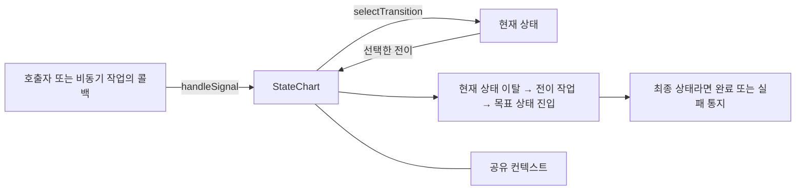
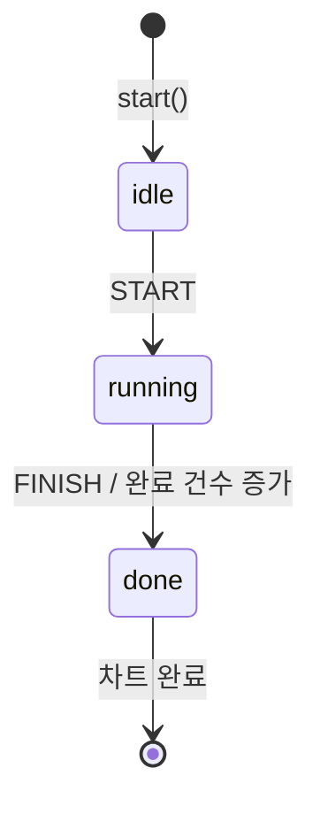
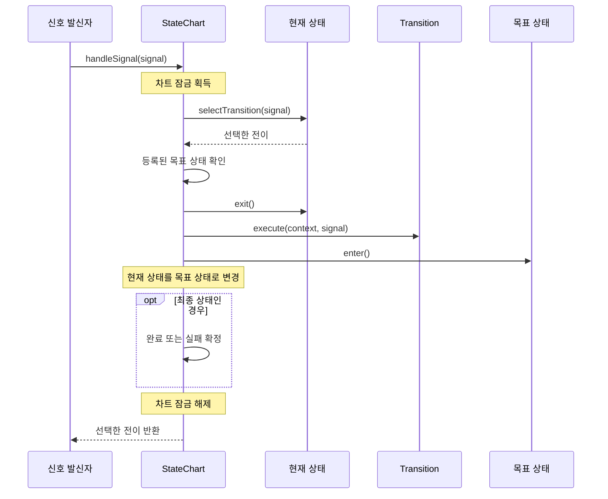

# utils.statechart 사용 가이드

`utils.statechart`는 현재 상태와 입력 신호에 따라 다음 동작을 결정하는 상태 차트 라이브러리다. 연결, 인증, 작업 수행, 종료처럼 단계별로 처리 규칙이 달라지는 작업에 사용할 수 있다. 각 상태는 신호에 맞는 전이를 선택하고, `StateChart`는 선택된 전이에 따라 상태를 옮긴다. 상태 진입·이탈 작업과 전이 중 수행할 작업을 나누어 정의한다.

`StateChart<C>`는 `AbstractAsyncExecution<C>`를 상속하므로 차트 전체의 성공·실패·취소 결과를 `utils.async` API(완료 대기, 결과 조회, 종료 콜백)로 다룬다. 다만 **상태 전이는 신호를 보낸 스레드에서 동기적으로 처리된다.** 신호 처리용 스레드를 따로 만들지 않으며, 신호는 차트의 큐를 거쳐 보낸 순서대로 하나씩 처리된다([6.1절](#61-직렬-처리와-실행-스레드)). 경로로 부모·자식 관계를 정하는 복합 상태(계층 상태)도 지원한다([7장](#7-복합-상태)).

예제는 Java 17 기준이다. 완전한 클래스 형태로 제시한 예제 외에는 import와 업무용 타입을 필요한 부분만 표시했다.

## 1. 구성 요소

| 요소 | 역할 | 주요 타입 |
|---|---|---|
| 컨텍스트 | 여러 상태가 공유하는 업무 데이터와 소속 차트 참조 보관 | [`StateContext<C>`](StateContext.java), [`AbstractStateContext<C>`](AbstractStateContext.java) |
| 차트 | 상태 등록, 신호 전달, 전이 실행, 종료 결과 관리 | [`StateChart<C>`](StateChart.java) |
| 상태 | 진입·이탈 작업을 수행하고 신호에 맞는 전이 선택 | [`State<C>`](State.java) |
| 신호 | 상태에 전달하는 사건이나 요청. 필요한 데이터를 담은 클래스로 구현 | [`Signal`](Signal.java) |
| 전이 | 목표 상태와 이동 중 수행할 작업 지정 | [`Transition<C>`](Transition.java), [`Transitions`](Transitions.java) |
| 전이 작업 | 컨텍스트와 신호를 받아 전이 중 실행하는 작업 | [`TransitionAction<C>`](TransitionAction.java) |



차트의 **업무 상태**와 **실행 상태**는 구분해야 한다. `getCurrentState()`는 `idle`, `running`처럼 사용자가 등록한 상태 객체를 반환한다(복합 상태 안에서는 가장 안쪽 상태). 인자 없는 `getState()`는 차트 전체가 실행 중인지, 완료되었는지 등을 나타내는 `AsyncState`(`RUNNING`, `COMPLETED` 등)를 반환한다.

## 2. 빠른 시작

다음 예제는 `START` 신호로 작업 상태에 들어가고, `FINISH` 신호로 완료 상태에 도달한다. 실제 작업을 실행하는 대신 완료 건수를 컨텍스트에 기록한다.



```java
import utils.statechart.AbstractStateContext;
import utils.statechart.Signal;
import utils.statechart.StateChart;
import utils.statechart.TerminalState;
import utils.statechart.Transitions;
import utils.statechart.TriggeredState;

public class StateChartExample {
    enum JobSignal implements Signal { START, FINISH }

    // 차트 역참조와 그 계약은 AbstractStateContext가 구현한다. 도메인 데이터만 더한다.
    static final class Context extends AbstractStateContext<Context> {
        private int completedCount;
    }

    public static void main(String[] args) throws Exception {
        Context context = new Context();
        StateChart<Context> chart = new StateChart<>(context);
        chart.addState(new TriggeredState<>("idle", context,
                JobSignal.START, Transitions.to("running")));
        chart.addState(new TriggeredState<>("running", context,
                JobSignal.FINISH, Transitions.to("done", (ctx, signal) -> {
                    ctx.completedCount++;
                })));
        chart.addState(new TerminalState<>("done", context));   // TerminalState는 등록하면 자동으로 최종 상태가 된다.
        chart.setInitialState("idle");

        chart.start();
        chart.handleSignal(JobSignal.START);
        chart.handleSignal(JobSignal.FINISH);

        Context result = chart.get();
        System.out.println(chart.getState());       // COMPLETED
        System.out.println(result.completedCount); // 1
    }
}
```

`chart.get()`은 종료까지 기다린 뒤 성공하면 컨텍스트를 반환한다. 실패하면 `ExecutionException`, 취소가 확정되면 `CancellationException`을 던진다. 실패나 취소를 예외 대신 결과 객체로 확인하려면 `waitForFinished()`를 사용한다. `waitForFinished()`는 완료·실패·취소를 담은 `AsyncResult<C>`를 반환하므로, 정상 완료만 기다리는 메서드로 해석해서는 안 된다.

## 3. 상태와 전이 정의

### 3.1 컨텍스트

`StateContext<C>`의 타입 인자에는 구현 클래스 자신을 넣는다(`class Context extends AbstractStateContext<Context>`). 차트와 상태에서 구체적인 컨텍스트 타입을 그대로 사용할 수 있다.

`StateChart` 생성자가 `context.setStateChart(this)`를 호출하므로 사용자가 직접 연결할 필요는 없다. 컨텍스트 구현은 이미 등록한 차트를 다른 차트로 바꾸려는 호출을 `IllegalStateException`으로 거부해야 한다. [`AbstractStateContext`](AbstractStateContext.java)를 상속하면 차트 역참조(`getStateChart()`/`setStateChart()`)와 이 "한 번만 설정" 계약을 직접 구현하지 않아도 된다. `StateContext`를 직접 구현해도 된다. 차트를 다시 실행하려면 차트와 컨텍스트를 새로 만든다.

업무 데이터는 컨텍스트에 추가할 수 있다. 다만 차트 내부 잠금이 외부 코드의 필드 접근까지 보호하지는 않는다. 실행 중 바뀌는 값은 신호를 통해 변경하거나 별도 동기화 규칙을 정한다.

### 3.2 상태의 세 가지 역할

| 메서드 | 호출 시점 | 구현할 내용 |
|---|---|---|
| `enter()` | 상태에 진입할 때 | 비동기 작업 시작, 타이머 등록 등 |
| `selectTransition(signal)` | 현재 상태에 신호가 전달될 때 | 신호를 처리할 전이 선택 |
| `exit()` | 다른 상태로 이동하거나 취소·실패로 정리될 때 | 해당 상태에서 시작한 작업 정리 |

`enter()`와 `exit()`의 기본 구현은 아무 일도 하지 않는다. `selectTransition()`은 전이 후보만 반환하도록 작성하고, 데이터 변경이나 외부 호출은 전이 작업에 둔다. 처리하지 않는 신호에는 `Optional.empty()`를 반환한다.

진입·진출 작업이 있는 사용자 상태는 보통 [`AbstractState<C>`](AbstractState.java)를 상속한다. 이 클래스는 경로와 컨텍스트를 보관하고, 신호별 전이를 등록하는 전이 표([3.4절](#34-신호별-전이-등록-on))를 갖고 있다.

```java
// JobContext는 AbstractStateContext<JobContext>를 상속한 컨텍스트다.
record JobFinished(String output) implements Signal { }

class RunningState extends AbstractState<JobContext> {
    RunningState(JobContext context) {
        super("running", context);
        // 신호별 전이를 표로 등록한다. selectTransition()을 재정의하지 않으면 이 표에서 전이를 고른다.
        on(JobFinished.class, finished -> Transitions.to("done",
                (ctx, ignored) -> ctx.setOutput(finished.output())));
    }
}
```

### 3.3 제공되는 상태 타입

| 타입 | 적합한 용도 | 사용할 때 확인할 점 |
|---|---|---|
| [`DefaultState`](DefaultState.java) | 신호별 전이만 등록하는 일반 상태 | 하위 클래스 없이 `new DefaultState<>(path, ctx).on(...)`. `enter()`·`exit()`는 아무 일도 하지 않음 |
| [`AbstractState`](AbstractState.java) | 진입·진출 작업이 있거나 전이를 직접 계산하는 상태 | `on(...)`으로 신호별 전이를 등록하거나 `selectTransition()`을 재정의. 필요에 따라 `enter()`·`exit()` 재정의 |
| [`TriggeredState`](TriggeredState.java) | 지정한 trigger 신호에 반응하는 상태 | 등록한 신호와 `equals()`로 비교. 고정 전이나 `Supplier<Transition<C>>` 지정 가능. 다른 신호는 `on(...)`으로 추가 |
| [`TerminalState`](TerminalState.java) | 더 이상 나가지 않는 정상 종료 상태 | `exit()`·`selectTransition()`·`on(...)`은 `UnsupportedOperationException`. 등록하면 자동으로 최종 상태 |
| [`FailureState`](FailureState.java) | 실패 원인을 보관하는 종료 상태 | 진입 전 실패 원인 설정(`Transitions.fail`, [5.3절](#53-실패-원인을-상태에-전달)). 등록하면 자동으로 최종 상태 |
| [`DefaultCompositeState`](DefaultCompositeState.java) | 하위 상태들을 묶는 복합 상태 | 생성자로 최초 하위 상태 경로 지정. 공통 전이는 `on(...)`으로 등록([7장](#7-복합-상태)) |

`TriggeredState`는 신호의 타입만 비교하지 않는다. 신호에는 enum이나 값 비교를 구현한 record를 쓰기 편하다. `equals()`를 재정의하지 않은 일반 클래스는 같은 내용으로 새 객체를 만들어도 등록한 것과 **같은 인스턴스**가 아니면 일치하지 않는다. trigger가 아닌 신호는 `on(...)`으로 추가 등록한 전이 표에 맡긴다.

`TerminalState`(`FailureState` 포함)는 빠져나올 수 없는 상태이므로 `addState()`하면 자동으로 최종 상태가 된다. `addFinalState()`는 일반 상태를 최종 상태로 쓸 때만 호출하며, `TerminalState`에 호출해도 무방하다. 종료 상태는 신호를 받지 않으므로 `on(...)`을 부르면 `UnsupportedOperationException`이다.

### 3.4 신호별 전이 등록 (`on`)

`AbstractState`(와 그 구현인 `DefaultState`, `DefaultCompositeState`, `TriggeredState`)는 신호와 전이의 짝을 등록하는 전이 표([`TransitionTable`](TransitionTable.java))를 갖고 있다. `selectTransition()`을 재정의하지 않으면 이 표에서 전이를 고른다.

```java
chart.addState(new DefaultState<>("/Idle", ctx)
        .on(JobSignal.START, Transitions.to("/Busy"))                              // equals로 같은 신호
        .on(Shutdown.class, Transitions.to("/Done"))                               // 타입(하위 타입 포함)
        .on(Progress.class, p -> p.percent() >= 100, Transitions.to("/Done"))      // 조건(guard)을 만족할 때
        .on(JobFailed.class, sig -> Transitions.fail("/Error", s -> sig.cause())));  // 신호로 전이를 만듦
```

| 등록 방법 | 반응하는 신호 |
|---|---|
| `on(signal, transition)` | 등록한 신호와 `equals()`로 같은 신호 |
| `on(SignalType.class, transition)` | 그 타입(하위 타입 포함)의 신호 |
| `on(SignalType.class, guard, transition)` | 그 타입의 신호 중 조건을 만족하는 신호. 만족하지 않으면 다음 항목 |
| `on(SignalType.class, sig -> transition)` | 그 타입의 신호. 함수가 `null`을 반환하면 다음 항목 |

항목은 등록한 순서대로 확인하고 처음 맞는 항목이 이긴다. 조건부 전이는 함수형 항목보다 조건(guard) 항목으로 쓰는 것이 의도가 잘 드러난다. `selectTransition()`을 재정의하면 표는 쓰이지 않으므로, 둘을 섞으려면 재정의한 메서드에서 `super.selectTransition(signal)`을 호출한다. `AbstractState`가 아닌 상태에서는 `TransitionTable`을 필드로 두고 `select(signal)`을 호출한다.

### 3.5 전이 생성 방법

| 호출 | 상태 이동 | 전이 작업 | `exit()`·`enter()` |
|---|---|---|---|
| `Transitions.to("next", action)` | `next`로 이동 | 실행 | 호출 |
| `Transitions.to("next")` | `next`로 이동 | 없음 | 호출 |
| `Transitions.internal(action)` | 현재 상태 유지 | 실행 | 호출하지 않음 |
| `Transitions.stay()` | 현재 상태 유지 | 없음 | 호출하지 않음 |
| `Transitions.fail("error", signal -> cause)` | `error`(`FailureState`)로 이동 | 원인을 계산해 목표 상태에 설정 | 호출 |

2026-10-31 이전 이름은 `Transitions.create(path, action)`과 `Transitions.noop(path)`였으며 지금은 삭제되었다. 특히 `noop`은 "아무것도 하지 않는다"로 읽히지만 실제로는 상태를 이동해서 이름을 바꿨다.

`internal()`과 `stay()`는 목표 경로가 없는 **내부 전이**다. 차트는 `exit()`·`enter()` 없이 `Transition.execute()`만 호출하며, `stay()`의 `execute()`는 아무 일도 하지 않는다. 사용자 정의 전이에서 목표를 `Optional.empty()`로 반환해도 같은 규칙이 적용된다. 내부 전이의 작업이 예외를 던지면 다른 전이처럼 차트가 실패한다. 최종 상태 판정은 하지 않는다.

```java
// 진행 보고를 받을 때마다 상태는 그대로 두고 진행률만 갱신한다.
if (signal instanceof Progress progress) {
    return Optional.of(Transitions.internal((ctx, sig) -> ctx.setProgress(progress.percent())));
}
```

반면 현재 상태의 경로를 목표로 명시하면(UML의 자기 전이, self-transition) `exit()` → 전이 작업 → `enter()`를 모두 수행한다. 예를 들어 `running`에서 `Transitions.to("running")`을 선택하면 같은 상태의 `exit()`와 `enter()`를 다시 호출한다. **현재 상태로 다시 진입하는 전이와 내부 전이는 다르다.** 전이가 내부 전이인지는 `Transition.isInternal()`로 확인한다(예전 이름 `isSelfTransition()`은 UML 용어와 뜻이 반대여서 이름을 바꿨고 삭제되었다).

신호를 무시하는 `Optional.empty()`와 달리 `Optional.of(Transitions.stay())`는 전이를 선택한 결과로 반환되므로, 바깥쪽 복합 상태나 하위 클래스의 기본 신호 처리(`onUnhandledSignal()`)로 넘어가지 않는다.

## 4. 구성과 실행 순서

### 4.1 시작 전 구성

차트를 만들 때는 다음 순서를 따른다.

1. 컨텍스트와 차트를 만든다.
2. `addState()`로 모든 상태를 등록한다.
3. `setInitialState()`로 초기 상태를 지정한다.
4. 최종 상태를 하나 이상 둔다. `TerminalState`·`FailureState`는 등록하면 자동으로 최종 상태가 되고, 일반 상태는 `addFinalState()`로 지정한다.
5. `start()`를 한 번 호출한다.

초기 상태는 최종 상태일 수 없다. `addState()`, `setInitialState()`, `addFinalState()`는 시작 전에만 호출할 수 있다. 이 메서드들과 `start()`의 구성 검사는 같은 차트 잠금 안에서 실행되므로, 구성한 스레드와 시작하는 스레드가 달라도 된다. 다만 구성을 모두 마친 뒤 시작해야 한다. 구성 도중 다른 스레드가 시작하면 덜 된 구성으로 검사된다. 등록되지 않은 경로를 초기·최종 상태로 지정하면 예외가 발생하므로 상태 등록을 먼저 마친다.

`addState()`는 다음 상태를 `IllegalArgumentException`으로 거부한다.

- 같은 경로가 이미 등록된 상태. 처음 등록한 상태를 유지한다(덮어쓰기를 허용하면 이미 지정한 초기·최종 상태가 이전 객체를 계속 가리키기 때문이다).
- 경로 형식이 잘못된 상태(빈 경로, `/`로 끝나는 경로, 빈 구간 `//`가 있는 경로. [7.1절](#71-계층-구성)).
- 차트와 다른 컨텍스트로 만든 상태. 상태 콜백은 `state.getContext()`를, 전이 작업은 차트의 컨텍스트를 쓰므로 둘이 다르면 서로 다른 데이터를 보게 된다.

등록된 상태를 경로로 찾을 때는 `findState(path)`를 쓴다. 결과는 `Optional`이며, 인자 없는 `getState()`(차트의 실행 상태)와 구분하려고 이름을 따로 두었다. 예전 `getState(path)`는 삭제되었다.

### 4.2 전이 처리 순서

다음 그림은 목표 경로가 있는 전이가 정상적으로 실행되는 순서다.



전이가 없으면 아무것도 하지 않고, 내부 전이(`internal()`·`stay()`)이면 이동 없이 전이 작업만 수행한다. 복합 상태 안에 있으면 전이 선택과 진출·진입이 여러 상태에 걸쳐 일어난다([7.2절](#72-진입진출과-신호-처리-순서)).

신호를 보내는 메서드는 세 가지다.

| 메서드 | 반환 | 용도 |
|---|---|---|
| `handleSignal(signal)` | 선택된 전이 `Optional<Transition>` | 처리 결과 종류를 구분할 필요가 없는 일반적인 경우 |
| `processSignal(signal)` | [`SignalResult`](SignalResult.java) | 처리 결과 종류를 구분해야 하는 경우 |
| `postSignal(signal)` | `CompletableFuture<SignalResult>` | 다른 신호 처리를 기다리지 않고 순서만 지켜 보내는 경우(수신 스레드, 비동기 작업 콜백) |

`SignalResult.status()`는 다음 중 하나다.

| 상태 | 의미 |
|---|---|
| `TRANSITIONED` | 전이를 선택해 예외 없이 수행했다. `internal()`·`stay()` 선택도 포함한다. 최종 상태(`FailureState` 포함)에 도달해 차트가 끝난 경우와, 콜백 안에서 종료가 요청되어 전이가 중간에 멈춘 경우도 이 값이다. |
| `FAILED` | 전이를 선택했지만 수행 중(`exit()`, 전이 작업, `enter()`) 예외가 나서 차트가 실패했다. 원인은 차트 결과로 확인한다. (2026-10-31 이전에는 이 경우도 `TRANSITIONED`였다.) |
| `UNHANDLED` | 차트는 실행 중이었지만 어떤 상태도 전이를 선택하지 않았다. 이때 하위 클래스의 `onUnhandledSignal(signal)`이 호출된다. |
| `IGNORED` | 처리할 때 차트가 `RUNNING`이 아니어서(시작 전, 취소 중, 종료 후) 신호를 버렸다. `selectTransition()` 안에서 종료가 요청되어 선택한 전이를 수행하지 않은 경우도 이 값이다. |
| `QUEUED` | 상태 콜백 안처럼 다른 신호를 처리하는 중에 같은 스레드가 보낸 신호라서, 현재 처리가 끝난 뒤 처리하도록 큐에 넣었다. `processSignal()`만 반환한다. |

`handleSignal()`은 `TRANSITIONED`·`FAILED`일 때 선택된 전이를 반환하고 나머지는 모두 `Optional.empty()`다. 따라서 반환값은 **전이 선택 여부**이며 성공적인 이동을 보장하지 않는다. 버렸는지, 처리할 전이가 없었는지, 실패했는지 구분하려면 `processSignal()`을 사용한다.

```java
SignalResult<JobContext> result = chart.processSignal(signal);
switch ( result.status() ) {
    case TRANSITIONED -> { }                            // 전이 수행(internal·stay 포함)
    case FAILED -> log.warn("transition failed: {}", chart.poll().getFailureCause());
    case UNHANDLED -> log.warn("unexpected signal: {}", signal);
    case IGNORED -> log.debug("chart is not running: {}", signal);
    case QUEUED -> { }                                  // 상태 콜백 안에서 보낸 신호. 현재 처리 후 처리됨
}
```

어떤 상태도 전이를 선택하지 않은 신호(`UNHANDLED`)에 공통 처리가 필요하면, `StateChart`를 상속해 `onUnhandledSignal(signal)`을 재정의한다. [`WebSocketStateChart`](../websocket/WebSocketStateChart.java)는 여기서 처리되지 않은 오류·연결 종료 신호로 차트를 끝낸다.

버린 신호의 로그는 다음과 같다. 시작 전에 보낸 신호는 호출 순서의 실수일 가능성이 높으므로 매번 WARN으로 남긴다. 종료 후에 도착한 신호는 첫 신호만 INFO로, 이후는 DEBUG로 남긴다.

### 4.3 현재 상태를 조회할 때

초기 상태의 `enter()`가 끝난 뒤에 `RUNNING`으로 바꾼다. 일반 전이에서도 목표 상태의 `enter()`가 끝난 뒤에 그 상태가 현재 상태가 된다. 그 전까지 `getCurrentState()`는 진출을 마친 상태의 부모(최상위 상태이면 `null`)를 반환한다.

이 사이에 같은 스레드로 보낸 신호는 지금 처리되지 않고 큐에 들어간다(`QUEUED`). 진입이 끝나고 진행 중인 전이가 마무리된 뒤에 처리된다. 초기 `enter()`에서 보낸 신호는 차트가 `RUNNING`이 된 뒤 처리된다. 따라서 `enter()`에서 바로 다음 단계로 넘어가는 신호를 보내도 된다. 다만 그 신호의 처리 결과를 `enter()` 안에서 기다리면 안 된다.

## 5. 완료·실패·취소

### 5.1 종료 경로별 차이

| 종료 방식 | 상태 콜백 | 차트 결과 |
|---|---|---|
| 일반 최종 상태로 전이 | 이전 상태 `exit()` → 전이 작업 → 최종 상태 `enter()` → (최종 상태가 하위 상태이면) 바깥 상태들 `exit()` | `COMPLETED`, 결과는 컨텍스트 |
| 최종 상태인 `FailureState`로 전이 | 위와 같은 순서 | `FAILED`, 해당 상태에 저장한 원인 사용 |
| 전이·시작 중 예외 | 진입해 있던 상태들을 안쪽부터 `exit()`([5.4절](#54-예외가-발생한-위치에-따른-동작)) | `FAILED`, 발생한 예외가 원인 |
| `complete()` 직접 호출 | 상태 콜백을 호출하지 않음 | `COMPLETED` |
| `fail(cause)` 직접 호출 | 상태 콜백을 호출하지 않음 | `FAILED` |
| 실행 중 `cancel(true)`, `setTimeout()` 시간 초과 | 진입해 있는 상태 모두를 안쪽부터 `exit()`. 최종 상태에는 진입하지 않음 | `CANCELLED` |

`complete()`·`fail()`을 직접 호출하거나 최종 상태에 도달하면 현재 업무 상태의 참조가 그대로 남는다. 취소나 예외로 끝나면 진입해 있던 상태를 진출하므로 참조가 비어 있다. 따라서 `getCurrentState() != null`을 실행 중이라는 뜻으로 사용하지 말고 `isRunning()`이나 `getState()`를 확인한다.

자원 정리를 최종 상태의 `enter()`에만 두면 `complete()`·`fail()` 직접 호출 경로에서 정리가 빠진다. 모든 종료 경로에 필요한 정리는 종료 콜백이나 자원 소유자의 정리 로직에도 반영한다. 다만 비동기 정리 콜백을 등록했다면 차트 결과 확정과 정리 완료는 별개다.

### 5.2 취소 처리

실행 중 `cancel(true)`를 호출하면 부모 [`EventDrivenExecution`](../async/EventDrivenExecution.java)이 `CANCELLING`으로 바꾸고 `StateChart.cancelWork()`를 호출한다. `cancelWork()`는 진입해 있는 상태를 안쪽부터 모두 진출한 뒤 **취소를 확정**한다. 따라서 차트는 `CANCELLED`가 되고 종료 콜백이 실행되며, `get()`과 `waitForFinished()`도 반환된다. `setTimeout()`의 시간 초과도 `cancel(true)`를 호출하므로 같은 경로로 끝난다.

- `exit()`가 예외를 던져도 경고 로그만 남기고 나머지 상태의 진출과 취소 확정을 계속한다. 이때도 현재 상태 참조는 비운다.
- 취소 요청과 동시에 진행 중이던 전이가 먼저 최종 상태에 도달했다면 그 결과(`COMPLETED`·`FAILED`)를 유지하고 취소하지 않는다.
- 시작 전 취소는 부모가 바로 `CANCELLED`로 처리한다.
- 상태 콜백 안에서 호출한 `cancel(true)`는 요청만 접수하고, 콜백이 반환된 뒤 처리한다([5.4절](#54-예외가-발생한-위치에-따른-동작)).
- `cancelWork()`는 내부 취소 콜백이므로 외부에서 직접 호출하는 취소 API로 사용하지 않는다.

### 5.3 실패 원인을 상태에 전달

`FailureState`에 도달했다는 이유만으로 실패 원인이 자동 저장되지는 않는다. 해당 상태로 들어가는 전이가 원인을 설정해야 한다. `Transitions.fail(path, causeFunc)`가 이 일을 한다. 전이를 유발한 신호로 원인을 만들어 목표 `FailureState`에 설정한 뒤 그 상태로 이동한다.

```java
record JobFailed(Throwable cause) implements Signal { }

chart.addState(new FailureState<>("error", context));   // 등록하면 자동으로 최종 상태가 된다.

// 사용자 상태의 selectTransition() 안에서, 또는 on(JobFailed.class, ...)로 등록한다.
if (signal instanceof JobFailed) {
    return Optional.of(Transitions.fail("error", sig -> ((JobFailed) sig).cause()));
}
```

전이 작업 → 목표 상태 진입 → 최종 상태 판정 순서이므로 위 설정은 실패 판정 전에 반영된다. 목표가 `FailureState`가 아니거나 원인 함수가 `null`을 반환하면, `Transitions.fail()`은 그 사실을 알리는 `IllegalStateException`으로 차트를 실패시킨다.

다른 작업도 함께 해야 하면 `Transitions.to(path, action)`의 작업에서 `errorState.setFailureCause(cause)`를 직접 호출해도 된다. 원인을 설정하지 않으면 차트는 `failure cause is not set: state=<경로>` 메시지의 `IllegalStateException`으로 실패하므로 실제 원인은 남지 않는다. 원인을 컨텍스트 등 다른 곳에 보관한다면 `getFailureCause()`를 재정의해 그 값을 돌려준다. `fail(cause)`를 직접 호출할 때는 `null`을 넘길 수 없다(`IllegalArgumentException`).

### 5.4 예외가 발생한 위치에 따른 동작

| 예외 발생 위치 | 차트에 미치는 영향 | 호출자에게 전달되는 방식 |
|---|---|---|
| 초기·최종 상태 미설정 등 시작 전 검증 | 시작 절차에 들어가지 않음 | 검증 예외 직접 전달 |
| 초기 상태 `enter()` | 진입을 마친 바깥 상태 `exit()` 후 실패 통지 | 원인을 담은 `IllegalStateException` |
| `selectTransition()`, `onUnhandledSignal()` | 진입해 있는 상태 `exit()` 후 실패 통지 | 발생한 예외를 다시 던짐. checked 예외(sneaky throw)이면 `processSignal()`은 `RuntimeExecutionException`으로 감싸고, `postSignal()`의 future는 그 예외로 실패 |
| 미등록 목표 경로 | 진입해 있는 상태 `exit()` 후 실패 통지 | `IllegalStateException` |
| 전이 중 `exit()`, 전이 작업, 목표 `enter()` | 진입해 있는 상태 `exit()` 후 실패 통지. 이전 상태로 되돌리지 않음 | 내부에서 처리하여 다시 던지지 않음(`processSignal()` 결과는 `FAILED`) |
| `handleSignal(null)` | 신호 처리 전에 거부 | `NullPointerException` |

`AssertionError` 같은 `Error`도 같은 경로로 처리된다. 예외는 `VirtualMachineError`(`OutOfMemoryError`, `StackOverflowError` 등)다. 이 오류는 차트를 실패(취소 중이면 취소 확정)시킨 뒤 호출자에게 그대로 다시 던진다. 따라서 전이 중에 발생해도 `handleSignal()`에서 전파된다. 어떤 오류든 차트가 `RUNNING`이나 `CANCELLING`에 남지는 않는다.

실패로 확정하기 전에 그때 진입해 있던 상태들을 가장 안쪽부터 `exit()`한다(진출 중 예외는 경고만 남기고 원래 실패 원인을 유지한다). `enter()`가 실패한 상태 자신은 진입하지 않은 것으로 보아 `exit()`하지 않으므로, 그 상태가 `enter()`에서 얻은 자원은 그 `enter()`가 정리해야 한다. `VirtualMachineError`로 실패할 때는 이 정리를 하지 않는다. 이미 수행한 외부 작업은 취소되지 않는다.

**콜백 안의 종료 요청**: 상태 콜백(`exit()`, 전이 작업, `enter()`, `selectTransition()`, `onUnhandledSignal()`) 안에서 `cancel(true)`·`complete()`·`fail()`을 호출하면 **요청만 접수**되고 바로 반환된다(`cancel(true)`는 `true`). 진행 중이던 전이의 나머지 단계는 실행하지 않으며, 콜백이 반환된 뒤 **정리 → 종료 확정 → 종료 리스너** 순서로 처리한다.

- 예를 들어 전이 작업에서 취소하면 목표 상태에 진입하지 않는다.
- 취소는 진입해 있는 상태를 자식부터 부모 순으로 모두 `exit()`한 뒤 확정한다. `enter()`가 반환된 상태는 진입한 것으로 보므로, 자기 `enter()`에서 취소한 상태도 자식부터 `exit()`된다.
- `complete()`·`fail()` 직접 호출은 상태를 `exit()`하지 않는다.
- 처음 접수된 요청만 유효하며, 이후 요청은 거부된다(`cancel(true)`는 `false`, `complete()`·`fail()`은 `IllegalStateException`). 그래서 실패 정리 중 `exit()`에서 종료를 요청해도 원래 실패가 그대로 확정된다.
- 정리 중 `VirtualMachineError`가 나면 종료를 확정한 뒤 다시 던진다.

시작 상태의 `enter()`에서 `cancel(true)`·`complete()`를 호출해도 같다. 진입이 끝난 뒤 시작을 확정(`RUNNING`, `whenStarted` 리스너 실행)하고 곧바로 취소·완료를 확정하며, `start()`는 정상 반환한다. 이때 실행되는 `whenStarted` 리스너에서 들어온 종료 요청도 거부되어, 처음 접수된 요청이 유지된다. `fail()`이면 `start()`가 `IllegalStateException`을 던진다.

이처럼 실패가 호출자에게 예외로 전달되지 않는 경로가 있으므로, `handleSignal()`에 대한 `try/catch`만으로 모든 실패를 감지할 수는 없다. 차트의 결과도 함께 확인한다.

### 5.5 결과 조회와 콜백

| API | 사용 목적 |
|---|---|
| `get()` | 완료를 기다려 컨텍스트를 얻거나 실패·취소 예외 처리 |
| `get(timeout, unit)` | 호출자의 대기 시간을 제한. 시간 초과가 차트를 취소하지는 않음 |
| `waitForFinished()` | `AsyncResult<C>`로 완료·실패·취소 구분 |
| `poll()` | 현재 실행 결과를 기다리지 않고 조회 |
| `whenFinished(handler)` | 종료 결과를 동기 콜백으로 처리 |
| `whenFinishedAsync(handler)` | 종료 결과를 별도 실행기에서 처리 |

`whenFinished()`는 비동기 콜백이 아니다. 종료를 통지하는 스레드에서 실행되며, 이미 끝난 차트에 등록하면 등록하는 스레드에서 즉시 호출될 수 있다. 긴 작업이나 다른 실행의 종료 대기는 동기 콜백에 넣지 않는다. 비동기 콜백의 완료까지 `waitForFinished()`가 기다려 주지는 않는다. 이 계층의 결과 조회에는 `getResult()` 대신 `get()` 또는 `waitForFinished()`를 사용한다.

## 6. 동시성과 비동기 작업 연결

### 6.1 직렬 처리와 실행 스레드

`StateChart`는 하나의 `Guard`(차트 잠금, `getChartLock()`)로 시작, 신호 처리, 명시적 종료 및 취소 정리를 직렬화한다. `enter()`, `exit()`, `selectTransition()`, 전이 작업도 이 잠금을 가진 상태에서 실행된다. 시작 전 구성이나 컨텍스트에 대한 외부 코드의 직접 접근까지 이 잠금으로 보호하지는 않는다.

신호는 **큐에 들어간 순서대로, 한 번에 하나씩, 한 신호의 처리가 끝난 뒤 다음 신호를 처리**한다(run-to-completion). 전용 스레드는 없다.

- 아무도 신호를 처리하고 있지 않으면 신호를 보낸 스레드가 처리한다. 그 스레드는 큐가 빌 때까지 다른 스레드가 넣은 신호도 이어서 처리한다. 따라서 한 스레드가 보낸 신호를 다른 스레드가 처리할 수 있다. `ThreadLocal`이나 스레드 소속을 전제로 상태를 구현하지 않는다.
- 상태 콜백이나 전이 작업 안에서 같은 스레드로 보낸 신호는 현재 처리가 끝난 뒤 처리된다(`QUEUED`). 전이 도중에 다른 전이가 끼어들지 않는다.
- `start()` 도중(초기 상태의 `enter()` 안 포함)에 보낸 신호는 차트가 `RUNNING`이 된 뒤 처리된다.
- 차트 잠금을 가진 코드(동기 종료 콜백, `getChartLock()`을 잡은 코드)에서 보낸 신호도, 다른 스레드가 처리하는 중이면 기다리지 않고 `QUEUED`로 반환한다. 처리 중인 스레드가 그 잠금을 기다리고 있을 수 있기 때문이다. 같은 이유로 상태 콜백 밖에서 차트 잠금을 가진 채 `start()`를 호출하면 항상 `IllegalStateException`으로 거부한다.

| 호출 | 다른 스레드가 처리 중일 때 | 상태 콜백 안(같은 스레드)에서 호출할 때 |
|---|---|---|
| `handleSignal()`, `processSignal()` | 큐에 넣고 자기 신호가 처리될 때까지 기다린다. 처리 중 예외는 처리한 스레드가 아니라 이 호출자에게 전달된다. | 큐에 넣고 바로 반환(`QUEUED`, `handleSignal()`은 `Optional.empty()`) |
| `postSignal()` | 큐에 넣고 바로 반환한다. 결과는 반환된 future로 받는다. | 큐에 넣고 바로 반환. future는 현재 처리가 끝난 뒤 완료된다. |

신호를 받는 쪽이 다른 신호 처리를 기다리면 곤란한 경우(네트워크 수신 스레드, 비동기 작업의 완료 콜백)에는 `postSignal()`을 사용한다. `postSignal()`이 돌려준 future를 취소하거나 `orTimeout()`으로 시간 제한을 걸어도 신호는 철회되지 않는다. 결과를 받지 않게 될 뿐, 신호는 순서대로 처리된다. 반환된 future는 내부 future의 사본이라서, `whenComplete()`·`handle()`이 받는 예외는 원래 예외를 원인으로 갖는 `CompletionException`이다. `get()`·`join()`의 동작은 일반 future와 같다.

이 큐는 [`utils.thread.CallerRunsSerialExecutor`](../thread/CallerRunsSerialExecutor.java)로 구현되어 있다. 같은 방식(전용 스레드 없이 작업을 넣은 스레드가 큐를 비우는 직렬 실행)이 필요한 다른 코드에서도 그 클래스를 쓸 수 있다.

오래 걸리는 통신이나 작업 완료 대기를 상태 콜백에 넣으면 다른 신호와 취소 정리도 잠금을 기다린다. 긴 작업은 별도로 실행하고 결과를 신호로 전달한다. 실행기에 작업을 넘겼더라도 상태 콜백 안에서 그 작업의 종료를 다시 기다리면 안 된다. 상태 콜백 안에서 `postSignal()`이 돌려준 future의 완료를 기다려도 교착된다. 그 신호는 현재 처리가 끝나야 처리되기 때문이다.

차트 잠금과 `AbstractAsyncExecution`의 실행 상태 잠금은 별개이며, 차트는 항상 차트 잠금 → 실행 상태 잠금 순서로 잡는다. **동기 종료 콜백(`whenFinished`)은 대부분의 경우 두 잠금을 모두 가진 채 실행된다.** 차트는 차트 잠금을 잡은 상태에서 부모에 종료를 통지하고, 부모는 자기 실행 상태 잠금 안에서 동기 콜백을 호출하기 때문이다.

| 종료 경로 | 동기 종료 콜백이 실행될 때 잡혀 있는 잠금 |
|---|---|
| 최종 상태 도달, `complete()`·`fail()` 직접 호출, 실행 중 `cancel(true)`·`setTimeout()`, 초기 상태 진입 실패 | 차트 잠금 + 실행 상태 잠금 |
| 시작 전 `cancel()` | 실행 상태 잠금 |
| 이미 끝난 차트에 콜백 등록 | 등록하는 스레드가 가진 잠금(차트 잠금은 그 스레드가 잡고 있을 때만) |

같은 스레드의 재진입은 허용되므로 콜백 안에서 `getCurrentState()` 같은 차트 메서드를 호출할 수 있다. 하지만 콜백이 실행되는 동안 다른 스레드의 신호 처리, 상태 조회, 취소는 모두 기다린다. 따라서 동기 콜백은 짧게 유지하고, 블록될 수 있는 작업(네트워크 I/O, 다른 스레드나 다른 차트의 완료 대기)은 `whenFinishedAsync()`로 등록한다. 비동기 콜백은 별도 스레드에서 실행되며 두 잠금을 갖지 않는다.

`findState()`와 `getInitialState()`는 차트 잠금 없이 읽으므로 어느 스레드에서, 어떤 잠금을 쥔 채 불러도 기다리지 않는다. 반면 `getCurrentState()`와 `getActiveStates()`는 진행 중인 전이가 끝날 때까지 기다린다. 실행 상태 잠금만 쥔 코드(시작 전 취소의 동기 종료 콜백)에서 이 둘을 부르면 잠금 순서가 뒤집혀 시작과 경쟁할 때 교착될 수 있다.

### 6.2 비동기 완료를 신호로 전달

```java
@Override
public void enter() {
    longRunningTaskAsync(getContext()).whenCompleteAsync((value, error) -> {
        Signal signal = error == null ? new JobFinished(value) : new JobFailed(error);
        getContext().getStateChart().handleSignal(signal);
    }, callbackExecutor);
}
```

이미 완료된 future에 등록한 콜백은 `enter()` 안에서 즉시 실행될 수 있다. 이 경우에도 신호는 큐에 들어가 진입이 끝난 뒤 처리되므로 상태가 꼬이지 않는다. 그래도 콜백 스레드가 다른 신호 처리를 기다리지 않게 하려면 `handleSignal()` 대신 `postSignal()`을 쓸 수 있다.

반대로 `enter()`에서 그 작업이나 콜백의 종료를 기다리면 안 된다. 콜백이 보낸 신호는 `enter()`가 끝나야 처리되므로, `enter()`가 그 결과를 기다리면 교착된다. 작업 완료 대기는 상태 콜백 밖에서 한다.

상태를 벗어난 뒤 도착하는 늦은 결과는 새 상태로 전달되거나 차트 종료 후 무시된다. 이전 작업의 결과가 새 작업에 섞이면 안 되는 경우 신호에 작업 ID를 넣어 확인하고, 상태 이탈 시 작업 취소도 함께 설계한다.

## 7. 복합 상태

### 7.1 계층 구성

복합 상태는 여러 하위 상태를 하나로 묶는다. 하위 상태 어디에 있든 같은 신호에 같은 전이를 적용해야 할 때 쓴다. 예를 들어 작업 중 여러 단계에 있더라도 연결이 끊기면 모두 실패 상태로 보내는 경우다. 평면 상태로는 단계마다 같은 전이를 반복해 적어야 한다.

부모·자식 관계는 **경로**로 정한다. 경로의 마지막 `/` 앞부분이 부모 경로다. 예를 들어 `"/Running/Idle"`의 부모는 `"/Running"`이며, 부모는 [`CompositeState`](CompositeState.java)로 등록되어 있어야 한다. 부모 상태를 자동으로 만들지는 않으며, `start()`가 이 관계를 검사한다. 하위 상태도 `addState()`로 차트에 등록한다. [`DefaultCompositeState`](DefaultCompositeState.java)는 생성자로 최초 하위 상태 경로를 받는다.

경로에 `/`가 앞에 하나만 있는 상태(`"/Running"`)나 `/`가 없는 상태(`"running"`)는 최상위 상태다. 최상위 상태만 쓰면 평면 상태 차트가 된다. 경로는 문자열 그대로 비교한다. `"/running/task"`와 `"running/task"`는 서로 다른 등록 키이며, 부모 경로도 각각 `"/running"`과 `"running"`이다. `addState()`는 경로 형식을 검사해, 비어 있거나 `/`로 끝나거나 빈 구간(`//`)이 있는 경로를 거부한다. 앞의 `/`는 선택이다. 경로 해석(검사, 부모 경로, 구간 분리)은 [`StatePath`](StatePath.java)에 모여 있다.

```java
record Disconnected() implements Signal { }

StateChart<JobContext> chart = new StateChart<>(context);
// 하위 상태가 처리하지 않은 Disconnected는 단계와 관계없이 실패로 보낸다.
chart.addState(new DefaultCompositeState<>("/Working", context, "/Working/Download")
        .on(Disconnected.class, Transitions.fail("/Failed", sig -> new IOException("disconnected"))));
chart.addState(new DownloadState("/Working/Download", context));  // 완료 시 "/Working/Process"
chart.addState(new ProcessState("/Working/Process", context));    // 완료 시 "/Done"
chart.addState(new TerminalState<>("/Done", context));            // TerminalState·FailureState는
chart.addState(new FailureState<>("/Failed", context));           // 자동으로 최종 상태가 된다.
chart.setInitialState("/Working");
chart.start();    // /Working → /Working/Download 순으로 진입
```

`DefaultCompositeState`는 `on(...)`으로 등록한 공통 전이만 선택하며, 등록한 것이 없으면 전이를 선택하지 않는다. `enter()`·`exit()`는 복합 상태 자신의 작업만 담는다. 하위 상태의 진입·진출은 차트가 수행한다.

### 7.2 진입·진출과 신호 처리 순서

차트는 진입해 있는 상태들의 체인(바깥쪽 → 가장 안쪽)을 관리한다. `getActiveStates()`는 바깥쪽부터 가장 안쪽까지의 목록을, `getCurrentState()`는 가장 안쪽 상태를 반환한다. 위 예에서 시작 직후에는 각각 `[/Working, /Working/Download]`와 `/Working/Download`다.

| 동작 | 순서 |
|---|---|
| 진입 | 복합 상태에 진입하면 최초 하위 상태(`getInitialStatePath()`)까지 이어서 진입한다. 바깥쪽 상태의 `enter()`가 먼저 호출된다. 하위 상태를 목표로 지정하면 아직 진입하지 않은 조상부터 진입한다. |
| 신호 처리 | 가장 안쪽 상태부터 `selectTransition()`을 묻고, 선택하지 않으면 바깥쪽 복합 상태에 묻는다. 처음 선택된 전이를 따르므로 하위 상태의 전이가 우선한다. |
| 하위 상태 사이 이동(`/Working/Download` → `/Working/Process`) | `Download.exit()` → 전이 작업 → `Process.enter()`. `/Working`은 그대로다. |
| 복합 상태 밖으로 이동(`/Working/Process` → `/Failed`) | `Process.exit()` → `Working.exit()` → 전이 작업 → `Failed.enter()` |
| 복합 상태로 이동(`/Idle` → `/Working`) | `Idle.exit()` → 전이 작업 → `Working.enter()` → `Download.enter()` |
| 하위 상태로 직접 이동(`/Idle` → `/Working/Process`) | `Idle.exit()` → 전이 작업 → `Working.enter()` → `Process.enter()` |
| 진입해 있는 복합 상태로 이동(`/Working/Process` → `/Working`) | `Process.exit()` → `Working.exit()` → 전이 작업 → `Working.enter()` → `Download.enter()`. 복합 상태를 처음부터 다시 시작하는 데 쓸 수 있다. |
| 취소 | 가장 안쪽부터 모든 상태의 `exit()`. 하나가 실패해도 나머지 진출과 취소 확정은 계속한다. |

공유하는 조상을 그대로 두는 규칙은 바깥쪽 복합 상태가 고른 전이에도 똑같이 적용된다. `/Working`이 `/Working/Download`로 가는 전이를 고르면 `/Working`은 진출하지 않는다.

### 7.3 최종 상태와 구성 검사

이동을 마친 뒤 가장 안쪽 상태가 최종 상태이면 차트가 종료된다. 하위 상태(`/Working/Aborted` 같은 `TerminalState`)도 최종 상태가 될 수 있다. 복합 상태 자체는 최종 상태가 될 수 없다.

하위 상태인 최종 상태에 도달하면, 차트는 종료하기 전에 그 바깥 상태들(`/Working`)을 가장 안쪽부터 `exit()`한다. 취소할 때 모든 상태를 진출하는 것과 같아서, 복합 상태의 `enter()`에서 연 자원을 `exit()`에서 닫는 구현은 정상 종료와 취소 모두에서 자원이 정리된다. 종료 리스너는 이 진출이 끝난 뒤 호출된다. 진출이 실패해도 경고만 남기고 종료를 계속한다. 종료 후 `getActiveStates()`에는 최종 상태만 남는다.

`start()`는 다음 구성을 `IllegalStateException`으로 거부한다.

- 경로상 부모가 등록되어 있지 않거나 `CompositeState`가 아닌 상태
- 등록되지 않았거나 직속 하위 상태가 아닌 최초 하위 상태
- 최종 상태로 지정한 복합 상태(최종 상태 판정은 가장 안쪽 상태로 하기 때문이다)
- 시작 상태가 복합 상태이고, 그 안에서 처음 진입할 가장 안쪽 상태가 최종 상태인 경우

UML 상태 차트의 병렬 영역(orthogonal region), 이력 상태(history), 진입·진출 지점, 복합 상태의 완료 이벤트는 지원하지 않는다.

## 8. 로그와 차트 이름

차트는 전이마다 INFO 로그 한 줄(`<이름>: transition <출발> -> <목표>`)을 남긴다. 신호 내용은 메시지 본문처럼 클 수 있어 INFO에 넣지 않고, DEBUG의 "received signal" 로그에 남긴다. 상태 진입·진출, 받은 신호, 내부 전이는 DEBUG다.

모든 로그 앞에는 차트 이름이 붙는다. 이름의 기본값은 `클래스이름@식별해시`(예: `StateChart@1b2c3d4`)이며, `setName("job-42")`처럼 지정하면 여러 차트가 같은 로거를 써도 구분하기 쉽다. `toString()`도 이 이름으로 시작한다.

## 9. 사용 중 확인할 사항

| 상황 | 확인할 점 |
|---|---|
| 신호를 보냈는데 아무 일도 없음 | `processSignal()`의 결과로 원인 구분(`IGNORED`: 차트가 `RUNNING`이 아님, `UNHANDLED`: 진입해 있는 어떤 상태도 신호를 선택하지 않음, `QUEUED`: 상태 콜백 안에서 보내 아직 처리 전) |
| `start()`가 부모 상태 오류로 거부됨 | 경로에 `/`가 둘 이상이면 앞부분 경로가 `CompositeState`로 등록되어 있어야 함 |
| `addState()`가 거부됨 | 빈 경로, `/`로 끝나는 경로(`"/A/"`), 빈 구간이 있는 경로(`"/A//B"`), 이미 등록된 경로, 차트와 다른 컨텍스트로 만든 상태는 쓸 수 없음 |
| 여러 차트의 로그가 섞여 구분이 안 됨 | 로그 앞에 붙는 차트 이름 확인. `setName()`으로 알아보기 쉬운 이름 지정. 진입·진출 로그는 DEBUG 수준 |
| 상태 콜백에서 신호 결과를 기다리다 멈춤 | 콜백 안에서 보낸 신호는 현재 처리가 끝나야 처리됨. `postSignal()`의 future를 콜백 안에서 기다리지 않음 |
| 오류 상태로 갔는데 실행이 끝나지 않음 | 오류 상태가 `FailureState`(자동으로 최종 상태)인지, 일반 상태라면 `addFinalState()`로 지정했는지 확인 |
| 머무르면서 작업하려는데 `exit()`·`enter()`가 다시 실행됨 | 현재 상태 경로를 목표로 지정한 전이는 재진입한다. `Transitions.internal(action)`을 사용 |
| 상태 전이가 실패했지만 호출에서 예외가 안 남 | 전이 수행 중 예외는 결과(`FAILED`)와 차트 상태로 확인 |
| 완료 후 연결·타이머가 남음 | `complete()`·`fail()` 직접 호출 경로에는 상태 이탈이 생략됨. 종료 콜백에서 정리 |
| 다른 신호나 취소가 오래 대기함 | 상태 콜백과 전이 작업이 차트 잠금을 오래 보유하는지 확인 |
| 같은 차트를 다시 시작할 수 없음 | 차트와 컨텍스트를 새로 생성 |

## 10. 관련 문서와 코드

- [utils.websocket](../websocket/README.md) — 상태 차트를 확장해 연결 결과와 수신 메시지를 신호로 처리하는 실제 사용 예
- [utils.async](../async/README.md) — 결과 조회, 콜백과 취소의 공통 동작
- [utils.thread](../thread/README.md) — `Guard`와 실행기, 신호 큐를 구현한 `CallerRunsSerialExecutor`
- [CLAUDE.md](CLAUDE.md) — 구현 구조와 설계 결정(영문)
- [`StateChartTest`](../../../../test/java/utils/statechart/StateChartTest.java) — 구성, 상태 전이, 완료·실패와 취소 정리, 종료 요청 순서 검증
- [`StatesTest`](../../../../test/java/utils/statechart/StatesTest.java), [`TransitionsTest`](../../../../test/java/utils/statechart/TransitionsTest.java), [`TransitionTableTest`](../../../../test/java/utils/statechart/TransitionTableTest.java), [`StatePathTest`](../../../../test/java/utils/statechart/StatePathTest.java), [`AbstractStateContextTest`](../../../../test/java/utils/statechart/AbstractStateContextTest.java) — 상태별 동작, 전이 생성, 전이 표, 경로, 컨텍스트 검증
