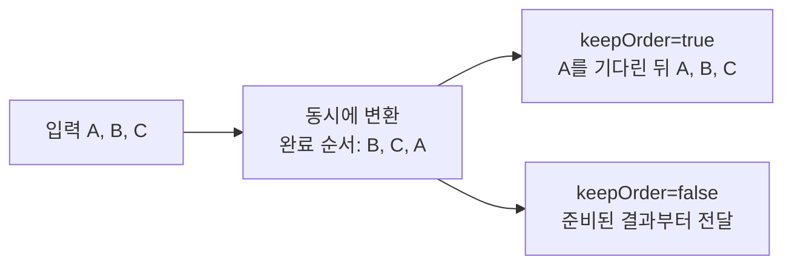

# `utils.stream` 사용자 가이드

`utils.stream`은 소비자가 값을 요청할 때 원소를 하나씩 읽어 처리하는 스트림 라이브러리다. `map`, `filter`, `toList`처럼 Java Stream과 비슷한 연산 외에도 파일·연결 등의 자원 정리, 키별 집계, 비동기 매핑, 생산자와 소비자 사이의 버퍼를 제공한다.

중심 인터페이스는 [`FStream<T>`](FStream.java)다. `next()`는 원소가 있으면 `FOption<T>`, 끝에 도달하면 `FOption.empty()`를 반환한다. 대부분의 변환은 값을 읽을 때 수행하지만, 정렬처럼 호출 즉시 전체 입력을 소비하는 연산도 있다. 자원을 다룰 때는 처리 시점과 정리 책임을 함께 확인한다.

예제는 Java 17 기준이다. `Person`, `Row` 같은 업무용 타입과 간단한 코드 조각의 import는 필요한 부분만 표시했다. API 목록의 각 줄은 개별 사용 형태이며 하나의 실행 가능한 코드 블록을 뜻하지는 않는다.

## 1. 핵심 타입과 처리 흐름

| 타입 | 역할 |
|---|---|
| [`FStream<T>`](FStream.java) | 원소 조회, 변환, 수집의 기본 인터페이스. `Iterable<T>`와 `AutoCloseable` 구현 |
| [`KeyValueFStream<K,V>`](KeyValueFStream.java) | 키와 값을 따로 변환·조회하는 스트림 |
| [`KeyedGroups<K,V>`](KeyedGroups.java) | 키별 값 목록을 보관하는 그룹 결과 |
| `IntFStream` 등 숫자·논리값 스트림 | 타입별 합계, 평균, 배열 변환 등의 편의 기능 |
| [`AsyncExecutionOptions`](AsyncExecutionOptions.java) | 비동기 작업 수, 결과 순서, 실행기 설정 |
| [`SuppliableFStream<T>`](SuppliableFStream.java) | 생산자가 넣은 데이터를 소비자가 꺼내는 용량 제한 버퍼 |
| [`Generator<T>`](Generator.java) | 별도 스레드에서 데이터를 생성하는 함수 |
| [`FStreams.AbstractFStream<T>`](FStreams.java) | 초기화·소진·닫힘 상태를 관리하는 사용자 스트림의 기반 클래스 |


스트림은 한 번 소비하는 객체다. 같은 입력을 여러 번 처리하려면 결과를 리스트 등에 보관하고 매번 새 스트림을 만든다. 일반 스트림의 `next()`와 `close()`를 여러 스레드에서 동시에 호출하지 않는다. `SuppliableFStream`의 큐 연산처럼 별도로 동기화를 제공하는 경우는 9장에서 설명한다.

## 2. 빠른 시작

```java
import java.util.List;
import utils.stream.FStream;

public class StreamExample {
    public static void main(String[] args) {
        List<String> result = FStream.of(" pear ", "", "apple", "banana")
                .map(String::trim)
                .filter(text -> !text.isEmpty())
                .sort()
                .toList();
        System.out.println(result);  // [apple, banana, pear]
    }
}
```

`map()`과 `filter()`는 읽을 때 처리한다. 위 예제의 `sort()`는 호출하는 즉시 입력을 모두 읽고 정렬하며, `toList()`는 그 정렬 결과를 수집한다.

파일을 읽을 때는 스트림뿐 아니라 실제 파일 자원도 명시적으로 닫는다.

```java
try (var reader = Files.newBufferedReader(path);
     FStream<String> lines = FStream.from(reader.lines())) {
    lines.filter(line -> !line.isBlank())
         .forEach(System.out::println);
}
```

`forEach()`는 스트림을 닫지만 `reader.lines()`의 스트림을 닫는 것만으로 reader의 소유권까지 이전되는 것은 아니다. 위처럼 reader도 자원으로 선언하면 중간 예외와 무관하게 파일을 정리할 수 있다.

`next()`를 직접 사용할 때는 호출자가 닫는다.

```java
try (FStream<Integer> stream = FStream.of(1, 2, 3)) {
    FOption<Integer> next;
    while ((next = stream.next()).isPresent()) {
        System.out.println(next.get());
    }
}
```

## 3. 스트림 생성과 연결

### 3.1 컬렉션·배열·Java Stream

| 호출 | 결과 |
|---|---|
| `FStream.empty()` | 빈 스트림 |
| `FStream.of("a", "b", "c")` | 주어진 원소를 순서대로 반환 |
| `FStream.from(iterable)` | 반복 가능한 객체에서 생성 |
| `FStream.from(iterator)` | 기존 반복자에서 생성 |
| `FStream.from(javaStream)` | Java Stream을 감쌈. 닫을 때 해당 Java Stream의 `close()` 호출 |
| `FStream.of(new int[] {1, 2, 3})` | `IntFStream` |
| `KeyValueFStream.from(map)` | 맵의 키·값 스트림 |

`FOption`은 값의 존재 여부를 나타낸다. `FOption.of(null)`도 표현할 수 있지만, 모든 스트림 연산이 null 원소를 동일하게 지원하지는 않는다. 특히 반복자 구현은 null을 끝 표시로 사용하고, 버퍼의 `ArrayDeque`도 null을 받지 않는다. 일반적인 처리에서는 null 원소를 피하고 `flatMapNullable()` 등으로 제거한다.

### 3.2 값 생성

```java
FStream.range(0, 10)                 // 0부터 9까지
FStream.repeat("x")                  // 무한 반복
FStream.repeat("x", 5)               // 다섯 번 반복
FStream.generate(1, n -> n * 2)      // 1, 2, 4, 8, ...

// Tuple의 첫 값은 다음 상태, 둘째 값은 출력 원소다. null을 반환하면 끝난다.
FStream.unfold(1, n -> n > 100 ? null : Tuple.of(n * 2, n))
```

무한 스트림에는 `take(n)` 같은 제한을 먼저 적용한다. `sort()`, `count()`, `toList()`처럼 끝까지 읽는 연산을 바로 적용하면 작업이 끝나지 않는다.

### 3.3 별도 스레드에서 생성

```java
try (FStream<Integer> numbers = FStream.generate(channel -> {
    for (int i = 0; i < 100; i++) {
        channel.supply(i);
    }
}, 16)) {
    numbers.take(10).forEach(System.out::println);
}
```

생성기는 첫 `next()` 호출 때 별도의 데몬 스레드에서 시작한다. 버퍼가 가득 차면 `supply()`가 빈자리가 생길 때까지 기다린다. 생성 함수가 정상 반환하면 내부 실행기가 `endOfSupply()`를 호출하므로 위 예제처럼 직접 종료를 알리지 않아도 된다.

일반 예외는 소비자에게 오류로 전달된다. 다만 현재 실행기는 `InterruptedException`, `CancellationException`, `IllegalStateException`을 정상 종료로 처리한다. 업무상 `IllegalStateException`도 소비자가 오류로 받아야 한다면 생성 함수에서 직접 잡아 `channel.endOfSupply(error)`로 전달한다.

스트림을 닫으면 생성 스레드에 인터럽트를 보내고 채널을 닫지만, 스레드가 완전히 끝날 때까지 기다리지는 않는다. 파일이나 DB 연결은 생성 함수 안의 `try-with-resources`로 정리한다. 이 생성기 스트림은 단일 소비자용이며 `next()`와 `close()`의 동시 호출을 지원하지 않는다.

### 3.4 여러 입력 연결

```java
FStream.concat(first, second)                    // 첫 스트림을 읽은 뒤 둘째 스트림
FStream.concat(streamOfStreams)                 // 하위 스트림을 순서대로 펼침
FStream.zip(listA, listB)                        // 짧은 쪽이 끝나면 종료
FStream.zip(listA, listB, true)                  // 긴 쪽까지, 부족한 값은 null
FStream.mergeParallel(streamOfStreams, 4, pool) // 여러 하위 스트림을 동시에 소비
```

`concat`을 중간에 닫으면 현재 읽는 하위 스트림과 바깥 스트림을 닫는다. 아직 꺼내지 않은 모든 하위 스트림까지 순회하며 닫지는 않는다. 이미 열린 파일 스트림을 목록에 미리 많이 담기보다, 필요할 때 생성하는 구조를 사용하거나 원래 소유자가 각각 닫도록 한다.

## 4. 원소 변환과 선택

### 4.1 매핑·필터

| 메서드 | 동작 |
|---|---|
| `map(f)`, `filter(p)`, `filterNot(p)` | 변환, 조건 선택, 반대 조건 선택 |
| `mapOrIgnore(f)` | 검사 예외를 허용하는 함수를 적용하고 실패한 원소 제외 |
| `tryMap(f)` | 각 결과를 `Try<S>`로 감싸 성공과 실패를 함께 전달 |
| `mapSelectively(p, f)` | 조건에 맞는 원소만 변환하고 나머지는 그대로 전달 |
| `peek(effect)` | 통과하는 원소에 추가 작업 수행 |
| `cast(type)` | 지정 타입으로 변환. 맞지 않으면 예외 |
| `castSafely(type)` | 해당 타입의 원소만 선택 |
| `ofExactClass(type)` | 하위 타입을 제외하고 정확히 같은 클래스만 선택 |
| `mapToInt`, `mapToLong`, `mapToFloat`, `mapToDouble`, `mapToBoolean` | 타입별 편의 스트림으로 변환 |

### 4.2 한 원소에서 여러 결과 만들기

| 메서드 | 변환 함수의 반환형 | 결과 처리 |
|---|---|---|
| `flatMap(f)` | `FStream<V>` | 하위 스트림의 원소를 순서대로 펼침 |
| `flatMapIterable(f)` | `Iterable<V>` | 반복 가능한 결과를 펼침 |
| `flatMapArray(f)` | `V[]` | 배열을 펼침 |
| `flatMapNullable(f)` | `V` | null이면 제외, 아니면 한 원소로 전달 |
| `flatMapFOption(f)` | `FOption<V>` | 값이 있는 경우만 전달 |
| `flatMapTry(f)` | `Try<V>` | 성공한 결과만 전달 |

`flatMapTry()`는 실패 결과를 제외한다. 실패 원인을 남겨야 한다면 제외하기 전에 `Try`를 검사한다.

### 4.3 구간과 중복

```java
stream.take(10)                        // 앞에서 최대 10개
stream.drop(3)                         // 앞 3개 제외
stream.dropLast(2)                     // 마지막 2개 제외
stream.takeWhile(predicate)            // 조건이 깨지기 전까지
stream.dropWhile(predicate)            // 처음 조건이 깨진 원소부터
stream.slice(Slice.builder().start(2).end(8).step(2).build())
stream.distinct()                      // 전체 중복 제거
stream.distinct(keyer)                 // 키 기준 전체 중복 제거
stream.unique()                        // 연속해서 나온 중복만 제거
stream.unique(keyer)                   // 키 기준 인접 중복 제거
```

`distinct()`는 이미 본 키를 보관하므로 서로 다른 값이 많을수록 메모리를 더 사용한다. `unique()`는 직전 값과 비교한다.

| 입력 | `distinct()` | `unique()` |
|---|---|---|
| `a, a, b, a` | `a, b` | `a, b, a` |

### 4.4 묶기·분할·인덱스

```java
stream.concatWith(other)                  // 뒤에 연결
stream.zipWith(other)                     // Tuple<T,S>로 묶기
stream.zipWith(other, zipper)             // 묶은 값을 함수로 변환
stream.zipWith(other, true)               // 긴 쪽 기준, 부족분은 null
stream.zipWithIndex()                     // 0부터 시작하는 Indexed<T>
stream.zipWithIndex(1)                    // 1부터 시작
stream.buffer(3, 1)                       // 크기 3, 시작 위치는 1씩 이동
stream.buffer(3, 3)                       // 겹치지 않게 세 개씩 묶기
stream.split(predicate)                   // 조건에 맞는 원소를 구분자로 사용
```

`buffer(count, skip)`은 끝에 남은 작은 묶음도 반환한다. 예를 들어 `[0,1,2,3]`에 `buffer(3,1)`을 적용하면 `[[0,1,2], [1,2,3], [2,3], [3]]`이다. `count`와 `skip`은 모두 양수로 사용한다. 현재 구현은 `skip <= 0`을 충분히 검증하지 않아 같은 묶음을 계속 반환할 수 있다.

`split()`은 구분자를 결과에서 제외하지만 빈 구간은 유지한다. `["a", ",", ","]`를 쉼표 기준으로 나누면 `[["a"], [], []]`이다. 빈 구간이 필요 없으면 `.filter(group -> !group.isEmpty())`를 이어 붙인다.

### 4.5 정렬과 일부 값 선택

| 호출 | 현재 구현의 동작 |
|---|---|
| `sort()`, `sort(comparator)` | 전체 입력을 즉시 읽고 정렬 |
| `sort(keyer)` | 추출한 키의 자연 순서로 정렬 |
| `sort(keyer, true)` | 키의 역순으로 정렬 |
| `quasiSort(queueLength)` | 제한된 선행 입력만 비교하는 근사 정렬 |
| `takeTopK(k)` | **자연 순서에서 작은 값 k개**를 선택해 작은 값부터 반환 |
| `takeTopK(k, true)` | 큰 값 k개를 선택해 큰 값부터 반환 |
| `takeTopK(k, keyer, reverse)` | 키 비교 순서의 앞쪽 k개 선택 |

`takeTopK()`의 이름과 일부 주석은 큰 값 선택으로 읽히지만 현재 우선순위 큐는 비교 순서에서 작은 값들을 유지한다. 예를 들어 `[4,1,3,2]`에서 `takeTopK(2)`는 `[1,2]`, `takeTopK(2,true)`는 `[4,3]`이다. 양수 k에서는 호출 즉시 전체 입력을 읽고 원본을 닫으며, k가 0이면 읽지 않고 빈 결과를 만든다.

`quasiSort(n)`은 최대 n+1개 정도를 먼저 읽어 작은 값부터 내보낸다. 멀리 떨어진 순서 뒤집힘까지 바로잡지는 못한다. 거의 정렬된 입력에 적합하고, 제한된 버퍼만 사용하므로 무한 입력에도 적용할 수 있다.

### 4.6 샘플링과 섞기

| 호출 | 동작과 조건 |
|---|---|
| `sample(ratio)` | 각 원소를 독립적인 확률로 선택. 0이면 선택하지 않고 1 이상이면 모두 선택 |
| `sample(total, ratio)` | 실제 개수가 total일 때 목표 표본 수에 맞춰 선택 확률 조정 |
| `shuffle()` | 첫 조회 시 전체 입력을 읽은 뒤 순서를 섞음 |

`sample(total, ratio)`의 목표 개수는 현재 `max(1, round(total * ratio))`다. 따라서 비율이 0이어도 total이 양수이면 한 개를 선택하고, total이 0이면 생성 시 예외가 발생한다. 목표 개수가 total을 넘는 설정도 거부된다. 정확한 개수를 기대하려면 실제 입력 개수와 total이 같아야 한다.

### 4.7 중간 누적값과 외부 변환 함수

```java
List<Integer> sums = FStream.of(1, 2, 3)
        .reduceLeak(Integer::sum)
        .toList();  // [1, 3, 6]
```

`reduceLeak()`은 첫 원소부터 중간 누적값을 차례로 반환한다. `foldLeak()`도 API에 있지만 현재 구현은 첫 원소를 그대로 반환한 뒤, 이후 입력값 대신 이전 출력값을 결합 함수에 전달한다. 예를 들어 `foldLeak(0, (s,t) -> Tuple.of(s+t, s+t))`를 `[1,2,3]`에 적용하면 `[1,1,2]`가 된다. 일반적인 누적 연산이 필요하면 `reduceLeak()`이나 별도 상태를 가진 스트림을 사용한다.

기존 스트림 변환 함수를 처리 과정에 넣을 때는 `lift()`를 사용한다. `stream.lift(f)`는 `f.apply(stream)`과 같다.

```java
FStream<Report> reports = FStream.from(rows)
        .lift(Normalizers::dropOutliers)
        .map(Report::from);
```

## 5. 소비·검색·집계

`forEach`, `fold`, `reduce`, `count`, `findFirst`, `toList` 등 주요 종단 연산은 `finally`에서 `closeQuietly()`를 호출한다. 처리 중 예외가 발생해도 정리를 시도하지만, 닫는 과정의 예외는 호출자에게 전달하지 않는다. 모든 확장 API가 같은 규칙을 따르는 것은 아니므로 자원을 가진 원본은 명시적으로 관리하는 것이 좋다(10장).

| 목적 | API | 반환값 또는 특징 |
|---|---|---|
| 전체 순회 | `forEach`, `forEachOrIgnore`, `forEachOrThrow` | 각각 일반 처리, 검사 예외 무시, 검사 예외 전파 |
| 개수 | `count()` | `long` |
| 누적 | `reduce(combiner)` | `FOption<T>` |
| 초기값부터 누적 | `fold(initial, folder)` | 누적 결과 |
| 조기 누적 종료 | `fold(initial, stopper, folder)` | 누적값이 stopper와 같아지면 종료 |
| 오른쪽부터 누적 | `foldRight(initial, folder)` | 전체 입력을 리스트로 읽은 뒤 뒤에서부터 결합 |
| 가변 객체에 수집 | `collect(accumulator, collector)` | 전달한 누적 객체 |
| 검색 | `findFirst`, `findFirst(predicate)`, `findLast` | `FOption<T>` |
| 조건 확인 | `exists`, `allMatch`, `noneMatch` | `boolean` |
| 접두 구간 비교 | `startsWith(prefixStream)` | 두 스트림 모두 정리 |
| 최댓값·최솟값 | `max`, `min` | **`java.util.Optional<T>`** |
| 동률까지 선택 | `maxMultiple`, `minMultiple` | `List<T>` |
| 컬렉션 수집 | `toList`, `toSet`, `toCollection` | 리스트·집합·지정 컬렉션 |
| 배열 수집 | `toArray(String.class)` | 지정 원소 타입 배열 |
| 뒤쪽 원소 | `takeLast(n)` | 마지막 n개의 `List<T>`. 전체 입력 소비 |
| 문자열 결합 | `join(", ")`, `join(", ", "[", "]")`, `join(csv)` | 문자열 |
| 키별 집계 | `reduceByKey`, `foldByKey`, `collectByKey` | 키별 결과 맵 |

`stream()`은 종단 연산이 아니라 Java Stream으로 변환하는 어댑터다. 반환된 Stream을 닫으면 원래 FStream도 닫는다. Java Stream의 단축 연산은 자동으로 `close()`하지 않으므로 자원으로 선언한다.

```java
try (java.util.stream.Stream<Integer> javaStream = FStream.range(0, 100).stream()) {
    System.out.println(javaStream.limit(3).toList());
}
```

## 6. 키·값 스트림

`KeyValueFStream<K,V>`는 `FStream<KeyValue<K,V>>`를 확장한다. `KeyValue`에서 매번 키와 값을 꺼내는 대신 함수의 인자로 따로 받을 수 있다.

```java
KeyValueFStream.from(map)
FStream.from(persons).tagKey(Person::getId)
FStream.from(rows).toKeyValueStream(Row::getId, Row::getValue)
KeyValueFStream.fromKeyed(keyedObjects)
```

| API | 동작 |
|---|---|
| `keys()`, `values()` | 키 또는 값만 추출 |
| `filterKey`, `filterValue` | 키 또는 값 조건으로 선택 |
| `mapKey`, `mapValue`, `mapKeyValue` | 키·값 변환 |
| `map(BiFunction)`, `flatMap(BiFunction)`, `forEach(BiConsumer)` | 키와 값을 별도 인자로 처리 |
| `groupByKey()` | 키별 목록을 가진 `KeyedGroups` 생성 |
| `sortByKey()` | 키의 자연 순서로 정렬 |
| `match(map)`, `flatMatch(map)` | 참조 맵과 키로 연결 |
| `toMap()`, `toMap(targetMap)` | 키별 값 수집. 중복 키는 나중 값이 덮어씀 |
| `toListMap()` | 같은 키의 값을 목록으로 수집 |

```java
Map<String, Integer> countByDepartment = FStream.from(employees)
        .tagKey(Employee::getDepartment)
        .groupByKey()
        .fstream()
        .mapValue(List::size)
        .toMap();
```

`match()`의 값은 원래 값과 참조 맵의 값을 묶은 `Tuple<V,R>`이다. `keepUnmatched=true`이면 일치하지 않은 항목도 유지하며, 튜플의 두 번째 값이 null이다. `flatMatch()`는 참조 맵에 있는 값 목록을 각각의 결과로 펼친다.

일반 `FStream`에는 `lookup(map)`과 `lookup(function, keepUnmatched)`도 있다. 각 원소를 키로 보고 조회한 값을 붙인다. 패키지 내부에 조인 구현 클래스가 있지만 `outerJoin()` 공개 진입점은 주석 처리되어 있으므로 실제 사용에는 `match`, `flatMatch`, `lookup`을 이용한다.

현재 `toListMap()`은 일반 반복문으로 구현되어 예외·빈 입력에서의 자동 정리가 주요 종단 연산과 같지 않다. 자원이 있는 스트림은 `try-with-resources`로 감싼다.

## 7. 숫자·논리값용 스트림

타입별 편의 연산을 제공하지만 내부적으로 `FStream<Integer>`, `FStream<Long>` 등 래퍼 타입을 사용한다. Java의 원시 타입 전용 Stream처럼 박싱이 전혀 없다고 가정하지 않는다.

| 타입 | 대표 생성 방법 | 전용 연산 |
|---|---|---|
| [`IntFStream`](IntFStream.java) | `FStream.range`, `FStream.of(int[])`, `mapToInt` | `sum`, `average`, `maxValue`, `minValue`, `toArray` |
| [`LongFStream`](LongFStream.java) | `LongFStream.range`, `mapToLong` | `sum`, `average`, `toArray` |
| [`FloatFStream`](FloatFStream.java) | `FloatFStream.of(float[])`, `mapToFloat` | `sum`, `average`, `toArray` |
| [`DoubleFStream`](DoubleFStream.java) | `FStream.of(double[])`, `mapToDouble` | `sum`, `average`, `toArray` |
| [`BooleanFStream`](BooleanFStream.java) | `BooleanFStream.of(boolean[])`, `mapToBoolean` | `andAll`, `orAll`, `toArray` |

```java
double average = FStream.of(10, 20, 30)
        .mapToInt(value -> value)
        .average()
        .getOrElse(0.0);

List<String> labels = FStream.range(0, 3)
        .mapToObj(i -> "item-" + i)
        .toList();
```

빈 입력의 평균은 빈 `FOption`이다. `IntFStream.sum()`은 `long`으로 누적한다. `BooleanFStream.andAll()`은 빈 입력에서 true, `orAll()`은 false를 반환하며, 현재 두 연산은 결과가 결정된 뒤에도 끝까지 읽는다. 조기 종료가 필요하면 `allMatch`나 `exists`를 사용한다.

## 8. 비동기 매핑과 병합

### 8.1 실행 옵션

`AsyncExecutionOptions`의 변경 메서드는 새 객체를 반환한다. 반환값을 사용해야 설정이 반영된다.

| 항목 | 기본값 | 현재 동작 |
|---|---|---|
| `keepOrder` | false | true이면 결과를 입력 순서대로 반환 |
| `workerCount` | `max(1, CPU 수 - 2)` | 동시에 진행할 작업 수. 1 이상 |
| `executor` | null | 매핑에서는 기본 비동기 실행기 사용 |
| `timeoutMillis` | -1 | 값은 보관하지만 현재 스트림 구현에서는 실행 제한에 사용하지 않음 |

```java
AsyncExecutionOptions options = AsyncExecutionOptions.WORKER_COUNT(4)
        .setKeepOrder(true)
        .setExecutor(pool);
```

`setTimeout()`이나 `TIMEOUT()`만으로 느린 매핑 작업을 중단할 수는 없다. 실제 호출하는 I/O 작업이나 별도의 실행 제어 계층에 제한 시간을 설정한다. 직접 제공한 실행기는 호출자가 종료한다.

### 8.2 결과와 실패 처리

`mapAsync()`와 `mapCheckedAsync()`의 결과 원소는 모두 **입력과 결과를 묶은 `Tuple<T, Try<R>>`**다. 일부 소스 주석의 `Try<R>` 단독 반환 설명과는 다르다.

```java
FStream.of("10", "bad", "30")
        .mapAsync(Integer::parseInt, AsyncExecutionOptions.WORKER_COUNT(2))
        .forEach(pair -> pair._2()
                .ifSuccessful(value -> System.out.println(pair._1() + " → " + value))
                .ifFailed(error -> System.err.println(pair._1() + " 변환 실패: " + error)));
```

매핑 함수의 예외는 해당 원소의 `Try.failure`로 전달한다. 검사 예외를 던지는 함수와 옵션을 함께 전달하려면 `mapCheckedAsync(mapper, options)`를 쓴다. 옵션 없이 호출하는 `mapAsync(mapper)`도 검사 예외를 허용한다.

입력 스트림 자체에서 값을 읽는 중 발생하는 오류까지 모두 `Try`에 담긴다는 뜻은 아니다. 실패를 무시하면 안 되는 작업에서는 각 `Try`를 검사하고, 필요하면 원인을 기록하거나 처리 전체를 중단한다.

### 8.3 결과 순서



순서 보존 모드는 앞의 느린 작업이 끝날 때까지 뒤의 결과도 기다린다. 순서를 보존하지 않으면 완료 콜백이 채널에 공급한 순서대로 결과를 받는다. 콜백 스케줄링이 개입하므로 작업 종료 시각의 엄격한 정렬로 해석하지 않는다.

작업은 스트림을 만드는 즉시가 아니라 첫 조회 때 시작한다. 이후 최대 작업 수만큼 미리 읽고 실행할 수 있으므로 `take(1)`로 결과 하나만 받아도 매핑 함수가 한 번만 실행된다고 보장하지 않는다.

### 8.4 하위 스트림 병렬 처리

```java
FStream<Record> records = FStream.from(files)
        .flatMapAsync(this::readRecords, AsyncExecutionOptions.WORKER_COUNT(4));
```

`keepOrder=true`이면 하위 스트림 생성 결과를 입력 순서대로 받아 하나씩 소비한다. `false`이면 `mergeParallel()`로 하위 스트림도 병렬 소비하므로 원소가 서로 섞일 수 있다. 검사 예외를 허용하는 함수에는 `flatMapCheckedAsync()`를 사용한다.

`flatMapAsync()`는 결과에 `Try`를 남기지 않으며 하위 스트림 생성에 실패한 입력은 제외될 수 있다. `mergeParallel()`도 워커의 실패 결과를 출력 채널에 전달하지 않고 다음 입력으로 넘어가는 경로가 있다. 따라서 누락 여부를 반드시 알아야 하는 처리에서는 `mapAsync()`로 성공·실패를 먼저 명시적으로 관리한다.

`mergeParallel(streams, workerCount, executor)`는 각 워커가 하위 스트림 하나를 끝까지 읽은 뒤 다음 스트림을 맡는 방식이다. executor가 null이면 이 병합 구현은 작업마다 새 스레드를 사용한다. 매핑에서의 기본 실행기 선택과 구분한다.

### 8.5 닫기와 작업 중단

| 구현 | `close()`의 의미 |
|---|---|
| 순서 보존 매핑 | 입력과 출력 채널을 닫음. 이미 시작한 작업에는 취소를 전달하지 않음 |
| 순서 비보존 매핑 | 입력·출력 채널을 닫고 추적 중인 작업에 취소 요청 |
| 병렬 병합 | 입력 스트림 공급원과 출력 채널을 닫음. 진행 중인 모든 하위 작업의 종료를 기다리지는 않음 |

취소 요청이 실제 함수 실행을 즉시 멈춘다는 보장은 없다. 현재 매핑에 사용하는 CompletableFuture 기반 실행도 진행 중인 함수를 강제로 인터럽트하지 않는다. 자원을 생성하는 함수는 예외·취소 후의 정리까지 직접 책임져야 한다. 닫힌 뒤 완성된 결과는 소비되지 않을 수 있으므로, `AutoCloseable` 결과 객체가 자동으로 닫힐 것으로 기대하지 않는다.

## 9. 생산자와 소비자 연결: `SuppliableFStream`

`SuppliableFStream`은 용량이 정해진 큐다. 생산자는 `supply()`로 값을 넣고, 소비자는 `next()`로 값을 꺼낸다.


```java
SuppliableFStream<Integer> channel = new SuppliableFStream<>(16);
Thread producer = new Thread(() -> {
    try {
        for (int i = 0; i < 100; i++) {
            channel.supply(i);
        }
        channel.endOfSupply();
    } catch (InterruptedException error) {
        Thread.currentThread().interrupt();
        channel.endOfSupply(error);
    } catch (Exception error) {
        channel.endOfSupply(error);
    }
});
producer.start();
try (channel) {
    channel.forEach(System.out::println);
} finally {
    producer.join();
}
```

| API | 동작 |
|---|---|
| `supply(value)` | 빈자리가 생길 때까지 기다려 적재 |
| `supply(value, timeout, unit)` | 적재 대기 시간 제한. 초과하면 `TimeoutException` |
| `next()` | 데이터 또는 종료 신호를 기다림 |
| `next(timeout, unit)` | 수신 대기 시간 제한. 초과하면 `TimeoutException` |
| `poll()` | 기다리지 않고 조회. 현재 비어 있어도 empty이므로 이것만으로 종료 판단 불가 |
| `capacity()`, `size()`, `emptySlots()` | 용량과 현재 큐 상태 조회 |
| `endOfSupply()` | 생산 종료. 이미 넣은 데이터는 유지 |
| `endOfSupply(error)` | 남은 데이터 뒤에 오류 전달 |
| `close()` | 소비 종료. 남은 데이터를 버리고 대기 중인 호출을 깨움 |

생산 종료는 첫 호출이 우선한다. `endOfSupply()` 뒤에 `endOfSupply(error)`를 호출해도 이미 정한 정상 종료를 오류로 바꾸지 않는다. 오류를 등록한 뒤 `close()`하면 데이터는 버리지만 오류는 보존한다. 이후 조회에서는 원래 런타임 예외 또는 변환된 런타임 예외가 전달된다.

큐의 적재·조회·종료 연산은 여러 스레드에서 사용할 수 있다. 하지만 그 위에 연결한 `map` 같은 일반 스트림까지 다중 소비자용이 되는 것은 아니다. 여러 소비자가 각자 `forEach()`를 사용하면 한 소비자의 종료·실패가 공유 채널 전체를 닫을 수 있으므로 채널 종료 책임을 정한다.

`setSupplyListener()`의 콜백은 생산자 스레드에서 큐 잠금 밖으로 나와 실행한다. 콜백까지 순서대로 직렬 실행된다고 보장하지 않는다. 다른 소비자가 이미 값을 꺼낼 수 있으므로 콜백에서는 `next()`로 무조건 기다리기보다 `poll()`을 사용할지 판단한다. 콜백에서 발생한 일반 예외는 무시하고, `close()`는 등록한 콜백 참조를 제거하지 않는다.

## 10. 자원 관리

### 10.1 소비 방식별 정리 책임

| 사용 방식 | 정리 방법과 주의점 |
|---|---|
| `toList`, `forEach`, `fold` 등 주요 종단 연산 | 완료·실패 시 `closeQuietly()` 호출. 닫기 오류는 전달하지 않음 |
| `map`, `filter` 결과 닫기 | 보통 원본까지 닫음. 모든 구현의 공통 보장은 아님 |
| `next()` 직접 반복 | 소진 후에도 호출자가 닫아야 함 |
| 향상된 for 문 | 중간 종료·예외·빈 입력에서 정리가 빠질 수 있으므로 자원으로 선언 |
| `stream()`으로 변환 | 반환된 Java Stream을 자원으로 선언 |
| `onClose()`로 감싼 스트림 | 현재 원본에 닫기를 전달하지 않음. 원본도 별도 정리 |

`FStreams.AbstractFStream`은 중복 `close()`를 무시하고, 닫은 뒤 `next()`에는 `IllegalStateException`을 던진다. 그러나 이 규칙을 패키지 전체에 일반화할 수는 없다. 빈 스트림, 연결 스트림, `onClose` 래퍼, `SuppliableFStream` 등에는 닫은 뒤 empty을 반환하는 구현도 있다. 닫은 스트림은 다시 읽지 않는 규칙으로 사용한다.

### 10.2 `onClose()`의 현재 제약

현재 [`CloserAttachedStream`](FStreams.java)의 `close()`는 등록한 작업만 실행하고 원본을 닫지 않는다. 따라서 다음 두 가지를 주의해야 한다.

- `source.onClose(task)`를 닫아도 source의 정리는 별도로 필요하다.
- `.onClose(first).onClose(second)`를 닫으면 가장 바깥의 second만 실행된다. 등록 순서대로 모두 실행하지 않는다.

원본도 자원으로 선언하면 콜백과 원본의 정리를 각각 처리할 수 있다.

```java
try (FStream<Integer> source = FStream.of(1, 2, 3);
     FStream<Integer> decorated = source.onClose(() -> System.out.println("소비 종료"))) {
    decorated.forEach(System.out::println);
}
```

자원 정리 여러 개를 연결할 때는 `onClose()`를 연달아 붙이는 대신 각각 `try-with-resources`로 관리한다. 콜백은 `Runnable`이므로 검사 예외를 직접 던지는 `connection.close()` 같은 메서드를 그대로 람다에 넣을 수 없다는 점도 구분한다.

### 10.3 반복자와 조기 종료

반복자는 생성하는 순간 첫 원소를 미리 읽고, 각 `next()`에서 그다음 원소를 미리 읽는다. 따라서 for 문 본문에서 `break`하기 전에 다음 입력이 이미 소비될 수 있다. 다음 원소를 기다리는 스트림이면 본문에 도달하기 전에 대기할 수도 있다.

```java
try (FStream<Row> rows = openRows()) {
    for (Row row : rows) {
        if (row.isTerminator()) {
            break;
        }
        process(row);
    }
}
```

일반 반복을 끝까지 마치면 소진을 감지한 반복자가 원본을 닫지만, 처음부터 빈 입력에서는 생성 시 닫기를 호출하지 않는다. 반복 중 예외에서도 자동 정리가 빠질 수 있으므로 자원 선언을 유지한다.

### 10.4 사용자 정의 스트림

```java
class CounterStream extends FStreams.AbstractFStream<Integer> {
    private int value;

    @Override
    protected void initialize() {
        value = 0;
    }

    @Override
    protected FOption<Integer> nextInGuard() {
        return value < 3 ? FOption.of(value++) : FOption.empty();
    }

    @Override
    protected void closeInGuard() {
        // 이 스트림이 소유한 자원을 정리한다.
    }
}
```

`initialize()`는 첫 조회 때 실행한다. 초기화가 성공한 뒤에는 반복 호출하지 않는다. `close()`는 final이며 중복 호출을 막지만, 메서드 이름의 `InGuard`가 실제 잠금을 의미하지는 않는다. 이 기반 클래스 자체에는 `next()`·`close()`의 동시 호출을 보호하는 잠금이 없다.

## 11. 입력을 읽는 시점과 메모리 사용

| 연산 | 입력을 읽는 시점 | 기억할 점 |
|---|---|---|
| `map`, `filter`, `take`, `drop`, `zipWith` | 결과 조회 시 | 조건에 따라 결과 하나를 위해 여러 입력을 읽을 수 있음 |
| `distinct` | 결과 조회 시 | 이미 본 키를 계속 보관 |
| `buffer`, `split` | 다음 묶음 요청 시 | `split`에 구분자가 없으면 큰 묶음이 만들어짐 |
| `quasiSort(n)` | 조회 시 최대 n+1개 정도 선행 읽기 | 전체 정렬 보장 없음 |
| `dropLast(n)` | 처음 n개를 보관하고 이후 한 개씩 읽기 | 전체 입력을 미리 읽지 않음 |
| `takeLast(n)` | 호출 시 끝까지 읽기 | 마지막 n개만 보관하는 종단 연산 |
| `sort`, 양수 k의 `takeTopK` | 호출 즉시 끝까지 읽기 | 반환값이 스트림이어도 입력은 이미 소비됨 |
| `shuffle` | 첫 조회 시 끝까지 읽기 | 전체 입력을 메모리에 보관 |
| `mapAsync`, `flatMapAsync`, `mergeParallel` | 첫 조회 때 시작, 이후 선행 실행 | 소비한 결과보다 더 많은 작업이 이미 시작될 수 있음 |

## 12. 문제 상황별 확인 사항

| 상황 | 확인할 내용 |
|---|---|
| 두 번째 수집에서 값이 없거나 예외가 남 | 스트림은 일회성. 원본 컬렉션에서 새로 생성 |
| `takeTopK()`에서 작은 값이 나옴 | 현재 기본 동작. 큰 값은 역순 옵션 사용 |
| 비동기 매핑 일부 결과가 빠진 것처럼 보임 | `Try.failure` 처리 여부와 `flatMapAsync`의 실패 제외 동작 확인 |
| 설정한 매핑 제한 시간이 적용되지 않음 | `timeoutMillis`는 현재 실행에 사용되지 않음 |
| `close()` 뒤에도 외부 작업이 계속됨 | 생성기·매핑·병합의 종료 대기와 취소 범위 확인 |
| 닫기 콜백은 실행됐는데 원본 자원이 남음 | `onClose`가 원본을 닫지 않는 현재 동작 확인 |
| 종료된 공유 채널에서 `supply()` 예외가 남 | 소비자의 `close()`나 생산 종료 이후에는 추가 적재 불가 |
| 무한 입력에서 정렬·수집이 끝나지 않음 | 전체 소비 연산 전에 `take()` 등으로 제한 |

## 13. 추가 API와 관련 문서

- [`PrependableFStream`](PrependableFStream.java) — `toPrependable()`로 생성. `prepend()`로 값을 되돌리고 `peekNext()`·`hasNext()`로 미리 확인
- [`TimedFStream`](TimedFStream.java) — 제한 시간을 둔 원소 조회 인터페이스
- [`FStreamable`](FStreamable.java) — `fstream()`으로 스트림을 제공하는 객체의 인터페이스
- [`FStreamException`](FStreamException.java) — 스트림 처리용 예외 타입
- [비동기 실행 가이드](../async/README.md) — 매핑 내부 실행이 사용하는 결과·콜백·취소 규칙
- [스레드 유틸리티 가이드](../thread/README.md) — 실행기와 동기화 도구
- [`utils.stream` 개발 노트](CLAUDE.md) — 패키지 구조
- [`스트림 테스트`](../../../../test/java/utils/stream) — 연산별 입력·출력과 경계 조건 예제
