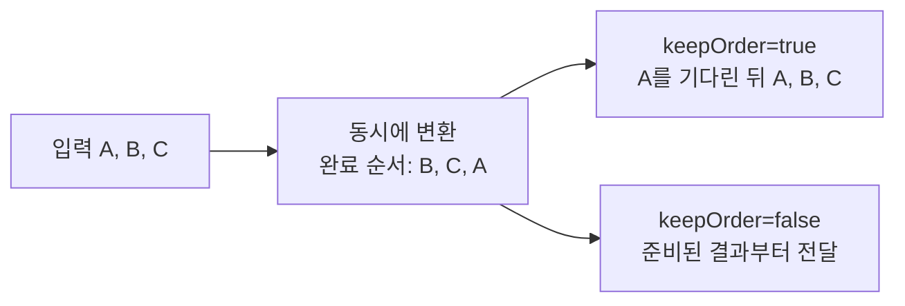

# `utils.stream` 사용자 가이드

`utils.stream`은 소비자가 값을 요청할 때 원소를 하나씩 읽어 처리하는 스트림 라이브러리다. `map`, `filter`, `toList`처럼 Java Stream과 비슷한 연산 외에도 파일·연결 등의 자원 정리, 키별 집계, 비동기 매핑, 생산자와 소비자 사이의 버퍼를 제공한다.

중심 인터페이스는 [`FStream<T>`](FStream.java)다. `next()`는 원소가 있으면 `FOption<T>`, 끝에 도달하면 `FOption.empty()`를 반환한다. 대부분의 변환은 값을 읽을 때 수행하지만, 정렬처럼 호출 즉시 전체 입력을 소비하는 연산도 있다. 자원을 다룰 때는 처리 시점과 정리 책임을 함께 확인한다.

예제는 Java 17 기준이다. `Person`, `Row` 같은 업무용 타입과 간단한 코드 조각의 import는 필요한 부분만 표시했다. API 목록의 각 줄은 개별 사용 형태이며 하나의 실행 가능한 코드 블록을 뜻하지는 않는다.

## 1. 핵심 타입과 처리 흐름

| 타입 | 역할 |
|---|---|
| [`FStream<T>`](FStream.java) | 원소 조회, 변환, 수집의 기본 인터페이스. `Iterable<T>`와 `AutoCloseable` 구현 |
| [`KeyValueFStream<K,V>`](KeyValueFStream.java) | 키와 값을 따로 변환·조회하는 스트림 |
| [`KeyedGroups<K,V>`](KeyedGroups.java) | 키별 값 목록을 보관하는 그룹 결과 |
| `IntFStream` 등 숫자·논리값 스트림 | 타입별 합계, 평균, 배열 변환 등의 편의 기능 |
| [`AsyncExecutionOptions`](AsyncExecutionOptions.java) | 비동기 작업 수, 결과 순서, 실행기 설정 |
| [`SuppliableFStream<T>`](SuppliableFStream.java) | 생산자가 넣은 데이터를 소비자가 꺼내는 용량 제한 버퍼 |
| [`Generator<T>`](Generator.java) | 별도 스레드에서 데이터를 생성하는 함수 |
| [`FStreams.AbstractFStream<T>`](FStreams.java) | 초기화·소진·닫힘 상태를 관리하는 사용자 스트림의 기반 클래스 |


스트림은 한 번 소비하는 객체다. 같은 입력을 여러 번 처리하려면 결과를 리스트 등에 보관하고 매번 새 스트림을 만든다. 일반 스트림의 `next()`와 `close()`를 여러 스레드에서 동시에 호출하지 않는다. `SuppliableFStream`의 큐 연산처럼 별도로 동기화를 제공하는 경우는 9장에서 설명한다.

## 2. 빠른 시작

```java
import java.util.List;
import utils.stream.FStream;

public class StreamExample {
    public static void main(String[] args) {
        List<String> result = FStream.of(" pear ", "", "apple", "banana")
                .map(String::trim)
                .filter(text -> !text.isEmpty())
                .sort()
                .toList();
        System.out.println(result);  // [apple, banana, pear]
    }
}
```

`map()`과 `filter()`는 읽을 때 처리한다. 위 예제의 `sort()`는 호출하는 즉시 입력을 모두 읽고 정렬하며, `toList()`는 그 정렬 결과를 수집한다.

파일을 읽을 때는 스트림뿐 아니라 실제 파일 자원도 명시적으로 닫는다.

```java
try (var reader = Files.newBufferedReader(path);
     FStream<String> lines = FStream.from(reader.lines())) {
    lines.filter(line -> !line.isBlank())
         .forEach(System.out::println);
}
```

`forEach()`는 스트림을 닫지만 `reader.lines()`의 스트림을 닫는 것만으로 reader의 소유권까지 이전되는 것은 아니다. 위처럼 reader도 자원으로 선언하면 중간 예외와 무관하게 파일을 정리할 수 있다.

`next()`를 직접 사용할 때는 호출자가 닫는다.

```java
try (FStream<Integer> stream = FStream.of(1, 2, 3)) {
    FOption<Integer> next;
    while ((next = stream.next()).isPresent()) {
        System.out.println(next.get());
    }
}
```

## 3. 스트림 생성과 연결

### 3.1 컬렉션·배열·Java Stream

| 호출 | 결과 |
|---|---|
| `FStream.empty()` | 빈 스트림 |
| `FStream.of("a", "b", "c")` | 주어진 원소를 순서대로 반환 |
| `FStream.from(iterable)` | 반복 가능한 객체에서 생성 |
| `FStream.from(iterator)` | 기존 반복자에서 생성 |
| `FStream.from(javaStream)` | Java Stream을 감쌈. 닫을 때 해당 Java Stream의 `close()` 호출 |
| `FStream.of(new int[] {1, 2, 3})` | `IntFStream` |
| `KeyValueFStream.from(map)` | 맵의 키·값 스트림 |

`FOption`은 값의 존재 여부를 나타낸다. `FOption.of(null)`도 표현할 수 있지만, 모든 스트림 연산이 null 원소를 동일하게 지원하지는 않는다. 특히 버퍼의 `ArrayDeque`는 null을 받지 않는다(반복자는 2026-11-02부터 null 원소도 그대로 반환한다). 일반적인 처리에서는 null 원소를 피하고 `mapNotNull()` 등으로 제거한다.

### 3.2 값 생성

```java
FStream.range(0, 10)                 // 0부터 9까지
FStream.repeat("x")                  // 무한 반복
FStream.repeat("x", 5)               // 다섯 번 반복
FStream.generate(1, n -> n * 2)      // 1, 2, 4, 8, ...

// Tuple의 첫 값은 다음 상태, 둘째 값은 출력 원소다. null을 반환하면 끝난다.
FStream.unfold(1, n -> n > 100 ? null : Tuple.of(n * 2, n))
```

무한 스트림에는 `take(n)` 같은 제한을 먼저 적용한다. `sort()`, `count()`, `toList()`처럼 끝까지 읽는 연산을 바로 적용하면 작업이 끝나지 않는다.

### 3.3 별도 스레드에서 생성

```java
try (FStream<Integer> numbers = FStream.generate(channel -> {
    for (int i = 0; i < 100; i++) {
        channel.supply(i);
    }
}, 16)) {
    numbers.take(10).forEach(System.out::println);
}
```

생성기는 첫 `next()` 호출 때 별도의 데몬 스레드에서 시작한다. 스레드 이름을 정하려면 `generate(generator, bufLength, threadName)`을 쓴다(2026-11-02 이전 이름 `asynchronouslyFrom`). 버퍼가 가득 차면 `supply()`가 빈자리가 생길 때까지 기다린다. 생성 함수가 정상 반환하면 내부 실행기가 `endOfSupply()`를 호출하므로 위 예제처럼 직접 종료를 알리지 않아도 된다.

생성 함수의 예외는 소비자에게 오류로 전달된다. `InterruptedException`·`CancellationException`과, 소비자가 스트림을 닫아 `supply()`가 실패한 `IllegalStateException`만 정상 종료로 처리한다. 채널이 닫히지 않았는데 난 `IllegalStateException`은 생성 오류다. 생성 함수가 `Error`를 던지면 소비자에게 그 `Error`를 전달한 뒤 생성 스레드에서도 다시 던진다.

스트림을 닫으면 생성 스레드에 인터럽트를 보내고 채널을 닫지만, 스레드가 완전히 끝날 때까지 기다리지는 않는다. 파일이나 DB 연결은 생성 함수 안의 `try-with-resources`로 정리한다. 이 생성기 스트림은 단일 소비자용이며 `next()`와 `close()`의 동시 호출을 지원하지 않는다.

### 3.4 여러 입력 연결

```java
FStream.concat(first, second)                    // 첫 스트림을 읽은 뒤 둘째 스트림
FStream.concat(streamOfStreams)                 // 하위 스트림을 순서대로 펼침
FStream.zip(listA, listB)                        // 짧은 쪽이 끝나면 종료
FStream.zip(listA, listB, true)                  // 긴 쪽까지, 부족한 값은 null
FStream.mergeParallel(streamOfStreams, 4, pool) // 여러 하위 스트림을 동시에 소비
```

이미 만든 스트림들을 받는 `concat(first, second, ...)`과 `concatWith(other)`는 결과를 닫으면 받은 스트림을 모두 닫는다(아직 읽지 않은 것과 첫 원소를 꺼내기 전에 닫은 경우 포함). 하위 스트림을 공급하는 스트림을 받는 `concat(streamOfStreams)`는 읽던 하위 스트림과 바깥 스트림만 닫는다. 아직 꺼내지 않은 하위 스트림은 만들어지지 않았으므로 닫을 것이 없고, 정리하려고 바깥 스트림을 끝까지 소비하면 무한 스트림에서 멈추기 때문이다. 그러므로 이미 열린 스트림을 담은 스트림을 넘기지 말고, 필요할 때 생성하는 구조를 쓰거나 `concat(FStream...)`을 쓴다.

## 4. 원소 변환과 선택

### 4.1 매핑·필터

| 메서드 | 동작 |
|---|---|
| `map(f)`, `filter(p)`, `filterNot(p)` | 변환, 조건 선택, 반대 조건 선택 |
| `mapOrIgnore(f)` | 검사 예외를 허용하는 함수를 적용하고 실패한 원소 제외 |
| `mapToTry(f)` | 각 결과를 `Try<S>`로 감싸 성공과 실패를 함께 전달(2026-11-02 이전 이름 `tryMap`) |
| `mapOrThrow(f)` | 검사 예외를 허용하는 함수를 적용하고 실패하면 예외를 그대로 던짐(아래 설명) |
| `mapSelectively(p, f)` | 조건에 맞는 원소만 변환하고 나머지는 그대로 전달 |
| `peek(effect)` | 통과하는 원소에 추가 작업 수행 |
| `cast(type)` | 지정 타입으로 변환. 맞지 않으면 예외 |
| `castSafely(type)` | 해당 타입의 원소만 선택 |
| `ofExactType(type)` | 하위 타입을 제외하고 정확히 같은 클래스만 선택(2026-11-02 이전 이름 `ofExactClass`) |
| `mapToInt`, `mapToLong`, `mapToFloat`, `mapToDouble`, `mapToBoolean` | 타입별 편의 스트림으로 변환 |

`mapOrThrow(f)`와 `mapToKeyValueOrThrow(f)`가 던지는 검사 예외는 컴파일러가 추적하지 못한다. 지연 연산이므로 예외는 원소를 꺼낼 때(`next()`나 `toList()`·`toMap()` 같은 종단 연산) 감싸지 않은 원래 형태로 던져지는데, 종단 연산은 `throws`를 선언하지 않는다. 종단 연산은 `finally`에서 스트림을 닫으므로 원본은 닫힌다.

```java
// 감싸는 메서드가 throws IOException을 선언하면 그대로 전파된다(가장 흔한 사용법).
List<String> lines = FStream.from(files).mapOrThrow(Files::readString).toList();

// 같은 try 블록에 IOException을 선언한 다른 호출이 없으면 catch (IOException e)는 컴파일 오류가 난다.
try {
    List<String> lines = FStream.from(files).mapOrThrow(Files::readString).toList();
}
catch ( Exception e ) {
    if ( e instanceof IOException ioe ) {
        throw new UncheckedIOException(ioe);   // 또는 여기서 처리
    }
    throw e;   // 컴파일러가 보기에는 비검사 예외만 남으므로 throws 선언이 필요 없다
}
```

선언된 예외가 필요하면 원소마다 부수 효과만 수행하는 `forEachOrThrow(effect)`(`throws X` 선언)를 쓰고, 실패를 값으로 다루려면 `mapToTry(f)`를 쓴다. 이름은 같은 "OrThrow"지만 `mapOrThrow`는 `throws` 선언을 뜻하지 않는다.

### 4.2 한 원소에서 여러 결과 만들기

| 메서드 | 변환 함수의 반환형 | 결과 처리 |
|---|---|---|
| `flatMap(f)` | `FStream<V>` | 하위 스트림의 원소를 순서대로 펼침 |
| `flatMapIterable(f)` | `Iterable<V>` | 반복 가능한 결과를 펼침 |
| `flatMapArray(f)` | `V[]` | 배열을 펼침 |
| `mapNotNull(f)` | `V` | null이면 제외, 아니면 한 원소로 전달(2026-11-02 이전 이름 `flatMapNullable`) |
| `flatMapFOption(f)` | `FOption<V>` | 값이 있는 경우만 전달 |
| `flatMapTry(f)` | `Try<V>` | 성공한 결과만 전달 |

`flatMapTry()`는 실패 결과를 제외한다. 실패 원인을 남겨야 한다면 제외하기 전에 `Try`를 검사한다.

### 4.3 구간과 중복

```java
stream.take(10)                        // 앞에서 최대 10개
stream.drop(3)                         // 앞 3개 제외
stream.dropLast(2)                     // 마지막 2개 제외
stream.takeWhile(predicate)            // 조건이 깨지기 전까지
stream.dropWhile(predicate)            // 처음 조건이 깨진 원소부터
stream.slice(Slice.builder().start(2).end(8).step(2).build())
stream.distinct()                      // 전체 중복 제거
stream.distinct(keyer)                 // 키 기준 전체 중복 제거
stream.distinctUntilChanged()          // 연속해서 나온 중복만 제거
stream.distinctUntilChanged(keyer)     // 키 기준 인접 중복 제거
```

`distinct()`는 이미 본 키를 보관하므로 서로 다른 값이 많을수록 메모리를 더 사용한다. `distinctUntilChanged()`는 직전 값과 비교한다(`null`도 값으로 비교). 2026-11-02에 `unique()`에서 이름을 바꿨다(별칭 없음).

| 입력 | `distinct()` | `distinctUntilChanged()` |
|---|---|---|
| `a, a, b, a` | `a, b` | `a, b, a` |

### 4.4 묶기·분할·인덱스

```java
stream.concatWith(other)                  // 뒤에 연결
stream.zipWith(other)                     // Tuple<T,S>로 묶기
stream.zipWith(other, zipper)             // 묶은 값을 함수로 변환
stream.zipWith(other, true)               // 긴 쪽 기준, 부족분은 null
stream.zipWithIndex()                     // 0부터 시작하는 Indexed<T>
stream.zipWithIndex(1)                    // 1부터 시작
stream.window(3, 1)                       // 크기 3, 시작 위치는 1씩 이동
stream.window(3, 3)                       // 겹치지 않게 세 개씩 묶기
stream.split(predicate)                   // 조건에 맞는 원소를 구분자로 사용
```

`window(size, step)`은 끝에 남은 작은 묶음도 반환한다. 예를 들어 `[0,1,2,3]`에 `window(3,1)`을 적용하면 `[[0,1,2], [1,2,3], [2,3], [3]]`이다. `size`와 `step`은 모두 양수여야 한다(아니면 `IllegalArgumentException`). 2026-11-02에 `buffer(count, skip)`에서 이름을 바꿨다(별칭 없음).

`split()`은 구분자를 결과에서 제외하지만 빈 구간은 유지한다. `["a", ",", ","]`를 쉼표 기준으로 나누면 `[["a"], [], []]`이다. 단 빈 입력은 빈 스트림이다(2026-11-02 이전에는 `[[]]`). 빈 구간이 필요 없으면 `.filter(group -> !group.isEmpty())`를 이어 붙인다.

### 4.5 정렬과 일부 값 선택

| 호출 | 현재 구현의 동작 |
|---|---|
| `sort()`, `sort(comparator)` | 전체 입력을 즉시 읽고 정렬 |
| `sort(SortOrder.DESCENDING)` | 자연 순서의 내림차순으로 정렬 |
| `sort(keyer)` / `sort(keyer, order)` | 추출한 키 기준으로 정렬. 기본은 오름차순 |
| `quasiSort(queueLength)` / `quasiSort(queueLength, order)` | 제한된 선행 입력만 비교하는 근사 정렬. 기본은 오름차순 |
| `quasiSort(queueLength, keyer)` / `quasiSort(queueLength, keyer, order)` | 키 기준 근사 정렬 |
| `takeTopK(k)` | 자연 순서에서 큰 값 k개를 큰 값부터 반환(`SortOrder.DESCENDING`과 같음) |
| `takeTopK(k, SortOrder.ASCENDING)` | 작은 값 k개를 작은 값부터 반환 |
| `takeTopK(k, keyer)` / `takeTopK(k, keyer, order)` | 추출한 키 기준으로 같은 규칙. 기본은 키가 큰 k개 |
| `takeTopK(k, comparator)` | 비교자 순서의 앞쪽 k개를 그 순서로 반환. `sort(comparator).take(k)`와 같음 |

예를 들어 `[4,1,3,2]`에서 `takeTopK(2)`는 `[4,3]`, `takeTopK(2, SortOrder.ASCENDING)`은 `[1,2]`다. 비교자를 받는 오버로드만 기본 방향이 없고 비교자 순서를 그대로 따른다. 큰 값을 고르려면 `(a,b) -> Integer.compare(b, a)`처럼 내림차순 비교자를 넘긴다.

전체를 정렬하지 않고 크기 k의 우선순위 큐만 유지한다. 원본은 결과에서 처음 원소를 꺼낼 때 끝까지 읽고 닫으며, k가 0이면 읽지 않는다.

방향은 `SortOrder`(`ASCENDING`/`DESCENDING`)로 지정한다. `sort`·`quasiSort`는 기본이 오름차순이고, `takeTopK`는 "상위 k개"라는 이름대로 기본이 내림차순이다.

2026-11-02 이전에는 `takeTopK(k)`가 작은 값 k개를 골랐고(Javadoc과 반대), 또 호출하는 즉시 원본을 끝까지 읽었다. `sort`·`quasiSort`·`takeTopK`의 방향은 `boolean reverse` 인자로 정했는데, 모두 `SortOrder`로 바꾸고 `boolean` 오버로드는 별칭 없이 삭제했다.

`quasiSort(n)`은 최대 n+1개 정도를 먼저 읽어 작은 값부터 내보낸다. 멀리 떨어진 순서 뒤집힘까지 바로잡지는 못한다. 거의 정렬된 입력에 적합하고, 제한된 버퍼만 사용하므로 무한 입력에도 적용할 수 있다.

### 4.6 샘플링과 섞기

| 호출 | 동작과 조건 |
|---|---|
| `sample(ratio)` | 각 원소를 독립적인 확률로 선택. 0이면 선택하지 않고 1 이상이면 모두 선택 |
| `sample(total, ratio)` | 실제 개수가 total일 때 목표 표본 수에 맞춰 선택 확률 조정 |
| `sample(total, ratio, minSamples)` | 위와 같되 최소 `minSamples`개(최대 total개)를 고름 |
| `shuffle()` | 첫 조회 시 전체 입력을 읽은 뒤 순서를 섞음 |

`sample(total, ratio)`의 목표 개수는 `round(total * ratio)`다. 비율은 0 이상 1 이하여야 하고, 비율이 0이면(또는 `total * ratio`가 0.5 미만이면) 아무것도 고르지 않는다. 적어도 몇 개는 골라야 하면 `sample(total, ratio, minSamples)`를 쓴다. 목표 개수만큼 고르면 남은 입력은 읽지 않는다. 정확한 개수를 기대하려면 실제 입력 개수와 total이 같아야 한다.

### 4.7 중간 누적값과 외부 변환 함수

```java
List<Integer> sums = FStream.of(1, 2, 3)
        .scan(Integer::sum)
        .toList();  // [1, 3, 6]
```

`scan(combiner)`는 `reduce()`의 lazy 판으로, 첫 원소부터 중간 누적값을 차례로 반환한다(Kotlin `runningReduce`). 2026-11-02에 `reduceLeak()`에서 이름을 바꿨다(검토 #24-1, 별칭 없음). 초기값이 필요하거나 누적값의 타입이 원소와 다르면 `scan(init, folder)`를 쓴다. 이쪽은 `fold()`의 lazy 판이다.

```java
List<String> joined = FStream.of(1, 2, 3)
        .scan("", (s, n) -> s + n)
        .toList();  // ["1", "12", "123"]
```

결과의 길이는 입력과 같고 초기값 자체는 반환하지 않는다. 첫 원소는 `folder(init, 첫 원소)`다(Scala `scanLeft`·Kotlin `runningFold`는 초기값을 먼저 반환하므로 하나 더 길다). 누적값이 `null`이 되어도 그대로 다음 단계에 전달된다. `scan`은 2026-11-02에 결과가 틀리던 `foldLeak()`(입력값 대신 직전 출력값을 결합해 `[1,2,3,4]`에서 `[1,1,2,4]`를 냄)을 대체했다. `foldLeak()`은 사용처가 없어 별칭 없이 삭제했다.

기존 스트림 변환 함수를 처리 과정에 넣을 때는 `transform()`을 사용한다. `stream.transform(f)`는 `f.apply(stream)`과 같다. `KeyValueFStream`을 받고 돌려주는 함수에는 `transformKeyValues()`를 쓴다. 두 메소드는 2026-11-02에 `lift()`·`liftKeyValues()`에서 이름을 바꿨다(검토 #24, 별칭 없음).

```java
FStream<Report> reports = FStream.from(rows)
        .transform(Normalizers::dropOutliers)
        .map(Report::from);
```

## 5. 소비·검색·집계

`forEach`, `fold`, `reduce`, `count`, `findFirst`, `toList` 등 주요 종단 연산은 `finally`에서 `closeQuietly()`를 호출한다. 처리 중 예외가 발생해도 정리를 시도하지만, 닫는 과정의 예외는 호출자에게 전달하지 않는다. 모든 확장 API가 같은 규칙을 따르는 것은 아니므로 자원을 가진 원본은 명시적으로 관리하는 것이 좋다(10장).

| 목적 | API | 반환값 또는 특징 |
|---|---|---|
| 전체 순회 | `forEach`, `forEachOrIgnore`, `forEachOrThrow` | 각각 일반 처리, 검사 예외 무시, 검사 예외 전파 |
| 개수 | `count()` | `long` |
| 누적 | `reduce(combiner)` | `FOption<T>` |
| 초기값부터 누적 | `fold(initial, folder)` | 누적 결과 |
| 조기 누적 종료 | `fold(initial, stopper, folder)` | 누적값이 stopper와 같아지면 종료 |
| 오른쪽부터 누적 | `foldRight(initial, folder)` | 전체 입력을 리스트로 읽은 뒤 뒤에서부터 결합 |
| 가변 객체에 수집 | `collect(accumulator, collector)` | 전달한 누적 객체 |
| 검색 | `findFirst`, `findFirst(predicate)`, `findLast` | `FOption<T>` |
| 조건 확인 | `exists`, `allMatch`, `noneMatch` | `boolean` |
| 접두 구간 비교 | `startsWith(prefixStream)` | 두 스트림 모두 정리 |
| 최댓값·최솟값 | `max`, `min` | `FOption<T>`(2026-11-02 이전에는 `java.util.Optional<T>`). `FOption.orElse(x)`는 값이 아니라 `FOption`을 반환하므로 값은 `getOrElse(x)`·`getOrNull()`로 꺼낸다 |
| 동률까지 선택 | `maxMultiple`, `minMultiple` | `List<T>` |
| 컬렉션 수집 | `toList`, `toSet`, `toCollection` | `List`·`Set`(2026-11-02 이전 선언 타입은 `ArrayList`·`HashSet`; 실제 객체는 지금도 수정 가능한 `ArrayList`·`HashSet`)·지정 컬렉션. 구체 타입이 필요하면 `toCollection(new ArrayList<>())` |
| 배열 수집 | `toArray(String.class)` | 지정 원소 타입 배열 |
| 뒤쪽 원소 | `takeLast(n)` | 마지막 n개의 `List<T>`. 전체 입력 소비 |
| 문자열 결합 | `join(", ")`, `join(", ", "[", "]")`, `join(csv)` | 문자열. `null` 원소는 `"null"` |
| 키별 집계 | `reduceByKey`, `foldByKey`, `collectByKey` | 키별 결과 맵. `reduceByKey`의 reducer가 `null`을 내면 IAE |

`stream()`은 종단 연산이 아니라 Java Stream으로 변환하는 어댑터다. 반환된 Stream을 닫으면 원래 FStream도 닫는다. Java Stream의 단축 연산은 자동으로 `close()`하지 않으므로 자원으로 선언한다.

```java
try (java.util.stream.Stream<Integer> javaStream = FStream.range(0, 100).stream()) {
    System.out.println(javaStream.limit(3).toList());
}
```

## 6. 키·값 스트림

`KeyValueFStream<K,V>`는 `FStream<KeyValue<K,V>>`를 확장한다. `KeyValue`에서 매번 키와 값을 꺼내는 대신 함수의 인자로 따로 받을 수 있다.

```java
KeyValueFStream.from(map)
FStream.from(persons).tagKey(Person::getId)
FStream.from(rows).mapToKeyValue(row -> KeyValue.of(row.getId(), row.getValue()))
KeyValueFStream.fromKeyed(keyedObjects)
```

원소를 `KeyValue`로 바꿀 때는 `mapToKeyValue`를 쓴다. 값이 원소 자신이면 `tagKey(keyer)`를 쓴다. 같은 일을 하던
`toKeyValueStream(mapper)`·`toKeyValueStream(keyer, valuer)`는 2026-11-02에 삭제했다(검토 #19, 별칭 없음). 키와 값을 따로 뽑던 호출은
`mapToKeyValue(t -> KeyValue.of(keyer(t), valuer(t)))`로 바꾼다.

| API | 동작 |
|---|---|
| `keys()`, `values()` | 키 또는 값만 추출 |
| `filterKey`, `filterValue` | 키 또는 값 조건으로 선택 |
| `filter(Predicate)`, `filter(BiPredicate)`, `filterNot`, `take`, `drop`, `takeWhile`, `dropWhile`, `sort(Comparator)`, `distinct`, `onClose` | `FStream`의 같은 연산과 같고 `KeyValueFStream`을 반환한다(2026-11-02부터, 그 전에는 `KeyValueFStream.from(...)`으로 다시 감싸야 했다). `filter(BiPredicate)`는 키와 값을 따로 받는다 |
| `mapKey`, `mapValue`, `mapKeyValue` | 키·값 변환. `mapKey`/`mapValue`는 키 또는 값 하나만 받는다 |
| `mapKeyWithValue`, `mapValueWithKey` | 키와 값을 함께 받아 키 또는 값을 바꿈(2026-11-02 이전 이름: `mapKey`/`mapValue`의 `BiFunction` 오버로드) |
| `map(BiFunction)`, `flatMap(BiFunction)`, `forEach(BiConsumer)` | 키와 값을 별도 인자로 처리 |
| `mapOrThrow(CheckedBiFunctionX)` | `map(BiFunction)`의 검사 예외 버전. 예외는 `FStream.mapOrThrow`처럼 선언 없이 원래 예외로 던져짐 |
| `groupByKey()` | 키별 목록을 가진 `KeyedGroups` 생성. 그룹은 처음 나온 순서, null 값도 목록에 포함. `asMap()`·`get()` 등은 읽기 전용 뷰. 같은 일을 하던 `toListMap()`은 2026-11-02에 삭제했다(검토 #24). `groupByKey().asMap()`으로 바꾼다 |
| `sortByKey()`, `sortByKey(Comparator)` | 키의 자연 순서 또는 주어진 비교자 순서로 정렬 |
| `match(map)`, `flatMatch(map)` | 참조 맵과 키로 연결 |
| `toMap()`, `toMap(targetMap)` | 키별 값 수집. 중복 키는 나중 값이 덮어씀 |
| `reduceByKey(reducer)`, `toMap(targetMap, merger)` | 중복 키의 값을 함수로 합침(2026-11-02 추가). `reduceByKey`는 처음 나온 키 순서의 맵. 합친 결과가 `null`이면 IAE |

```java
Map<String, Integer> countByDepartment = FStream.from(employees)
        .tagKey(Employee::getDepartment)
        .groupByKey()
        .fstream()
        .mapValue(List::size)
        .toMap();
```

`KeyedGroups`는 키별 값 목록이다. `fstream()`은 `(키, 값 목록)` 스트림을, `ungroup()`은 다시 `(키, 값)` 스트림을 낸다. `size()`는 전체 값의 수, `groupCount()`는 키의 수다. `asMap()`·`keySet()`·`get()`·`getOrDefault()`는 읽기 전용이고, 내용을 바꾸는 것은 `add()`·`remove()`뿐이다. 다만 `fstream()`이 내는 목록은 내부 목록 그대로라서 고치면 그룹에 반영된다.

`match()`의 값은 원래 값과 참조 맵의 값을 묶은 `Tuple<V,R>`이다. 일치 여부는 참조 맵에 키가 있는지(`containsKey`)로 판단하므로, 참조 맵에 값이 null로 들어 있는 키도 일치한 것으로 전달된다(튜플의 두 번째 값이 null). 2026-11-01 이전에는 이런 항목을 일치하지 않은 것으로 보아 버렸다. `keepUnmatched=true`이면 일치하지 않은 항목도 유지하며, 튜플의 두 번째 값이 null이다. 따라서 이때는 두 경우를 튜플만으로 구분할 수 없다. `flatMatch()`는 값 목록을 담은 참조 맵과 일대다로 연결하여, 목록의 값마다 `(키, (원래 값, 참조 값))` 한 행을 낸다. 참조 값이 하나도 없는 원소(빈 목록, null 목록, 맵에 없는 키)는 모두 "일치하지 않음"으로 같게 다룬다. `keepUnmatched=false`(inner join)이면 이런 원소는 나오지 않고, `true`(left outer join)이면 `(원래 값, null)` 한 행으로 남는다.

| 참조 맵의 상태 | `flatMatch(lut)` | `flatMatch(lut, true)` |
|---|---|---|
| 값이 n개인 목록 | n행 | n행 |
| 빈 목록 또는 null | 0행 | `(v, null)` 1행 |
| 키가 없음 | 0행 | `(v, null)` 1행 |

키의 존재만 보는 `match()`와 달리 null 목록을 일치로 보지 않는다. 2026-11-02 이전에는 null 목록이 inner join에서도 `(v, null)`을 냈고, 빈 목록은 outer join에서도 원소가 사라졌다.

일반 `FStream`에는 `lookup(map[, keepUnmatched])`과 `lookup(function, keepUnmatched)`도 있다. 각 원소를 키로 보고 조회한 값을 붙인 `(원소, 값)` 쌍을 낸다. 맵을 받는 버전은 `match()`와 같이 키의 존재(`containsKey`)로 판단하므로 값이 null인 키도 `(원소, null)`로 일치한다. 조회 함수를 받는 버전은 키의 존재를 알 수 없으므로 함수가 null을 반환하면 일치하지 않은 것으로 본다. 2026-11-02 이전에는 맵 버전도 `get()` 결과가 null이면 일치하지 않은 것으로 보았다. 조인이 필요하면 `match`, `flatMatch`, `lookup`을 이용한다.

## 7. 숫자·논리값용 스트림

타입별 편의 연산을 제공하지만 내부적으로 `FStream<Integer>`, `FStream<Long>` 등 래퍼 타입을 사용한다. Java의 원시 타입 전용 Stream처럼 박싱이 전혀 없다고 가정하지 않는다.

| 타입 | 대표 생성 방법 | 전용 연산 |
|---|---|---|
| [`IntFStream`](IntFStream.java) | `IntFStream.range`·`FStream.range`, `of(int...)`, `mapToInt`, `toIntFStream()`(원소가 이미 `Integer`일 때) | `sum`, `average`, `maxValue`, `minValue`, `toArray` |
| [`LongFStream`](LongFStream.java) | `LongFStream.range`, `of(long...)`, `mapToLong` | `sum`, `average`, `maxValue`, `minValue`, `toArray` |
| [`FloatFStream`](FloatFStream.java) | `of(float...)`, `mapToFloat` | `sum`, `average`, `maxValue`, `minValue`, `toArray` |
| [`DoubleFStream`](DoubleFStream.java) | `of(double...)`, `FStream.of(double[])`, `mapToDouble` | `sum`, `average`, `maxValue`, `minValue`, `toArray` |
| [`BooleanFStream`](BooleanFStream.java) | `BooleanFStream.of(boolean[])`, `mapToBoolean` | `andAll`, `orAll`, `toArray` |

Int·Long·Float·Double 스트림은 생성 방법도 같다. 기본형 값은 `of(...)`, 박싱 배열은 `from(Integer[])` 등, 컬렉션은 `from(Iterable)`, 기존 `FStream<Integer>` 등은 `downcast(stream)`으로 감싼다. 2026-11-02 이전에는 박싱 배열용도 `of(Long...)` 같은 이름이어서 `LongFStream.of(1L, 2L)` 같은 리터럴 호출이 모호성 컴파일 오류가 났다.

```java
double average = FStream.of(10, 20, 30)
        .mapToInt(value -> value)
        .average()
        .getOrElse(0.0);

List<String> labels = FStream.range(0, 3)
        .mapToObj(i -> "item-" + i)
        .toList();
```

빈 입력의 평균은 빈 `FOption`이다. `IntFStream.sum()`은 `long`으로, `FloatFStream.sum()`은 `double`로 누적한다(2026-11-02 이전에는 `float`로 누적해 정밀도를 잃었다). 원소에 null이 있으면 수치 연산은 `NullPointerException`을 던진다. `BooleanFStream.andAll()`은 빈 입력에서 true, `orAll()`은 false를 반환하며, 현재 두 연산은 결과가 결정된 뒤에도 끝까지 읽는다. 조기 종료가 필요하면 `allMatch`나 `exists`를 사용한다.

## 8. 비동기 매핑과 병합

### 8.1 실행 옵션

`AsyncExecutionOptions`는 불변 객체다. `withXxx()`는 값을 바꾼 새 객체를 반환하므로 반환값을 사용해야 설정이 반영된다. 2026-11-02에 `setXxx()`에서 이름을 바꿨고(별칭 없음), 실행에 쓰이지 않던 timeout 설정(`setTimeout`·`TIMEOUT`·`getTimeoutMillis`)은 지웠다.

| 항목 | 기본값 | 현재 동작 |
|---|---|---|
| `keepOrder` | false | true이면 결과를 입력 순서대로 반환 |
| `workerCount` | `max(1, CPU 수 - 2)` | 동시에 진행할 작업 수. 1 이상 |
| `executor` | null | 매핑에서는 기본 비동기 실행기 사용 |

```java
AsyncExecutionOptions options = AsyncExecutionOptions.WORKER_COUNT(4)
        .withKeepOrder(true)
        .withExecutor(pool);
```

느린 매핑 작업에 제한 시간이 필요하면 실제 호출하는 I/O 작업이나 별도의 실행 제어 계층에 설정한다. 직접 제공한 실행기는 호출자가 종료한다.

### 8.2 결과와 실패 처리

비동기 연산의 이름은 실패 처리 방식을 따른다. 접미사가 없으면 실패를 결과 스트림의 오류로 전파하고, `ToTry`가 붙으면 실패를 결과에 담는다(동기 연산의 `mapToTry`와 같은 규칙).

| 연산 | 결과 원소 | 매핑 함수의 실패 |
|---|---|---|
| `mapAsync(mapper[, options])` | 매핑 값 | 그 원소를 꺼낼 때 원래 예외로 던짐 |
| `mapAsyncToTry(mapper[, options])` | `MappingResult<T,R>`(입력과 `Try`) | 그 원소의 `result()`에 `Try.failure`로 담고 계속 |
| `flatMapAsync(mapper[, options])` | 하위 스트림의 원소 | 원래 예외로 던짐(8.4) |

세 연산 모두 검사 예외를 던질 수 있는 `CheckedFunction`을 받는다. 예외를 던지지 않는 람다나 메서드 참조도 그대로 넘길 수 있다. `Function` 타입 변수는 `f::apply`로 넘긴다. 매핑 함수가 던진 검사 예외는 결과를 읽는 쪽에 선언 없이 전달된다(`mapOrThrow`와 같다, 4.1 참고).

```java
List<Integer> values = FStream.of("10", "20", "30")
        .mapAsync(Integer::parseInt, AsyncExecutionOptions.WORKER_COUNT(2))
        .toList();     // 하나라도 실패하면 그 NumberFormatException이 던져짐

FStream.of("10", "bad", "30")
        .mapAsyncToTry(Integer::parseInt, AsyncExecutionOptions.WORKER_COUNT(2))
        .forEach(r -> r.result()
                .ifSuccessful(value -> System.out.println(r.input() + " → " + value))
                .ifFailed(error -> System.err.println(r.input() + " 변환 실패: " + error)));
```

`MappingResult`는 `input()`, `result()`(`Try`), `isSuccessful()`, `isFailed()`, `get()`(실패면 원래 예외를 던짐)을 제공한다. 입력 스트림에서 다음 원소를 꺼내다 난 예외는 특정 원소에 묶을 수 없으므로 두 연산 모두에서 스트림 전체의 실패가 된다. 이미 나온 결과를 모두 받은 뒤 다음 `next()`에서 원래 예외로 던져진다.

2026-11-02에 이름을 정리했다(별칭 없음). 예전의 `mapAsync`·`mapCheckedAsync`(결과가 `Tuple<T, Try<R>>`)는 `mapAsyncToTry`가 되었고, 결과 원소는 `MappingResult`가 되었다(`_1()` → `input()`, `_2()` → `result()`). `flatMapCheckedAsync`는 `flatMapAsync`로 합쳤다. `mapAsync`는 실패를 전파하는 새 연산이다.

### 8.3 결과 순서



순서 보존 모드는 앞의 느린 작업이 끝날 때까지 뒤의 결과도 기다린다. 순서를 보존하지 않으면 완료 콜백이 채널에 공급한 순서대로 결과를 받는다. 콜백 스케줄링이 개입하므로 작업 종료 시각의 엄격한 정렬로 해석하지 않는다.

작업은 스트림을 만드는 즉시가 아니라 첫 조회 때 시작한다. 이후 최대 작업 수만큼 미리 읽고 실행할 수 있으므로 `take(1)`로 결과 하나만 받아도 매핑 함수가 한 번만 실행된다고 보장하지 않는다.

### 8.4 하위 스트림 병렬 처리

```java
FStream<Record> records = FStream.from(files)
        .flatMapAsync(this::readRecords, AsyncExecutionOptions.WORKER_COUNT(4));
```

`keepOrder=true`이면 매핑 함수 호출(하위 스트림 생성)만 병렬로 하고, 하위 스트림은 결과를 소비하는 스레드가 입력 순서대로 하나씩 끝까지 읽는다. 생성이 비싸고 읽기가 싼 경우에 맞다. `false`이면 `mergeParallel()`로 워커가 하위 스트림 읽기까지 맡으므로 원소가 서로 섞일 수 있다.

`keepOrder=true`에서 결과 스트림을 중간에 닫으면 읽던 하위 스트림과, 미리 만들어 두었지만 아직 읽지 않은 하위 스트림을 닫는다. 닫을 때 진행 중이던 매핑 함수가 나중에 만든 하위 스트림도 만들어지는 즉시 비동기로 닫는다. 따라서 `close()`가 돌아온 직후에는 일부가 아직 닫히지 않았을 수 있다. 2026-11-02 이전에는 읽지 않은 하위 스트림이 닫히지 않았다.

`flatMapAsync()`·`mergeParallel()`은 실패를 결과 스트림의 오류로 전파한다. 매핑 함수가 예외를 던지거나 하위 스트림을 읽는 중 예외가 나면, 그때까지 나온 원소를 받은 뒤 다음 원소를 꺼낼 때 감싸지 않은 원래 예외가 던져진다(검사 예외는 `mapOrThrow`처럼 선언 없이 전달된다, 4.1 참고). 순서를 보존하지 않는 경우(`keepOrder=false`, `mergeParallel`)는 처음 실패 뒤로 새 입력을 처리하지 않고, 진행 중인 다른 워커도 다음 출력에서 멈춘다. 여러 워커가 실패해도 처음 예외만 전달한다. 워커가 인터럽트되면 `InterruptedException`으로 실패한다.

일부 입력의 실패를 허용하려면 매핑 함수 안에서 처리한다. 예를 들어 실패하면 `FStream.empty()`를 반환하게 한다. 입력별 성공·실패를 모두 알아야 하면 `mapAsyncToTry()`로 받아 처리한다. 2026-11-02 이전에는 실패한 입력을 흔적 없이 건너뛰어 결과 일부가 조용히 빠졌다.

`mergeParallel(streams, workerCount, executor)`는 각 워커가 하위 스트림 하나를 끝까지 읽은 뒤 다음 스트림을 맡는 방식이다. executor가 null이면 비동기 매핑과 같이 `CompletableFuture`의 기본 풀(공용 `ForkJoinPool`)에서 실행된다. 하위 스트림을 읽는 작업이 오래 막히면 공용 풀을 점유하므로, 블로킹 I/O가 많으면 전용 executor를 지정한다.

### 8.5 닫기와 작업 중단

| 구현 | `close()`의 의미 |
|---|---|
| 순서 보존 매핑 | 입력과 출력 채널을 닫음. 이미 시작한 작업에는 취소를 전달하지 않음 |
| 순서 비보존 매핑 | 입력·출력 채널을 닫고 추적 중인 작업에 취소 요청 |
| 병렬 병합 | 입력 스트림 공급원과 출력 채널을 닫음. 진행 중인 모든 하위 작업의 종료를 기다리지는 않음 |

취소 요청이 실제 함수 실행을 즉시 멈춘다는 보장은 없다. 현재 매핑에 사용하는 CompletableFuture 기반 실행도 진행 중인 함수를 강제로 인터럽트하지 않는다. 자원을 생성하는 함수는 예외·취소 후의 정리까지 직접 책임져야 한다. 닫힌 뒤 완성된 결과는 소비되지 않을 수 있으므로, `AutoCloseable` 결과 객체가 자동으로 닫힐 것으로 기대하지 않는다.

## 9. 생산자와 소비자 연결: `SuppliableFStream`

`SuppliableFStream`은 용량이 정해진 큐다. 생산자는 `supply()`로 값을 넣고, 소비자는 `next()`로 값을 꺼낸다.


```java
SuppliableFStream<Integer> channel = new SuppliableFStream<>(16);
Thread producer = new Thread(() -> {
    try {
        for (int i = 0; i < 100; i++) {
            channel.supply(i);
        }
        channel.endOfSupply();
    } catch (InterruptedException error) {
        Thread.currentThread().interrupt();
        channel.endOfSupply(error);
    } catch (Exception error) {
        channel.endOfSupply(error);
    }
});
producer.start();
try (channel) {
    channel.forEach(System.out::println);
} finally {
    producer.join();
}
```

| API | 동작 |
|---|---|
| `supply(value)` | 빈자리가 생길 때까지 기다려 적재 |
| `supply(value, timeout, unit)` | 적재 대기 시간 제한. 초과하면 `TimeoutException` |
| `next()` | 데이터 또는 종료 신호를 기다림 |
| `next(timeout, unit)` | 수신 대기 시간 제한. 초과하면 `TimeoutException` |
| `poll()` | 기다리지 않고 조회. 현재 비어 있어도 empty이므로 이것만으로 종료 판단 불가 |
| `capacity()`, `size()`, `emptySlots()` | 용량과 현재 큐 상태 조회 |
| `endOfSupply()` | 생산 종료. 이미 넣은 데이터는 유지 |
| `endOfSupply(error)` | 남은 데이터 뒤에 오류 전달 |
| `close()` | 소비 종료. 남은 데이터를 버리고 대기 중인 호출을 깨움 |

생산 종료는 첫 호출이 우선한다. `endOfSupply()` 뒤에 `endOfSupply(error)`를 호출해도 이미 정한 정상 종료를 오류로 바꾸지 않는다. 오류를 등록한 뒤 `close()`하면 데이터는 버리지만 오류는 보존한다. 이후 조회에서는 원래 런타임 예외 또는 변환된 런타임 예외가 전달된다.

큐의 적재·조회·종료 연산은 여러 스레드에서 사용할 수 있다. 하지만 그 위에 연결한 `map` 같은 일반 스트림까지 다중 소비자용이 되는 것은 아니다. 여러 소비자가 각자 `forEach()`를 사용하면 한 소비자의 종료·실패가 공유 채널 전체를 닫을 수 있으므로 채널 종료 책임을 정한다.

`setSupplyListener()`의 콜백은 생산자 스레드에서 큐 잠금 밖으로 나와 실행한다. 콜백까지 순서대로 직렬 실행된다고 보장하지 않는다. 다른 소비자가 이미 값을 꺼낼 수 있으므로 콜백에서는 `next()`로 무조건 기다리기보다 `poll()`을 사용할지 판단한다. 콜백에서 발생한 일반 예외는 무시하고, `close()`는 등록한 콜백 참조를 제거하지 않는다.

## 10. 자원 관리

### 10.1 소비 방식별 정리 책임

| 사용 방식 | 정리 방법과 주의점 |
|---|---|
| `toList`, `forEach`, `fold` 등 주요 종단 연산 | 완료·실패 시 `closeQuietly()` 호출. 닫기 오류는 전달하지 않음 |
| `map`, `filter` 결과 닫기 | 보통 원본까지 닫음. 모든 구현의 공통 보장은 아님 |
| `next()` 직접 반복 | 소진 후에도 호출자가 닫아야 함 |
| 향상된 for 문 | 끝까지 돌면 원본을 닫음(빈 입력 포함). 중간 종료·예외에서는 정리가 빠지므로 자원으로 선언 |
| `stream()`으로 변환 | 반환된 Java Stream을 자원으로 선언 |
| `onClose()`로 감싼 스트림 | 원본을 먼저 닫고 등록한 작업을 실행(2026-11-02부터) |

`FStreams.AbstractFStream`은 중복 `close()`를 무시하고, 닫은 뒤 `next()`에는 `IllegalStateException`을 던진다. 그러나 이 규칙을 패키지 전체에 일반화할 수는 없다. 빈 스트림, 연결 스트림, `SuppliableFStream` 등에는 닫은 뒤 empty을 반환하는 구현도 있다. 닫은 스트림은 다시 읽지 않는 규칙으로 사용한다.

### 10.2 `onClose()`의 동작

[`CloserAttachedStream`](FStreams.java)의 `close()`는 원본을 먼저 닫고, 그 직후 등록한 작업을 실행한다.

- 원본을 닫다 예외가 나도 작업은 실행된다. 둘 다 실패하면 작업의 예외를 원본 예외의 suppressed로 붙여 원본 예외를 던진다.
- `.onClose(first).onClose(second)`를 닫으면 `first`, `second` 순서로 모두 실행된다.
- 닫은 뒤 `next()`는 `IllegalStateException`이다.

```java
try (FStream<Integer> decorated = FStream.of(1, 2, 3).onClose(() -> System.out.println("소비 종료"))) {
    decorated.forEach(System.out::println);
}   // 원본이 닫힌 뒤 "소비 종료"
```

콜백은 `Runnable`이므로 검사 예외를 직접 던지는 `connection.close()` 같은 메서드를 그대로 람다에 넣을 수 없다. 2026-11-02 이전에는 `close()`가 등록한 작업만 실행하고 원본을 닫지 않았으며, 연달아 등록하면 가장 바깥 작업만 실행됐다.

### 10.3 반복자와 조기 종료

반복자는 `hasNext()`가 불릴 때 원소를 하나씩 읽고 미리 읽지 않는다. 따라서 for 문 본문에서 `break`해도 그다음 입력은 소비되지 않는다. 2026-11-02 이전에는 생성할 때와 각 `next()`에서 다음 원소를 미리 읽었다.

```java
try (FStream<Row> rows = openRows()) {
    for (Row row : rows) {
        if (row.isTerminator()) {
            break;
        }
        process(row);
    }
}
```

반복을 끝까지 마치면 끝을 감지한 반복자가 원본을 닫는다. 처음부터 빈 입력도 같다. 그러나 `break`나 반복 중 예외로 멈추면 자동 정리가 일어나지 않으므로 자원 선언을 유지한다. `stream()`으로 바꾼 Java Stream도 같은 반복자를 쓰므로 null 원소에서 잘리지 않는다.

### 10.4 사용자 정의 스트림

```java
class CounterStream extends FStreams.AbstractFStream<Integer> {
    private int value;

    @Override
    protected void initialize() {
        value = 0;
    }

    @Override
    protected FOption<Integer> nextInGuard() {
        return value < 3 ? FOption.of(value++) : FOption.empty();
    }

    @Override
    protected void closeInGuard() {
        // 이 스트림이 소유한 자원을 정리한다.
    }
}
```

`initialize()`는 첫 조회 때 실행한다. 초기화가 성공한 뒤에는 반복 호출하지 않는다. `close()`는 final이며 중복 호출을 막지만, 메서드 이름의 `InGuard`가 실제 잠금을 의미하지는 않는다. 이 기반 클래스 자체에는 `next()`·`close()`의 동시 호출을 보호하는 잠금이 없다.

## 11. 입력을 읽는 시점과 메모리 사용

| 연산 | 입력을 읽는 시점 | 기억할 점 |
|---|---|---|
| `map`, `filter`, `take`, `drop`, `zipWith` | 결과 조회 시 | 조건에 따라 결과 하나를 위해 여러 입력을 읽을 수 있음 |
| `distinct` | 결과 조회 시 | 이미 본 키를 계속 보관 |
| `window`, `split` | 다음 묶음 요청 시 | `split`에 구분자가 없으면 큰 묶음이 만들어짐 |
| `quasiSort(n)` | 조회 시 최대 n+1개 정도 선행 읽기 | 전체 정렬 보장 없음 |
| `dropLast(n)` | 처음 n개를 보관하고 이후 한 개씩 읽기 | 전체 입력을 미리 읽지 않음 |
| `takeLast(n)` | 호출 시 끝까지 읽기 | 마지막 n개만 보관하는 종단 연산 |
| `sort` | 호출 즉시 끝까지 읽기 | 반환값이 스트림이어도 입력은 이미 소비됨 |
| 양수 k의 `takeTopK` | 첫 조회 시 끝까지 읽기 | k개만 보관 |
| `shuffle` | 첫 조회 시 끝까지 읽기 | 전체 입력을 메모리에 보관 |
| `mapAsync`, `mapAsyncToTry`, `flatMapAsync`, `mergeParallel` | 첫 조회 때 시작, 이후 선행 실행 | 소비한 결과보다 더 많은 작업이 이미 시작될 수 있음 |

## 12. 문제 상황별 확인 사항

| 상황 | 확인할 내용 |
|---|---|
| 두 번째 수집에서 값이 없거나 예외가 남 | 스트림은 일회성. 원본 컬렉션에서 새로 생성 |
| `mapOrThrow()` 뒤 `catch (IOException e)`가 "never thrown" 컴파일 오류 | 종단 연산이 `throws`를 선언하지 않음. 메서드에 `throws` 선언, `catch (Exception)` 후 구분, 또는 `forEachOrThrow`·`tryMap` 사용(4.1) |
| `takeTopK(k, comparator)`에서 작은 값이 나옴 | 비교자 순서의 앞쪽 k개를 고름. 큰 값은 내림차순 비교자를 넘기거나 `takeTopK(k)` 사용 |
| 비동기 매핑 일부 결과가 빠진 것처럼 보임 | `mapAsyncToTry`의 `isFailed()` 결과를 처리했는지 확인(`mapAsync`·`flatMapAsync`는 실패를 예외로 전파) |
| `close()` 뒤에도 외부 작업이 계속됨 | 생성기·매핑·병합의 종료 대기와 취소 범위 확인 |
| 종료된 공유 채널에서 `supply()` 예외가 남 | 소비자의 `close()`나 생산 종료 이후에는 추가 적재 불가 |
| 무한 입력에서 정렬·수집이 끝나지 않음 | 전체 소비 연산 전에 `take()` 등으로 제한 |

## 13. 추가 API와 관련 문서

- [`PrependableFStream`](PrependableFStream.java) — `toPrependable()`로 생성. `prepend()`로 값을 되돌리고 `peekNext()`·`hasNext()`로 미리 확인
- [`TimedFStream`](TimedFStream.java) — 제한 시간을 둔 원소 조회 인터페이스
- [`FStreamable`](FStreamable.java) — `fstream()`으로 스트림을 제공하는 객체의 인터페이스
- [`FStreamException`](FStreamException.java) — 스트림 처리용 예외 타입
- [비동기 실행 가이드](../async/README.md) — 매핑 내부 실행이 사용하는 결과·콜백·취소 규칙
- [스레드 유틸리티 가이드](../thread/README.md) — 실행기와 동기화 도구
- [`utils.stream` 개발 노트](CLAUDE.md) — 패키지 구조
- [`스트림 테스트`](../../../../test/java/utils/stream) — 연산별 입력·출력과 경계 조건 예제
