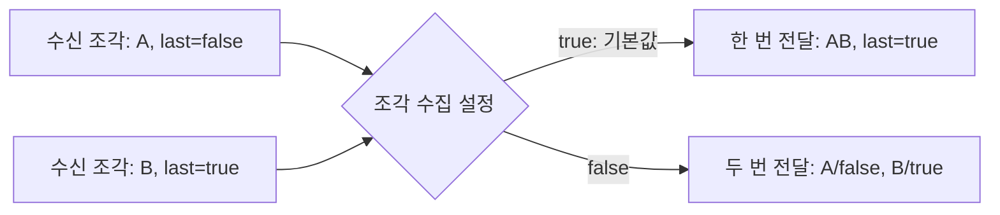
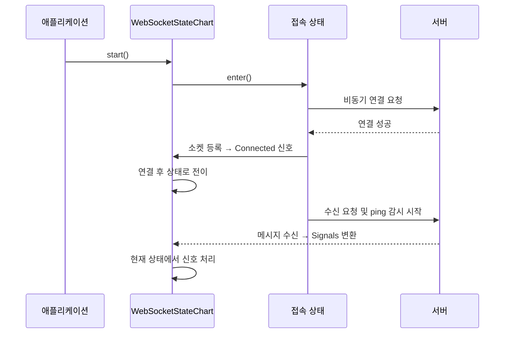
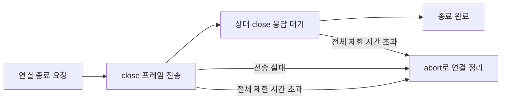

# utils.websocket 사용 안내

`utils.websocket`은 JDK `java.net.http.WebSocket`을 이용해 메시지를 수신하고, 연결 상태에 따라 작업을 진행하는 패키지다. RxJava 3 기반 수신 API와 상태 차트 기반 양방향 통신 API를 제공한다.

이 문서는 Java 17을 기준으로 주요 클래스의 사용법, 메시지 처리 방식, 종료와 오류 처리 규칙을 설명한다. 상태 차트 자체의 구성 방법은 [utils.statechart 사용 안내](../statechart/README.md)를 참고한다.

## 1. 용도에 맞는 API 선택

| 구분 | `WebSocketObservable` | `WebSocketStateChart<C>` |
|---|---|---|
| 적합한 용도 | 서버가 보내는 메시지를 구독·변환·필터링 | 요청 전송, 응답 대기, 작업 완료 등 단계별 처리 |
| 연결 시점 | 구독할 때마다 새 연결 생성 | `WebSocketConnectingState` 진입 시 연결 시도 |
| 송신 | 공개 송신 API 없음 | 텍스트·바이너리 송신 API 제공 |
| 수신 | RxJava `onNext` | 상태 차트의 `Signal` |
| 종료 결과 | `onComplete` 또는 `onError` | `COMPLETED`, `FAILED`, `CANCELLED` |
| 사용자가 중단할 때 | 구독의 `dispose()` | 차트의 `cancel(true)` |
| 주기적인 ping | 제공하지 않음 | ping 주기와 pong 제한 시간을 모두 설정하면 사용 |

두 API는 별도의 메시지 타입을 사용한다. `WebSocketObservable.TextMessage`와 `Signals.TextMessage`는 서로 다른 클래스이므로 함께 사용할 때 import에 주의한다.

## 2. WebSocketObservable로 메시지 수신

### 2.1. 생성과 구독

다음은 서버가 메시지를 먼저 보내는 엔드포인트를 구독하는 예다. `uri(...)`는 필수이며, `build()`만으로 연결되지는 않는다.

```java
import io.reactivex.rxjava3.disposables.Disposable;
import utils.websocket.WebSocketObservable;

WebSocketObservable messages = WebSocketObservable.builder()
    .uri("ws://localhost:8080/events")
    .maxTextMessageLength(1024 * 1024)
    .build();

Disposable subscription = messages.subscribe(
    message -> {
        if (message instanceof WebSocketObservable.TextMessage text) {
            System.out.println(text.getText());
        }
        else if (message instanceof WebSocketObservable.BinaryMessage binary) {
            System.out.println("수신 바이트 수: " + binary.getBytes().length);
        }
    },
    error -> System.err.println("수신 실패: " + error),
    () -> System.out.println("서버가 연결을 종료했습니다.")
);

// 수신이 더 이상 필요하지 않은 시점에 호출한다.
// subscription.dispose();
```

`subscribe()`는 연결 완료를 기다리지 않는다. 위 코드는 송신 기능을 사용하지 않으므로, 요청을 받아야 응답하는 echo 서버에 연결하면 수신 없이 대기할 수 있다.

같은 `messages`를 두 번 구독하면 연결도 두 개 만들어진다. 여러 구독자가 하나의 연결을 공유해야 한다면 `messages.publish().refCount()`로 공유 스트림을 만들고 그 스트림을 구독한다. 마지막 구독이 해제된 뒤 다시 구독하면 새로 연결하며, 이전 메시지를 재생하지는 않는다.

### 2.2. 메시지 조각과 크기 제한

WebSocket 메시지는 여러 조각으로 나뉘어 도착할 수 있다. 기본 설정은 마지막 조각까지 모은 뒤 하나의 메시지로 전달한다.



| 수신 타입 | 데이터 접근 | 마지막 조각 확인 | 수집 여부 설정 |
|---|---|---|---|
| `TextMessage` | `getText()` | `isLast()` | `collectTextFragments(boolean)` |
| `BinaryMessage` | `getBytes()` | `isLast()` | `collectBinaryFragments(boolean)` |

조각을 즉시 처리하려면 해당 수집 옵션을 `false`로 설정한다. 이때 메시지 경계는 `isLast()`로 판단하며, 수집 모드의 크기 제한은 적용되지 않는다. 애플리케이션이 직접 조각을 모은다면 누적 크기도 직접 제한해야 한다.

텍스트 제한은 Java 문자열 길이인 UTF-16 코드 단위 수이고, 바이너리 제한은 바이트 수다. 수집 중 제한을 넘으면 버퍼를 비우고 `IllegalStateException`을 `onError`로 전달한 뒤 연결을 닫는다. `getBytes()`는 내부 배열을 그대로 반환하므로, 여러 소비자가 공유하는 메시지를 수정해야 한다면 먼저 배열을 복사한다.

### 2.3. 빌더 설정

| 메소드 | 기본값 | 용도 |
|---|---|---|
| `uri(String)` | 없음, 필수 | `ws://` 또는 `wss://` 서버 주소 |
| `httpClient(HttpClient)` | 패키지 공용 클라이언트 | 프록시·TLS 등 HTTP 클라이언트 설정 |
| `connectTimeout(Duration)` | 30초 | 접속 시간 제한. `null`이면 빌더에 제한을 지정하지 않음 |
| `closeTimeout(Duration)` | 5초 | close 전송과 상대 응답을 포함한 종료 절차의 제한 시간 |
| `webSocketBuilderCustomizer(Consumer<WebSocket.Builder>)` | 없음 | 헤더·서브프로토콜 등 접속 옵션 |
| `collectTextFragments(boolean)` | `true` | 텍스트 조각 수집 여부 |
| `collectBinaryFragments(boolean)` | `true` | 바이너리 조각 수집 여부 |
| `maxTextMessageLength(int)` | `16 * 1024 * 1024` | 수집할 텍스트 메시지의 최대 길이 |
| `maxBinaryMessageLength(int)` | `16 * 1024 * 1024` | 수집할 바이너리 메시지의 최대 바이트 수 |

크기 제한은 양수여야 한다. 접속 제한은 `null` 또는 양수인 `Duration`을 받는다. 종료 제한은 밀리초로 변환했을 때 1ms 이상이어야 하고 `long` 범위를 넘을 수 없다.

### 2.4. 종료와 소비 속도

| 발생 상황 | 구독자에게 전달되는 결과 |
|---|---|
| 서버가 정상 종료 코드 `1000`, `1001`, `1005`로 종료 | `onComplete` |
| 그 밖의 종료 코드 | `onError(WebSocketClosedException)` |
| 접속 실패, 통신 오류, 수집 크기 초과 | `onError`로 원인 전달 |
| 구독자가 `dispose()` 호출 | 이후 통지를 중단하고 연결 종료. 별도 `onComplete` 없음 |

`1005`는 수신한 close 프레임에 상태 코드가 없다는 뜻이며, 이 패키지는 정상 종료로 분류한다. `WebSocketClosedException`에서는 종료 코드와 사유를 확인할 수 있다.

구독 해제 시 연결을 닫기 시작하고, 상대가 제한 시간 안에 종료에 응답하지 않으면 `abort()`로 끊는다. 접속 도중 구독을 해제한 경우에도 나중에 연결된 소켓을 정리한다.

내부에서는 수신 콜백마다 `request(1)`로 다음 콜백을 요청한다. 이것이 RxJava 소비자의 처리 속도를 보장하는 것은 아니다. `Observable`에는 Reactive Streams 방식의 역압력이 없으므로, `observeOn(...)` 이후의 처리가 느리면 대기열이 커질 수 있다. 메시지 빈도에 맞춰 필터링·샘플링 등 소비 전략을 정한다.

## 3. WebSocketStateChart로 통신 절차 구성

### 3.1. 주요 클래스의 역할

| 클래스 | 역할과 사용 방법 |
|---|---|
| `WebSocketContext<C>` | 서버 주소와 업무 데이터를 보관한다. 자신의 타입을 지정해 상속한다. |
| `WebSocketStateChart<C>` | 상태 등록, 신호 처리, 송신, 연결 종료를 담당한다. |
| `States.WebSocketConnectingState<C>` | 비동기 접속 후 성공·실패에 맞는 상태로 이동한다. |
| `Signals` | 연결·수신·오류·종료를 표현하는 신호 클래스 모음이다. |
| `States.CompletedState<C>` | 작업을 성공으로 끝내는 최종 상태다. |
| `States.StoppedState<C>` | 업무상 중지를 성공적인 종료로 표현하는 최종 상태다. |
| `States.FailedState<C>` | 설정된 원인으로 작업을 실패시키는 최종 상태다. |

`WebSocketContext`는 차트 생성 시 자동으로 차트와 연결된다. 직접 `setStateChart(...)`를 호출하지 않는다. 하나의 컨텍스트에는 하나의 차트만 등록할 수 있다.



`start()`가 반환되어도 접속이 완료된 것은 아니다. 연결 직후 실행할 송신은 연결 후 상태의 `enter()`에 둔다. 이 메소드가 끝나야 수신 요청을 시작하므로, `enter()` 안에서 서버 응답을 기다리면 안 된다.

### 3.2. 요청을 보내고 응답을 받는 예제

다음 예제는 echo 서버에 `hello`를 보내고 첫 텍스트 응답을 받으면 성공으로 끝난다. 접속 실패는 `/Failed`로 이동하고, 송신·통신 오류는 차트의 기본 오류 처리에 맡긴다.

```java
import java.time.Duration;
import java.util.Optional;
import java.util.concurrent.TimeUnit;

import utils.statechart.AbstractState;
import utils.statechart.Signal;
import utils.statechart.Transition;
import utils.statechart.Transitions;
import utils.websocket.Signals;
import utils.websocket.States;
import utils.websocket.WebSocketContext;
import utils.websocket.WebSocketStateChart;

public class EchoExample {
    static final class Context extends WebSocketContext<Context> {
        Context(String serverUrl) {
            super(serverUrl);
        }
    }

    public static void main(String[] args) throws Exception {
        Context context = new Context("ws://localhost:8080/echo");
        WebSocketStateChart<Context> chart = new WebSocketStateChart<>(context);
        chart.setPingInterval(Duration.ofSeconds(20));
        chart.setPongTimeout(Duration.ofSeconds(5));

        chart.addState(new States.WebSocketConnectingState<>(
            "/Connecting", context, "/AwaitingReply", "/Failed"));
        chart.addState(new States.CompletedState<>("/Completed", context));
        chart.addState(new States.FailedState<>("/Failed", context));
        chart.addState(new AbstractState<Context>("/AwaitingReply", context) {
            @Override
            public void enter() {
                var socket = chart.getWebSocket();
                chart.sendText("hello").whenComplete((ws, error) -> {
                    if (error != null) {
                        chart.postSignal(new Signals.WebSocketError(socket, error));
                    }
                });
            }

            @Override
            public Optional<Transition<Context>> selectTransition(Signal signal) {
                if (signal instanceof Signals.TextMessage text) {
                    return Optional.of(Transitions.to("/Completed",
                        (ctx, sig) -> System.out.println("응답: " + text.getText())));
                }
                return Optional.empty();
            }
        });
        chart.setInitialState("/Connecting");

        try {
            chart.start();
            chart.get(30, TimeUnit.SECONDS);
        }
        finally {
            if (!chart.isDone()) {
                chart.cancel(true);
            }
        }
    }
}
```

접속 상태의 생성자에는 자신의 경로, 컨텍스트, 접속 성공 시 이동할 경로, 실패 시 이동할 경로를 지정한다. 두 목적지 상태는 미리 차트에 등록해야 한다. 실패 목적지가 `FailureState`이면 접속 실패 원인도 자동으로 설정된다.

`CompletedState`, `StoppedState`, `FailedState`는 `addState(...)`로 등록하면 최종 상태로 인식된다. 별도로 `addFinalState(...)`를 호출할 필요는 없다. `StoppedState`의 실행 결과는 `CANCELLED`가 아닌 `COMPLETED`다. 호출자에게 취소 결과를 전달하려면 `cancel(true)`를 사용한다.

`selectTransition(...)`에서는 전이를 선택하고, 출력이나 데이터 변경은 전이 액션에서 수행한다. 예제의 `get(...)`은 차트 실행 종료를 기다린다. 시간 초과 자체가 차트를 취소하지는 않으므로 `finally`에서 실행 중인 차트를 정리한다.

### 3.3. 수신 신호 처리

| 신호 | 주요 접근 메소드 | 발생 시점 |
|---|---|---|
| `Signals.Connected` | `getWebSocket()` | 접속 성공 후 소켓을 등록했을 때 |
| `Signals.ConnectionFailed` | `getCause()` | 비동기 접속이 실패했을 때 |
| `Signals.TextMessage` | `getText()` | 텍스트 메시지의 마지막 조각까지 모았을 때 |
| `Signals.BinaryMessage` | `getBytes()`, `isLast()` | 바이너리 조각을 수신할 때마다 |
| `Signals.WebSocketError` | `getError()` | 통신 오류, 텍스트 길이 초과, pong 시간 초과 등 |
| `Signals.ConnectionClosed` | `getStatusCode()`, `getReason()` | 상대의 close를 수신했을 때 |

`ConnectionFailed`를 제외한 신호는 `WebSocketSignal`을 상속하므로 `getWebSocket()`으로 해당 소켓에 접근할 수 있다.

차트는 텍스트를 항상 완성된 메시지로 전달한다. 기본 최대 길이는 `16 * 1024 * 1024`이며 `setMaxTextMessageLength(int)`로 변경한다. 제한을 넘으면 해당 메시지의 남은 조각까지 버리고 `WebSocketError`를 보낸다. 사용자가 이 오류를 처리해 차트를 유지한다면 다음 메시지부터 다시 수신할 수 있다.

바이너리는 조각별로 전달하며 패키지에서 합치거나 전체 크기를 제한하지 않는다. 완성된 메시지가 필요하면 `isLast()`까지 직접 모으고 누적 크기를 제한한다. `getBytes()`로 받은 배열의 공유·수정 규칙은 Observable과 같다.

## 4. 송신과 종료 처리

### 4.1. 메시지 송신

| 메소드 | 의미 |
|---|---|
| `sendText(text)` / `sendBinary(bytes)` | 완성된 메시지를 비동기로 전송 |
| `sendText(text, last)` / `sendBinary(bytes, last)` | 메시지 조각 전송. 마지막 조각에서 `last=true` |
| `sendTextSync(...)` / `sendBinarySync(...)` | 해당 송신이 완료될 때까지 호출 스레드에서 대기 |

비동기 송신의 반환값은 `CompletableFuture<WebSocket>`이며, 서버의 업무 응답까지 기다리는 값은 아니다. 차트가 실행 중이고 소켓이 연결된 뒤 호출한다. 연결 전 호출이나 실행 상태 위반은 즉시 예외가 날 수 있고, 실제 전송 오류는 future로 전달될 수 있으므로 둘 다 고려한다.

패키지는 송신 대기열을 제공하지 않는다. 앞선 텍스트·바이너리 송신이 완료되기 전에 다음 송신을 호출하면 future가 실패할 수 있다. 순서가 필요한 송신은 다음과 같이 연결한다.

```java
chart.sendText("first")
    .thenCompose(ws -> chart.sendText("second"))
    .whenComplete((ws, error) -> {
        if (error != null) {
            chart.postSignal(new Signals.WebSocketError(chart.getWebSocket(), error));
        }
    });
```

분할 전송 중에는 같은 메시지 종류를 유지하고 마지막 조각까지 보내야 한다. 바이너리 배열은 송신 future가 완료될 때까지 수정하지 않는다. 동기 송신은 `InterruptedException`과 전송 실패를 감싼 `RuntimeExecutionException`을 처리해야 한다.

### 4.2. 차트 종료와 연결 종료의 차이

업무를 끝내려면 최종 상태로 전이하거나 `complete()`, `fail(cause)`, `cancel(true)`를 사용한다. 어느 경로로 차트가 끝나든 종료 훅이 연결 정리를 시작한다. 직접 종료 메소드를 호출하면 사용자 정의 최종 상태의 `enter()`는 실행되지 않으므로, 공통 정리는 `whenFinished(...)`에 둔다.

| 호출 | 완료 기준 및 주의점 |
|---|---|
| `complete()` | 차트를 성공으로 종료 |
| `fail(cause)` | 주어진 원인으로 차트를 실패 처리 |
| `cancel(true)` | 차트를 취소 처리 |
| `closeConnection()` | close 전송 완료까지 대기. 상대 응답은 백그라운드에서 대기 |
| `closeConnectionAsync()` | 상대 close 수신 또는 강제 종료까지 기다리는 future 반환 |

연결 종료 메소드는 `(int statusCode, String reason)` 오버로드도 제공하며, 인자가 없으면 정상 종료 코드 `1000`을 사용한다. 반복 호출해도 안전하고, 등록된 소켓이 없으면 즉시 끝난다.



기본 종료 제한은 5초다. `closeConnectionAsync()`의 future는 강제 종료로 정리한 경우에도 정상 완료하므로, 그 완료 여부로 정상적인 종료 협상 성공을 판단해서는 안 된다. 차트 종료 결과와 소켓 정리 완료도 별개다. 정리까지 기다려야 한다면 차트 종료 후 `closeConnectionAsync()`의 완료를 확인한다.

`closeConnection()`은 차트 결과를 직접 지정하지 않지만, 상대 응답으로 `ConnectionClosed`가 들어오면 기본 처리에 따라 차트도 취소되거나 실패할 수 있다. 업무 종료 목적이라면 연결 종료 메소드보다 차트 종료 API를 사용한다.

### 4.3. 처리하지 않은 오류와 종료 신호

사용자 상태가 전이를 선택하지 않은 신호에는 다음 기본 처리가 적용된다.

| 신호 | 기본 결과 |
|---|---|
| `WebSocketError` | 해당 오류로 `FAILED` |
| `ConnectionClosed`: `1000`, `1001`, `1005` | `CANCELLED` |
| 그 밖의 `ConnectionClosed` | `WebSocketClosedException`을 원인으로 `FAILED` |

따라서 정상적인 소켓 종료가 업무 성공을 뜻하지는 않는다. 서버 종료를 업무 성공으로 인정하려면 `ConnectionClosed`를 처리해 완료 상태로 전이하도록 명시한다. 업무 실패로 차트를 끝내더라도 자동 정리는 close 코드 `1000`을 사용하므로, 반대 방향으로도 close 코드와 업무 결과를 동일하게 해석하지 않는다.

`Transitions.stay()`도 신호를 처리한 것으로 간주하므로 기본 오류 처리를 막는다. 이미 닫힌 연결에서 계속 송신할 수는 없으며, 오류를 무시하고 차트를 유지하려면 이후 진행 경로를 별도로 마련해야 한다.

기본 오류 처리는 하위 클래스가 재정의한 `fail(...)`이나 `cancel(...)`을 거치지 않는다. 모든 종료 경로에 필요한 처리는 해당 메소드의 재정의에만 의존하지 말고 `whenFinished(...)`에 등록한다.

## 5. 접속 설정과 연결 유지

### 5.1. 차트 설정

설정은 가급적 `start()` 전에 완료한다.

| 설정 메소드 | 기본값 | 시작 후 변경 |
|---|---|---|
| `setHttpClient(HttpClient)` | 패키지 공용 클라이언트 | 불가 |
| `setConnectTimeout(Duration)` | 30초 | 불가 |
| `setWebSocketBuilderCustomizer(...)` | 없음 | 불가 |
| `setPingInterval(Duration)` | 미설정 | 불가 |
| `setPongTimeout(Duration)` | 미설정 | 불가 |
| `setCloseTimeout(Duration)` | 5초 | 가능. 이미 시작한 종료 절차에는 소급 적용되지 않음 |
| `setMaxTextMessageLength(int)` | `16 * 1024 * 1024` | 가능 |

시작 후 변경이 금지된 설정을 변경하면 예외가 발생한다. 접속 제한은 양수 또는 `null`, ping·pong·종료 시간은 밀리초로 변환 가능한 1ms 이상의 값을 지정한다.

인증 헤더와 서브프로토콜은 WebSocket 빌더 설정 콜백에서 지정한다.

```java
chart.setWebSocketBuilderCustomizer(builder -> builder
    .header("Authorization", "Bearer " + token)
    .subprotocols("v1.json"));
```

Observable에서는 `.webSocketBuilderCustomizer(...)`로 같은 콜백을 지정한다. 콜백은 접속 직전에 실행되며, 그 안에서 `buildAsync()`를 호출하지 않는다. 별도로 지정한 `HttpClient`와 그 실행기의 수명은 호출자가 관리한다.

### 5.2. Ping/Pong 감시

다음 두 값을 모두 지정하면 연결 후 주기적으로 ping을 보내고 pong 응답을 감시한다.

```java
chart.setPingInterval(Duration.ofSeconds(20));
chart.setPongTimeout(Duration.ofSeconds(5));
```

감시는 `Connected` 처리 후 수신을 시작할 때 활성화된다. pong이 제한 시간 안에 도착하지 않으면 `RuntimeTimeoutException`을 담은 `WebSocketError`를 보내고 감시를 중단한다. 별도 오류 전이가 없으면 차트도 실패한다.

ping마다 응답 대기를 관리하므로 pong 제한 시간이 ping 주기보다 길어도 감시한다. 통신 단절 감지까지는 대략 ping 주기와 pong 제한 시간의 합이 걸릴 수 있으며, 스케줄링과 신호 처리 지연도 영향을 준다. ping과 pong의 payload를 개별 대조하지 않으므로 로그의 왕복 시간은 참고값으로 사용한다.

차트가 종료되거나 pong 시간 초과가 발생하면 감시가 중단된다. 시간 초과 신호를 사용자 상태에서 처리해 차트를 유지해도 감시가 자동 재개되지는 않는다. 서버에서 보낸 ping에는 JDK가 자동으로 pong을 응답하므로 애플리케이션에서 중복 응답할 필요가 없다.

## 6. 실행 흐름과 자원 관리

### 6.1. 콜백과 상태 처리

상태 차트는 신호 처리를 직렬화하지만 차트마다 전용 처리 스레드를 만들지는 않는다. 신호를 제출한 스레드가 처리를 맡을 수 있으므로 `enter()`, `exit()`, 전이 액션에서 오래 걸리는 작업을 수행하지 않는다. 비동기 작업의 결과는 신호로 전달한다.

내부 접속 콜백과 예약 작업은 패키지 공용 실행기를 사용한다. 이 실행기는 구현 세부사항이며, 애플리케이션 작업을 실행하는 용도로 노출되지 않는다.

### 6.2. 접속 중 취소와 재연결

접속 상태를 떠나거나 차트를 취소해도 진행 중인 접속 시도 자체가 즉시 취소되지는 않는다. 뒤늦게 연결되면 해당 소켓을 닫고, 더 이상 유효하지 않은 접속 결과와 콜백은 차트에 반영하지 않는다. 종료 호출이 반환되었다고 해서 진행 중이던 네트워크 접속까지 즉시 사라진 것은 아니다.

한 차트에는 소켓을 한 번만 등록할 수 있다. 재연결할 때는 새로운 컨텍스트와 차트를 생성한다. Observable은 새로 구독할 때 새 연결을 생성한다.

`getWebSocket()`은 등록 전에는 `null`이지만, 연결 종료 후에도 마지막 소켓을 반환한다. 반환값이 `null`이 아니라는 이유만으로 송신 가능 상태라고 판단하지 않는다.

## 7. 문제 해결과 관련 코드

| 증상 | 확인할 사항 |
|---|---|
| 구독했지만 메시지가 오지 않음 | 서버가 먼저 보내는 프로토콜인지 확인. 요청 송신이 필요하면 차트 API 사용 |
| 연결 직후 송신에서 예외 발생 | `start()` 반환 직후가 아니라 연결 후 상태에서 송신하는지 확인 |
| `enter()`에서 응답 대기가 끝나지 않음 | 수신을 시작하기 전에 상태 진입을 막고 있지 않은지 확인 |
| 연속 송신 중 일부 메시지가 누락됨 | 반환 future의 오류 확인 및 `thenCompose(...)`로 송신 순서 보장 |
| 서버가 정상 종료했는데 차트가 취소됨 | 기본 정책이다. 업무 성공이라면 종료 신호에 완료 전이를 정의 |
| ping이 동작하지 않음 | 시작 전에 ping 주기와 pong 제한 시간을 모두 지정했는지 확인 |
| 큰 메시지가 오류로 끝남 | 수집 크기 제한 확인. 조각 처리 시에는 별도 크기 제한 구현 |
| 여러 구독으로 연결이 늘어남 | 연결 공유가 필요하면 `publish().refCount()` 사용 |
| 재연결 시 등록 오류 발생 | 기존 차트·컨텍스트를 재사용하지 않고 새 인스턴스 생성 |

주요 구현과 검증 코드는 다음과 같다.

- 수신 API: [WebSocketObservable.java](WebSocketObservable.java)
- 상태 차트 API: [WebSocketStateChart.java](WebSocketStateChart.java), [WebSocketContext.java](WebSocketContext.java)
- 상태와 신호: [States.java](States.java), [Signals.java](Signals.java), [WebSocketSignal.java](WebSocketSignal.java)
- 종료 예외: [WebSocketClosedException.java](WebSocketClosedException.java)
- 내부 수신·종료 처리: [WebSocketListener.java](WebSocketListener.java), [WebSocketCloser.java](WebSocketCloser.java)
- 동작 검증: [WebSocketObservableTest.java](../../../../test/java/utils/websocket/WebSocketObservableTest.java), [WebSocketStateChartTest.java](../../../../test/java/utils/websocket/WebSocketStateChartTest.java), [WebSocketCloserTest.java](../../../../test/java/utils/websocket/WebSocketCloserTest.java)
